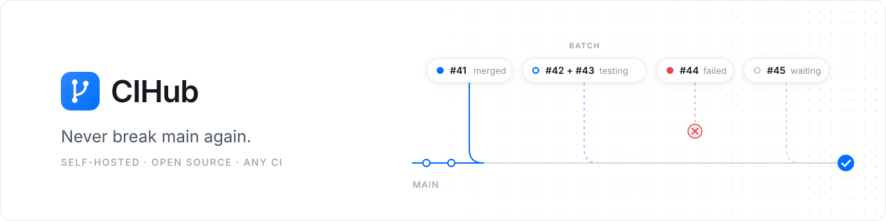

  <picture>
    <source media="(prefers-color-scheme: dark)" srcset=".github/assets/banner-dark.svg">
    
  </picture>

  
  
  
  

  <a href="INSTALL.md"><b>Install</b></a> ·
  <a href="#how-it-works"><b>How it works</b></a> ·
  <a href="GOAL.md"><b>Why</b></a> ·
  <a href="AGENTS.md"><b>Contribute</b></a>

Two pull requests pass CI on their own. You merge both. `main` is red, and nobody knows why.

CIHub makes that impossible. Approve a pull request, type `/cihub merge`, and go back to work. CIHub lines it up
behind the others, tests it together with everything that lands before it, and merges it only if the result still
passes. No rebase loop, no broken `main`, no "who merged that?".

- **Green by design.** What gets tested is exactly what lands.
- **Your CI, unchanged.** GitHub Actions, Buildkite, Jenkins: if it reports a check, CIHub waits for it.
- **Yours to run.** One container and a Postgres. Your code stays on your infrastructure.
- **Never a mystery.** Each pull request says where it stands in the queue and what it waits for.
- **Quick when it gets busy.** Pull requests are tested in parallel or in batches, and one flaky failure does
  not kick anyone out.

## How it works

| 1. Approve | 2. Queue | 3. Merge |
| --- | --- | --- |
| A pull request is approved and its checks are green. | Comment `/cihub merge`. CIHub tests it on top of everything ahead of it, alone or in a batch. | If that exact combination passes, CIHub merges it. If not, the pull request leaves the queue, with the reason on it. |

## Get started

[`INSTALL.md`](INSTALL.md) takes you from zero to your first merged pull request in about 30 minutes.

## Status

Early days: v0.1. The queue works; a dashboard, metrics and flaky test detection come next.

## Contribute

Read [`GOAL.md`](GOAL.md) for what CIHub is for and [`AGENTS.md`](AGENTS.md) for how we build it, with or
without a coding agent.

## License

[Apache-2.0](LICENSE).
