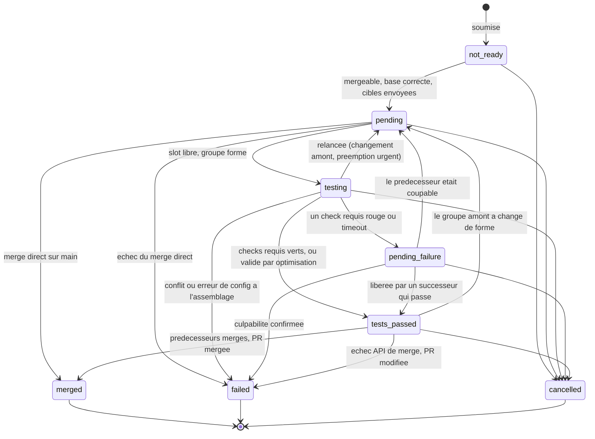
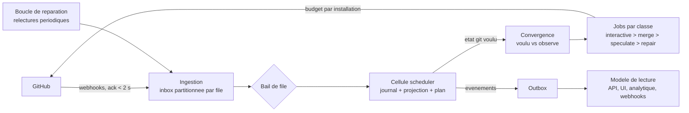
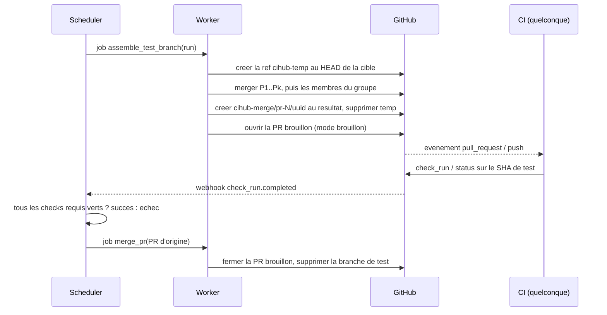

> Doc vivant (référence, v2 open source) : https://claude.ai/code/artifact/6afe2cd0-5ecc-4b6a-894e-9ca22a6d36ad — instantané du 25/09/2026.
> Version anglaise = instantané de la v1 SaaS : https://claude.ai/code/artifact/566489c0-083d-48e2-8bc7-7089d60920b7

# CIHub Merge Queue — Architecture et spécification

Sep 25, 2026 · @Nicolas Lecoy

Version de référence de la spécification, révisée le 25 septembre 2026 pour un outil open source et autonome, puis le 28 septembre 2026 pour passer de Go à Rust dans un monorepo organisé en workspace Cargo ; CIHub Merge Queue — Architecture & Specification reste l'instantané de la première version (produit SaaS). Les identifiants techniques (états, raisons, réglages, tables, endpoints) restent en anglais : ce sont les noms utilisés dans le code et l'API.

## Objectif, périmètre et objectifs

CIHub est un outil open source et auto-hébergé, indépendant de Batch, dont le premier module est une file de merge pour GitHub : elle prend les pull requests approuvées et vertes, les ordonne par rapport à leur branche cible, reteste chacune au-dessus de tout ce qui la précède selon la stratégie choisie, et ne merge que ce qui passe encore. Son second module conserve l'historique des résultats de tests pour dire si un test est instable. Le tout est écrit en Rust, dans un monorepo organisé en workspace Cargo, avec Postgres comme seule dépendance au départ et ClickHouse en option pour les gros volumes. La file s'inspire de ce que font Trunk, Mergify, la file native de GitHub, les merge trains de GitLab, bors, Zuul, Aviator et Graphite, ainsi que des retours publics de Shopify et d'Uber, sans en copier aucune : l'analyse ci-dessous dit ce qu'on retient et ce qu'on fait autrement.

Décisions prises avec Nicolas les 19, 25 et 28 septembre 2026 :

| Décision           | Choix                                                                               | Conséquence sur la conception                                                                                                                                        |
| ------------------ | ----------------------------------------------------------------------------------- | -------------------------------------------------------------------------------------------------------------------------------------------------------------------- |
| Distribution       | Open source, auto-hébergé, projet autonome sans lien avec l'infrastructure de Batch | Une image, un Postgres, une GitHub App ; installation en `docker compose up` ; projet CIHub (`cihub`), crates `cihub-*`, GitHub App `cihub-io`, commandes `/cihub`, licence Apache-2.0           |
| Tenancy            | Multi-tenant conservé                                                               | Une instance peut servir plusieurs organisations GitHub, ou être hébergée en SaaS par un tiers ; chaque table porte `org_id`, isolation par sécurité au niveau ligne |
| SCM                | GitHub d'abord, via une GitHub App                                                  | Une interface `scm` avec une seule implémentation ; GitLab prévu derrière la même interface, pas en v1                                                               |
| CI                 | Agnostique de la CI                                                                 | La file ne lance jamais la CI : elle pousse une branche de test et attend les statuts et check runs requis                                                           |
| Stockage           | Postgres seul en v1, ClickHouse ajouté ensuite derrière une interface d'analytique  | L'historique, les métriques et les résultats de tests vivent dans Postgres au départ ; le schéma ClickHouse décrit plus bas est la cible, pas un prérequis           |
| Résultats de tests | OTLP natif (un test = un span) plus un convertisseur JUnit XML                      | Le module de tests instables est le second module de la plateforme et réutilise tout le socle                                                                        |
| Structure          | Monolithe modulaire : un socle, des modules                                         | La merge queue et les tests instables sont deux modules, chacun dans sa crate ; le découpage en lots vit dans un document séparé                                     |
| Langage et dépôt   | Rust, monorepo, workspace Cargo                                                     | Deux binaires (`cihubd` pour les rôles serveur, `cihub` pour la CLI) ; noyau pur isolé dans des crates sans E/S ; tableau de bord, action GitHub et chart Helm dans le même dépôt |

Objectifs de la v1 :

- Une file de merge efficace qui propose plusieurs stratégies, choisies par file : séquentielle, par lots, optimiste, parallèle par cibles impactées, avec ou sans merge direct, et trois méthodes de merge (squash, merge commit, rebase).
- Garder la branche cible toujours verte : une PR ne merge qu'après que ses tests sont passés sur un commit qui contient toutes les PR devant elle.
- Offrir un chemin de migration depuis Trunk, Mergify ou la file native GitHub : labels, commandes et fichier de configuration convertibles, sans imposer leur vocabulaire.
- Conserver l'historique des résultats de tests, reçus en OTLP ou convertis depuis JUnit, et en déduire quels tests sont instables, pour que la file ne rejette pas une PR à cause d'un test connu comme tel.
- Être simple à installer et à exploiter : une image, un Postgres, une GitHub App, une configuration guidée dans l'interface, moins de trente minutes de la première commande à la première PR mergée.
- Rendre chaque décision explicable : un journal d'événements par PR répond à « pourquoi ma PR attend-elle encore » et alimente les tableaux de bord.

Hors périmètre de la v1 : GitLab et Bitbucket (l'interface les prévoit), héberger la CI nous-mêmes, les fonctions de revue de code, une extension de navigateur, une app Slack au-delà des webhooks sortants, un provider Terraform, et ClickHouse lui-même, qui arrive quand le volume le justifie.

## Analyse concurrentielle

Toutes les files de merge sérieuses convergent sur le même noyau (tester la PR au-dessus de celles qui la précèdent, retirer le coupable, reconstruire derrière) et divergent sur quatre points : où tourne la CI, comment on absorbe les échecs, comment on passe à l'échelle, et à quel point l'utilisateur peut exprimer ses règles. Huit produits et quatre retours d'expérience ont été passés en revue (documentation officielle, tickets publics, articles d'ingénierie) ; le tableau résume ce que chacun apporte et où il casse.

| Produit                                                                                                                                                           | Modèle de file                                                                                 | Où tourne la CI                                                                         | Échec                                                                                                      | Passage à l'échelle                                                                             | Idée distinctive                                                                                                                                 | Limite observée                                                                                                                             |
| ----------------------------------------------------------------------------------------------------------------------------------------------------------------- | ---------------------------------------------------------------------------------------------- | --------------------------------------------------------------------------------------- | ---------------------------------------------------------------------------------------------------------- | ----------------------------------------------------------------------------------------------- | ------------------------------------------------------------------------------------------------------------------------------------------------ | ------------------------------------------------------------------------------------------------------------------------------------------- |
| [Trunk](https://docs.trunk.io/merge-queue/merge-queue)                                                                                                            | FIFO spéculative, mode parallèle par cibles impactées, lots + bissection                       | Branches `trunk-merge/*` avec PR brouillon optionnelle                                  | Échec en attente jusqu'à conclusion des prédécesseurs, profondeur configurable, merge optimiste            | Concurrence fixe (5 à 50)                                                                       | Cache des résultats pendant la bissection, réconciliation indépendante des webhooks                                                              | Peu d'expressivité : seuls les status checks gouvernent                                                                                     |
| [Mergify](https://docs.mergify.com/merge-queue/)                                                                                                                  | Files multiples par dépôt, routage par conditions, modes serial / parallel (scopes) / isolated | PR brouillons cumulatives `mergify/merge-queue/*`, ou en place sur la PR en mode sériel | Lots scindés puis bissectés, `max_checks_retries`, timeout automatique au p95, `skip_intermediate_results` | `max_parallel_checks` jusqu'à 128, taille de lot dynamique                                      | Langage de conditions (\~80 attributs), séparation conditions d'entrée / conditions de merge, gels planifiés, 45 raisons de retrait              | Retards de détection de checks de 9 à 46 min en sept. 2026 (tickets #5177, #5183), surface de configuration instable                        |
| [GitHub natif](https://docs.github.com/en/repositories/configuring-branches-and-merges-in-your-repository/configuring-pull-request-merges/managing-a-merge-queue) | FIFO spéculative par branche, groupes de merge                                                 | Branches `gh-readonly-queue/*` et événement `merge_group`                               | Retrait du coupable, reconstruction derrière ; « jump to top » reconstruit tout                            | 1 à 100 groupes en parallèle                                                                    | Zéro installation, intégré aux rulesets                                                                                                          | Un seul jeu de checks pour PR et groupe (les workflows filtrés par chemin bloquent la file), `merge_group` parfois jamais émis, pas de lots |
| [GitLab merge trains](https://docs.gitlab.com/ci/pipelines/merge_trains/)                                                                                         | Train par branche cible                                                                        | Pipelines de résultats fusionnés                                                        | Le wagon fautif sort, les suivants sont recomposés                                                         | 20 pipelines en parallèle par défaut                                                            | Intégration native au CI GitLab                                                                                                                  | Pas de lots ni de bissection, un push direct relance tout                                                                                   |
| [bors / rust-lang bors](https://bors.tech/documentation/)                                                                                                         | Un seul lot en test, sériel strict                                                             | Push sur `staging`, puis fast-forward de `master`                                       | Bissection binaire du lot                                                                                  | Aucun parallélisme                                                                              | Le commit testé est le commit qui atterrit ; `try`, `rollup`, `treeclosed`                                                                       | Débit borné par la durée de CI ; bors-ng et homu archivés                                                                                   |
| [Zuul](https://zuul-ci.org/docs/zuul/latest/gating.html)                                                                                                          | Pipelines dépendantes multi-dépôts, état futur des dépendances servi aux jobs                  | Zuul est la CI                                                                          | Le coupable sort, les suivants sont rebasés sur le plus proche élément sain                                | Fenêtre adaptative (20 par défaut, plancher 3, croissance linéaire, décroissance exponentielle) | Fenêtre TCP-like, `Depends-On` inter-dépôts, vingt ans de production chez OpenStack                                                              | Impose d'adopter Zuul comme CI                                                                                                              |
| [Aviator](https://docs.aviator.co/mergequeue/concepts/parallel-mode)                                                                                              | Sériel, parallèle par cibles affectées, lots                                                   | PR brouillons sur branches temporaires, fast-forward optionnel                          | Réinitialisation de la file en parallèle, validation optimiste, bissection parallèle                       | `max_parallel_builds`, jusqu'à 1 M de cibles par compte                                         | Classification des échecs par lecture des logs (« le fichier cité est-il modifié par le lot ? »), reprise ciblée d'un job                        | Réinitialisations coûteuses en CI, configuration lourde                                                                                     |
| [Graphite](https://graphite.com/docs/graphite-merge-queue)                                                                                                        | Piles entières en file, CI parallèle sur A, A←B, A←B←C                                         | PR brouillons `gtmq_*`                                                                  | Coupable retiré, exécutions dépendantes annulées, lots bissectés                                           | Concurrence configurée (4 en interne)                                                           | Pensé pour les PR empilées                                                                                                                       | GitHub seulement, incompatible avec la file native                                                                                          |
| [Shopify](https://shopify.engineering/successfully-merging-work-1000-developers)                                                                                  | Branche prédictive simulant le futur `master`, lots de 8, 3 lots de CI d'avance                | Branche prédictive                                                                      | Seuil de tolérance : 3 échecs consécutifs avant retrait, 0,39 % de faux retraits à 25 % de flakiness       | 400 commits par jour, 1 000 développeurs                                                        | Boucle de réconciliation état voulu / état GitHub, verrou d'incident qui laisse la CI tourner                                                    | Interne                                                                                                                                     |
| [Uber SubmitQueue](https://arxiv.org/html/2501.03440v2)                                                                                                           | Arbre de spéculation, sélection probabiliste des builds sous budget                            | Build interne                                                                           | Analyseur de conflits sur le graphe de build pour prouver l'indépendance                                   | Milliers de changements par jour                                                                | Régression logistique (97 % de précision) pour choisir quoi spéculer, prédiction de durée de build, contournement des gros changements bloquants | Interne, exige un graphe de build                                                                                                           |

Ce que CIHub retient, et d'où :

| Idée                                                      | Origine                                       | Ce qu'on en fait                                                                                                                                                                                                              |
| --------------------------------------------------------- | --------------------------------------------- | ----------------------------------------------------------------------------------------------------------------------------------------------------------------------------------------------------------------------------- |
| Fenêtre de spéculation adaptative                         | Zuul                                          | La concurrence de test n'est pas un nombre fixe : elle croît après chaque succès et se contracte après chaque échec, entre un plancher et un plafond ; c'est la défense la moins chère contre les tempêtes de tests instables |
| Reconstruction sur le plus proche élément sain            | Zuul, GitLab, GitHub                          | Un échec ne retire que le coupable ; jamais de réinitialisation de toute la file                                                                                                                                              |
| Budget d'échec tolérant                                   | Shopify, Chromium, Aviator                    | Un seul échec ne retire jamais une PR ; on compte les échecs consécutifs, on relance ciblé, et on croise avec les tests connus comme instables                                                                                |
| Lots et bissection                                        | bors, Mergify, Aviator, Graphite              | Pour les CI longues, O(log N) exécutions par échec au lieu de N, avec cache des résultats intermédiaires                                                                                                                      |
| Files indépendantes par cibles impactées                  | Uber, Aviator, Trunk, Mergify                 | Le levier de débit numéro un sur un monodépôt ; calculé par recouvrement, jamais par des voies nommées à la main                                                                                                              |
| Conditions d'entrée distinctes des conditions de merge    | Mergify, demande la plus fréquente sur GitHub | Un petit langage de conditions, pas un DSL de 80 attributs                                                                                                                                                                    |
| État voulu et boucle de réconciliation                    | Shopify                                       | La file est un journal d'événements ; le réconciliateur calcule l'état git voulu et le fait converger, de façon idempotente, ce qui rend webhooks perdus, pannes GitHub et redémarrages récupérables                          |
| Le commit testé est le commit qui atterrit                | bors, Aviator, Graphite                       | Méthode de merge `fast_forward` en plus de squash, merge et rebase, quand la protection de branche le permet                                                                                                                  |
| Raisons de retrait énumérées et statuts de lot explicites | Mergify                                       | Déjà dans le modèle de domaine ; chaque sortie de file a une cause nommée et une page                                                                                                                                         |

Ce que CIHub fait autrement. Aucun de ces produits n'est à la fois open source, auto-hébergeable en une commande et multi-tenant : bors l'était mais ne spécule pas, Zuul l'est mais impose sa CI, les autres sont des SaaS. Aucun ne traite le budget GitHub comme une ressource à ordonnancer, alors que les retards de Mergify en septembre 2026 viennent de là : chez CIHub, chaque appel GitHub porte une classe de priorité (commandes des humains, merges, spéculation, rattrapage) et la spéculation est la première chose sacrifiée quand le budget baisse. Aucun ne conserve l'historique des tests au niveau du cas avec la file comme source de vérité expérimentale : CIHub exploite les bissections comme des expériences contrôlées pour qualifier les tests instables. Enfin, les pannes courantes relevées partout (check requis qui ne rapporte jamais, `merge_group` jamais émis, retrait sans raison lisible, reconstruction totale après une priorité) ont chacune une réponse nommée dans les sections fiabilité et algorithmes.

Sources : [Trunk — documentation](https://docs.trunk.io/merge-queue/merge-queue), [Mergify — merge queue](https://docs.mergify.com/merge-queue/), [Mergify — conditions](https://docs.mergify.com/configuration/conditions), [Mergify — lots](https://docs.mergify.com/merge-queue/batches), [Mergify — ticket #5183](https://github.com/Mergifyio/mergify/issues/5183), [GitHub — merge queue](https://docs.github.com/en/repositories/configuring-branches-and-merges-in-your-repository/configuring-pull-request-merges/managing-a-merge-queue), [GitHub — discussion #46757](https://github.com/orgs/community/discussions/46757), [GitLab — merge trains](https://docs.gitlab.com/ci/pipelines/merge_trains/), [bors](https://bors.tech/documentation/), [rust-lang/bors](https://github.com/rust-lang/bors), [Zuul — gating](https://zuul-ci.org/docs/zuul/latest/gating.html), [Zuul — pipelines](https://zuul-ci.org/docs/zuul/latest/config/pipeline.html), [Aviator — mode parallèle](https://docs.aviator.co/mergequeue/concepts/parallel-mode), [Aviator — tests instables](https://docs.aviator.co/mergequeue/concepts/flaky-test-management), [Graphite](https://graphite.com/docs/graphite-merge-queue), [Shopify — merge queue v2](https://shopify.engineering/successfully-merging-work-1000-developers), [Uber — SubmitQueue 2025](https://arxiv.org/html/2501.03440v2), [Chromium — CQ](https://chromium.googlesource.com/chromium/src/+/HEAD/docs/infra/cq.md).

## Modèle de domaine

Six entités portent tout le produit : une organisation installe la GitHub App sur des dépôts, chaque dépôt a une file par branche cible, une file contient des entrées (une par soumission de PR), les entrées sont regroupées en groupes de test (une PR seule ou un lot) qui possèdent des exécutions de test, et chaque transition est enregistrée comme un événement immuable. Tout le reste (voies, bissections, piles) en découle.

| Entité               | Identité                     | Attributs clés                                                                                                      | Notes                                                                                                          |
| -------------------- | ---------------------------- | ------------------------------------------------------------------------------------------------------------------- | -------------------------------------------------------------------------------------------------------------- |
| Organisation         | `org_id`                     | nom, identifiants d'installation GitHub, plan, jetons d'API                                                         | Frontière de tenancy ; toutes les autres tables portent `org_id`                                               |
| Dépôt                | `repo_id`                    | `repository_id` GitHub, `owner/name`, identifiant d'installation, branche par défaut                                | Une installation peut couvrir plusieurs dépôts                                                                 |
| File                 | `queue_id`                   | `repo_id`, `target_branch`, état, mode, tous les réglages                                                           | Unique sur (`repo_id`, `target_branch`)                                                                        |
| Entrée de file       | `item_id`                    | `queue_id`, numéro de PR, SHA de tête à la soumission, état, priorité, `no_batch`, `force_enqueued`, position       | Une resoumission après annulation crée une nouvelle entrée ; `is_current` désigne l'entrée vivante de cette PR |
| Groupe de test       | `group_id`                   | `queue_id`, `item_ids` ordonnés, nature (`single`, `batch`, `bisection`), groupe parent, prédécesseurs, clé de voie | L'unité qui est testée et retenue en échec en attente                                                          |
| Exécution de test    | `run_id`                     | `group_id`, branche de test, SHA de test, numéro de PR brouillon, statut, statuts requis et leur source, début/fin  | Un groupe peut avoir plusieurs exécutions (relances)                                                           |
| Observation de check | (`run_id`, nom)              | nature (`check_run` ou `status`), état, conclusion, URL, date d'observation                                         | Dernière observation par nom de statut                                                                         |
| Cibles impactées     | (`repo_id`, PR, SHA de tête) | `targets[]` ou `ALL`, date d'envoi                                                                                  | Le dernier envoi par SHA gagne                                                                                 |
| Événement            | `event_id`                   | `org_id`, `queue_id`, `item_id`, `group_id`, `run_id`, type, raison, acteur, payload, `occurred_at`                 | En ajout seul dans Postgres, diffusé vers ClickHouse                                                           |

Les états d'une entrée sont peu nombreux et publics ; ils servent tels quels dans l'API, les webhooks et l'analytique :



Tout état non terminal peut aussi passer à `cancelled` (PR fermée, poussée, base modifiée, repassée en brouillon, demande d'un utilisateur ou d'un admin, label retiré, délai d'attente dépassé) ou à `merged` avec la raison `manual_merge` quand la PR est mergée hors de la file. Chaque transition porte une raison issue d'un vocabulaire fermé, énuméré ici en entier parce qu'une sortie de file sans cause lisible est la plainte la plus fréquente contre les files existantes : raisons `pending` (`merge_item_now_ready`, `manual_push_to_target_branch`, `prerequisite_merge_item_failed`, `prerequisite_merge_item_cancelled`, `prerequisite_merge_item_manually_merged`, `tests_restarted_by_user`, `tests_restarted_by_api_request`, `skip_the_line_interrupted`, `bisection_required`, `bisection_test_run_passed`) ; raisons `tests_passed` (`test_run_passed`, `successor_test_run_passed`, `passed_by_optimization`) ; raisons `merged` (`merge_graph_merge`, `merge_graph_direct_merge`, `manual_merge`) ; raisons `cancelled` (`user_requested`, `admin_requested`, `pr_closed`, `pr_pushed_to`, `pr_base_branch_changed`, `pr_converted_to_draft`, `label_removed`, `not_ready_timeout_expired`, et la famille `stacked_pr_*`) ; et raisons `failed` réparties en `start_test_run_*` (`invalid_event`, `merge_conflict`, `config_not_found`, `config_parsing_failure`, `config_bad_version`, `config_missing_required_statuses`, `config_bad_required_statuses`, `no_required_statuses`, `retry_exhausted`, `draft_prs_not_allowed`, `permissions_block_test_branch`), `test_run_*` (`required_status_failed`, `timeout`, `failed_by_optimization`) et `github_api_*` (`merge_pr_failed`, `direct_merge_pr_failed`, `rate_limit_exceeded`, `branch_protection_unmet`, `merge_already_in_progress`, `repeated_server_errors`), plus `pr_updated_at_merge_time`. Une entrée `not_ready` porte en outre des `block_reasons[]` de nature `review_required` (avec `have`/`need`), `changes_requested`, `failing_required_check`, `awaiting_required_check` (avec `check`, `status`), `behind_base`, `merge_conflict`, `stack_needs_rebase` (avec `onto_pr_number`) ou `undetermined`.

Une arête n'accepte que les raisons que décrit son étiquette, et `cihub-domain` refuse toute autre combinaison. `not_ready` passe à `pending` seulement avec `merge_item_now_ready` ; `testing` passe à `tests_passed` avec `test_run_passed` ou `passed_by_optimization`, et `pending_failure` seulement avec `successor_test_run_passed`. Chaque raison `failed` n'a qu'un état de départ : `start_test_run_*` quitte `testing` (échec à l'assemblage) ; `test_run_*`, y compris `failed_by_optimization`, quitte `pending_failure` (culpabilité confirmée) ; `github_api_direct_merge_pr_failed` quitte `pending`, d'où part le merge direct ; les autres `github_api_*`, y compris `rate_limit_exceeded` et `repeated_server_errors`, ainsi que `pr_updated_at_merge_time`, quittent `tests_passed` (étape de merge). Les raisons `pending` ne sont pas contraintes par arête.

La file elle-même est une petite machine à états : `running` accepte et merge ; `paused` n'accepte rien et ne merge rien mais conserve l'ordre ; `draining` n'accepte rien et laisse merger ce qui est en vol ; `switching_modes` est atteint automatiquement quand le mode change avec des entrées en vol et se comporte comme `draining` jusqu'à ce que la file soit vide.

## Algorithmes de la file

Un seul algorithme couvre le mode simple, le mode parallèle, le batching et la bissection : un **réconciliateur** par file recalcule un graphe de dépendances (le graphe de merge) à partir de la liste ordonnée des entrées admises, et une exécution de test n'est valide que tant que l'ensemble des prédécesseurs du groupe et le SHA de base sont inchangés. Chaque fonction ci-dessous est soit une règle de construction de ce graphe, soit une règle de réaction à son changement.

**Conditions.** Une file déclare deux jeux de conditions distincts, parce que les confondre est la limite la plus citée de la file native GitHub : `queue_conditions` dit ce qu'une PR doit satisfaire pour être admise (revues, labels, auteur, fichiers touchés, checks sur la PR elle-même) et `merge_conditions` ce que le commit spéculatif doit satisfaire pour être mergé (les checks requis sur la branche de test, au moins). Les protections de branche GitHub sont lues et injectées dans les deux jeux par défaut (`branch_protection_injection: both | merge | none`). Le langage est volontairement petit : une condition est `[-] attribut [op valeur]` avec `=`, `!=`, `~=` (regex), `*=` (glob), `<`, `<=`, `>`, `>=`, `#attribut` pour une longueur, et des blocs `and`, `or`, `not` ; une trentaine d'attributs couvrent l'état de la PR, les revues, les checks, les labels, l'auteur, les fichiers, la base et la tête, la position et l'ancienneté dans la file, et l'heure. Le même langage sert au routage entre files d'une même branche et aux `priority_rules`.

La syntaxe est propre à CIHub. Les attributs reprennent le nom de Mergify quand le sens est le même, pour que le convertisseur de migration reste simple, mais aucun alias n'est accepté. Vocabulaire figé (décidé le 28 septembre 2026) :

| Attribut                                                                                    | Type                                                            | Équivalent Mergify                    | Remarque                                                                                 |
| ------------------------------------------------------------------------------------------- | --------------------------------------------------------------- | ------------------------------------- | ---------------------------------------------------------------------------------------- |
| `draft`, `conflict`, `from-fork`                                                            | booléen                                                         | même nom                              |                                                                                          |
| `behind-base`                                                                               | booléen                                                         | aucun (`#commits-behind > 0`)         | Lu dans `mergeStateStatus = BEHIND`                                                      |
| `number`, `additions`, `deletions`                                                          | entier                                                          | `number` ; aucun pour les deux autres | `additions` et `deletions` sont des champs de la PR                                      |
| `title`, `body`, `author`, `base`, `head`                                                   | chaîne                                                          | même nom                              |                                                                                          |
| `github-review-decision`                                                                    | `approved`, `changes_requested`, `review_required`, `none`      | même nom                              | Valeurs en minuscules                                                                    |
| `approved-reviews-by`, `changes-requested-reviews-by`, `review-requested`                   | liste                                                           | même nom                              |                                                                                          |
| `review-threads-unresolved`                                                                 | liste                                                           | même nom                              | Lu seulement si une condition de la file l'utilise                                       |
| `check-success`, `check-neutral`, `check-skipped`, `check-pending`                          | liste                                                           | même nom                              | `check-pending` : pas encore de conclusion                                               |
| `check-failure`                                                                             | liste                                                           | sens plus large                       | `failure`, `error`, `cancelled`, `timed_out`, `action_required` ou `stale`               |
| `label`                                                                                     | liste                                                           | même nom                              |                                                                                          |
| `sender`                                                                                    | chaîne                                                          | même nom                              | Auteur de la commande ou de la soumission                                                |
| `sender-permission`                                                                         | `none` < `read` < `triage` < `write` < `maintain` < `admin`     | même nom                              | Ordonné                                                                                  |
| `files`                                                                                     | liste                                                           | même nom                              | Lu seulement si une condition de la file l'utilise                                       |
| `queue-name`                                                                                | chaîne                                                          | même nom                              |                                                                                          |
| `queue-position`                                                                            | entier                                                          | même nom                              | 0 en tête de file, -1 hors file                                                          |
| `queue-age`, `pr-age`                                                                       | durée (`30m`, `2h`, `7d`)                                       | aucun (`queued-at`, `created-at`)     |                                                                                          |
| `schedule`                                                                                  | plage horaire                                                   | même nom et même syntaxe              | Reporté : demande une base des fuseaux horaires dans le noyau pur                        |

Règles de la syntaxe :

- Un seul symbole par opérateur : ni `:`, ni `≠`, `≥`, `≤`.
- Un booléen s'écrit seulement `attribut` ou `-attribut` ; `draft = true` est une erreur. Une chaîne accepte `=`, `!=`, `~=` et `*=` ; un entier, une durée et `sender-permission` acceptent `=`, `!=`, `<`, `<=`, `>`, `>=` ; `github-review-decision` accepte `=` et `!=`.
- Sur une liste, `=`, `~=` et `*=` sont vrais si un élément correspond, et `!=` est vrai si aucun élément n'est égal ; `#liste` compare le nombre d'éléments avec les opérateurs d'un entier. Une chaîne absente (`sender`, `queue-name` hors file) se comporte comme une liste vide ; une comparaison sur une valeur absente (`queue-age` hors file, `sender-permission` sans émetteur) est fausse.
- `-attribut op valeur` est la négation de `attribut op valeur` : `-label = do-not-merge` est vrai quand aucun label ne vaut `do-not-merge`.
- La valeur va jusqu'à la fin de la condition, sans les espaces des deux bouts (`author = dependabot[bot]`), ou entre guillemets doubles avec `\"` et `\\` comme échappements.
- `~=` cherche une correspondance n'importe où dans la chaîne avec la crate `regex`, en temps linéaire garanti, ce qui protège une instance partagée ; les assertions avant et arrière et les références arrière ne sont pas acceptées, et le convertisseur Mergify le signale. `*=` compare le chemin entier avec un glob où `*` ne traverse pas `/` et `**` le traverse.
- Dans `queue_conditions`, les checks sont lus sur la tête de la PR ; dans `merge_conditions`, sur le SHA de test. Les noms correspondent exactement, sans préfixe `@app/`. Pas de modèles (`{{ author }}`).
- Une liste de conditions est un `and`. Un bloc est une clé unique `and`, `or` ou `not` suivie d'une liste ; `not` est vrai quand la liste entière n'est pas satisfaite.
- Un attribut inconnu, un opérateur qui ne va pas avec le type ou une valeur invalide donne une erreur avec sa colonne dans la condition, que `cihub-config` complète par la ligne du fichier.

**Stratégies.** Les réglages individuels (batching, merge optimiste, mode parallèle, merge direct) restent disponibles, mais une file se configure d'abord par une stratégie nommée, `strategy`, qui les positionne de façon cohérente ; choisir une stratégie puis ajuster un réglage est permis, et l'interface signale alors l'écart avec la stratégie.

| `strategy`           | Ce qu'elle active                                                                                            | Pour qui                                                                               |
| -------------------- | ------------------------------------------------------------------------------------------------------------ | -------------------------------------------------------------------------------------- |
| `sequential`         | Une PR testée à la fois, mode `inplace` possible, merge direct activé                                        | Petits dépôts, CI courte, aucune branche temporaire, aucun contournement de protection |
| `pipelined` (défaut) | Tests prédictifs avec fenêtre adaptative 2–20, merge direct, budget d'échec à 1 relance, sans lots           | Dépôts à trafic modéré                                                                 |
| `batched`            | Lots de taille dynamique 2–8 avec attente de 5 min, bissection, `pending_failure_depth` = 1, merge optimiste | CI longue et coûteuse, beaucoup de PR par heure                                        |
| `parallel`           | Files indépendantes par cibles impactées, lots par voie, merge optimiste                                     | Monodépôts qui publient leurs cibles (Bazel, Nx, script maison)                        |

Chaque stratégie est une simple table de valeurs par défaut sur les réglages existants ; en ajouter une nouvelle ne demande aucun code dans le noyau. Valeurs fixées le 28 septembre 2026, à ajuster avec l'usage (les autres réglages ont la même valeur par défaut pour toutes les stratégies) :

| Réglage                     | `sequential` | `pipelined` | `batched` | `parallel` |
| --------------------------- | ------------ | ----------- | --------- | ---------- |
| `mode`                      | `single`     | `single`    | `single`  | `parallel` |
| `window`                    | 1–1          | 2–20        | 2–20      | 2–20       |
| `batching.enabled` / `size` | non          | non         | oui / 8   | oui / 4    |
| `pending_failure_depth`     | 0            | 0           | 1         | 1          |
| `optimistic_merging`        | non          | non         | oui       | oui        |
| `direct_merge_mode`         | `always`     | `always`    | `always`  | `always`   |
| `failure_budget.retries`    | 1            | 1           | 1         | 1          |

**Ordre.** Chaque entrée admise reçoit une `position` (entier 64 bits espacé) qui détermine entièrement sa place ; les entrées sont triées par `position` seule, et `priority_value` ne décide que du point d'insertion d'une nouvelle entrée. `urgent` (valeur 0) passe en tête, devant les groupes déjà en test, ce qui est la seule insertion qui invalide un test en cours. Toute autre valeur est insérée avant la première entrée qui n'est pas en test et dont la `priority_value` est plus grande : les entrées `high` (10) se rangent donc derrière les groupes en test, en FIFO entre elles, et devant toutes les entrées `medium` (100) et `low` (200). Les valeurs 1 à 255 sont acceptées et ne préemptent jamais.

**Graphe de merge.** Chaque entrée porte un ensemble de cibles `T(i)` : les cibles impactées envoyées en mode parallèle, ou la sentinelle `ALL` en mode simple (ainsi que pour toute PR ayant envoyé `ALL` ou dépassé la limite d'envoi de 20 Mo). L'entrée `j` est un prédécesseur de `i` si `j` est devant `i` et qu'il existe une chaîne d'entrées placées devant `i`, aux ensembles de cibles se recouvrant deux à deux, qui relie `j` à `i`. Le mode simple dégénère donc en chaîne linéaire, et le mode parallèle produit des voies indépendantes sans jamais les nommer. Une entrée est testée au-dessus d'exactement ses prédécesseurs et ne merge qu'une fois tous ses prédécesseurs mergés.

**Branche de test prédictive.** Pour un groupe `G` de prédécesseurs ordonnés `P1..Pk`, l'exécuteur crée `cihub-temp/pr-<N>/<run_uuid>` au SHA de tête de la cible (`base_sha`), y merge `P1..Pk` puis les membres de `G` avec l'API merges de GitHub (un appel par SHA de tête de PR, dans l'ordre ; un 204 signifie déjà contenu et compte comme un succès), puis crée la référence `cihub-merge/pr-<N>/<run_uuid>` au SHA obtenu via l'API git refs et supprime la référence temporaire : la CI ne voit ainsi qu'un seul push de création de branche, pour le commit final, et aucun pour les merges intermédiaires. Les préfixes sont configurables par file (une équipe qui migre peut garder `trunk-merge`) et ne peuvent pas changer tant que la file contient des entrées vivantes. Un 409 sur un appel de merge termine l'exécution avec `start_test_run_merge_conflict` et un `conflict_culprit` de type `queue_pr`, `base_branch` ou `stacked_pr`, identifié par l'appel qui a échoué. Trois modes de déclenchement : en mode `draft_pr`, l'exécuteur ouvre ensuite une PR brouillon de la branche de test vers la branche cible, pour que la CI déclenchée sur `pull_request` tourne sans modification, et la ferme à la fin ; en mode `push`, la CI doit se déclencher sur `cihub-merge/**` ; en mode `inplace`, réservé à la stratégie `sequential`, aucune branche n'est créée : la branche de la PR est mise à jour sur la cible (`update_method: merge | rebase`) et la CI de la PR elle-même fait foi, ce qui évite toute exigence de contournement des protections de branche pour les petits dépôts.

**Fin d'exécution.** Les noms des statuts requis viennent, par ordre de précédence, de la surcharge dans l'interface, de `.cihub.yaml` lu sur la branche cible au `base_sha` (jamais depuis la PR, pour qu'une PR ne puisse pas affaiblir sa propre barrière), puis de la protection de la branche cible : l'union des `required_status_checks` de la protection classique et des rulesets de dépôt et d'organisation qui correspondent à la branche. Un résultat vide fait échouer l'exécution avec `start_test_run_no_required_statuses`. L'exécution stocke tous les `check_run` et `status` rapportés pour le SHA de test et marque ceux qui sont requis. Elle passe quand chaque nom requis a une conclusion terminale `success`, `neutral` ou `skipped` ; elle échoue au premier `failure`, `error`, `cancelled`, `timed_out`, `action_required` ou `stale` ; elle expire après `testing_timeout_minutes` (300 par défaut) avec `test_run_timeout`. Les noms correspondent exactement ; un nom qui ne rapporte jamais donne un timeout, pas un échec. Les rapports liés à un SHA d'une exécution annulée ou remplacée sont stockés puis ignorés, et quand l'App dispose de la permission optionnelle `actions: write`, l'exécuteur annule les workflows en cours de cette exécution.

**Fenêtre de spéculation.** Le nombre de groupes testés en même temps n'est pas une constante mais une fenêtre adaptative, sur le modèle de Zuul : `window.floor` (2 par défaut), `window.ceiling` (20), une fenêtre courante qui augmente de 1 à chaque exécution réussie et se divise par 2 à chaque échec confirmé. Une file saine s'ouvre jusqu'au plafond ; une file frappée par des tests instables se referme d'elle-même et cesse de gaspiller de la CI sur des exécutions vouées à redémarrer. `testing_concurrency` reste accepté comme raccourci qui fixe plancher et plafond à la même valeur. Un lot occupe une place dans la fenêtre ; les exécutions de bissection puisent dans un pool distinct `bisection_concurrency` (égal par défaut au plafond). Les places sont attribuées dans l'ordre du graphe, et la fenêtre se réduit d'elle-même quand le budget GitHub de l'installation passe en mode `throttled`.

**Batching.** Désactivé par défaut. Le réconciliateur forme un lot à partir de la plus longue série d'entrées en attente consécutives qui partagent une voie, ne sont pas `no_batch` et ne sont pas bloquées, jusqu'à `batching.size` (4 par défaut). Il démarre le lot quand il est plein ou quand son membre le plus ancien a attendu `batching.max_wait_minutes` (5 par défaut). Une entrée `no_batch` garde sa position et forme un groupe d'une seule PR. Les lots sont testés de façon prédictive comme les entrées seules ; chaque membre merge quand même comme son propre commit, dans l'ordre.

**Bissection.** Quand l'échec d'un lot est confirmé (voir échec en attente), il est coupé en deux en conservant l'ordre ; les deux moitiés deviennent des groupes de nature `bisection` ayant le lot en échec pour parent, la première moitié héritant des prédécesseurs du lot et la seconde dépendant en plus de la première. Les prédécesseurs d'un groupe (`predecessor_ids`) sont des entrées et non des groupes, car le graphe de merge est défini sur les entrées : la seconde moitié a donc pour prédécesseurs ceux du lot plus les entrées de la première moitié. Les résultats sont mis en cache dans une bissection : si le lot entier a échoué et que la première moitié passe, la seconde est marquée en échec sans exécution (`test_run_failed_by_optimization`). Seule la moitié testée repasse en `pending` (`bisection_required`) ; les entrées de l'autre moitié restent en `pending_failure` jusqu'à la conclusion de la première, puis passent en `failed` si elle passe, ou en `pending` pour être testées si elle échoue. Une moitié en échec continue de se diviser jusqu'à isoler des PR seules ; les moitiés qui passent mergent normalement. Six PR coûtent 2 à 4 exécutions au lieu de 6.

**Échec en attente et profondeur.** Un groupe dont l'exécution échoue passe en `pending_failure` et attend que chaque prédécesseur atteigne un état final. Si un prédécesseur a échoué, a été annulé ou a changé de forme, le groupe redémarre (`prerequisite_merge_item_failed`, etc.) avec son nouvel ensemble de prédécesseurs. Si tous les prédécesseurs ont mergé, le groupe est le coupable, sauf si `pending_failure_depth` vaut `N > 0` : il attend alors aussi que les `N` premiers groupes successeurs dont les exécutions l'incluent terminent **leurs exécutions** (et non leur état final, ce qui éviterait une attente mutuelle). L'ensemble des successeurs est réévalué à chaque réconciliation : un groupe admis derrière le groupe en échec après l'échec, avec des cibles qui se recouvrent, compte donc, comme chez Trunk. Une exécution successeur qui passe libère le groupe (`successor_test_run_passed`) si le merge optimiste est actif. Sinon le groupe devient `failed` (PR seule) ou est bissé (lot), et ses successeurs redémarrent sans lui.

**Budget d'échec.** Un seul échec ne suffit jamais à désigner un coupable. Quand un groupe est en position de coupable (tous ses prédécesseurs ont mergé, aucun successeur ne l'a libéré), la file consomme d'abord son budget : `failure_budget.retries` (1 par défaut) relances de l'exécution, et seulement les jobs en échec quand la CI le permet (`actions: write`), avant de le déclarer `failed`. Le budget est augmenté d'une relance quand le contrat `FlakeOracle` reconnaît les tests en échec, et mis à zéro quand l'échec est un conflit de merge ou une erreur de configuration, qui ne sont jamais transitoires. Shopify rapporte qu'un seuil de trois échecs consécutifs ramène les faux retraits à 0,4 % avec un quart de tests instables ; CIHub expose le seuil et publie, par file, le taux de retraits qui se sont avérés injustifiés (la PR resoumise sans changement a passé), pour que l'équipe le règle sur ses propres chiffres.

**Merge optimiste.** Désactivé par défaut. Quand il est actif, une exécution qui passe prouve tous les groupes sur lesquels elle a été construite : le réconciliateur marque donc tous les groupes devant elle encore en `testing` comme `tests_passed` (`passed_by_optimization`) et interrompt leurs exécutions, et marque ceux en `pending_failure` comme `tests_passed` (`successor_test_run_passed`) ; chaque entrée concernée enregistre l'exécution du successeur dans `verified_by_run_id`. Le premier effet exige un plafond de fenêtre (`window.ceiling`) supérieur à 1 ; le second exige `pending_failure_depth > 0`, puisqu'à la profondeur 0 un groupe en échec est évincé dès que ses prédécesseurs mergent. CIHub redémarre toujours les groupes en aval quand un prédécesseur est évincé, car leurs tests incluaient du code qui n'atterrira pas ; c'est plus strict que ce que suggère la page batching de Trunk et cela figure dans les questions ouvertes.

**Merge direct sur main.** À l'admission, si le réglage est actif, que la base de merge de la PR avec la cible égale le HEAD de la cible, que l'entrée n'a aucun prédécesseur et que les statuts requis sont déjà verts sur la tête de la PR, la PR est mergée immédiatement (`merge_graph_direct_merge`) sans branche de test.

**Changements extérieurs.** Un `push` sur la branche cible appartient à la file quand son `sender` est le compte bot de l'App (`cihub-io[bot]`) ou que son SHA `after` égale un `merged_sha` enregistré par un job de merge ; tout autre push invalide toutes les exécutions (le SHA de base a changé) et les groupes concernés redémarrent avec `manual_push_to_target_branch`. Une PR de la file mergée hors de la file est marquée `merged` (`manual_merge`) et ses dépendants redémarrent avec `prerequisite_merge_item_manually_merged`. Un push sur la tête d'une PR de la file, un changement de branche de base, un passage en brouillon, une fermeture ou le retrait du label d'entrée annulent l'entrée avec la raison correspondante ; la PR doit être resoumise. Les soumissions par label ne sont honorées que pour les PR ouvertes et non brouillons.

**Étape de merge.** Les groupes mergent strictement dans l'ordre du graphe, et à l'intérieur d'un lot les membres mergent dans l'ordre du lot. Quatre méthodes : `squash`, `merge_commit` et `rebase` merge la PR d'origine par l'API GitHub avec le garde-fou `sha` positionné sur le SHA de tête enregistré à l'admission (un 409 donne `pr_updated_at_merge_time`) ; `fast_forward` avance la branche cible directement sur le commit testé, de sorte que le commit qui atterrit est exactement celui que la CI a vu, au prix d'une protection de branche qui autorise l'App à pousser et d'un historique en merge commits ; GitHub marque alors la PR comme mergée de lui-même. Si un membre d'un lot échoue à merger, les membres derrière lui dans le même lot et tous les groupes en aval redémarrent, car leurs tests incluaient le code non mergé. Les réponses 5xx sont retentées 10 fois sur 60 s ; un 405 « merge already in progress » est suivi d'une lecture de la PR et de la branche cible, car le merge a pu réussir. Le SHA du commit de merge est enregistré comme `merged_sha`, et le login du bot est vérifié sur les pushes entrants, pour que les merges de la file ne soient jamais pris pour des changements extérieurs. Une ligne `merge-commit-title: <titre>` dans le corps de la PR remplace le titre du commit pour squash et merge commit.

**Délais et tics.** `not_ready_timeout_hours` (168 par défaut, un ajout CIHub : Trunk expose la raison `not_ready_timeout_expired` sans documenter de valeur) annule les entrées qui ne sont jamais devenues mergeables ; `testing_timeout_minutes` borne une exécution. Le réconciliateur tourne aussi sur un tic de 30 s pour chaque file ayant des entrées vivantes : il relit les checks d'une exécution en cours via l'API quand celle-ci est silencieuse depuis 5 minutes, relit l'état de chaque PR vivante toutes les 5 minutes (ce qui rattrape les événements `closed`, `synchronize` et de merge perdus), et revérifie la mergeabilité des entrées `not_ready` avec un délai progressif par entrée de 1 à 15 minutes, en une requête GraphQL groupée par dépôt : un webhook perdu ne fait donc que retarder la file, jamais la bloquer.

## Architecture du système

CIHub est un monolithe modulaire déployé en processus sans état au-dessus de Postgres. Ce qui le rend résilient tient en trois décisions : l'état d'une file est un **journal d'événements** en ajout seul dont tout le reste se déduit ; le réconciliateur ne pilote pas GitHub pas à pas mais calcule un **état git voulu** et fait converger l'état observé vers lui, de façon idempotente, autant de fois qu'il le faut ; et chaque appel sortant est un **job budgété, priorisé et rejouable**. Ce qui le rend scalable tient en une seule : l'unité de travail est la file, et une file est louée à une instance à la fois, ce qui permet de répartir des milliers de files sur des instances interchangeables sans coordination autre que la base.



Le parcours d'un événement : GitHub livre un webhook, l'ingestion vérifie la signature, l'écrit tel quel dans l'inbox de la file concernée et acquitte, sans rien décider. L'instance qui détient le bail de cette file lit son inbox dans l'ordre, ajoute au journal les faits que l'événement établit (mergeable, check terminé, push reçu), rejoue la projection, puis exécute le réconciliateur : une fonction pure qui, de l'état projeté et de l'heure, produit un **plan** — l'ensemble des références git qui devraient exister avec leur composition, les PR qui devraient être mergées, les statuts et commentaires qui devraient être affichés. La convergence compare ce plan à l'état observé (le dernier connu de GitHub, consigné dans le journal) et n'émet que les jobs qui comblent l'écart. Les jobs s'exécutent contre GitHub et consignent leur résultat dans l'inbox, comme n'importe quel événement. Une réconciliation est donc rejouable à l'identique, un job perdu est simplement réémis au tour suivant, et un état GitHub dérivé (branche supprimée à la main, PR mergée hors de la file) est corrigé sans code spécifique.

Règles de conception sur lesquelles repose le reste de la spécification :

- **Journal d'événements par file, source de vérité.** Les tables d'état (`mq_items`, `mq_groups`, `mq_runs`) sont des projections, reconstructibles par rejeu ; un instantané est pris tous les 500 événements pour borner le temps de chargement. On peut rejouer une file jusqu'à un instant donné pour comprendre une décision, ou la rejouer entièrement après un bug de projection.
- **Réconciliateur déterministe.** `Plan(état, horloge) → plan` n'a aucune E/S, ne connaît ni Postgres ni GitHub, et se teste par tables et par propriétés. La même entrée donne toujours le même plan.
- **Convergence, pas pilotage.** Le plan décrit un état voulu (« la référence `cihub-merge/pr-12/…` doit exister au commit composé de A, B, C »), jamais une séquence d'appels. Chaque job vérifie l'état réel avant d'agir et est sans effet s'il est déjà atteint.
- **Bail par file.** Une table `queue_leases` (propriétaire, battement, expiration à 15 s) désigne l'instance qui traite une file ; toute instance peut reprendre un bail expiré. Les files d'une même organisation sont préférentiellement groupées sur une instance pour partager le cache GitHub, sans que ce soit une contrainte.
- **Inbox partitionnée, acquittement inconditionnel.** L'ingestion n'échoue jamais faute de traitement : elle stocke et acquitte en moins de 2 s, même si Postgres est lent (file locale bornée en mémoire avec rejeu). L'ordre est garanti par file, pas globalement.
- **Budget GitHub ordonnancé.** Chaque installation a un seau de jetons alimenté par les en-têtes de rate limit, et chaque job une classe : `interactive` (commandes, statuts, commentaires), `merge`, `speculate` (branches de test), `repair` (relectures). Quand le budget baisse, la spéculation est réduite en premier, le merge en dernier ; rien n'est perdu, tout est différé.
- **Boucle de réparation.** Indépendamment des webhooks, chaque file relit périodiquement ce qui compte (PR vivantes, checks des exécutions en cours, tête de la branche cible, existence des références de test) à un intervalle adaptatif de 30 s à 10 min selon l'activité, et injecte ce qu'elle observe dans l'inbox. Un webhook perdu coûte au plus un intervalle.
- **Modes dégradés explicites.** Par installation : `normal`, `throttled` (budget bas : plus de spéculation nouvelle), `github_unavailable` (rien ne part, tout s'accumule, la boucle de réparation teste la reprise), `paused` (décision humaine). Le mode est visible dans l'interface et l'API, avec sa cause.
- **Transport enfichable, Postgres par défaut.** Inbox, jobs et outbox sont des tables Postgres derrière des interfaces `Inbox`, `JobQueue`, `Outbox` ; une implémentation NATS JetStream est prévue pour les déploiements au-delà de quelques milliers de webhooks par minute, sans changer les modules.
- **Isolation entre organisations.** Sécurité au niveau ligne, quotas par organisation sur l'inbox et les jobs, et ordonnancement équitable des workers : une organisation bruyante ralentit ses propres files, pas celles des autres.

Ce qui passe à l'échelle, et comment :

| Dimension                | Limite naturelle                                                         | Réponse                                                                                                                                                                       |
| ------------------------ | ------------------------------------------------------------------------ | ----------------------------------------------------------------------------------------------------------------------------------------------------------------------------- |
| Nombre de files          | Aucune, chaque file est indépendante                                     | Baux répartis sur N instances de scheduler ; une instance tient quelques centaines de files actives                                                                           |
| Profondeur d'une file    | Le réconciliateur est en O(n) sur les entrées vivantes                   | Plafond de 500 entrées vivantes par file, fenêtre de spéculation bornée                                                                                                       |
| Webhooks                 | Débit d'écriture Postgres                                                | Inbox partitionnée par mois et par organisation ; passage à NATS derrière l'interface au-delà de quelques milliers par minute                                                 |
| Appels GitHub            | 5 000 points par heure et par installation, plus les limites secondaires | Budget par installation, classes de priorité, lectures conditionnelles par ETag, requêtes GraphQL groupées ; plusieurs GitHub Apps par instance pour GitHub Enterprise Server |
| Historique et analytique | Volume de lignes                                                         | Partitions mensuelles, tables de faits, puis ClickHouse derrière `analytics.Store`                                                                                            |
| Organisations            | Isolation et équité                                                      | RLS, quotas, ordonnancement équitable ; une instance sert des centaines d'organisations                                                                                       |

Ordre de grandeur visé pour une instance standard : 1 000 organisations, 20 000 dépôts, 5 000 files, 50 000 soumissions par jour, un à deux milliers de webhooks par minute en pointe, sur un primaire Postgres avec répliques de lecture. Le contrat de module, les frontières entre modules et le découpage en lots sont décrits dans le document « Découpage en lots et décisions techniques ».

## Workspace Rust et découpage des crates

Un seul dépôt contient tout le projet : le workspace Cargo pour le code Rust, le tableau de bord, l'action GitHub, le chart Helm, les migrations et la documentation. Le workspace (édition 2024, toolchain fixée par `rust-toolchain.toml`, Rust 1.97 au 28 septembre 2026) produit deux binaires. `cihubd` est le serveur : sa sous-commande choisit le rôle (`cihubd server`, `cihubd scheduler`, `cihubd worker`, `cihubd notifier`, plus `cihubd migrate`), et chaque rôle reste un processus distinct ; un seul binaire au lieu de quatre évite quatre éditions de liens et quatre copies des mêmes dépendances dans l'image. `cihub` est la CLI, distribuée seule et sans aucun code serveur. Les crates ne sont pas publiées sur crates.io en v1 (`publish = false`) et partagent une seule version, celle de la release.

```
Cargo.toml               workspace : membres, [workspace.package], [workspace.dependencies], [workspace.lints], profils
Cargo.lock
rust-toolchain.toml      version de Rust, composants clippy et rustfmt
deny.toml                licences, avis de securite, regles de dependances entre crates
mise.toml                versions de Node, pnpm et des outils cargo ; taches de developpement
.sqlx/                   metadonnees des requetes sqlx verifiees, pour compiler sans base
crates/
  domain/                cihub-domain : identifiants, etats, raisons, reglages, evenements (pur)
  conditions/            cihub-conditions : langage de conditions, analyse et evaluation (pur)
  config/                cihub-config : .cihub.yaml, strategies, fusion avec l'interface (pur)
  contracts/             cihub-contracts : traits inter-modules (FlakeOracle) et implementations neutres (pur)
  mq-core/               cihub-mq-core : projection, graphe de merge, fenetre, lots, bissection, plan (pur)
  flaky-core/            cihub-flaky-core : signaux, classification, seuils (pur)
  scm/                   cihub-scm : trait Scm et types SCM normalises
  github/                cihub-github : auth App, REST, GraphQL, budget, webhooks entrants
  github-sim/            cihub-github-sim : simulateur GitHub avec injection de pannes (tests)
  store/                 cihub-store : pool Postgres, transactions, RLS, verrous, baux, migrations
  platform/              cihub-platform : contrat Module, tenancy, inbox, jobs, outbox, webhooks sortants
  analytics/             cihub-analytics : trait AnalyticsStore, Postgres ; ClickHouse derriere une feature
  telemetry/             cihub-telemetry : tracing, OpenTelemetry, Prometheus
  api-types/             cihub-api-types : types de l'API publique, erreurs problem+json
  http/                  cihub-http : serveur axum, auth, sessions, montage des routes, ingestion des webhooks
  otlp/                  cihub-otlp : spans de test OTLP, convertisseur JUnit XML
  client/                cihub-client : client Rust de l'API publique
  mergequeue/            cihub-mergequeue : module merge queue
  flakytests/            cihub-flakytests : module tests instables
  cihubd/                binaire serveur
  cli/                   binaire cihub
migrations/
  postgres/              un seul repertoire sqlx, fichiers prefixes par module (core_, mq_, ft_)
  clickhouse/
web/                     tableau de bord React (pnpm), embarque dans cihubd
actions/
  upload-test-results/   action GitHub : telecharge la CLI et appelle cihub test-results push
deploy/
  compose/               docker compose de reference
  helm/                  chart Helm
docs/
```

| Crate              | Responsabilité                                                                                                                                                                                                         | Dépend de (workspace)                                         | Dépendances externes principales                                 |
| ------------------ | ---------------------------------------------------------------------------------------------------------------------------------------------------------------------------------------------------------------------- | ------------------------------------------------------------- | ---------------------------------------------------------------- |
| `cihub-domain`     | Identifiants ULID typés (`OrgId`, `QueueId`, `ItemId`, ...) au format texte `typedid` de Batch (`org_0627ank54ajth78mw4353dqpw5dvt5kp`), énumérations fermées des états, raisons et réglages, enveloppe `Event`, `transition(&Item, &Event) -> Result<Transition, TransitionError>`             | —                                                             | `serde`, `ulid`, `time`, `strum`                                 |
| `cihub-conditions` | Grammaire `[-] attribut [op valeur]` avec blocs `and`, `or`, `not` ; évaluation sur un contexte de PR ; erreurs avec position dans le fichier                                                                           | `domain`                                                      | `regex`, `globset`                                               |
| `cihub-config`     | Modèle de `.cihub.yaml` versionné, table des stratégies, fusion fichier et interface avec la source de chaque réglage, validation des plages                                                                           | `domain`, `conditions`                                        | `serde`, `serde-saphyr`                                          |
| `cihub-contracts`  | `trait FlakeOracle` et l'oracle neutre qui répond « inconnu »                                                                                                                                                          | `domain`                                                      | —                                                                |
| `cihub-mq-core`    | Projection (repli des événements en `QueueState`), graphe de merge, prédécesseurs, validité des exécutions, fenêtre adaptative, lots, bissection, budget d'échec, `plan(&QueueState, now) -> Plan`                     | `domain`, `conditions`, `config`                              | aucune ; `proptest` et `insta` en dépendances de test            |
| `cihub-flaky-core` | Signaux de détection, classification `stable` / `suspect` / `flaky` / `broken`, calcul de `case_key`                                                                                                                  | `domain`                                                      | aucune                                                           |
| `cihub-scm`        | `trait Scm` (`get_pr`, `mergeability`, `create_ref`, `merge_into_ref`, `open_draft_pr`, `close_pr`, `merge_pr`, `set_status`, `upsert_comment`, `required_checks`, ...), types normalisés, classes de priorité d'appel | `domain`                                                      | `serde`                                                          |
| `cihub-github`     | JWT de l'App et jetons d'installation en cache, client REST et GraphQL, budget par installation (seau de jetons, ETag, modes dégradés), vérification HMAC et traduction des webhooks en événements du domaine          | `scm`, `domain`                                               | `reqwest`, `jsonwebtoken`, `graphql_client`, `hmac`, `sha2`      |
| `cihub-github-sim` | Faux GitHub HTTP en processus : modèle git simplifié suffisant pour les merges et les conflits, refs, PR, checks, émission de webhooks ; injection de 5xx, 429, webhooks perdus, dupliqués ou désordonnés              | `scm`, `domain`                                               | `axum`, `tokio`                                                  |
| `cihub-store`      | Pool, `with_tx`, positionnement de `cihub.org_id` pour la RLS, `try_queue_lock`, baux de file, migrations embarquées, test de correspondance entre enums Postgres et `cihub-domain`                                   | `domain`                                                      | `sqlx`                                                           |
| `cihub-platform`   | Contrat `Module` et registre, tenancy (organisations, utilisateurs, rôles, jetons), traits `Inbox`, `JobQueue`, `Outbox` et leur implémentation Postgres, exécution des jobs (idempotence, backoff, rebut, quotas), webhooks sortants | `domain`, `store`, `scm`                                      | `tokio`, `sqlx`, `reqwest`, `axum` (types de routes)             |
| `cihub-analytics`  | `trait AnalyticsStore`, implémentation Postgres sur les tables de faits, implémentation ClickHouse derrière la feature `clickhouse`                                                                                    | `domain`, `store`                                             | `sqlx`, `clickhouse` (optionnel)                                 |
| `cihub-telemetry`  | Initialisation des logs JSON, export des traces OTLP, registre Prometheus, clés de corrélation                                                                                                                        | —                                                             | `tracing`, `tracing-subscriber`, `opentelemetry`, `prometheus-client` |
| `cihub-api-types`  | Requêtes et réponses de l'API publique, codes d'erreur, schémas OpenAPI derrière la feature `openapi`                                                                                                                  | `domain`                                                      | `serde`, `utoipa` (optionnel)                                    |
| `cihub-http`       | Serveur axum, auth par jeton et par session, CSRF, limite de débit, erreurs problem+json, endpoint des webhooks GitHub, `/v1/openapi.json`, fichiers du tableau de bord                                                | `platform`, `api-types`, `github`, `telemetry`                | `axum`, `tower-http`, `rust-embed`                               |
| `cihub-otlp`       | Types de spans de test, décodage OTLP/HTTP (protobuf et JSON), convertisseur JUnit XML vers spans ; utilisé par le serveur et par la CLI                                                                                | `domain`                                                      | `opentelemetry-proto`, `prost`, `quick-xml`                      |
| `cihub-client`     | Client typé de l'API publique, utilisé par la CLI et par les tests de bout en bout                                                                                                                                    | `api-types`                                                   | `reqwest`                                                        |
| `cihub-mergequeue` | Boucle de réconciliation (charger, `plan`, converger), persistance `mq_*`, exécuteurs de jobs (assemblage, merge, statuts, commentaires), routes `/v1/queues`, rendu des commentaires de PR                            | `mq-core`, `config`, `contracts`, `platform`, `scm`, `analytics` | `tokio`, `sqlx`, `axum`                                          |
| `cihub-flakytests` | Réception OTLP, persistance `ft_*`, jobs de classification, quarantaine, implémentation de `FlakeOracle`, routes `/v1/flaky`                                                                                           | `flaky-core`, `otlp`, `contracts`, `platform`, `analytics`    | `tokio`, `sqlx`, `axum`                                          |
| `cihubd`           | Chargement de la configuration, sous-commandes de rôle, enregistrement des modules selon les features Cargo                                                                                                           | les crates serveur                                            | `clap`, `tokio`, `mimalloc`                                      |
| `cihub-cli`        | Binaire `cihub` : commandes de la CLI, déduction du dépôt et de la branche depuis le remote git                                                                                                                        | `client`, `api-types`, `otlp`                                 | `clap`, `tokio`                                                  |

Quatre règles structurent le découpage, et chacune est vérifiée en CI plutôt que laissée à la discipline :

- **Le noyau est pur par construction.** `cihub-domain`, `cihub-conditions`, `cihub-config`, `cihub-contracts`, `cihub-mq-core` et `cihub-flaky-core` ne dépendent ni de `tokio`, ni de `sqlx`, ni de `reqwest`, ni d'`axum`. « Aucune E/S dans le noyau » n'est plus une convention : ces crates ne peuvent pas nommer un type de ces bibliothèques. `cargo deny` l'impose par des règles `bans` qui listent, pour chaque dépendance lourde, les seules crates autorisées à la déclarer (`wrappers`). Le noyau est aussi ce qui change le plus souvent, et comme il ne dépend de rien de lourd, il se recompile et se teste en quelques secondes.
- **La CLI ne tire aucun code serveur.** `cihub-cli` ne dépend que de `cihub-client`, `cihub-api-types` et `cihub-otlp` ; les mêmes règles `bans` interdisent `sqlx` et `axum` dans son arbre.
- **Les modules ne se connaissent pas.** `cihub-mergequeue` et `cihub-flakytests` ne dépendent pas l'un de l'autre ; ils communiquent par les traits de `cihub-contracts` et par les événements. Seul `cihubd` les connaît tous les deux : chaque module y est une feature Cargo activée par défaut, puis activé par organisation à l'exécution. Le contrat `Module` de `cihub-platform` expose le nom du module, ses routes (`axum::Router`), ses exécuteurs de jobs et ses abonnements aux événements ; il n'y a pas de chargement dynamique.
- **Une seule version par dépendance externe.** Toutes les versions sont déclarées dans `[workspace.dependencies]` et les crates les reprennent avec `workspace = true` ; édition, licence et `rust-version` viennent de `[workspace.package]`, les lints de `[workspace.lints]` (`unsafe_code = "forbid"`, un sous-ensemble de `clippy::pedantic`).

Les requêtes Postgres sont écrites en SQL avec les macros `sqlx::query!` et `query_as!`, vérifiées à la compilation contre le schéma ; les métadonnées sont versionnées dans `.sqlx/` pour que la compilation et la CI tournent sans base (`SQLX_OFFLINE=true`), et `cargo sqlx prepare --check` échoue si elles sont périmées. Chaque crate de module écrit ses propres requêtes sur ses tables ; `cihub-store` ne fournit que le pool, les transactions et les verrous. Les migrations sont dans un seul répertoire `migrations/postgres/`, embarqué dans `cihubd` par `sqlx::migrate!`, avec des fichiers horodatés et préfixés par module, car le migrateur sqlx tient un seul historique par base. Les enums Postgres ne sont pas dérivés dans `cihub-domain`, pour qu'il reste sans `sqlx` : `cihub-store` les convertit par `as_str` et `FromStr`, et un test compare `pg_enum` aux variantes de chaque énumération.

Les dépendances d'exécution restent peu nombreuses et rassemblées dans `[workspace.dependencies]` : `tokio` pour l'exécution asynchrone, `axum` et `tower-http` pour HTTP, `sqlx` pour Postgres et les migrations, `reqwest` pour les appels sortants, `jsonwebtoken` pour le JWT de la GitHub App, `graphql_client` pour les requêtes de mergeabilité, `clickhouse` derrière une feature, `opentelemetry-proto` et `prost` pour OTLP, `quick-xml` pour JUnit, `tracing` et `opentelemetry` pour la télémétrie, `prometheus-client` pour les métriques, `utoipa` pour le document OpenAPI, `rust-embed` pour le tableau de bord, `clap` pour les deux binaires, `thiserror` dans les bibliothèques et `anyhow` dans les binaires seulement. Le client GitHub est écrit sur `reqwest` plutôt que pris dans un SDK complet, car chaque appel doit passer par le budget de l'installation (classe de priorité, seau de jetons, lecture conditionnelle par ETag) et la vingtaine d'endpoints utilisés tient dans un petit client dont on contrôle chaque requête. TLS passe partout par `rustls`, sans OpenSSL, ce qui permet des binaires statiques musl ; `cihubd` utilise `mimalloc`, car l'allocateur de musl est lent sous charge multi-thread. Pas de broker de messages : `LISTEN/NOTIFY` de Postgres (`sqlx::postgres::PgListener`) réveille le scheduler et les workers, avec le tic de 30 s comme filet.

Chaque rôle est un ensemble de tâches `tokio` sous un même jeton d'annulation : sur `SIGTERM`, le processus cesse de prendre du travail, termine la transaction en cours, libère ses baux et sort. Une tâche peut être interrompue à n'importe quel point d'attente, ce qui est sans danger parce que les exécuteurs de jobs sont idempotents et que les réconciliations sont transactionnelles. Le réconciliateur lui-même est une fonction synchrone : la tâche de la file charge l'état, appelle `plan`, puis écrit le résultat.

Le processus scheduler est celui qu'il faut comprendre pour raisonner sur la correction. Chaque réplique exécute une boucle : prendre ou renouveler les baux de `queue_leases` sur les files ayant du travail en attente (`queues.dirty = true` ou un tic dû), puis, pour chaque file détenue, ouvrir une transaction, prendre `pg_try_advisory_xact_lock`, exécuter la réconciliation et remettre `dirty` à faux. Le bail attribue une file à une réplique (projection et cache GitHub en mémoire) ; le verrou consultatif de transaction garantit qu'une seule réconciliation s'applique à la fois, y compris pendant la reprise d'un bail expiré. Toute écriture sur les entrées d'une file (par l'ingestion, par un résultat de job, par l'API) positionne `dirty` et émet `NOTIFY cihub_queue, '<queue_id>'`. La réconciliation d'une file ne s'exécute jamais en parallèle d'elle-même et n'attend aucune E/S autre que Postgres : une réplique gère donc des centaines de files.

## Intégration GitHub

CIHub se présente comme une GitHub App (`cihub-io`) installée par organisation, avec une seconde App optionnelle (`cihub-sudo`) qui porte le contournement des protections de branche pour les merges direct-to-queue, reprenant la séparation de Trunk pour que l'App principale n'ait jamais besoin de droits d'administration. Toute l'authentification passe par des jetons d'installation émis depuis la clé privée de l'App et mis en cache jusqu'à 5 minutes avant expiration.

| Permission      | Niveau            | Usage                                                                                                                                 |
| --------------- | ----------------- | ------------------------------------------------------------------------------------------------------------------------------------- |
| Contents        | write             | créer et supprimer les refs `cihub-temp/**` et `cihub-merge/**`, API merges, lire `.cihub.yaml`                                       |
| Pull requests   | write             | lire l'état et la mergeabilité des PR, ouvrir et fermer les PR brouillons de test, merger les PR, poster et modifier les commentaires |
| Commit statuses | write             | publier le statut `CIHub Merge Queue (<branch>)`                                                                                      |
| Checks          | read              | observer les check runs sur les SHA de test                                                                                           |
| Metadata        | read              | lister les dépôts                                                                                                                     |
| Administration  | read              | lire les protections de branche et les rulesets pour déduire les checks requis et faire tourner le vérificateur de configuration      |
| Issues          | write             | labels sur les PR (label d'entrée, labels d'état)                                                                                     |
| Members         | read              | associer les logins GitHub aux rôles de l'organisation pour les commandes réservées aux admins                                        |
| Actions         | write (optionnel) | annuler les workflows des branches de test remplacées pour économiser des minutes de CI                                               |

Événements webhook souscrits : `installation`, `installation_repositories`, `pull_request` (opened, synchronize, closed, reopened, edited, converted\_to\_draft, ready\_for\_review, labeled, unlabeled), `pull_request_review`, `issue_comment` (commandes), `push` (branches cibles et têtes de PR), `check_run`, `check_suite`, `status`, `branch_protection_rule`, `repository` (renommé, supprimé). Chaque livraison est vérifiée avec le secret HMAC, dédoublonnée par `X-GitHub-Delivery`, stockée et acquittée en moins de 2 s ; le traitement est asynchrone.

La mergeabilité est lue, jamais calculée. Le scheduler demande à GraphQL `pullRequest.mergeable`, `mergeStateStatus` (`CLEAN`, `BLOCKED`, `BEHIND`, `DIRTY`, `UNSTABLE`, `HAS_HOOKS`, `UNKNOWN`), `reviewDecision` et `statusCheckRollup` en une requête pour jusqu'à 50 PR par dépôt ; `CLEAN`, `HAS_HOOKS` et `UNSTABLE` (un check non requis a échoué) admettent l'entrée, conformément à la sémantique des protections de branche ; `UNKNOWN` programme une relecture après un court délai, car GitHub calcule cette valeur paresseusement, et produit entre-temps une raison de blocage `undetermined` ; tout le reste maintient l'entrée en `not_ready` avec la liste `block_reasons[]` rendue dans le commentaire de la PR. Une exception est calculée : quand le seul check requis non satisfait est le contexte `CIHub Merge Queue (<branch>)` de la file elle-même, l'entrée est admise, sans quoi un dépôt qui exige le statut de la file ne pourrait jamais entrer dans la file. Les revérifications sont pilotées par les événements (revues, check runs et statuts sur la tête de la PR, `synchronize`, pushes sur la cible qui rendent des PR `BEHIND`), le sondage progressif du tic servant de filet, ce qui maintient un dépôt de 50 PR en attente sous 300 points GraphQL par heure.

La file écrit trois choses sur la PR. Un **statut de commit** nommé `CIHub Merge Queue (<branche cible>)` sur la tête de la PR : `pending` tant que l'entrée est en `not_ready`, `pending`, `testing` ou `pending_failure`, `success` à partir de `tests_passed` (posé avant l'appel de merge, pour que la règle de check requis de GitHub soit satisfaite quand la file merge), `failure` sur `failed` et `error` sur `cancelled`, avec une URL de détails vers la page de l'entrée. Les équipes peuvent en faire un check requis pour que rien ne merge sans test vérifié par la file ; c'est le ruleset de restriction de push décrit plus bas qui empêche réellement de merger en contournant la file. Un **commentaire de bot** par PR, créé à la soumission et modifié sur place à chaque changement d'état, montrant l'état, la position, les prédécesseurs, le lien vers la branche de test et, en cas d'échec, les checks en échec et une case de relance. Des **labels d'état** optionnels `cihub:queued`, `cihub:testing`, `cihub:failed`, qui continuent d'être mis à jour sur une PR qui les porte déjà même après désactivation du réglage, comme chez Trunk.

Les commandes sont lues dans les événements `issue_comment` des PR : `/cihub merge [--priority=urgent|high|medium|low|0-255] [--no-batch] [--direct]`, `/cihub cancel`, `/cihub restart`, avec `/trunk merge` et `/trunk cancel` acceptés comme alias pour les migrations. L'auteur du commentaire doit avoir le droit `write` sur le dépôt (`--direct` exige `admin`), vérifié via l'API de permissions des collaborateurs et mis en cache 5 minutes.

Attentes de protection de branche, documentées pour les clients exactement comme le fait Trunk : deux rulesets sur la branche cible, l'un restreignant les mises à jour avec l'App `cihub-io` en liste de contournement en mode **exempt** (le mode `always` de GitHub ne couvre pas les mises à jour de branche par une App d'après l'expérience de Trunk, et le vérificateur de configuration le contrôle empiriquement par une mise à jour de ref sans effet), l'autre portant les règles de mergeabilité sans aucun contournement ; tout autre ruleset doit exclure `cihub-temp/**/*` et `cihub-merge/**/*` ; « exiger que les branches soient à jour » doit être désactivé, sauf si l'on s'appuie sur le merge direct sur main. Un vérificateur de configuration dans le tableau de bord lit les rulesets et signale chacun de ces points avant l'activation de la file.

L'embarquement commence dans le tableau de bord, pas sur GitHub : l'utilisateur se connecte avec GitHub, crée ou rejoint l'organisation CIHub correspondant à son organisation GitHub, et installe l'App depuis là avec un paramètre `state` qui lie l'installation obtenue à cette organisation ; un webhook `installation.created` sans `state` correspondant est stocké comme non réclamé et présenté à tout admin de cette organisation GitHub à sa prochaine connexion. Une organisation peut porter plusieurs installations (l'App principale, l'App sudo et les installations sur comptes personnels), et seuls les admins d'organisation peuvent créer des files.

## Intégration CI

CIHub ne lance jamais la CI. Il produit un commit sur une branche (et, par défaut, une PR brouillon pour cette branche), et tout système de CI qui rapporte des check runs ou des statuts de commit GitHub sur ce commit fonctionne sans modification : GitHub Actions, Buildkite, CircleCI, Jenkins, miroirs GitLab CI, exécution distante Bazel. Le seul contrat entre la file et la CI, ce sont les noms des statuts requis et le SHA de test.



Deux modes de déclenchement sont proposés par file. En **mode PR brouillon** (par défaut), une PR brouillon de la branche de test vers la branche cible est ouverte, donc les workflows sur `pull_request` tournent sans modification ; la CI distingue les exécutions de file par la ref de tête `cihub-merge/`, et le corps de la PR brouillon porte l'identifiant d'exécution et les numéros des PR testées. En **mode push**, aucune PR n'est créée et la CI doit écouter `push` sur `cihub-merge/**` ; cela évite les déploiements de prévisualisation et les bots déclenchés par PR à chaque exécution. Dans les deux modes, la branche de test est supprimée à la fin de l'exécution, après une rétention configurable (`keep_test_branches_minutes`, 0 par défaut) pour le débogage.

Les jobs de CI peuvent enrichir la file par deux endpoints. `POST /v1/repos/{owner}/{name}/prs/{pr}/impacted-targets` envoie les cibles qu'une PR touche (Bazel, Nx ou n'importe quel script) pour le mode parallèle ; `GET /v1/test-runs/{run_id}` permet à un job de découvrir quelles PR il teste et l'union de leurs cibles impactées, pour qu'un build de monodépôt se limite aux projets concernés. L'identifiant d'exécution est le dernier segment du nom de branche, disponible dans GitHub Actions via `${GITHUB_REF##*/}`.

Les noms des statuts requis sont résolus une fois par exécution et enregistrés sur elle avec leur source (`ui_override`, `repo_config`, `branch_protection`). Un check qui rapporte sous un nom différent de celui exigé (un job de workflow renommé) est l'erreur de configuration la plus courante ; le tableau de bord affiche les noms requis à côté des noms observés pour chaque exécution afin de la rendre visible.

## Modèle de données Postgres

Postgres 16 porte l'état opérationnel : 18 tables, chacune appartenant à un tenant portant `org_id` et un index qui commence par lui, de sorte que l'isolation est assurée par la sécurité au niveau ligne plutôt que par la discipline applicative. Les identifiants sont des ULID (ordonnés dans le temps, favorables aux index), stockés en `uuid` (16 octets) et exposés dans l'API, les webhooks et les journaux au format du paquet Go `typedid` de Batch : un préfixe de type (`org`, `repo`, `queue`, `item`, `group`, `run`, `event`), `_`, puis 32 caractères base32 minuscules qui codent les 16 octets de l'identifiant suivis d'une somme de contrôle CRC32 du type et de ces octets ; les horodatages sont en `timestamptz` ; les énumérations sont des enums Postgres reflétées par la crate `cihub-domain` et comparées par un test.

| Table                                | Rôle                                         | Colonnes clés                                                                                                                                                                                                                                                                                                                                                                                                                                                                                                                 |
| ------------------------------------ | -------------------------------------------- | ----------------------------------------------------------------------------------------------------------------------------------------------------------------------------------------------------------------------------------------------------------------------------------------------------------------------------------------------------------------------------------------------------------------------------------------------------------------------------------------------------------------------------- |
| `orgs`                               | Tenant                                       | `id`, `slug`, `github_org_id`, `created_at`, `settings jsonb`                                                                                                                                                                                                                                                                                                                                                                                                                                                                 |
| `installations`                      | Installations de la GitHub App               | `id`, `org_id`, `github_installation_id`, `app_kind` (`main`, `sudo`), `account_type`, `suspended_at`, `claimed_at`                                                                                                                                                                                                                                                                                                                                                                                                           |
| `repos`                              | Dépôts rattachés à une installation          | `id`, `org_id`, `installation_id`, `github_repo_id`, `owner`, `name`, `default_branch` ; unique (`github_repo_id`)                                                                                                                                                                                                                                                                                                                                                                                                            |
| `queues`                             | Une par branche cible                        | `id`, `org_id`, `repo_id`, `target_branch`, `state`, `mode`, `settings jsonb`, `required_statuses text[]`, `required_statuses_source`, `branch_prefix`, `dirty bool`, `next_tick_at`, `last_target_sha` ; unique (`repo_id`, `target_branch`)                                                                                                                                                                                                                                                                                 |
| `queue_items`                        | Une ligne par soumission                     | `id`, `org_id`, `queue_id`, `pr_number`, `pr_title`, `pr_author`, `pr_head_sha`, `pr_base_branch`, `state`, `state_reason`, `state_changed_at`, `seq bigint` (compteur d'admission), `position bigint` (ordre), `priority_value smallint`, `priority_name`, `no_batch`, `force_enqueued`, `skip_the_line` (vrai pour `urgent`), `submitted_by`, `submitted_via` (`comment`, `label`, `api`, `ui`, `cli`), `mergeability`, `block_reasons jsonb`, `group_id`, `is_current`, `verified_by_run_id`, `merged_sha`, `concluded_at` |
| `test_groups`                        | Unité de test                                | `id`, `org_id`, `queue_id`, `kind` (`single`, `batch`, `bisection`), `item_ids uuid[]` (ordonné), `parent_group_id`, `predecessor_ids uuid[]`, `base_sha`, `state`, `successor_wait_remaining int`, `created_at`, `concluded_at`                                                                                                                                                                                                                                                                                              |
| `test_runs`                          | Une tentative pour un groupe                 | `id`, `org_id`, `queue_id`, `group_id`, `attempt`, `test_branch`, `test_sha`, `draft_pr_number`, `status` (`assembling`, `in_progress`, `succeeded`, `failed`, `interrupted`, `cancelled`, `timed_out`), `required_statuses text[]`, `required_statuses_source`, `tested_pr_numbers int[]`, `started_at`, `deadline_at`, `last_report_at`, `ended_at`, `failure_reason`, `conflict_culprit jsonb`                                                                                                                             |
| `check_observations`                 | Chaque check ou statut vu sur un SHA de test | `org_id`, `run_id`, `name`, `kind` (`check_run`, `status`), `required bool`, `status`, `conclusion`, `details_url`, `observed_at` ; PK (`run_id`, `name`, `kind`)                                                                                                                                                                                                                                                                                                                                                             |
| `impacted_targets`                   | Envois pour le mode parallèle                | `org_id`, `repo_id`, `pr_number`, `head_sha`, `targets text[]`, `is_all bool`, `uploaded_at` ; PK (`repo_id`, `pr_number`, `head_sha`)                                                                                                                                                                                                                                                                                                                                                                                        |
| `events`                             | Chronologie en ajout seul                    | `id`, `org_id`, `queue_id`, `item_id`, `group_id`, `run_id`, `type`, `from_state`, `to_state`, `reason`, `actor jsonb`, `payload jsonb`, `occurred_at` ; partitionnée par mois sur `occurred_at`                                                                                                                                                                                                                                                                                                                              |
| `webhook_inbox`                      | Livraisons GitHub brutes                     | `delivery_id` (PK), `org_id`, `installation_id`, `queue_id`, `event`, `action`, `payload jsonb`, `received_at`, `processed_at`, `error`                                                                                                                                                                                                                                                                                                                                                                                       |
| `jobs`                               | File d'effets de bord                        | `id`, `org_id`, `queue_id`, `type`, `idempotency_key` (unique), `payload jsonb`, `state` (`queued`, `running`, `done`, `failed`, `dead`), `attempts`, `run_after`, `locked_by`, `locked_until`, `last_error`                                                                                                                                                                                                                                                                                                                  |
| `outbox`                             | Événements en attente de diffusion           | `id`, `org_id`, `event_id`, `targets text[]` (`clickhouse`, `webhook:<id>`), `state`, `attempts`, `next_attempt_at`, `batch_id`                                                                                                                                                                                                                                                                                                                                                                                               |
| `webhook_endpoints`                  | Abonnements webhook des clients              | `id`, `org_id`, `url`, `secret_enc`, `event_types text[]`, `enabled`, `failure_count`, `disabled_at`                                                                                                                                                                                                                                                                                                                                                                                                                          |
| `audit_log`                          | Actions d'admin et changements de réglages   | `id`, `org_id`, `actor_user_id`, `action`, `target`, `before jsonb`, `after jsonb`, `ip`, `occurred_at` ; conservé 2 ans                                                                                                                                                                                                                                                                                                                                                                                                      |
| `api_tokens`, `users`, `memberships` | Tenancy et authentification                  | empreinte du jeton, scopes, `expires_at`, `last_used_at` ; identifiant et login GitHub ; `org_id`, `user_id`, `role` (`admin`, `member`, `viewer`)                                                                                                                                                                                                                                                                                                                                                                            |

La ligne `queue_items` est le chemin chaud. Sa machine à états est garde-fouée en SQL : chaque transition est un `UPDATE ... WHERE id = $1 AND state = $2` dont on vérifie le nombre de lignes, de sorte que deux réconciliateurs ne peuvent jamais appliquer la même transition, même si le verrou consultatif était perdu. `seq` vient d'une séquence unique et enregistre l'ordre d'admission ; `position` est l'ordre de file matérialisé décrit dans les algorithmes, attribué par pas de 1 000 et renuméroté par le réconciliateur quand un intervalle est épuisé, indexé par `queue_items (queue_id, position) WHERE is_current AND state NOT IN ('merged','failed','cancelled')`. `is_current` fait l'objet d'un index unique partiel sur (`queue_id`, `pr_number`) : une PR a donc au plus une entrée vivante, tandis que son historique reste interrogeable.

Les réglages qui changent ensemble vivent dans `queues.settings jsonb`, avec un schéma versionné validé par `cihub-config` : `strategy`, `window {floor, ceiling}`, `bisection_concurrency`, `testing_timeout_minutes`, `not_ready_timeout_hours`, `merge_method`, `merge_commit_title`, `trigger`, `update_method`, `batching {enabled, size, max_wait_minutes}`, `failure_budget {retries}`, `optimistic_merging`, `pending_failure_depth`, `direct_merge_mode`, `optimization_mode`, `branch_protection_injection`, `comments_enabled`, `commands_enabled`, `status_check_enabled`, `label_commands {enabled, enqueue_label}`, `state_labels_enabled`, `keep_test_branches_minutes`. Un changement de `mode` ou de `merge_method` est enregistré comme événement avec son acteur, et un changement de mode avec des entrées en vol fait passer la file en `switching_modes`.

Rétention : les lignes de `webhook_inbox` sont supprimées 7 jours après traitement, les `jobs` en `done` au bout de 3 jours, les partitions d'`events` sont supprimées après 90 jours (ClickHouse garde l'historique long), `test_runs` et `check_observations` après 180 jours, et `queue_items` est conservé tant que l'organisation existe. Index au-delà des clés primaires : `jobs (state, run_after)` partiel sur les jobs en attente, `webhook_inbox (processed_at) WHERE processed_at IS NULL`, `events (item_id, occurred_at)`, `test_runs (queue_id, status)` partiel sur les exécutions en cours, `queues (dirty, next_tick_at)`.

La sécurité au niveau ligne est activée sur chaque table de tenant avec la politique `org_id = current_setting('cihub.org_id')::uuid` ; l'API positionne ce paramètre à chaque requête, et le scheduler et les workers tournent avec un rôle de contournement mais filtrent toujours par `queue_id`, ce qui implique l'organisation.

## Analytique : Postgres d'abord, ClickHouse ensuite

L'analytique passe par une interface unique, `analytics.Store`, avec deux implémentations : Postgres, seule livrée en v1 et suffisante jusqu'à quelques millions d'événements par mois, et ClickHouse, activée par configuration quand le volume ou la profondeur d'historique le justifient. Le notifier alimente l'une ou l'autre depuis l'outbox, les modules ne voient que l'interface, et le tableau de bord pose ses questions à l'interface. Passer de l'une à l'autre est une migration de données, pas un changement de code applicatif.

En v1, l'implémentation Postgres dérive du flux d'événements quatre tables de faits, partitionnées par mois et indexées par (`org_id`, `queue_id`, date) : `an_item_conclusions` (une ligne par entrée conclue, avec ses durées d'attente, de test et de séjour), `an_state_durations` (une ligne par passage dans un état), `an_test_run_results` (une ligne par exécution) et `an_hourly_queue_stats` (agrégat horaire recalculé par un job toutes les cinq minutes pour l'heure courante et la précédente). Les percentiles se calculent avec `percentile_cont` sur les tables de faits pour les plages courtes et sur des quantiles approchés stockés dans l'agrégat pour les plages longues. Le schéma ClickHouse ci-dessous est la cible équivalente, colonne pour colonne, de sorte que la migration soit une copie.

| Table                   | Moteur                                                                                                                  | Granularité                        | Colonnes clés                                                                                                                                                                                                                                                                                                                                           |
| ----------------------- | ----------------------------------------------------------------------------------------------------------------------- | ---------------------------------- | ------------------------------------------------------------------------------------------------------------------------------------------------------------------------------------------------------------------------------------------------------------------------------------------------------------------------------------------------------- |
| `events`                | `ReplacingMergeTree(ingested_at)` partitionnée par mois, ordonnée par (`org_id`, `queue_id`, `occurred_at`, `event_id`) | une ligne par événement Postgres   | `event_id`, `org_id`, `repo_id`, `queue_id`, `target_branch`, `item_id`, `pr_number`, `group_id`, `run_id`, `type LowCardinality`, `from_state`, `to_state`, `reason LowCardinality`, `actor_login`, `priority_value`, `batched`, `is_bisection`, `impacted_targets Array(String)`, `payload String` (JSON), `occurred_at DateTime64(3)`, `ingested_at` |
| `item_conclusions`      | `ReplacingMergeTree(concluded_at)` ordonnée par (`org_id`, `queue_id`, `concluded_at`, `item_id`)                       | une ligne par entrée conclue       | `conclusion` (`merged`, `failed`, `cancelled`), `reason`, `submitted_at`, `admitted_at`, `first_testing_at`, `concluded_at`, `time_in_queue_ms`, `wait_ms`, `test_ms`, `restarts`, `attempts`, `priority_value`, `batched`, `verified_by_successor`, `impacted_targets`                                                                                 |
| `state_durations`       | `ReplacingMergeTree` ordonnée par (`org_id`, `queue_id`, `item_id`, `state`, `entered_at`)                              | une ligne par passage dans un état | `item_id`, `state`, `entered_at`, `left_at`, `duration_ms`, `exit_reason`                                                                                                                                                                                                                                                                               |
| `test_run_results`      | `ReplacingMergeTree` ordonnée par (`org_id`, `queue_id`, `ended_at`, `run_id`)                                          | une ligne par exécution            | `group_kind`, `outcome`, `failure_reason`, `duration_ms`, `pr_numbers`, `required_statuses`, `failing_statuses Array(Tuple(String,String))`, `is_bisection`, `batch_size`                                                                                                                                                                               |
| `mv_hourly_queue_stats` | `SummingMergeTree` par (`org_id`, `queue_id`, `hour`)                                                                   | agrégat horaire                    | `merged`, `failed`, `cancelled`, `restarts`, `runs`, `run_ms_sum`, `time_in_queue_ms_sum`, `time_in_queue_quantiles` (`quantilesState`)                                                                                                                                                                                                                 |

Dans les deux implémentations, le notifier n'écrit que depuis l'outbox et les tables dérivées sont construites à partir du même événement (une transition terminale porte toute la chronologie de l'entrée dans `payload`), donc exactes plutôt que reconstituées par jointure. Avec Postgres, l'écriture des faits et le marquage de l'outbox sont dans la même transaction : l'exactement-une-fois est gratuit. Avec ClickHouse, le notifier réserve un lot déterministe (`batch_id`, jusqu'à 1 000 lignes ou 2 s), l'insère avec `insert_deduplication_token = batch_id` pour qu'une reprise après crash soit écartée plutôt que comptée deux fois, ne marque le lot terminé qu'après acquittement, et les requêtes lisent les tables `ReplacingMergeTree` avec `FINAL` ou `argMax` car le remplacement est différé.

Questions auxquelles le schéma répond directement, chacune correspondant à un graphique du tableau de bord ou à un appel d'API :

- Nombre de conclusions par jour et par file, ventilé par raison (histogramme de la vue Santé ; `item_conclusions`).
- Temps en file p50/p95/p99 par jour ou par heure (courbe de la vue Santé ; `quantileExact` sur `item_conclusions`, ou l'agrégat pour les plages au-delà de 30 jours).
- Durée de test et exécutions de CI déclenchées par PR (`test_run_results`), dont la part de bissection.
- Taux de redémarrage et ses causes (`state_durations` dont `exit_reason` est une raison de redémarrage), la première chose à regarder quand une file semble lente.
- Débit par cible impactée en mode parallèle (`arrayJoin(impacted_targets)`).
- Détail des PR derrière chaque barre (plafonné à 2 500 lignes, comme chez Trunk).

L'endpoint Prometheus (`GET /v1/metrics`) est servi depuis Postgres : jauges instantanées (`mq_depth_current`, `mq_awaiting_mergeability`, `mq_testing_slots_active`, `mq_prs_testing`) depuis les tables vivantes, fenêtres glissantes (`mq_pr_conclusions_1h_total`, `mq_pr_restarts_1h_total`, `mq_pr_state_duration_1h_seconds{state}` et les histogrammes d'attente, de test et de temps en file avec les tranches 60, 300, 600, 900, 1800, 3600, 5400, 7200 s) depuis les tables de faits, étiquetées par `repo`, `branch` et `queue_type` (`main`, `bisection`). Contrairement à Trunk, les totaux sont aussi exposés en vrais compteurs (`mq_pr_conclusions_total`), pour que `rate()` fonctionne.

Rétention avec Postgres : 90 jours pour `events`, 13 mois pour les tables de faits, illimitée pour l'agrégat horaire ; les partitions les plus anciennes sont détachées par un job quotidien. Avec ClickHouse : 13 mois pour `events`, illimitée pour les agrégats, une réplique par instance avec `ReplicatedMergeTree` dès qu'un second nœud existe. Dans les deux cas, la couche de requêtes applique la même isolation par `org_id` que le reste de la base.

## Résultats de tests et tests instables

Le module `flakytests` reçoit les résultats de tests de la CI au format OTLP, où chaque cas de test est un span, en garde l'historique par dépôt, et classe chaque cas comme stable, suspect, instable ou cassé. La file de merge l'interroge, par un contrat, au seul moment où elle désigne un coupable : si tous les checks en échec s'expliquent par des tests connus comme instables, elle relance une fois au lieu d'évincer la PR.

**Réception.** CIHub expose un récepteur OTLP/HTTP standard sur `POST /v1/otlp/v1/traces` (protobuf ou JSON), authentifié par jeton d'organisation ou par identifiant d'exécution GitHub Actions pour les forks. Un job de CI y envoie ses résultats avec n'importe quel SDK ou collecteur OpenTelemetry, ce qui réutilise un écosystème existant plutôt qu'un format maison. Pour les chaînes qui ne produisent que du JUnit XML, un convertisseur est fourni sous deux formes : la commande `cihub test-results push --junit reports/*.xml` et l'action GitHub `cihub/upload-test-results`, qui lisent le XML et l'envoient comme spans. Le modèle suit les conventions sémantiques OpenTelemetry pour les tests (`test.case.name`, `test.suite.name`, `test.case.result.status`) complétées d'attributs de contexte que le convertisseur et l'action renseignent : `vcs.repository.name`, `vcs.ref.head.revision`, `vcs.ref.head.name`, `cicd.pipeline.run.id`, `cicd.pipeline.task.name`, et `cihub.test_run_id` quand l'exécution vient de la file.

| Niveau OTLP | Ce qu'il représente               | Attributs clés                                                                                                                                                          |
| ----------- | --------------------------------- | ----------------------------------------------------------------------------------------------------------------------------------------------------------------------- |
| Trace       | Une exécution de CI sur un commit | `vcs.repository.name`, `vcs.ref.head.revision`, `cicd.pipeline.run.id`                                                                                                  |
| Span racine | Un job ou un shard de tests       | `cicd.pipeline.task.name`, `test.framework`, `host.name`                                                                                                                |
| Span suite  | Une suite ou un fichier de tests  | `test.suite.name`                                                                                                                                                       |
| Span cas    | Un cas de test, avec sa durée     | `test.case.name`, `test.case.result.status` (`pass`, `fail`, `skip`, `error`), `test.case.retry` (numéro de tentative), message et trace d'erreur en événements de span |

**Stockage.** Les spans de cas sont aplatis dans Postgres en une table de faits `ft_results` partitionnée par mois (`org_id`, `repo_id`, `sha`, `branch`, `run_id`, `case_key`, `status`, `attempt`, `duration_ms`, `error_fingerprint`, `observed_at`), avec `case_key` = hachage stable de (suite, nom, paramètres). Une table `ft_cases` porte l'état courant par cas et par dépôt (`state`, taux d'échec glissant sur 7 et 30 jours, dernière alternance, propriétaire, `quarantined_at`), recalculée par un job à chaque ingestion. Le payload OTLP brut est conservé 7 jours pour rejeu. Ces tables passent sur ClickHouse par la même interface `analytics.Store` que le reste, quand il est activé.

**Détection.** Un cas est jugé sur trois signaux, du plus sûr au plus faible : (1) sur un même commit, des issues différentes entre deux exécutions ou entre deux tentatives d'une même exécution ; (2) sur la branche cible, censée verte, une alternance succès/échec sans changement du code du test ; (3) dans la file, un échec puis un succès pour le même sous-ensemble de code au cours d'une bissection, signal que Trunk laisse de côté et que CIHub exploite. Les seuils (`flaky` à partir de 2 alternances sur 7 jours ou d'un taux d'échec entre 5 et 80 % sur la cible, `broken` au-delà, `suspect` à la première alternance) sont des réglages de dépôt. La quarantaine est manuelle par défaut, automatique en option ; elle ne modifie jamais la CI du client, elle change seulement la lecture qu'en fait la file.

**Ce que la file en fait.** Le contrat `contracts.FlakeOracle` reçoit les checks en échec d'une exécution et répond depuis `ft_cases` en moins de 50 ms : `AllFailuresAreKnownFlakes`, la liste des cas incriminés et une confiance. Une réponse positive vaut une seule relance (`tests_restarted_flake_suspected`) ; une seconde échec suit le chemin normal. Sans le module, l'oracle neutre répond « inconnu » et la file se comporte exactement comme décrit plus haut. Dans l'autre sens, le module s'abonne à `mergequeue.run.completed` pour rattacher les résultats aux exécutions de file et aux bissections.

**Surfaces.** `GET /v1/flaky/cases` (filtres dépôt, état, propriétaire, tri par coût = échecs × durée), `GET /v1/flaky/cases/{key}` avec l'historique, `POST /v1/flaky/cases/{key}/quarantine` et `unquarantine`, `GET /v1/flaky/runs/{run_id}` ; une page « Tests instables » par dépôt, un badge sur la page d'une exécution de file, un commentaire optionnel sur la PR listant les tests instables rencontrés, et les webhooks `flaky.case.state_changed` et `flaky.case.quarantined`.

## APIs

L'API publique est une REST orientée ressources sous `https://api.cihub.io/v1` ; elle couvre tout ce que fait l'API RPC de Trunk et comble ses manques : erreurs structurées, endpoint de liste des files, et une réponse de création qui renvoie la file. L'authentification se fait par `Authorization: Bearer <token>` avec des jetons d'API portés par l'organisation (scopes `queues:read`, `queues:write`, `prs:write`, `targets:write`, `metrics:read`) ou par une session du tableau de bord ; la CLI utilise la même API.

| Méthode            | Chemin                                                   | Rôle                                                                                                                                                                                                                                            | Équivalent Trunk                                 |
| ------------------ | -------------------------------------------------------- | ----------------------------------------------------------------------------------------------------------------------------------------------------------------------------------------------------------------------------------------------- | ------------------------------------------------ |
| GET                | `/repos`                                                 | Dépôts visibles par le jeton                                                                                                                                                                                                                    | aucun                                            |
| GET, POST          | `/repos/{owner}/{name}/queues`                           | Lister les files, en créer une (`target_branch`, `mode`, réglages) ; la création est réservée aux admins et renvoie la file                                                                                                                     | `createQueue`                                    |
| GET, PATCH, DELETE | `/queues/{queue_id}`                                     | Lire, modifier partiellement les réglages ou `state`, supprimer quand la file est vide                                                                                                                                                          | `getQueue`, `updateQueue`, `deleteQueue`         |
| GET                | `/queues/{queue_id}/items`                               | Entrées vivantes et historique, filtres `state`, `since`, `until`, pagination par curseur `take` ≤ 100                                                                                                                                          | `listPullRequests`                               |
| POST               | `/queues/{queue_id}/items`                               | Soumettre une PR : `pr_number`, `priority` (nom ou 0–255), `no_batch`, `direct`                                                                                                                                                                 | `submitPullRequest`                              |
| GET                | `/queues/{queue_id}/prs/{pr_number}`                     | Entrée courante d'une PR, `?include=timeline` ; recherche par `?branch=` également                                                                                                                                                              | `getSubmittedPullRequest`                        |
| POST               | `/queues/{queue_id}/prs:batchGet`                        | Jusqu'à 50 PR par numéro ou par branche, renvoie `not_found[]`                                                                                                                                                                                  | `getSubmittedPullRequests`                       |
| POST               | `/items/{item_id}/cancel`, `/items/{item_id}/restart`    | Annuler ou relancer les tests                                                                                                                                                                                                                   | `cancelPullRequest`, `restartTestsOnPullRequest` |
| GET                | `/queues/{queue_id}/graph`                               | Le graphe de merge en nœuds et arêtes pour le tableau de bord                                                                                                                                                                                   | aucun                                            |
| GET                | `/test-runs/{run_id}`                                    | Détail d'une exécution : branche, SHA, tous les check runs et statuts observés avec les requis marqués, PR testées, cibles impactées, dépendants                                                                                                | `getMergeQueueTestingDetails`                    |
| GET                | `/queues/{queue_id}/test-results`                        | Une ligne par PR et par tentative sur une plage (≤ 45 jours) : `outcome` (`passed`, `failed`, `interrupted`, `cancelled`), `cycle_conclusion`, `bisection` (`entered_bisection`, `in_bisection`), `run_id` ; pagination par offset avec `total` | `listMergeQueueTestingResults`                   |
| POST               | `/repos/{owner}/{name}/prs/{pr_number}/impacted-targets` | Corps `{head_sha, targets}` avec une liste ou `"ALL"` ; limite 20 Mo ; accepte aussi un identifiant de workflow de fork à la place d'un jeton                                                                                                   | `setImpactedTargets`                             |
| POST               | `/queues/{queue_id}:resync`                              | Admin : relire depuis GitHub chaque PR vivante et chaque exécution                                                                                                                                                                              | aucun                                            |
| GET                | `/metrics`                                               | Exposition Prometheus, filtres `repo`, `branch`                                                                                                                                                                                                 | `getMergeQueueMetrics`                           |
| GET, POST, DELETE  | `/orgs/{org}/webhooks`                                   | Gérer les endpoints de webhooks sortants, tester une livraison                                                                                                                                                                                  | portail Svix                                     |
| GET                | `/orgs/{org}/audit`                                      | Changements de réglages et actions d'admin                                                                                                                                                                                                      | aucun                                            |

Les erreurs sont en `application/problem+json` avec `type`, `title`, `status`, `detail` et un `code` machine (`queue_not_empty`, `pr_is_draft`, `pr_not_found`, `queue_paused`, `targets_required`, `rate_limited`). Limite de débit : 600 requêtes par minute et par jeton, `Retry-After` sur les 429. Le document OpenAPI 3.1 est généré depuis les handlers et publié sur `/v1/openapi.json` ; le client TypeScript du tableau de bord en est dérivé, et le client Rust `cihub-client` partage directement les types de `cihub-api-types`.

Les webhooks sortants suivent la spécification [Standard Webhooks](https://www.standardwebhooks.com) (en-têtes `webhook-id`, `webhook-timestamp`, `webhook-signature` en HMAC-SHA256), sont retentés avec backoff exponentiel sur 24 heures et désactivés après 7 jours d'échecs. Les types d'événements et les champs des payloads reprennent exactement les noms de Trunk, y compris son orthographe `canceled`, pour qu'un consommateur migre sans changer de code : `pull_request.{submitted,queued,testing,pending_failure,merged,failed,canceled}` et `pull_request_batch.{...}`, plus, propres à CIHub, `pull_request.tests_passed`, `queue.state_changed`, `queue.settings_changed` et `test_run.{started,completed}`. Les payloads portent `type`, `action`, `status`, `timestamp`, `repository {host, owner, name}`, `pr_number`, `author`, `submitter`, `target_branch`, `http_details_url`, et selon l'état `queued_reason`, `full_queue`, `waiting_to_be_batched`, `waiting_for_prs[]`, `related_prs[]`, `batched`, `is_bisection`, `test_branch`, `test_branch_sha`, `test_pr_number`, `merged_reason`, `failure_reason`, `cancellation_reason` et `failure_causing_statuses[]` ; les événements de lot ajoutent `pr_numbers[]`, `pr_numbers_in_batch[]` et `submitters[]`. Les événements par PR sont émis pour chaque membre d'un lot, comme chez Trunk.

La CLI (`cihub`) est un client mince, distribué seul et sans aucun code serveur ; elle ne parle qu'à l'API publique : `cihub login`, `cihub merge <pr> [-p urgent|high|low|0-255] [--no-batch]`, `cihub cancel <pr>`, `cihub restart <pr>`, `cihub status [<pr>]`, `cihub queue pause|resume|drain`, `cihub queue graph`, `cihub targets upload --pr <n> --sha <sha> --file targets.txt` ; le dépôt et la branche cible sont déduits du remote git et de la branche de base de la PR.

Les interfaces internes ne sont pas du RPC : les processus partagent Postgres, donc l'« API interne » est constituée des tables `jobs` et `outbox` et des canaux `NOTIFY` `cihub_queue`, `cihub_jobs`, `cihub_outbox`.

## Configuration

Le comportement d'une file se configure dans un fichier `.cihub.yaml` (ou `.cihub.yml`) à la racine du dépôt, lu sur la tête de la branche cible (pour qu'une PR ne puisse pas assouplir sa propre barrière), ou dans le tableau de bord, qui écrit le même modèle. Si les deux noms de fichier existent, la configuration est en erreur, car aucun des deux ne l'emporte. Plusieurs files peuvent viser la même branche : une PR est routée vers la première file dont les `queue_conditions` sont satisfaites, ou vers celle nommée dans la commande (`/cihub merge --queue hotfix`).

```yaml
version: 1
queues:
  - name: main
    branch: main
    strategy: batched                     # sequential | pipelined | batched | parallel
    merge_method: squash                  # squash | merge_commit | rebase | fast_forward
    trigger: draft_pr                     # draft_pr | push | inplace
    queue_conditions:                     # admission : la PR elle-meme
      - github-review-decision = approved
      - -draft
      - -label = do-not-merge
      - check-success = lint
    merge_conditions:                     # sur le commit speculatif
      - check-success = build
      - check-success = integration-tests
    window: { floor: 2, ceiling: 20 }
    batching: { size: 8, max_wait_minutes: 5 }
    failure_budget: { retries: 1 }
    pending_failure_depth: 1
    optimistic_merging: true
  - name: hotfix
    branch: main
    strategy: sequential
    merge_method: fast_forward
    trigger: inplace
    queue_conditions:
      - label = hotfix
      - sender-permission >= write
priority_rules:
  - name: urgent
    conditions: [ label = urgent ]
    priority: urgent                      # urgent | high | medium | low | 0-255
  - name: dependabot
    conditions:
      - author = dependabot[bot]            # une liste en ligne coupe le YAML sur les crochets
    priority: low
defaults:                                 # tout reglage d'une file ; chaque file peut le remplacer
  label_commands: { enqueue_label: ready-to-merge }
  merge_commit_title: pr_title            # pr_title | pr_title_and_number
```

Le fichier doit commencer par `version: 1` : une autre valeur, ou son absence, donne `start_test_run_config_bad_version`. Une clé inconnue, une valeur hors plage ou une incohérence entre deux réglages donne `start_test_run_config_parsing_failure`, avec la ligne et la colonne de la valeur fautive ; une liste `required_statuses` avec un nom vide ou en double donne `start_test_run_config_bad_required_statuses`. `defaults` accepte tous les réglages d'une file, mais pas `name`, `branch` ni les conditions ; deux files ne peuvent pas avoir le même `name`.

Le premier réglage d'une file est `strategy` (`sequential`, `pipelined` par défaut, `batched`, `parallel`), qui positionne les valeurs par défaut de ceux qui suivent ; les réglages individuels restent modifiables par les admins de l'organisation (avec journal d'audit) et lisibles par les membres. Chaque réglage prend la valeur de la source la plus forte, dans l'ordre `default` < `strategy` < `file` (`defaults`, puis la file) < `ui`, et `cihub-config` rend la valeur avec sa source, que l'interface affiche pour signaler un écart avec la stratégie. L'état de la file (`running`, `paused`, `draining`) n'est pas un réglage du fichier : seuls le tableau de bord, l'API et la CLI le changent.

| Réglage                                                        | Défaut                              | Plage                                               |
| -------------------------------------------------------------- | ----------------------------------- | --------------------------------------------------- |
| `mode`                                                         | `single`                            | `single`, `parallel`                                |
| `window.floor` / `window.ceiling`                              | 2 / 20                              | 1–100, plancher ≤ plafond                           |
| `testing_concurrency`                                          | aucun (raccourci)                   | 1–100 ; fixe plancher et plafond ; exclu avec `window` |
| `bisection_concurrency`                                        | le plafond de la fenêtre            | 1–200                                               |
| `testing_timeout_minutes`                                      | 300                                 | 10–1440                                             |
| `not_ready_timeout_hours`                                      | 168                                 | 1–720                                               |
| `merge_method`                                                 | `squash`                            | `squash`, `merge_commit`, `rebase`, `fast_forward`  |
| `merge_commit_title`                                           | `pr_title`                          | `pr_title`, `pr_title_and_number`                   |
| `trigger`                                                      | `draft_pr`                          | `draft_pr`, `push`, `inplace` (`sequential` seulement) |
| `update_method`                                                | `merge`                             | `merge`, `rebase` ; utilisé par `inplace`           |
| `batching.enabled` / `size` / `max_wait_minutes`               | désactivé / 4 / 5                   | taille maximale 2–20, attente 1–60                  |
| `failure_budget.retries`                                       | 1                                   | 0–10                                                |
| `optimistic_merging`                                           | désactivé                           | booléen, effectif avec un plafond > 1 ou une profondeur > 0 |
| `pending_failure_depth`                                        | 0                                   | 0–10                                                |
| `direct_merge_mode`                                            | `always`                            | `off`, `always`                                     |
| `optimization_mode`                                            | `bisection_skip_redundant_tests`    | `off`, `bisection_skip_redundant_tests`             |
| `comments_enabled`, `commands_enabled`, `status_check_enabled` | activés                             | booléen                                             |
| `label_commands.enabled` / `enqueue_label`                     | activé / `cihub-merge-queue-submit` | chaîne non vide                                     |
| `state_labels_enabled`                                         | désactivé                           | booléen                                             |
| `keep_test_branches_minutes`                                   | 0                                   | 0–1440                                              |
| `branch_prefix`                                                | `cihub`                             | chaîne sans `/` ni espace ; branches `<prefix>-merge/` et `<prefix>-temp/` |
| `branch_protection_injection`                                  | `both`                              | `both`, `merge`, `none`                             |
| `required_statuses`                                            | hérités de la protection de branche | liste ; liste vide = aucun, null = héritage         |

Les options par PR sont posées à la soumission et stockées sur l'entrée : priorité, `no_batch`, `direct` (admins, nécessite l'App sudo). Les priorités ont les mêmes noms et valeurs que chez Trunk (`urgent` 0, `high` 10, `medium` 100, `low` 200), pour que les mêmes commentaires fonctionnent. Un dépôt peut avoir plusieurs files (`main`, branches `release/*`), chacune avec ses propres réglages ; une PR est routée par sa branche de base, et un changement de branche de base annule l'entrée avec `pr_base_branch_changed`.

Une file ne peut pas être supprimée tant qu'elle contient des entrées vivantes ; sa suppression efface ses réglages et son historique de Postgres mais pas de ClickHouse. Changer de `mode` avec des entrées en vol fait passer en `switching_modes`, refuse les nouvelles soumissions avec `queue_switching_modes`, et se termine automatiquement quand la dernière entrée se conclut.

## Fiabilité et gestion des pannes

La promesse de correction de la file est qu'une PR n'est mergée qu'après une exécution de test réussie sur un commit dont l'arbre égale ce que contiendra la branche cible ; la promesse de résilience est qu'aucune intention n'est jamais perdue : une soumission, une commande, un résultat de check survivent aux crashes, aux webhooks perdus, aux pannes de GitHub et aux opérateurs concurrents, et sont au pire retardés. Les mécanismes sont le journal d'événements, la convergence idempotente vers un état voulu, la boucle de réparation, le budget GitHub ordonnancé, et des modes dégradés explicites plutôt que des comportements implicites sous stress.

| Panne                                                               | Détection                                                                                                                                                                                                                                                                    | Traitement                                                                                                                                                                                                                                             |
| ------------------------------------------------------------------- | ---------------------------------------------------------------------------------------------------------------------------------------------------------------------------------------------------------------------------------------------------------------------------- | ------------------------------------------------------------------------------------------------------------------------------------------------------------------------------------------------------------------------------------------------------ |
| Crash du scheduler pendant une réconciliation                       | La transaction est annulée ; le verrou de transaction est libéré                                                                                                                                                                                                             | La réplique suivante rejoue la réconciliation depuis le même état ; aucune écriture partielle n'existe                                                                                                                                                 |
| Crash d'un worker pendant un job                                    | `locked_until` expire                                                                                                                                                                                                                                                        | Le job est repris ; chaque exécuteur lit d'abord GitHub (la branche existe-t-elle ? la PR est-elle mergée ? le commentaire existe-t-il ?) et saute les étapes déjà faites via l'`idempotency_key` de chaque étape                                      |
| Webhook GitHub perdu (GitHub ne réessaie pas une livraison échouée) | L'insertion en inbox précède tout traitement et répond en moins de 2 s ; un balayage toutes les 5 minutes liste les livraisons récentes via `GET /app/hook/deliveries` et redemande celles absentes de l'inbox ; le tic relit les PR vivantes et les exécutions silencieuses | Un retard d'au plus un balayage ou un tic, jamais une transition perdue                                                                                                                                                                                |
| Webhooks désordonnés                                                | `received_at` et horodatages GitHub                                                                                                                                                                                                                                          | Traitement séquentiel par file ; un `check_run` pour un SHA qu'aucune exécution n'attend est stocké puis ignoré                                                                                                                                        |
| Livraison de webhook en double                                      | `X-GitHub-Delivery` unique dans `webhook_inbox`                                                                                                                                                                                                                              | La seconde insertion est sans effet                                                                                                                                                                                                                    |
| 5xx GitHub au merge                                                 | Code HTTP                                                                                                                                                                                                                                                                    | 10 reprises sur 60 s, puis `github_api_repeated_server_errors`                                                                                                                                                                                         |
| 405 GitHub « merge already in progress »                            | Code HTTP                                                                                                                                                                                                                                                                    | Reprise avec backoff ; avant d'abandonner, lire la PR : mergée = succès, ouverte et sur la base = fermer sans resoumettre, sinon `github_api_merge_already_in_progress`                                                                                |
| 409 au merge (`sha` différent)                                      | Code HTTP                                                                                                                                                                                                                                                                    | `pr_updated_at_merge_time` ; l'entrée échoue, l'utilisateur resoumet                                                                                                                                                                                   |
| Un membre de lot échoue à merger                                    | Résultat du job de merge                                                                                                                                                                                                                                                     | Les membres derrière lui dans le lot et tous les groupes en aval redémarrent ; seul le membre fautif passe en `failed`                                                                                                                                 |
| Rate limit primaire (429, ou 403 avec `x-ratelimit-remaining: 0`)   | En-têtes                                                                                                                                                                                                                                                                     | Le suivi de budget par installation met en pause tous ses jobs jusqu'au reset ; une exécution attend au lieu d'échouer pendant 15 min, puis `github_api_rate_limit_exceeded` sur le chemin de merge ou `start_test_run_retry_exhausted` à l'assemblage |
| Rate limit secondaire (403 avec `Retry-After`)                      | En-têtes                                                                                                                                                                                                                                                                     | Même suivi, backoff exponentiel, alerte au-delà de 3 occurrences par heure                                                                                                                                                                             |
| 422 à l'assemblage (validation, par ex. ref existante)              | Code HTTP                                                                                                                                                                                                                                                                    | L'exécuteur relit la ref et continue si elle correspond déjà ; sinon 3 reprises sur 90 s puis `start_test_run_retry_exhausted`                                                                                                                         |
| Conflit de merge à l'assemblage                                     | 409 sur l'API merges                                                                                                                                                                                                                                                         | `start_test_run_merge_conflict` avec la PR coupable identifiée par l'appel qui a échoué ; l'entrée échoue, ses dépendants redémarrent                                                                                                                  |
| La protection de branche bloque la branche de test                  | 403 à la création de ref                                                                                                                                                                                                                                                     | `start_test_run_permissions_block_test_branch` ; remonté par le vérificateur de configuration                                                                                                                                                          |
| Push extérieur sur la cible                                         | `push` dont le `sender` n'est pas le bot et dont le `after` n'est pas un `merged_sha` enregistré                                                                                                                                                                             | Toutes les exécutions sont invalidées, les groupes redémarrent avec `manual_push_to_target_branch`                                                                                                                                                     |
| Branche de test remplacée encore en cours de CI                     | Exécution marquée `interrupted`                                                                                                                                                                                                                                              | Branche supprimée après `keep_test_branches_minutes` ; workflows annulés si `actions: write` est accordée ; rapports tardifs ignorés                                                                                                                   |
| Bascule Postgres                                                    | Erreurs de connexion                                                                                                                                                                                                                                                         | Le pool sqlx rouvre ses connexions ; une réconciliation en vol échoue et est rejouée ; jobs et outbox survivent                                                                                                                                                  |
| ClickHouse indisponible                                             | Erreurs d'insertion                                                                                                                                                                                                                                                          | Les lignes d'outbox s'accumulent avec backoff ; les merges ne sont pas affectés ; alerte à 10 min de retard                                                                                                                                            |
| Endpoint webhook client injoignable                                 | Réponse non-2xx                                                                                                                                                                                                                                                              | Reprises sur 24 h, endpoint désactivé après 7 jours, visible dans le tableau de bord                                                                                                                                                                   |
| Installation suspendue ou App désinstallée                          | Webhook `installation`                                                                                                                                                                                                                                                       | Les files passent en `paused` avec la raison `installation_suspended` ; les entrées restent ; la reprise les revalide                                                                                                                                  |

Modes dégradés, par installation, décidés par le budget GitHub et la boucle de réparation, affichés dans l'interface avec leur cause :

| Mode                 | Entrée                                                 | Ce qui continue                                                        | Ce qui s'arrête                                                         | Sortie                                                           |
| -------------------- | ------------------------------------------------------ | ---------------------------------------------------------------------- | ----------------------------------------------------------------------- | ---------------------------------------------------------------- |
| `normal`             | —                                                      | Tout                                                                   | —                                                                       | —                                                                |
| `throttled`          | Budget restant sous 20 %, ou limite secondaire touchée | Commandes, statuts, merges des groupes déjà verts                      | Nouvelles branches de spéculation ; la fenêtre se contracte au plancher | Budget au-dessus de 40 % pendant 5 min                           |
| `github_unavailable` | 3 échecs réseau ou 5xx consécutifs sur l'installation  | Ingestion, journal, décisions ; les jobs s'accumulent avec leur classe | Tout appel sortant sauf une sonde toutes les 30 s                       | Sonde réussie ; rejeu des jobs par classe, `interactive` d'abord |
| `paused`             | Admin, ou installation suspendue par GitHub            | Ingestion et journal ; les PR peuvent être soumises                    | Décisions et effets                                                     | Reprise par un admin, avec revalidation des entrées              |

Ces modes valent pour une installation ; une panne de Postgres arrête tout processus, par construction, et la reprise se fait par rejeu de l'inbox et des baux expirés. La résilience se prouve par des tests d'injection de panne exécutés en intégration continue : un simulateur GitHub qui rend au hasard des 5xx, des 429, des webhooks perdus, dupliqués ou désordonnés, et des scheduler tués à des instants aléatoires, avec pour oracle qu'à la fin chaque PR verte est mergée exactement une fois, dans l'ordre du graphe, et que chaque PR rouge porte une raison. Un exercice de chaos mensuel rejoue la même chose sur l'instance de staging.

Règles de cohérence que le réconciliateur impose à chaque passage, et qu'un job nocturne vérifie aussi sur toute la base : chaque entrée `testing` appartient à exactement un groupe ayant une exécution en cours ; les `predecessor_ids` d'un groupe sont tous devant lui dans l'ordre et aucun n'est terminal ; le nombre d'exécutions en cours hors bissection ne dépasse jamais `testing_concurrency` ; une entrée en `tests_passed` a une exécution dont le `base_sha` est la tête actuelle de la cible ou dont tous les prédécesseurs ont mergé ; `is_current` est vrai pour au plus une entrée par PR.

GitHub est la source de vérité de l'état git, Postgres celle de l'état de la file. En cas de désaccord (une PR que Postgres croit en file est en réalité mergée ou fermée sur GitHub), le réconciliateur croit GitHub et enregistre la transition avec `manual_merge` ou `pr_closed`. Une resynchronisation complète d'une file (`POST /queues/{id}:resync`, admins seulement) relit depuis GitHub chaque PR vivante et chaque exécution en cours : c'est la sortie de secours après un incident.

Des limites de capacité protègent la base partagée : au plus 500 entrées vivantes par file, 20 Mo par envoi de cibles impactées, 2 000 livraisons de webhooks par minute et par installation avant que les livraisons ne passent en priorité basse, et 100 jobs en vol par installation.

## Sécurité et multi-tenancy

La tenancy est imposée sur trois couches : sécurité au niveau ligne dans Postgres (et politiques de ligne dans ClickHouse quand il est activé), identifiants portés par l'organisation à l'API, et un jeton d'installation GitHub par installation, jamais partagé entre organisations. Rien d'un tenant n'est déductible des données d'un autre, y compris par le temps de réponse, car les réconciliateurs sont par file et les workers filtrent chaque requête par `queue_id`.

- Les utilisateurs se connectent par OAuth GitHub ; une organisation CIHub correspond à une organisation GitHub, et les rôles viennent de l'appartenance GitHub à la connexion (les propriétaires deviennent `admin`, les membres `member`), rafraîchis toutes les heures et modifiables par un admin. `viewer` sert aux tableaux de bord en lecture seule.
- Les jetons d'API sont des secrets aléatoires de 32 octets montrés une seule fois, stockés en empreintes SHA-256, portés par organisation avec les scopes listés dans la section APIs, avec expiration optionnelle et suivi de dernière utilisation. Les jetons utilisés par la CI pour les cibles impactées ne doivent porter que `targets:write`.
- Les PR issues de forks ne peuvent pas porter de secrets : `impacted-targets` accepte donc aussi un identifiant d'exécution GitHub Actions ; CIHub vérifie via l'API que l'exécution est en cours, appartient au dépôt et correspond au SHA de tête annoncé, comme le fait Trunk.
- La clé privée de la GitHub App et le secret de webhook vivent dans le gestionnaire de secrets (Vault ou le KMS du cloud) et sont chargés au démarrage ; les jetons d'installation ne sont mis en cache qu'en mémoire. Les secrets de webhooks clients sont chiffrés au repos avec une clé de données par organisation.
- L'App `cihub-sudo` est opt-in par organisation, installée séparément, et son jeton n'est utilisé que par le job `merge_pr` pour les entrées `force_enqueued` ; chacun de ces merges est journalisé avec l'utilisateur demandeur.
- Les commandes issues des commentaires de PR ne sont honorées que pour les utilisateurs disposant de `write` (ou `admin` pour `--direct`) sur le dépôt ; les commentaires du bot de la file sont ignorés pour éviter les boucles.
- Journal d'audit : chaque changement de réglage, pause, reprise, drain, suppression, création de jeton et merge forcé, avec acteur, IP et valeurs avant/après, conservé 2 ans.
- Tout le trafic est en TLS 1.2 ou supérieur ; les webhooks sont vérifiés en HMAC-SHA256 avant toute analyse ; les corps de requête sont plafonnés à 25 Mo ; le tableau de bord utilise des cookies same-site et des jetons CSRF.
- Résidence des données : chaque instance est autonome et garde ses données là où elle tourne ; un hébergeur qui sert plusieurs régions déploie plusieurs instances, sans réplication entre elles.

## Observabilité

Chaque processus émet des traces OpenTelemetry, des métriques Prometheus et des logs JSON avec les mêmes clés de corrélation (`org_id`, `queue_id`, `item_id`, `run_id`, `delivery_id`) : une question comme « pourquoi la PR 4821 a-t-elle redémarré à 14 h 03 » se répond d'abord par la chronologie d'événements de l'entrée, ensuite par les traces. La chronologie est l'outil de débogage principal et elle est exposée aux clients ; le reste sert à exploiter le service.

| Signal                  | Contenu                                                                                                                                                                                                                                                                                                                                                                                                  | Où                                                                                                                         |
| ----------------------- | -------------------------------------------------------------------------------------------------------------------------------------------------------------------------------------------------------------------------------------------------------------------------------------------------------------------------------------------------------------------------------------------------------- | -------------------------------------------------------------------------------------------------------------------------- |
| Chronologie de l'entrée | Chaque transition avec sa raison, son acteur et son payload                                                                                                                                                                                                                                                                                                                                              | `events` Postgres (90 jours), tables de faits ou ClickHouse (13 mois), page PR du tableau de bord, API `?include=timeline` |
| Métriques de service    | `cihub_reconcile_duration_seconds{queue}`, `cihub_reconcile_errors_total`, `cihub_jobs_inflight{type}`, `cihub_job_duration_seconds{type}`, `cihub_job_failures_total{type,reason}`, `cihub_webhook_inbox_lag_seconds`, `cihub_outbox_lag_seconds`, `cihub_github_requests_total{installation,endpoint,status}`, `cihub_github_rate_limit_remaining{installation}`, `cihub_clickhouse_insert_batch_size` | Prometheus, collectées sur `/internal/metrics` de chaque processus                                                         |
| Métriques produit       | Les séries `mq_*` par file (profondeur, attente de mergeabilité, slots, conclusions, redémarrages, histogrammes d'attente, de test et de temps en file)                                                                                                                                                                                                                                                  | `GET /v1/metrics` côté client, et les mêmes séries dans le Prometheus interne avec un label `org` pour les vues de flotte  |
| Traces                  | Une trace par livraison de webhook, de l'inbox à la réconciliation puis aux jobs et aux appels GitHub ; une par requête d'API                                                                                                                                                                                                                                                                            | Collecteur OpenTelemetry, échantillonnage 10 % plus 100 % des erreurs                                                      |
| Logs                    | Structurés, une ligne par décision de réconciliation (`decision=start_run group=... predecessors=...`) et par étape de job                                                                                                                                                                                                                                                                               | Loki ou le stockage de logs du cloud, 30 jours                                                                             |

Alertes qui réveillent : plus de 1 % d'erreurs de réconciliation pendant 5 min ; retard de l'inbox webhook au-delà de 60 s ; une file dont une exécution dépasse `deadline_at` de plus de 10 min et reste en cours (timeout bloqué) ; retard d'outbox au-delà de 10 min ; budget de rate limit GitHub sous 10 % pour une installation ayant des entrées vivantes ; file de rebut des jobs non vide. Alertes en simple notification : échecs d'insertion ClickHouse, endpoints webhook clients désactivés automatiquement, installation d'App suspendue.

Tableaux de bord d'exploitation : vue de flotte (files par état, entrées par état, exécutions en cours, merges par heure), budget GitHub par installation, débit des jobs et répartition des erreurs par type et raison, et une vue « files les plus lentes » triée par temps en file p95 sur la dernière heure. Les clients voient la vue Santé (conclusions, temps en file, durée de test, redémarrages par cause) et le graphe en direct.

## Déploiement et infrastructure

L'installation de référence tient en une image, un Postgres 16 et une GitHub App ; le `docker compose` du dépôt démarre les quatre rôles (`cihubd server`, `cihubd scheduler`, `cihubd worker`, `cihubd notifier`) et Postgres en une commande, avec l'assistant de première configuration, servi par le rôle `server`, qui crée la GitHub App par le flux de manifeste GitHub et enregistre ses secrets, sans copier-coller. Chaque rôle est toujours un processus distinct, sur une machine comme sur Kubernetes, ce qui permet de les dimensionner indépendamment ; un chart Helm couvre ce second cas. Aucun rôle ne détient d'état, donc mises à jour progressives et mise à l'échelle ne demandent aucune coordination au-delà de la base.

| Profil   | Composants                                                                                                                                                                                                  | Dimensionnement indicatif                                    | Pour                                                   |
| -------- | ----------------------------------------------------------------------------------------------------------------------------------------------------------------------------------------------------------- | ------------------------------------------------------------ | ------------------------------------------------------ |
| Minimal  | Les quatre rôles, une réplique chacun, + Postgres, en `docker compose` sur une machine                                                                                                                      | 2 vCPU / 4 Go, Postgres 20 Go                                | Une organisation, jusqu'à une dizaine de dépôts actifs |
| Standard | `server` × 2, `scheduler` × 2, `worker` × 2, `notifier` × 1 sur Kubernetes ; Postgres managé avec réplique et PITR ; PgBouncer en mode transaction pour `server` (version 1.21 ou plus avec `max_prepared_statements` activé, car sqlx utilise des requêtes préparées), connexions directes pour les autres rôles | 1 vCPU / 1 Go par réplique, Postgres 4 vCPU / 16 Go / 200 Go | Plusieurs organisations, centaines de dépôts           |
| Volume   | Standard + ClickHouse (1 nœud 4 vCPU / 16 Go / 500 Go, second nœud pour la réplication) activé par configuration                                                                                            | idem                                                         | Historique de tests profond, milliers de PR par jour   |
| Ingress  | Terminaison TLS, chemin des webhooks restreint aux plages d'IP publiées par GitHub, WAF optionnel                                                                                                           | —                                                            | Tous les profils exposés sur Internet                  |

La configuration passe par des variables d'environnement ou un fichier `cihub.yaml`, et les réglages qui peuvent changer à chaud (organisations, files, modules activés) vivent en base et s'éditent dans l'interface. Environnements du projet lui-même : `dev` (docker compose avec Postgres, ClickHouse optionnel et une GitHub App pointée sur une organisation de test ; `rust-toolchain.toml` fixe la version de Rust, `mise.toml` celles de Node, pnpm et des outils cargo et définit les tâches, dont `mise run dev` qui lance les quatre rôles en local et le serveur de développement du tableau de bord), `staging` (vrai GitHub, dépôts synthétiques avec un bot qui ouvre des PR en continu), `prod` (l'instance qui merge le dépôt de CIHub). Les migrations s'exécutent au démarrage du binaire ou, sur Kubernetes, en job préalable au déploiement, et restent rétrocompatibles sur une version pour que les anciens et les nouveaux processus coexistent.

CI de CIHub lui-même : `cargo fmt --check`, `cargo clippy --workspace --all-targets -- -D warnings`, `cargo deny check` (licences, avis de sécurité, règles de dépendances entre crates), `cargo sqlx prepare --check`, tests avec `cargo nextest`, tests de `cihub-mq-core` pilotés par des scénarios tabulaires et des instantanés de plans (`insta`) et un test de propriété (`proptest`) qui génère des files aléatoires et vérifie les règles de cohérence, tests d'injection de panne contre `cihub-github-sim`, tests d'intégration contre de vrais Postgres et ClickHouse en conteneurs, et un test de bout en bout nocturne qui soumet des PR sur un vrai dépôt GitHub via le déploiement de staging. CIHub utilise sa propre file pour son propre `main` dès la phase 1.

Sauvegardes et reprise, à la charge de l'hébergeur mais documentées : `pg_dump` quotidien ou PITR sur 7 jours, exercice de restauration mensuel ; l'analytique et les tables de faits peuvent être reconstruites depuis `events` sur 90 jours ; ClickHouse, quand il existe, se sauvegarde vers le stockage objet. Publication : image serveur multi-architecture sur GHCR contenant le seul binaire statique `cihubd`, binaires signés par version (dont la CLI `cihub`, pour Linux et macOS), chart Helm, journal des changements et politique de compatibilité de l'API, sous licence Apache-2.0.

## Feuille de route

Quatre phases, chacune livrable seule et se terminant par l'usage de CIHub sur son propre dépôt ; le détail par lots d'une semaine, adapté à un développeur assisté d'agents de code, est dans le document de découpage. Le réconciliateur à base de graphe est construit dès la phase 1 sous sa forme générale, pour que les phases suivantes ajoutent des stratégies et des modules, pas des réécritures.

| Phase                                            | Périmètre                                                                                                                                                                                                                                                                                                                                                             | Critère de sortie                                                                                                                                                             |
| ------------------------------------------------ | --------------------------------------------------------------------------------------------------------------------------------------------------------------------------------------------------------------------------------------------------------------------------------------------------------------------------------------------------------------------- | ----------------------------------------------------------------------------------------------------------------------------------------------------------------------------- |
| 1 — Merge queue installable (lots 0 à 9)         | Socle (tenancy, bus, jobs, adaptateur GitHub), noyau de file pur, réconciliateur, cycle de test complet, conditions d'entrée et de merge, fenêtre adaptative, budget d'échec, stratégies `sequential` et `pipelined`, méthodes squash / merge / rebase / fast-forward, merge direct, surfaces PR, API et CLI, `docker compose` et assistant de première configuration | Le dépôt de CIHub merge par CIHub pendant 2 semaines sans merge rouge ; une personne extérieure installe et merge une première PR en moins de 30 minutes en suivant le README |
| 2 — Débit et visibilité (lots 10 à 12)           | Tableau de bord, analytique Postgres, vue Santé, Prometheus, webhooks sortants, stratégie `batched` (lots, bissection, profondeur d'échec, merge optimiste)                                                                                                                                                                                                           | Temps en file p50 réduit de 40 % sur une charge synthétique de 20 PR/heure ; la bissection isole un échec planté en ≤ log2(lot) exécutions                                    |
| 3 — Tests instables (lot 14, avancé)             | Récepteur OTLP, convertisseur JUnit et action GitHub, tables `ft_*`, détection, quarantaine, contrat `FlakeOracle` consommé par la file, page dédiée                                                                                                                                                                                                                  | Le module s'ajoute sans modifier la merge queue hors de l'appel au contrat ; sur un dépôt avec un test instable connu, le nombre de PR évincées à tort tombe à zéro           |
| 4 — Échelle et écosystème (lots 13, 15 et suite) | Stratégie `parallel` avec cibles impactées, actions Bazel et Nx, ClickHouse derrière `analytics.Store`, chart Helm, durcissement, puis PR empilées, direct-to-queue, Slack, Terraform, GitLab derrière l'interface `scm`                                                                                                                                              | Un monodépôt pilote merge des PR disjointes en parallèle ; une instance tient 1 000 PR par jour avec ClickHouse activé ; première organisation extérieure en production       |

Hypothèse d'équipe : un développeur qui pilote des agents de code, d'où des lots d'une semaine aux interfaces figées et aux critères de sortie automatisés. Les deux risques les plus élevés sont les invariants du réconciliateur sous événements GitHub concurrents (atténués par le noyau pur et ses tests de propriété, livrés en premier) et les rulesets GitHub mal configurés chez les utilisateurs (atténués par le vérificateur de configuration et l'assistant d'installation, tous deux en phase 1).

## Questions ouvertes

- [x] Nom du projet, préfixe des crates, nom de la GitHub App et préfixe de commande à fixer avant le premier commit, car renommer une App casse ensuite les rulesets des utilisateurs. Décidé le 28 septembre 2026 : projet CIHub (`cihub`), crates `cihub-*`, GitHub App `cihub-io` (organisation `getcihub`), commandes `/cihub`.
- [x] Licence : Apache-2.0 (adoption maximale, hébergeurs tiers libres) ou AGPL-3.0 (protection contre un SaaS concurrent bâti dessus). Décidé le 28 septembre 2026 : Apache-2.0.
- [x] Langage de conditions : vocabulaire d'attributs à figer (une trentaine) et compatibilité de syntaxe avec Mergify pour faciliter les migrations, ou syntaxe propre plus stricte. Décidé le 28 septembre 2026 : syntaxe propre et stricte, 31 attributs aux noms de Mergify quand le sens est le même (voir Algorithmes de la file, Conditions) ; `regex` et `globset` en dépendances ; `files` et `review-threads-unresolved` lus seulement quand une condition les utilise ; `schedule` reprend la syntaxe de Mergify, mais son implémentation est reportée, car les fuseaux horaires demandent une base embarquée dans le noyau pur.
- [ ] `fast_forward` : méthode par défaut de la stratégie `sequential` (le commit testé atterrit) ou option, vu qu'elle exige un contournement de protection de branche.
- [ ] Merge optimiste après l'éviction d'un prédécesseur : règle stricte (redémarrer l'aval) par défaut, la souple restant une option.
- [ ] Push sur une PR en file : annuler (sûr, boucles avec Dependabot) ou resoumettre automatiquement ; proposition : annuler par défaut, `resubmit_on_push` comme réglage.
- [ ] Permission optionnelle `actions: write` pour annuler la CI des branches remplacées et relancer les seuls jobs en échec : vaut-elle une demande d'installation plus intimidante ?
- [ ] Spéculation probabiliste à la Uber (choisir quoi tester selon une probabilité de succès apprise) : hors v1, mais le journal d'événements doit conserver dès maintenant les attributs nécessaires (taille du diff, auteur, fichiers, durées).
- [ ] Conventions sémantiques OpenTelemetry pour les tests : suivre la proposition en cours du groupe CI/CD, ou figer nos attributs `cihub.*` tant qu'elle n'est pas stable.
- [ ] Seuil de bascule vers ClickHouse et vers NATS : volumes à partir desquels la documentation les recommande.
- [x] Crate YAML pour `.cihub.yaml` : `serde_yaml` est archivé ; choisir un successeur maintenu qui donne la position des erreurs, car les messages d'erreur de configuration font partie du produit. Décidé le 28 septembre 2026 : `serde-saphyr`, sans `unsafe`, avec la ligne et la colonne des erreurs et `Spanned<T>` pour la position d'une valeur, y compris pour les validations entre champs ; `serde_yaml` 0.9.34 place une erreur dans une liste sur l'élément précédent. `serde_yml` est exclu (RUSTSEC-2025-0068).
- [ ] Stack du tableau de bord : React avec le client TypeScript généré est l'hypothèse retenue ; à confirmer.
