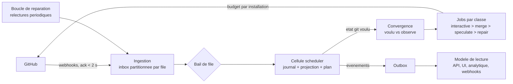

# Architecture du système

Contexte : tout le monde, avant le premier changement de code : parcours d'un événement, règles de conception, rôles, workspace et crates. Le code est la source de vérité (`AGENTS.md` D1) ; ce fichier dit l'intention et les règles de structure.

CIHub est un monolithe modulaire déployé en processus sans état au-dessus de Postgres. Ce qui le rend résilient tient en trois décisions : l'état d'une file est un **journal d'événements** en ajout seul dont tout le reste se déduit ; le réconciliateur ne pilote pas GitHub pas à pas mais calcule un **état git voulu** et fait converger l'état observé vers lui, de façon idempotente, autant de fois qu'il le faut ; et chaque appel sortant est un **job budgété, priorisé et rejouable**. Ce qui le rend scalable tient en une seule : l'unité de travail est la file, et une file est louée à une instance à la fois, ce qui permet de répartir des milliers de files sur des instances interchangeables sans coordination autre que la base.



Le parcours d'un événement : GitHub livre un webhook, l'ingestion vérifie la signature, l'écrit tel quel dans l'inbox de la file concernée et acquitte, sans rien décider. L'instance qui détient le bail de cette file lit son inbox dans l'ordre, ajoute au journal les faits que l'événement établit (PR observée, check terminé, push reçu), rejoue la projection, puis exécute le réconciliateur : une fonction pure qui, de l'état projeté et de l'heure, produit les décisions de la file, ajoutées au journal, et un **plan** — l'ensemble des références git qui devraient exister avec leur composition, les PR qui devraient être mergées, les statuts et commentaires qui devraient être affichés. La convergence compare ce plan à l'état observé (le dernier connu de GitHub, consigné dans le journal) et n'émet que les jobs qui comblent l'écart. Les jobs s'exécutent contre GitHub et consignent leur résultat dans l'inbox, comme n'importe quel événement. Une réconciliation est donc rejouable à l'identique, un job perdu est simplement réémis au tour suivant, et un état GitHub dérivé (branche supprimée à la main, PR mergée hors de la file) est corrigé sans code spécifique.

Règles de conception sur lesquelles repose le reste de la spécification :

- **Journal d'événements par file, source de vérité.** Le journal contient des faits (ce qui a été observé) et des décisions (ce que la file a choisi) ; les tables d'état (`queue_items`, `test_groups`, `test_runs`) sont des projections, reconstructibles par rejeu avec la fonction pure `apply`, qui n'appelle jamais `plan` (`AGENTS.md` D5) ; un instantané est pris tous les 500 événements pour borner le temps de chargement. On peut rejouer une file jusqu'à un instant donné pour comprendre une décision, ou la rejouer entièrement après un bug de projection.
- **Réconciliateur déterministe.** `plan(état, now) → plan` n'a aucune E/S, ne connaît ni Postgres ni GitHub, et se teste par tables et par propriétés. La même entrée donne toujours le même plan.
- **Convergence, pas pilotage.** Le plan décrit un état voulu (« la référence `cihub-merge/pr-12/…` doit exister au commit composé de A, B, C »), jamais une séquence d'appels. Chaque job vérifie l'état réel avant d'agir et est sans effet s'il est déjà atteint.
- **Bail par file.** Une table `queue_leases` (propriétaire, battement, expiration à 15 s) désigne l'instance qui traite une file ; toute instance peut reprendre un bail expiré. Les files d'une même organisation sont préférentiellement groupées sur une instance pour partager le cache GitHub, sans que ce soit une contrainte.
- **Inbox partitionnée, acquittement inconditionnel.** L'ingestion n'échoue jamais faute de traitement : elle stocke et acquitte en moins de 2 s, même si Postgres est lent (file locale bornée en mémoire avec rejeu). L'ordre est garanti par file, pas globalement.
- **Budget GitHub ordonnancé.** Chaque installation a un seau de jetons alimenté par les en-têtes de rate limit, et chaque job une classe : `interactive` (commandes, statuts, commentaires), `merge`, `speculate` (branches de test), `repair` (relectures). Quand le budget baisse, la spéculation est réduite en premier, le merge en dernier ; rien n'est perdu, tout est différé.
- **Boucle de réparation.** Indépendamment des webhooks, chaque file relit périodiquement ce qui compte (PR vivantes, checks des exécutions en cours, tête de la branche cible, existence des références de test) à un intervalle adaptatif de 30 s à 10 min selon l'activité, et injecte ce qu'elle observe dans l'inbox. Un webhook perdu coûte au plus un intervalle.
- **Modes dégradés explicites.** Par installation : `normal`, `throttled` (budget bas : plus de spéculation nouvelle), `github_unavailable` (rien ne part, tout s'accumule, la boucle de réparation teste la reprise), `paused` (décision humaine). Le mode est visible dans l'interface et l'API, avec sa cause.
- **Transport enfichable, Postgres par défaut.** Inbox, jobs et outbox sont des tables Postgres derrière des interfaces `Inbox`, `JobQueue`, `Outbox` ; une implémentation NATS JetStream est prévue pour les déploiements au-delà de quelques milliers de webhooks par minute, sans changer les modules.
- **Isolation entre organisations.** Sécurité au niveau ligne, quotas par organisation sur l'inbox et les jobs, et ordonnancement équitable des workers : une organisation bruyante ralentit ses propres files, pas celles des autres.

Ce qui passe à l'échelle, et comment :

| Dimension                | Limite naturelle                                                         | Réponse                                                                                                                                                                       |
| ------------------------ | ------------------------------------------------------------------------ | ----------------------------------------------------------------------------------------------------------------------------------------------------------------------------- |
| Nombre de files          | Aucune, chaque file est indépendante                                     | Baux répartis sur N instances de scheduler ; une instance tient quelques centaines de files actives                                                                           |
| Profondeur d'une file    | Le réconciliateur est en O(n) sur les entrées vivantes                   | Plafond de 500 entrées vivantes par file, fenêtre de spéculation bornée                                                                                                       |
| Webhooks                 | Débit d'écriture Postgres                                                | Inbox partitionnée par mois et par organisation ; passage à NATS derrière l'interface au-delà de quelques milliers par minute                                                 |
| Appels GitHub            | 5 000 points par heure et par installation, plus les limites secondaires | Budget par installation, classes de priorité, lectures conditionnelles par ETag, requêtes GraphQL groupées ; plusieurs GitHub Apps par instance pour GitHub Enterprise Server |
| Historique et analytique | Volume de lignes                                                         | Partitions mensuelles, tables de faits, puis ClickHouse derrière le trait `AnalyticsStore`                                                                                        |
| Organisations            | Isolation et équité                                                      | RLS, quotas, ordonnancement équitable ; une instance sert des centaines d'organisations                                                                                       |

Ordre de grandeur visé pour une instance standard : 1 000 organisations, 20 000 dépôts, 5 000 files, 50 000 soumissions par jour, un à deux milliers de webhooks par minute en pointe, sur un primaire Postgres avec répliques de lecture. Le découpage en lots est décrit dans [LOTS.md](LOTS.md).

## Workspace Rust et crates

Un seul dépôt contient tout le projet : le workspace Cargo, puis, avec leurs lots, le tableau de bord, l'action
GitHub, le chart Helm et les migrations. Le workspace (édition 2024, Rust fixé par `mise.toml`)
produit deux binaires (`AGENTS.md` D8) : `cihub-server`, le serveur, et `cihub`, la CLI, distribuée seule et sans
code serveur. Les crates s'appellent `cihub-*`, ne sont pas publiées sur crates.io (`publish = false`) et partagent
une seule version, celle de la release. Une crate se crée quand un lot en a besoin, après validation
(`AGENTS.md` D9) ; la liste ci-dessous est la cible, et la colonne « Lot » dit quand chaque crate arrive.

```
Cargo.toml               workspace : membres, [workspace.package], [workspace.dependencies], [workspace.lints]
Cargo.lock
clippy.toml              reglages des lints, dont l'interdiction de l'horloge et du hasard
deny.toml                licences, avis de securite, regles de dependances entre crates
mise.toml                Rust, outils et taches (AGENTS.md §5)
mise.lock                versions et sommes de controle des outils, par plateforme
compose.yaml             Postgres de developpement
release-please-config.json, .release-please-manifest.json   versions et CHANGELOG.md (AGENTS.md D19)
.renovaterc.json5        mises a jour des dependances (AGENTS.md D21)
.github/workflows/       CI (un job par tache mise, Build Success)
crates/
  domain/                cihub-domain         (existe)
  conditions/            cihub-conditions     (existe)
  config/                cihub-config         (existe)
  mq-core/               cihub-mq-core        (existe)
  server/                cihub-server         (existe)
  telemetry/             cihub-telemetry      (existe)
  ...                    les autres crates du tableau, avec leur lot
migrations/              migrations Postgres embarquees dans cihub-server (lot 2)
web/                     tableau de bord, embarque par le role api (lot 10)
```

| Crate              | Responsabilité                                                                                                                                                         | Dépend de (workspace)                                            | Lot | État   |
| ------------------ | ---------------------------------------------------------------------------------------------------------------------------------------------------------------------- | ---------------------------------------------------------------- | --- | ------ |
| `cihub-domain`     | Identifiants ULID typés, entités, vocabulaire fermé, enveloppe `Event`, tables des transitions (pur)                                                                   | —                                                                | 1   | existe |
| `cihub-conditions` | Langage de conditions : analyse, évaluation sur un contexte de PR, erreurs avec position (pur)                                                                         | `domain`                                                         | 8   | existe |
| `cihub-config`     | Modèle de `.cihub.yaml`, table des stratégies, fusion des sources avec la source de chaque réglage, plages (pur)                                                       | `domain`, `conditions`                                           | 8   | existe |
| `cihub-mq-core`    | `apply`, graphe de merge, prédécesseurs, validité des exécutions, fenêtre adaptative, lots, bissection, budget d'échec, `plan`, `check` (pur)                          | `domain`, `config`                                               | 1   | existe |
| `cihub-contracts`  | Trait `FlakeOracle` et l'oracle neutre qui répond « inconnu » (pur)                                                                                                    | `domain`                                                         | 14  | cible  |
| `cihub-flaky-core` | Signaux de détection, classification `stable` / `suspect` / `flaky` / `broken`, `case_key` (pur)                                                                       | `domain`                                                         | 14  | cible  |
| `cihub-store`      | Pool Postgres, transactions, `cihub.org_id` pour la RLS, verrous, baux, migrations embarquées, test des enums Postgres                                                | `domain`                                                         | 2   | cible  |
| `cihub-telemetry`  | Logs (`AGENTS.md` D13), puis traces OpenTelemetry et registre Prometheus                                                                                               | —                                                                | 2   | existe |
| `cihub-platform`   | Contrat `Module`, tenancy (organisations, utilisateurs, rôles, jetons), traits `Inbox`, `JobQueue`, `Outbox` et leur implémentation Postgres, exécution des jobs       | `domain`, `store`, `scm`                                         | 2–3 | cible  |
| `cihub-scm`        | Trait `Scm`, types SCM normalisés, classes de priorité d'appel                                                                                                         | `domain`                                                         | 4   | cible  |
| `cihub-github`     | Auth App, jetons d'installation, client REST et GraphQL, budget par installation, modes dégradés, vérification HMAC et traduction des webhooks en faits                | `scm`, `domain`                                                  | 4   | cible  |
| `cihub-github-sim` | Simulateur GitHub en processus, avec injection de pannes (tests)                                                                                                       | `scm`, `domain`                                                  | 4   | cible  |
| `cihub-http`       | Serveur HTTP du rôle `api` : auth, sessions, CSRF, limite de débit, erreurs problem+json, webhooks GitHub, `/api/v1/openapi.json`, tableau de bord                         | `platform`, `api-types`, `github`, `telemetry`                   | 4   | cible  |
| `cihub-mergequeue` | Module merge queue : boucle de réconciliation, projections, exécuteurs de jobs, routes `/api/v1/queues`, rendu des commentaires de PR                                     | `mq-core`, `config`, `contracts`, `platform`, `scm`, `analytics` | 5   | cible  |
| `cihub-api-types`  | Requêtes et réponses de l'API publique, codes d'erreur                                                                                                                 | `domain`                                                         | 9   | cible  |
| `cihub-client`     | Client typé de l'API publique, pour la CLI et les tests de bout en bout                                                                                                | `api-types`                                                      | 9   | cible  |
| `cihub-cli`        | Binaire `cihub`                                                                                                                                                        | `client`, `api-types`, `otlp`                                    | 9   | cible  |
| `cihub-analytics`  | Trait `AnalyticsStore`, implémentation Postgres, puis ClickHouse                                                                                                       | `domain`, `store`                                                | 11  | cible  |
| `cihub-otlp`       | Spans de test OTLP, convertisseur JUnit XML ; utilisé par le serveur et par la CLI                                                                                     | `domain`                                                         | 14  | cible  |
| `cihub-flakytests` | Module tests instables : réception OTLP, tables `ft_*`, classification, quarantaine, implémentation de `FlakeOracle`, routes `/api/v1/flaky`                             | `flaky-core`, `otlp`, `contracts`, `platform`, `analytics`       | 14  | cible  |
| `cihub-server`     | Binaire `cihub-server` : configuration, rôles, sous-commande `migrate`, enregistrement des modules                                                                     | les crates serveur                                               | 2   | existe |

Quatre règles structurent le découpage, et chacune est vérifiée en CI plutôt que laissée à la discipline :

- **Le noyau est pur par construction.** Les crates pures ne dépendent ni de `tokio`, ni de `sqlx`, ni de
  `reqwest`, ni d'`axum` : les règles `bans` de `deny.toml` listent, pour chaque dépendance lourde, les seules
  crates qui peuvent la déclarer. Le noyau change souvent ; comme il ne dépend de rien de lourd, il se recompile et
  se teste en quelques secondes.
- **La CLI ne tire aucun code serveur.** `cihub-cli` ne dépend que de `cihub-client`, `cihub-api-types` et
  `cihub-otlp` ; les mêmes règles `bans` le contrôlent.
- **Les modules ne se connaissent pas.** `cihub-mergequeue` et `cihub-flakytests` ne dépendent pas l'un de
  l'autre ; ils communiquent par les traits de `cihub-contracts` et par les événements. Seul `cihub-server` les
  connaît tous les deux. Le contrat `Module` de `cihub-platform` expose le nom du module, ses routes, ses
  exécuteurs de jobs et ses abonnements aux événements ; il n'y a pas de chargement dynamique.
- **Une seule version par dépendance externe.** Toutes les versions sont dans `[workspace.dependencies]`
  (`AGENTS.md` D2) ; édition, licence et `rust-version` viennent de `[workspace.package]`, les lints de
  `[workspace.lints]`.

Les requêtes Postgres sont écrites en SQL avec les macros `sqlx::query!` et `query_as!`, vérifiées à la
compilation contre le schéma ; les métadonnées sont versionnées dans `.sqlx/` pour que la compilation et la CI
tournent sans base. Les migrations sont dans `migrations/`, embarquées dans `cihub-server` et appliquées par
`cihub-server migrate` (`AGENTS.md` D14). Les enums Postgres ne sont pas dérivés dans `cihub-domain`, pour qu'il
reste sans `sqlx` : `cihub-store` les convertit par `as_str` et `FromStr`, et un test compare `pg_enum` aux
variantes de chaque énumération.

## Le binaire `cihub-server` et ses rôles

`cihub-server` exécute les quatre rôles dans un processus par défaut ; `CIHUB_ROLES` en choisit une partie
(`AGENTS.md` D8). Un rôle n'a pas de crate : il lance des boucles dont le code est dans les crates de bibliothèque.

| Rôle        | Ce que le rôle lance                            | Crate qui porte le code |
| ----------- | ----------------------------------------------- | ----------------------- |
| `api`       | serveur HTTP : API, webhooks, OTLP, tableau de bord | `cihub-http`        |
| `scheduler` | boucle de réconciliation des files              | `cihub-mergequeue`      |
| `worker`    | exécution des jobs des modules                  | `cihub-platform`        |
| `notifier`  | diffusion de l'outbox                           | `cihub-platform`        |

`main` lit la configuration, démarre les logs et le pool Postgres, vérifie que le schéma est à jour, puis lance une
tâche `tokio` par rôle dans un `JoinSet`, avec un seul `CancellationToken`. Sur `SIGTERM`, il annule le jeton :
chaque boucle cesse de prendre du travail, termine sa transaction en cours, libère ses baux et sort. Si une boucle
sort en erreur, `main` annule les autres et le processus s'arrête. Une tâche peut être interrompue à n'importe quel
point d'attente, ce qui est sans danger parce que les exécuteurs de jobs sont idempotents et que les
réconciliations sont transactionnelles. La réconciliation elle-même est synchrone : la tâche de la file charge
l'état, appelle `plan`, puis écrit le résultat.

Les rôles d'un même processus ne partagent que le pool Postgres et se réveillent par `LISTEN/NOTIFY`, comme entre
processus. Le mode tout-en-un et le mode avec un processus par rôle se comportent donc de la même façon.

### Passer à l'échelle

Chaque rôle peut avoir ses propres processus, avec la même image et une valeur de `CIHUB_ROLES` différente, par
exemple un déploiement Kubernetes par rôle :

| Déploiement       | `CIHUB_ROLES` | Répliques                            | Comment les répliques se partagent le travail                                                                                   |
| ----------------- | ------------- | ------------------------------------ | ------------------------------------------------------------------------------------------------------------------------------- |
| `cihub-api`       | `api`         | N, derrière un répartiteur de charge | Aucun état ; chaque webhook va dans l'inbox, et le dédoublonnage par `delivery_id` écarte un double reçu par une autre réplique |
| `cihub-scheduler` | `scheduler`   | N                                    | Une file est traitée par une seule réplique à la fois (bail et verrou) ; les files se répartissent entre les répliques          |
| `cihub-worker`    | `worker`      | N                                    | Chaque réplique prend et verrouille des jobs ; un job d'une réplique arrêtée est repris quand `locked_until` expire            |
| `cihub-notifier`  | `notifier`    | 1 ou plus                            | Même principe sur l'outbox                                                                                                      |

Les limites : une file n'est traitée que par une réplique à la fois, pour garder l'ordre, donc ajouter des
schedulers augmente le nombre de files traitées en parallèle, pas la vitesse d'une file ; au-delà d'un certain
nombre de workers, c'est le budget GitHub de l'installation qui limite ; Postgres est la ressource commune
(connexions, avec PgBouncer devant `api`, et débit d'écriture). Au-delà, NATS est prévu derrière les mêmes traits,
pas en v1.

## Le scheduler

Le processus scheduler est celui qu'il faut comprendre pour raisonner sur la correction. Chaque réplique exécute
une boucle : prendre ou renouveler les baux de `queue_leases` sur les files ayant du travail en attente
(`queues.dirty = true` ou un tic dû), puis, pour chaque file détenue, ouvrir une transaction, prendre
`pg_try_advisory_xact_lock`, exécuter la réconciliation et remettre `dirty` à faux. Le bail attribue une file à une
réplique ; le verrou consultatif de transaction garantit qu'une seule réconciliation s'applique à la fois, y
compris pendant la reprise d'un bail expiré. Toute écriture sur les entrées d'une file (par l'ingestion, par un
résultat de job, par l'API) positionne `dirty` et émet `NOTIFY cihub_queue, '<queue_id>'`. La réconciliation d'une
file ne s'exécute jamais en parallèle d'elle-même et n'attend aucune E/S autre que Postgres : une réplique gère
donc des centaines de files.
