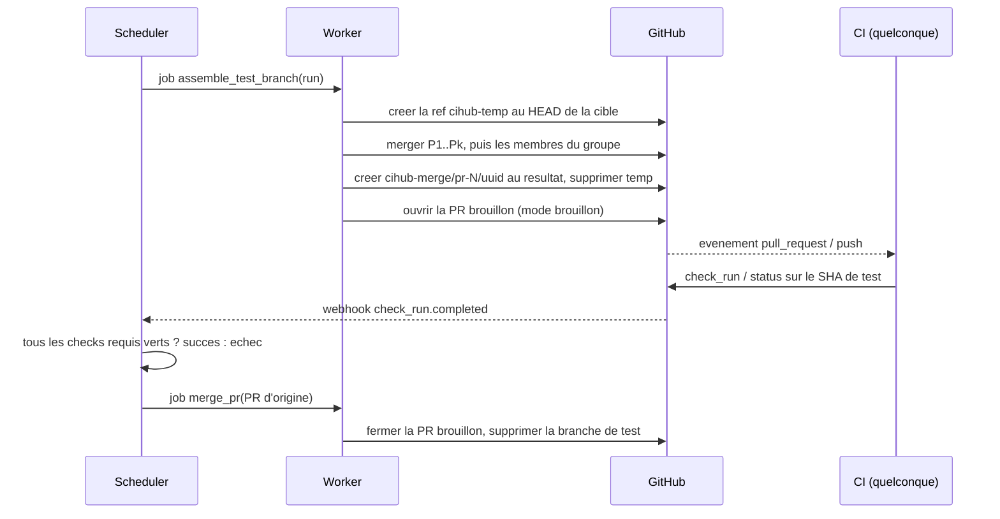

# Intégration CI

Contexte : qui touche au contrat entre la file et la CI : branches de test, modes de déclenchement, statuts requis, endpoints appelés par les jobs de CI. Le code est la source de vérité (`AGENTS.md` D1) ; ce fichier dit l'intention.

CIHub ne lance jamais la CI. Il produit un commit sur une branche (et, par défaut, une PR brouillon pour cette branche), et tout système de CI qui rapporte des check runs ou des statuts de commit GitHub sur ce commit fonctionne sans modification : GitHub Actions, Buildkite, CircleCI, Jenkins, miroirs GitLab CI, exécution distante Bazel. Le seul contrat entre la file et la CI, ce sont les noms des statuts requis et le SHA de test.



Deux modes de déclenchement sont proposés par file. En **mode PR brouillon** (par défaut), une PR brouillon de la branche de test vers la branche cible est ouverte, donc les workflows sur `pull_request` tournent sans modification ; la CI distingue les exécutions de file par la ref de tête `cihub-merge/`, et le corps de la PR brouillon porte l'identifiant d'exécution et les numéros des PR testées. En **mode push**, aucune PR n'est créée et la CI doit écouter `push` sur `cihub-merge/**` ; cela évite les déploiements de prévisualisation et les bots déclenchés par PR à chaque exécution. Dans les deux modes, la branche de test est supprimée à la fin de l'exécution, après une rétention configurable (`keep_test_branches_minutes`, 0 par défaut) pour le débogage.

Les noms des branches sont figés (lot 6, `cihub-domain`) : `<prefix>-temp/pr-<N>/<run_id>` pour la branche
temporaire où les têtes sont mergées, `<prefix>-merge/pr-<N>/<run_id>` pour la branche de test, où `N` est le
numéro de la première PR du groupe et `run_id` l'identifiant de l'exécution (`run_…`), avec `branch_prefix`
(`cihub` par défaut). Le nom de la branche de test mène à son exécution : un check rapporté sur elle est routé
vers sa file par ce nom, ou par son SHA de test une fois la branche supprimée (`AGENTS.md` D118). Le titre de la
PR brouillon est `CIHub: test #12 on main` et son corps est figé aussi :

```markdown
**CIHub merge queue** test run `run_…`.

- Target: `main` at `<base_sha>`
- Tests: #12
- On top of: #10, #11

CIHub opened this pull request for the CI and closes it when the run ends. Do not merge, review or edit it.
```

À la fin de l'exécution, quel qu'en soit le résultat, le job `cleanup_test_branch` ferme la PR brouillon et
supprime la branche de test et la branche temporaire, après `keep_test_branches_minutes` (`AGENTS.md` D117).

Les jobs de CI peuvent enrichir la file par deux endpoints. `POST /api/v1/repos/{owner}/{name}/prs/{pr}/impacted-targets` envoie les cibles qu'une PR touche (Bazel, Nx ou n'importe quel script) pour le mode parallèle ; `GET /api/v1/test-runs/{run_id}` permet à un job de découvrir quelles PR il teste et l'union de leurs cibles impactées, pour qu'un build de monodépôt se limite aux projets concernés. L'identifiant d'exécution est le dernier segment du nom de branche, disponible dans GitHub Actions via `${GITHUB_REF##*/}`.

Les noms des statuts requis sont résolus une fois par exécution et enregistrés sur elle avec leur source (`ui_override`, `repo_config`, `branch_protection`). Un check qui rapporte sous un nom différent de celui exigé (un job de workflow renommé) est l'erreur de configuration la plus courante ; le tableau de bord affiche les noms requis à côté des noms observés pour chaque exécution afin de la rendre visible.
