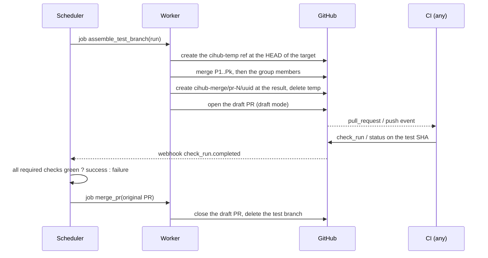

# CI integration

CIHub never starts the CI. It produces a commit on a branch (and, by default, a draft PR for that branch), and any CI system that reports GitHub check runs or commit statuses on that commit works without modification: GitHub Actions, Buildkite, CircleCI, Jenkins, GitLab CI mirrors, Bazel remote execution. The only contract between the queue and the CI is the names of the required statuses and the test SHA.



Two trigger modes are offered per queue. In **draft PR mode** (the default), a draft PR from the test branch to the target branch is opened, so the workflows on `pull_request` run without modification; the CI tells queue runs apart by the `cihub-merge/` head ref, and the body of the draft PR carries the run identifier and the numbers of the tested PRs. In **push mode**, no PR is created and the CI must listen to `push` on `cihub-merge/**`; this avoids preview deployments and PR-triggered bots at each run. In both modes, the test branch is deleted at the end of the run, after a configurable retention (`keep_test_branches_minutes`, 0 by default) for debugging.

The branch names are frozen (Lot 6, `cihub-domain`): `<prefix>-temp/pr-<N>/<run_id>` for the temporary
branch where the heads are merged, `<prefix>-merge/pr-<N>/<run_id>` for the test branch, where `N` is the
number of the first PR of the group and `run_id` the identifier of the run (`run_…`), with `branch_prefix`
(`cihub` by default). The name of the test branch leads to its run: a check reported on it is routed to its
queue by this name, or by its test SHA once the branch is deleted (`DECISIONS.md` D118). The title of the draft
PR is `CIHub: test #12 on main` and its body is frozen too:

```markdown
**CIHub merge queue** test run `run_…`.

- Target: `main` at `<base_sha>`
- Tests: #12
- On top of: #10, #11

CIHub opened this pull request for the CI and closes it when the run ends. Do not merge, review or edit it.
```

At the end of the run, whatever its result, the `cleanup_test_branch` job closes the draft PR and deletes the
test branch and the temporary branch, after `keep_test_branches_minutes` (`DECISIONS.md` D117).

CI jobs can enrich the queue through two endpoints. `POST /api/v1/repos/{owner}/{name}/prs/{pr}/impacted-targets` sends the targets that a PR touches (Bazel, Nx or any script) for the parallel mode; `GET /api/v1/test-runs/{run_id}` lets a job discover which PRs it tests and the union of their impacted targets, so that a monorepo build limits itself to the affected projects. The run identifier is the last segment of the branch name, available in GitHub Actions through `${GITHUB_REF##*/}`.

The names of the required statuses are resolved once per run and recorded on it with their source (`repo_config`, `branch_protection`). A check that reports under a name different from the required one (a renamed workflow job) is the most common configuration error; the dashboard displays the required names next to the observed names for each run to make it visible.
