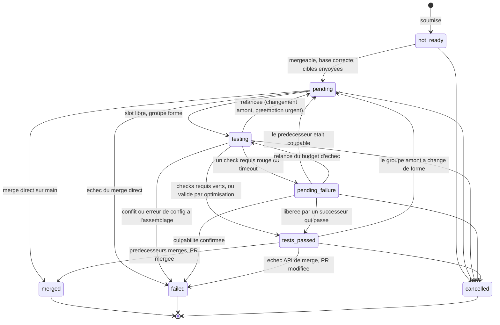

# Modèle de domaine : le contrat de vocabulaire

Contexte : qui touche aux états, aux transitions, aux raisons ou aux types d'événements d'une entrée, d'un groupe,
d'une exécution ou d'une file. Ce fichier définit les termes que nous utilisons tous, humains et agents. Le code
est la source de vérité (`AGENTS.md` D1) : la liste des valeurs de chaque vocabulaire fermé est dans
`cihub-domain`, avec un commentaire `///` qui donne le sens de chaque valeur. Ce qui n'est pas encore codé est
décrit dans le lot qui le construit (`docs/LOTS.md`).

## Entités

Le vocabulaire du domaine est celui de CIHub, pas celui d'un SCM (`AGENTS.md` D23) : chaque adaptateur
(`cihub-github`) traduit les valeurs de son SCM, et le noyau n'en voit aucune. Une **PR** désigne toute demande de
changement : une pull request GitHub, une merge request GitLab.

Six entités portent tout le produit : une organisation installe la GitHub App sur des dépôts, chaque dépôt a une
file par branche cible, une file contient des entrées (une par soumission de PR), les entrées sont regroupées en
groupes de test (une PR seule ou un lot) qui possèdent des exécutions de test, et chaque fait observé et chaque
décision de la file est enregistré comme un événement immuable. Tout le reste (voies, bissections, piles) en
découle.

| Entité               | Identité                     | Sens                                                                                                                                          | Code (`cihub-domain`)  |
| -------------------- | ---------------------------- | --------------------------------------------------------------------------------------------------------------------------------------------- | ---------------------- |
| Organisation         | `org_id`                     | Frontière de tenancy : toutes les autres tables portent `org_id`                                                                              | `OrgId`                |
| Dépôt                | `repo_id`                    | Un dépôt GitHub rattaché à une installation ; une installation peut couvrir plusieurs dépôts                                                 | `RepoId`               |
| File                 | `queue_id`                   | Une par branche cible d'un dépôt, avec son état, son mode et ses réglages                                                                     | `Queue`                |
| Entrée de file       | `item_id`                    | Une soumission d'une PR ; une resoumission après annulation crée une nouvelle entrée, et `is_current` désigne l'entrée vivante de cette PR   | `Item`                 |
| Groupe de test       | `group_id`                   | L'unité testée et retenue en échec en attente : une PR seule, un lot, ou une moitié de bissection                                            | `TestGroup`            |
| Exécution de test    | `run_id`                     | Une tentative de test d'un groupe sur une branche de test ; un groupe peut avoir plusieurs exécutions (relances)                              | `TestRun`              |
| Observation de check | (`run_id`, nom)              | La dernière observation d'un check run ou d'un statut de commit sur le SHA de test                                                            | `CheckObservation`     |
| Cibles impactées     | (`repo_id`, PR, SHA de tête) | Ce qu'une PR modifie, qui la place dans le graphe de merge ; `ALL` en mode simple                                                             | `ImpactedTargets`      |
| Événement            | `event_id`                   | Un fait ou une décision, en ajout seul dans le journal de la file                                                                             | `Event`                |

Les identifiants sont des ULID typés au format texte `typedid` (`AGENTS.md` D4). Chaque vocabulaire fermé est une
énumération dont la valeur texte (`snake_case`) est la même dans l'API, les webhooks, l'analytique et Postgres.

## Journal

- **Journal** : la suite en ajout seul des événements d'une file ; c'est la source de vérité de la file. Les
  tables d'état sont des projections du journal.
- **Fait** : ce que GitHub, la CI ou un utilisateur a établi (« la PR 12 a un nouveau SHA de tête »). Un fait
  change seulement l'état observé.
- **Décision** : ce que la file a choisi (« l'entrée de la PR 12 passe en `cancelled`, raison `pr_pushed_to` »).
  Une décision change seulement l'état de la file et porte l'identifiant du fait qui l'a causée (`cause_id`).
- **Demande** : un fait qui attend une décision (soumission, annulation, relance, résultat de job).
- **`apply`** : la fonction pure qui applique un événement à l'état ; le rejeu n'utilise qu'elle.
- **`plan`** : la fonction pure qui lit l'état et l'heure, et produit des décisions et l'état voulu.
- **Raison** : la cause lisible d'une transition, issue d'un vocabulaire fermé. Chaque transition en porte une.
- **Acteur** : qui est à l'origine d'un événement : un utilisateur (avec son login), le compte de l'App, ou CIHub.

Code : `Event`, `EventKind` (un payload par type), `EventType` (les noms `<sujet>.<verbe>`, avec
`is_decision`), `Actor` et `ActorKind` dans `cihub-domain` ; `apply` dans `cihub-mq-core`. Une demande en attente
est un `Request` du snapshot.

## Entrée de file

États (`ItemState`) : `not_ready`, `pending`, `testing`, `pending_failure`, `tests_passed`, `merged`, `failed`,
`cancelled`. Les trois derniers sont terminaux. Ils servent tels quels dans l'API, les webhooks et l'analytique.

| État              | Sens                                                                                          |
| ----------------- | --------------------------------------------------------------------------------------------- |
| `not_ready`       | Soumise, mais pas encore admissible (revue, checks de la PR, mergeabilité, cibles manquantes) |
| `pending`         | Admise, en attente d'une place dans la fenêtre de spéculation                                 |
| `testing`         | Membre d'un groupe dont une exécution est en cours                                            |
| `pending_failure` | Son exécution a échoué ; la file attend de savoir si la faute vient d'elle ou d'un prédécesseur |
| `tests_passed`    | Validée par une exécution ; attend que ses prédécesseurs mergent                              |
| `merged`          | Mergée par la file, par merge direct, ou hors de la file                                      |
| `failed`          | Retirée de la file avec une raison ; la PR doit être resoumise                                |
| `cancelled`       | Annulée par un utilisateur ou par un changement de la PR                                      |

Les transitions permises et leurs raisons sont dans le code : une seule énumération `Reason` et, pour chaque
machine à états, une table (état de départ, état d'arrivée) → raisons permises (`AGENTS.md` D6), le trait
`Lifecycle` et la fonction `check_transition`.

Familles de raisons, pour s'y retrouver : admission et test ; retour en `pending` (changement en amont, relance,
préemption `urgent`, bissection) ; `tests_passed` ; `merged` ; `cancelled` ; `start_test_run_*` (échec à
l'assemblage de la branche de test) ; `test_run_*` (échec ou timeout de l'exécution) ; échec de l'appel de merge
(`merge_rejected`, `direct_merge_rejected`, `merge_rate_limit_exceeded`, `merge_branch_protection_unmet`,
`merge_already_in_progress`, `merge_repeated_server_errors`, `pr_updated_at_merge_time`) ; raisons de la file,
dont `access_lost` et `access_restored` quand CIHub perd ou retrouve son accès au dépôt.

Une entrée `not_ready` porte en outre des raisons de blocage (`BlockReason`) : ce qui l'empêche d'être admise,
affiché dans le commentaire de la PR. La mergeabilité (`Mergeability`) dit si le SCM accepte le merge : `mergeable`, `behind`,
`conflict`, `blocked` ou `unknown` ; la traduction depuis GitHub et la règle d'admission sont dans
`docs/GITHUB.md`. Ce que CIHub lit d'une PR : son état
(`PrState` : `open`, `closed`, `merged`), sa décision de revue (`ReviewDecision`) et ses checks (`CheckReport`).

Priorité (`Priority`) : une valeur de 0 à 255 ; la plus petite passe en premier. Les noms `urgent` (0), `high`
(10), `medium` (100) et `low` (200) sont ceux de Trunk. Seule la valeur décide de l'ordre
(`docs/ALGORITHMS.md`). Source d'une soumission : `SubmittedVia`.

## Groupe de test

Nature d'un groupe (`GroupKind`) : `single` (une PR), `batch` (un lot), `bisection` (une moitié d'un lot en
échec). Un groupe a son propre état, parce qu'un groupe coupé ou abandonné n'a plus d'entrées, et que les membres
d'un lot passent un par un à `merged`. États (`GroupState`) : `testing`, `pending_failure`, `tests_passed`,
`merged`, `failed`, `bisected`, `dissolved` ; les quatre derniers sont terminaux. Un groupe `dissolved` est
abandonné par la file (un membre est sorti, un prédécesseur ou la base a changé) ; ses membres encore vivants
retournent en `pending`. La règle de cohérence entre l'état d'un groupe et celui de ses entrées est dans
`docs/RELIABILITY.md`.

## Exécution de test

Statuts (`RunStatus`) : `assembling`, `in_progress`, `succeeded`, `failed`, `interrupted`, `cancelled`,
`timed_out`. Les cinq derniers sont terminaux. `interrupted` veut dire que la file a remplacé l'exécution (groupe
abandonné, validé par optimisation) ; `cancelled` veut dire qu'un membre du groupe a été annulé.

Nature d'un check observé (`CheckKind`) : `check` (un check avec une exécution : check run GitHub, job de
pipeline GitLab) ou `status` (un statut de commit). Conclusion (`CheckConclusion`) : les valeurs de
GitHub ; `success`, `neutral` et `skipped` passent, les autres font échouer l'exécution. Coupable d'un conflit à
l'assemblage (`ConflictCulprit`) : une PR de la file ou la branche de base. Source des statuts requis
(`RequiredStatusesSource`) : `ui_override`, `repo_config`, `branch_protection`. Un job qui échoue rapporte une
erreur (`JobError`), jamais une raison : `plan` choisit la raison.

## File

États (`QueueState`) : `running` accepte et merge ; `paused` n'accepte rien et ne merge rien mais conserve
l'ordre ; `draining` n'accepte rien et laisse merger ce qui est en vol ; `switching_modes` est atteint
automatiquement quand le mode change avec des entrées en vol et se comporte comme `draining` jusqu'à ce que la file
soit vide. Mode (`QueueMode`) : `single` ou `parallel`. Demande d'un opérateur (`QueueControl`) : `pause`,
`resume`, `drain`. Les réglages de la file sont dans `cihub-config`
(`docs/CONFIGURATION.md`).
