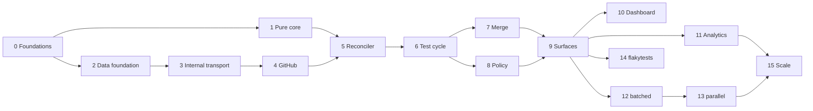

# Phases and lots

Context: whoever starts a piece of work. This file splits the roadmap into lots of about one week for one
developer who drives coding agents. Each lot has a goal, a content, the interfaces it **freezes** (the following
lots build on them without changing them), its dependencies and an **automated exit criterion** that is the
definition of "done". A lot starts only when its dependencies are done and when the questions of
`docs/DECISIONS.md` that it lists are settled.

**Tracking (`DECISIONS.md` D3).** The status of a lot is `to do`, `in progress`, `done` or `blocked` (with the cause).
As soon as a lot starts, it receives a "Tracking" block: what is done (crates, points of the content), what remains,
and the deviations from the plan, each validated according to `DECISIONS.md`. The status and the block are updated in
the same change as the code.

## Phases

Four phases, each deliverable on its own and completed by the use of CIHub on its own repository. The graph-based
reconciler is built from phase 1 in its general form, so that the following phases add strategies and modules, not
rewrites.

| Phase                       | Lots            | Scope                                                                                                                                                                                                                                                                                                                                                             | Exit criterion                                                                                                                                                                |
| --------------------------- | --------------- | ----------------------------------------------------------------------------------------------------------------------------------------------------------------------------------------------------------------------------------------------------------------------------------------------------------------------------------------------------------------- | ----------------------------------------------------------------------------------------------------------------------------------------------------------------------------- |
| 1. Installable merge queue  | 0 to 9          | Foundation (tenancy, log, jobs, GitHub adapter), pure core, reconciler, complete test cycle, entry and merge conditions, adaptive window, failure budget, `sequential` and `pipelined` strategies, squash / merge / rebase / fast-forward methods, direct merge, PR surfaces, API and CLI, `docker compose` and procedure to create the App                       | The CIHub repository merges through CIHub for 2 weeks without a red merge; an outside person installs and merges a first PR in less than 30 minutes by following the README  |
| 2. Throughput and visibility | 10 to 12       | Dashboard, Postgres analytics, Health view, Prometheus, outgoing webhooks, `batched` strategy (batches, bisection, failure depth, optimistic merge)                                                                                                                                                                                                                 | Queue time p50 reduced by 40 % on a synthetic load of 20 PRs per hour; bisection isolates a planted failure in ≤ log2(batch) runs                                            |
| 3. Flaky tests              | 14 (advanced)   | OTLP receiver, JUnit converter and GitHub action, `ft_*` tables, detection, quarantine, `FlakeOracle` trait consumed by the queue, dedicated page                                                                                                                                                                                                                | The module is added without changing the merge queue outside the call to the trait; on a repository with a known flaky test, zero PR evicted wrongly                        |
| 4. Scale and ecosystem      | 13, 15 and next | `parallel` strategy with impacted targets, Bazel and Nx actions, ClickHouse behind `AnalyticsStore`, Helm chart, hardening, then stacked PRs, direct-to-queue, Slack, Terraform, GitLab behind `Scm`                                                                                                                                                              | A pilot monorepo merges disjoint PRs in parallel; an instance holds 1,000 PRs per day with ClickHouse enabled; first outside organization in production                     |

The two highest risks are the invariants of the reconciler under concurrent GitHub events (mitigated by the pure
core and its property tests, delivered first) and the GitHub rulesets misconfigured by the users (mitigated by the
configuration checker, in phase 1).

## Overview

| Lot | Title                                                  | Phase | Depends on | Questions | Status                                   |
| --- | ------------------------------------------------------ | ----- | ---------- | --------- | ---------------------------------------- |
| 0   | Repository foundations                                 | 1     | —          | —         | done                                     |
| 1   | Pure core of the queue                                 | 1     | 0          | —         | done                                     |
| 2   | Data foundation: server, tenancy, log                  | 1     | 0          | —         | done                                     |
| 3   | Internal transport: inbox, jobs, leases                | 1     | 2          | —         | done                                     |
| 4   | GitHub adapter, simulator and App installation         | 1     | 3          | —         | done                                     |
| 5   | Reconciler and admission                               | 1     | 1, 4       | —         | done                                     |
| 6   | Test cycle                                             | 1     | 5          | —         | done                                     |
| 7   | Merge and outside changes                              | 1     | 6          | —         | done                                     |
| 8   | Queue policy                                           | 1     | 6          | —         | done                                     |
| 9   | Surfaces: PR, API, CLI                                 | 1     | 7, 8       | —         | in progress                              |
| 10  | Dashboard                                              | 2     | 9          | Q9        | to do                                    |
| 11  | Analytics, metrics and outgoing webhooks               | 2     | 9          | —         | to do                                    |
| 12  | `batched` strategy                                     | 2     | 9          | Q3        | to do                                    |
| 13  | `parallel` strategy                                    | 4     | 12         | —         | to do                                    |
| 14  | `flakytests` module                                    | 3     | 9          | Q1, Q7, Q12 | to do                                  |
| 15  | Scale: ClickHouse, Helm, hardening                     | 4     | 11, 13     | Q8        | to do                                    |

Lots 1 and 2 can advance in parallel after lot 0, as can lots 7 and 8 after lot 6, and lots 10, 11, 12 and 14
after lot 9.

---

## Phase 1: installable merge queue

Lots 0 to 8 are done; their tracking is in [LOTS_DONE.md](LOTS_DONE.md).

### Lot 9: surfaces: PR, API, CLI

- **Goal**: let humans and the CI use the queue; end of phase 1.
- **Content**: `CIHub Merge Queue (<branch>)` status, bot comment edited in place, state labels;
  `/cihub merge|cancel|restart` commands, with permission checks; REST API v1
  of `docs/API.md` (without metrics and outgoing webhooks), `problem+json` errors, rate limit, OpenAPI 3.1
  generated from the code (`cihub-web`, `cihub-api-types`); Rust client `cihub-client`; `cihub` CLI;
  `Dockerfile` of the `cihub-server` image and workflow that publishes the image to GHCR at each version
  (`DECISIONS.md` D19); installation `docker compose` with the `cihub-migrate` service (`DECISIONS.md` D14) and
  installation README, with a prompt that helps write `.cihub.yaml` (`DECISIONS.md` D134); configuration checker as an API endpoint, with the rulesets read through the
  `Scm` trait (`DECISIONS.md` D87); block reason that names the missing required check (`DECISIONS.md` D112); 5-minute
  permission cache and message of a refused submission.
- **Frozen interfaces**: API v1 published in `/api/v1/openapi.json`; PR commands; CLI commands.
- **Exit criterion**: an end-to-end test on the staging instance submits PRs on a real repository and merges
  them; the CIHub repository moves to its own queue; an outside person follows the README and merges a first
  PR in less than 30 minutes (criterion of phase 1, measured by hand).
- **Tracking**:
  - Steps: 1. bootstrap of an organization (Q14); 2. PR surfaces; 3. API v1; 4. client and CLI;
    5. configuration checker; 6. image, installation `docker compose` and README; 7. exit criteria.
  - Done (October 2, 2026, D154, D155): step 1. `cihub-server admin bootstrap --installation <id>` reads the account
    of the installation, creates the organization (slug: the login of the account), its account, its connection and
    the `org_modules` row of the `mergequeue` module, requests `sync_repos` and shows once a `bootstrap` token with
    the five scopes; on an installation already bootstrapped, it creates only a new token. The
    `Scm` trait gains `installation` and `list_repos` (GitHub and simulator, contract suite). The `sync_repos` job
    creates and updates `repos` without deleting any and without taking the repository of another organization; it is
    requested by the routing of each `installation_repositories` delivery (key of the delivery), and by the bootstrap
    and each scheduler replica (key of the hour). Tests: against Postgres, the bootstrap and its rerun, the reading of
    the repositories, the hourly request and the routing; the two GitHub routes on hand-written responses.
  - Done (October 2, 2026): the GitHub responses are recorded again (D155, 64 exchanges, with the installation and
    its repositories), with the `cihub` ruleset put back in recording mode for the duration of the recording;
    #55 merged afterwards. The recorder keeps only the repository of the suite in the list of the repositories of
    the installation, because the others may be private and the cassette is public.
  - Done (October 2, 2026, D156 to D158): step 2. `plan` gives `Desired.surfaces` (each live item, and each item
    that the reconciliation terminates, seen before its eviction); `cihub-mergequeue` turns it into the queue status,
    the comment and the state labels, writes the desired rendering in `pr_surfaces` and requests `publish_surfaces`,
    which publishes under an advisory lock of the PR; `merge_pr` publishes `success` before the merge. `/cihub cancel`
    and `/cihub restart` go through the `pr_command` job; a refused command receives a comment. `cihub-github`
    keeps a permission for 5 minutes. `pr.observed` carries `required_checks`, and a `blocked` PR names its required
    checks that fail or are pending. Tests: rendering (status, comment, labels, cut at 140 characters), surfaces in
    the core (position, end of an evicted item, named reasons), and against Postgres and the simulator a single
    comment, the status and the labels, then restart, cancellation and refusal of a command.
  - Done (October 2, 2026, D159, D160): step 3. Crate `cihub-api-types` (requests, responses, `ErrorCode`,
    `Problem`, OpenAPI schemas behind the `openapi` feature, `utoipa` dependency). `cihub-platform` carries the
    `problem+json` error, `ApiGrant` and the extractors; the `Module` contract gains `ModuleApi` (routes and document).
    `cihub-web` authenticates `/api/v1` by token, limits each token to 600 requests per minute and per replica,
    serves `/repos`, `/orgs/{org}/audit` and `/api/v1/openapi.json` (without token). `cihub-mergequeue` serves the
    queue routes of D160; `audit_log` gains `actor_token_id`, and `bootstrap` audits its token. Tests: against
    Postgres, the authentication, the scopes, the limit and the document; and end to end on the simulator, a
    submission through the API, the item, its timeline, its run, the graph, restart, cancellation, pause, new
    queue, resync and audit log.
  - Done (October 2, 2026, D161): step 4. `cihub-client` (the methods that the CLI uses) and `cihub-cli` (`cihub` binary,
    `clap` dependency). Tests: git remote, choice of the queue, and the client against the real server in the
    end-to-end test of the API.
  - Done (October 2, 2026, D162): step 5. The `Scm` trait gains `check_setup` (neutral findings); GitHub reads the
    rulesets of the target branch and of the test branches, and the simulator restricts no update;
    `GET /queues/{id}/config-check`. Tests: the contract suite, a hand-written response, and the route.
  - Done (October 2, 2026): step 6. `Dockerfile` (distroless, pinned by digest), `.github/workflows/image.yaml`
    (GHCR, one native runner per architecture, then a manifest), `deploy/compose.yaml` and `deploy/.env.example`,
    `README.md` with the installation procedure and the help prompt for `.cihub.yaml`, `release` profile. Verified
    by the agent: image built (69.6 MB), `migrate` in the image against Postgres, `docker compose config`,
    `actionlint` and `zizmor`.
  - Done (October 2, 2026, D163): welcome comment. `PrChanged` gains `opened`; the `welcome_pr` job posts the
    welcome comment once, with its submit box; `pr_comments` keeps the comment of the PR, shared by its queues,
    and `publish_surfaces` takes it over. The adapter translates the checked box into `SubmitBoxChecked`, which the
    connection pass submits if the comment is the one of CIHub. The box comes back for a `failed` or `cancelled`
    item. Tests: translation of the opening and of the box, and against Postgres and the simulator the welcome,
    the submission by the box, its return after a cancellation, the refusal of an account without `write` and a
    box in the comment of someone else.
  - Done (October 4, 2026, D167): sentence of each reason. `Reason::describe` in `cihub-domain`; the status and the
    comment of a `failed` or `cancelled` PR show it instead of the code, the API `Item` gains `state_description`
    and the CLI shows it. Tests: the table (one short, unique sentence per reason), the rendering of a failure, and
    the field against Postgres.
  - Done (October 3, 2026, D168, D169): one binary, `cihub`. `cihub-cli` (`crates/cli/`, the former
    `crates/server/`) gives it, with `clap`: one file per command and one per role; the HTTP endpoints stay in
    `cihub-web`. The former client-only `cihub-cli` crate is removed. Groups `login`, `queue` (`--repo`, `--queue`; with two queues and no `--queue`, the command refuses and
    lists the names) and `server` (`start`, `migrate`, `bootstrap --installation <id>`, `--config
    <file>`). `CIHUB_ROLES` is removed and `CIHUB_LOG` becomes `CIHUB_LOG_FILTER`; the YAML file of the server has one
    key per variable. Image: entry point `cihub`, default command `server start`. Tests: table tests of the
    configuration (file only, variables only, a variable over the file, unknown key, wrong type, missing database,
    rules of the `github` keys), the refused arguments, and against Postgres `cihub server start|migrate` and
    `cihub queue drain|status` against a running server.
  - Done (October 5, 2026, D170): `cihub server start` takes no argument and always runs the four roles; a
    deployment scales by identical replicas. The probes give only the name and the version of the binary.
  - Done (October 4, 2026, D172): no queue is created by hand. The first `/cihub merge` on a branch without a
    queue creates, in `submit_pr`, the queues that `.cihub.yaml` names on the branch, or the queue of the default
    branch named after it, with the file that it read; a queue without an entry has `defaults`; a queue that the
    file no longer names takes no new submission. `POST /repos/{owner}/{name}/queues`, `cihub queue create`,
    `CreateQueue` and `queue_exists` are removed; the README no longer has a step that creates a queue. Tests:
    `defaults` alone in `cihub-config`, the rule of the queues that take submissions, and against Postgres and
    the simulator the queue of the default branch, the queues of the file and their routing, a label and a
    command on another branch that create nothing.
  - Remaining: record the GitHub responses again for `check_setup` (D90, D162); until then,
    `the_contract_passes_on_recorded_answers` fails. Step 7, the exit criteria: the end-to-end test on staging,
    CIHub on its own queue, and an installation by an outside person, which need an instance, an App and a person.
  - Deviations (D160, D162): deferred, `DELETE /queues/{id}`, `GET /queues/{id}/test-results`, the `?branch=`
    search and the no-op ref update of the checker.

---

## Phase 2: throughput and visibility

### Lot 10: dashboard

- **Content**: `web/` (Q9), served and embedded by the `web` role; GitHub OAuth login, sessions, CSRF; pages for
  the queue, the PR and its timeline, the run (required statuses against observed statuses), live graph;
  configuration checker and assistant; form that writes `.cihub.yaml` and opens it as a PR on the repository, never
  as a direct commit (`DECISIONS.md` D134).
- **Exit criterion**: component tests and an end-to-end browser test on `docker compose`: login, creation of a
  queue, submission, follow-up until the merge; the assistant reports each configuration point of
  `docs/GITHUB.md` on a misconfigured repository.

### Lot 11: analytics, metrics and outgoing webhooks

- **Content**: `AnalyticsStore` trait and its Postgres implementation (`cihub-analytics`, `an_*` tables); the
  `notifier` role; the outbox and its subscriptions, written with their event in the same transaction
  (`DECISIONS.md` D65); `/metrics` on the internal address; Health view; `GET /api/v1/metrics`; Standard Webhooks
  outgoing webhooks with the CIHub vocabulary (`DECISIONS.md` D139); `/orgs/{org}/webhooks` endpoints.
- **Exit criterion**: an event and its outbox entry are written in the same transaction; the fact tables rebuilt
  from `events` equal those written continuously;
  each webhook type is emitted exactly once per transition, signed, and retried after a failure; `rate()`
  works on the exposed counters.

### Lot 12: `batched` strategy

- **Content**: batch formation, `no_batch`, maximum wait; bisection with a cache of the results and a
  `bisection_concurrency` pool; `pending_failure_depth > 0`; optimistic merge (Q3); `batched` strategy. Taken over
  from lot 7: measure the useless assemblies after the closing of the PR at the head.
- **Exit criterion**: criterion of phase 2 on a synthetic load of the simulator: p50 reduced by
  40 % at 20 PRs per hour against `pipelined`, and a planted failure isolated in ≤ log2(batch size) runs.

---

## Phase 3: flaky tests

### Lot 14: `flakytests` module

- **Content**: OTLP/HTTP receiver in the `web` role; `cihub test-results push --junit` and the GitHub action;
  `ft_results` and `ft_cases` tables; the three detection signals, including bisection; quarantine;
  `cihub-flaky-core` and `cihub-flakytests`, implementation of the `FlakeOracle` trait (`cihub-contracts`) and
  restart reason (Q1); "Flaky tests" page, `/api/v1/flaky/*` API, `flaky.*` webhooks. This lot can be split in two
  (reception and storage, then detection and oracle) if it exceeds one week.
- **Exit criterion**: criterion of phase 3; with the module disabled, the queue suite passes without any
  change; the oracle answers in less than 50 ms at p99 on 1 M results.

---

## Phase 4: scale and ecosystem

### Lot 13: `parallel` strategy

- **Content**: `POST /repos/{owner}/{name}/prs/{pr}/impacted-targets` (`targets:write` token or GitHub Actions
  run for forks, 20 MB limit); lanes by overlap; batches per lane; `parallel` strategy;
  example actions for Bazel and Nx.
- **Exit criterion**: on the simulator, PRs with disjoint targets are tested and merged in
  parallel, and an `ALL` PR serializes everything that follows it; criterion of phase 4 on a pilot monorepo.

### Lot 15: scale: ClickHouse, Helm, hardening

- **Content**: ClickHouse implementation of `AnalyticsStore` (Q8); Helm chart, with the migration `Job` as a
  `pre-install` and `pre-upgrade` hook (`DECISIONS.md` D14); load test at the order of magnitude of the standard
  instance; chaos exercise on staging; API compatibility policy and first published version.
- **Exit criterion**: an instance holds 1,000 PRs per day with ClickHouse enabled; the migration from Postgres to
  ClickHouse is a copy without any change to the application code.

### Next

Stacked PRs, direct-to-queue with the `cihub-sudo` App, Slack, Terraform, GitLab behind `Scm`. These lots are
split when phase 4 starts.
