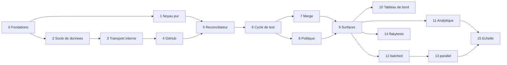

# Phases et lots

Contexte : qui commence un travail. Ce fichier découpe la feuille de route en lots d'environ une semaine pour un
développeur qui pilote des agents de code. Chaque lot a un objectif, un contenu, les interfaces qu'il **fige** (les
lots suivants s'appuient dessus sans les changer), ses dépendances et un **critère de sortie automatisé** qui est
la définition de « terminé ». Un lot ne commence que quand ses dépendances sont terminées et que les questions de
`AGENTS.md` §4.1 qu'il liste sont tranchées.

**Suivi (`AGENTS.md` D3).** Le statut d'un lot est `à faire`, `en cours`, `terminé` ou `bloqué` (avec la cause).
Dès qu'un lot commence, il reçoit un bloc « Suivi » : ce qui est fait (crates, points du contenu), ce qui reste,
et les écarts avec le plan, chacun validé selon `AGENTS.md` §4. Le statut et le bloc sont mis à jour dans le même
changement que le code.

## Phases

Quatre phases, chacune livrable seule et terminée par l'usage de CIHub sur son propre dépôt. Le réconciliateur à
base de graphe est construit dès la phase 1 sous sa forme générale, pour que les phases suivantes ajoutent des
stratégies et des modules, pas des réécritures.

| Phase                       | Lots            | Périmètre                                                                                                                                                                                                                                                                                                                                                         | Critère de sortie                                                                                                                                                             |
| --------------------------- | --------------- | ----------------------------------------------------------------------------------------------------------------------------------------------------------------------------------------------------------------------------------------------------------------------------------------------------------------------------------------------------------------- | ----------------------------------------------------------------------------------------------------------------------------------------------------------------------------- |
| 1. Merge queue installable  | 0 à 9           | Socle (tenancy, journal, jobs, adaptateur GitHub), noyau pur, réconciliateur, cycle de test complet, conditions d'entrée et de merge, fenêtre adaptative, budget d'échec, stratégies `sequential` et `pipelined`, méthodes squash / merge / rebase / fast-forward, merge direct, surfaces PR, API et CLI, `docker compose` et procédure de création de l'App     | Le dépôt de CIHub merge par CIHub pendant 2 semaines sans merge rouge ; une personne extérieure installe et merge une première PR en moins de 30 minutes en suivant le README |
| 2. Débit et visibilité      | 10 à 12         | Tableau de bord, analytique Postgres, vue Santé, Prometheus, webhooks sortants, stratégie `batched` (lots, bissection, profondeur d'échec, merge optimiste)                                                                                                                                                                                                       | Temps en file p50 réduit de 40 % sur une charge synthétique de 20 PR par heure ; la bissection isole un échec planté en ≤ log2(lot) exécutions                                |
| 3. Tests instables          | 14 (avancé)     | Récepteur OTLP, convertisseur JUnit et action GitHub, tables `ft_*`, détection, quarantaine, trait `FlakeOracle` consommé par la file, page dédiée                                                                                                                                                                                                                | Le module s'ajoute sans modifier la merge queue hors de l'appel au trait ; sur un dépôt avec un test instable connu, zéro PR évincée à tort                                   |
| 4. Échelle et écosystème    | 13, 15 et suite | Stratégie `parallel` avec cibles impactées, actions Bazel et Nx, ClickHouse derrière `AnalyticsStore`, chart Helm, durcissement, puis PR empilées, direct-to-queue, Slack, Terraform, GitLab derrière `Scm`                                                                                                                                                       | Un monodépôt pilote merge des PR disjointes en parallèle ; une instance tient 1 000 PR par jour avec ClickHouse activé ; première organisation extérieure en production       |

Les deux risques les plus élevés sont les invariants du réconciliateur sous des événements GitHub concurrents
(atténués par le noyau pur et ses tests de propriété, livrés en premier) et les rulesets GitHub mal configurés chez
les utilisateurs (atténués par le vérificateur de configuration, en phase 1).

## Vue d'ensemble

| Lot | Titre                                                  | Phase | Dépend de | Questions | Statut                                   |
| --- | ------------------------------------------------------ | ----- | --------- | --------- | ---------------------------------------- |
| 0   | Fondations du dépôt                                    | 1     | —         | —         | terminé                                  |
| 1   | Noyau pur de la file                                   | 1     | 0         | —         | terminé                                  |
| 2   | Socle de données : serveur, tenancy, journal           | 1     | 0         | —         | terminé                                  |
| 3   | Transport interne : inbox, jobs, baux                  | 1     | 2         | —         | terminé                                  |
| 4   | Adaptateur GitHub, simulateur et installation de l'App | 1     | 3         | —         | terminé                                  |
| 5   | Réconciliateur et admission                            | 1     | 1, 4      | —         | terminé                                  |
| 6   | Cycle de test                                          | 1     | 5         | —         | terminé                                  |
| 7   | Merge et changements extérieurs                        | 1     | 6         | —         | terminé                                  |
| 8   | Politique de file                                      | 1     | 6         | —         | en cours (commencé avant son tour)       |
| 9   | Surfaces : PR, API, CLI                                | 1     | 7, 8      | —         | à faire                                  |
| 10  | Tableau de bord                                        | 2     | 9         | Q9        | à faire                                  |
| 11  | Analytique, métriques et webhooks sortants             | 2     | 9         | —         | à faire                                  |
| 12  | Stratégie `batched`                                    | 2     | 9         | Q3        | à faire                                  |
| 13  | Stratégie `parallel`                                   | 4     | 12        | —         | à faire                                  |
| 14  | Module `flakytests`                                    | 3     | 9         | Q1, Q7, Q12 | à faire                                |
| 15  | Échelle : ClickHouse, Helm, durcissement               | 4     | 11, 13    | Q8        | à faire                                  |

Les lots 1 et 2 peuvent avancer en parallèle après le lot 0, ainsi que les lots 7 et 8 après le lot 6, et les lots
10, 11, 12 et 14 après le lot 9.

---

## Phase 1 : merge queue installable

### Lot 0 : fondations du dépôt

- **Objectif** : un dépôt où chaque lot suivant n'ajoute que du code métier.
- **Contenu** : workspace Cargo (`Cargo.toml`, `[workspace.package]`, `[workspace.dependencies]`,
  `[workspace.lints]`) ; Rust et outils installés par `mise`, avec `mise.lock` (`AGENTS.md` D17) ; `clippy.toml` ; `deny.toml` (licences, avis de sécurité, règles
  `bans` qui gardent les crates pures et la CLI sans code serveur) ; tâches de `mise.toml` (`AGENTS.md` §5) ;
  `compose.yaml` avec Postgres (`AGENTS.md` D12) ; CI GitHub Actions avec un job par tâche `mise` et un job
  `Build Success` (`AGENTS.md` D18) ; `LICENSE` (Apache-2.0) et `.gitignore`.
- **Interfaces figées** : noms des crates (`cihub-*`, `publish = false`) ; noms des tâches `mise` ; lints du
  workspace.
- **Critère de sortie** : `mise install --locked` installe toute la suite ; `mise run check`, `mise run cover` et
  `mise run lint-workflows` passent en local et en CI ; `mise run db` démarre un Postgres sain.
- **Suivi** :
  - Fait : workspace ; Rust 1.98.1 et outils par `mise`, avec `mise.lock` ; lints de `AGENTS.md` §5.1 et
    interdiction de l'horloge et du hasard (D16) ; `deny.toml` ; tâches `fmt`, `lint`, `test`, `cover`, `check`,
    `lint-workflows` et `db` ; `compose.yaml` ; CI avec les jobs `Rust Lint`, `Rust Test`, `Rust Coverage`,
    `Workflow Lint` et `Build Success`, actions épinglées par SHA. Vérifié en local : `mise install --locked`,
    `mise run check`, `mise run cover` (91,4 % des lignes des crates pures), `mise run lint-workflows` et
    `mise run db`.
    `rust-toolchain.toml` retiré : `mise.toml` fixe Rust. release-please (`AGENTS.md` D19). Renovate
    (`AGENTS.md` D21), configuration validée par `renovate-config-validator` 44.118.1. La CI, release-please et
    Renovate passent sur GitHub.
  - Plus tard : le dépôt passera de `nlecoy/cihub` à `getcihub/cihub`. `Cargo.toml` et les documents utilisent déjà
    `getcihub` ; les workflows lisent le nom du dépôt dans `github.repository` et ne changent pas. Il faudra
    recréer les secrets et installer la GitHub App de bot sur le nouveau dépôt.
  - Écarts : le squelette de `cihub-server` passe au lot 2 (`AGENTS.md` D9).

### Lot 1 : noyau pur de la file

- **Objectif** : toute la logique de décision de la file, sans E/S, testée avant d'avoir un seul appel GitHub.
- **Contenu** : dans `cihub-domain`, les entités `Item`, `TestGroup`, `TestRun`, `Event` et tout le vocabulaire
  fermé, avec les tables des transitions permises (`AGENTS.md` D6) ; la crate `cihub-mq-core`, qui implémente
  `apply` (rejeu, `AGENTS.md` D5) ; l'ordre par `position` et l'insertion par `priority_value`, dont la préemption
  `urgent` ; le graphe de merge avec ensembles de cibles (`ALL` en mode simple, recouvrement en mode parallèle) ; la
  validité d'une exécution (prédécesseurs et `base_sha` inchangés) ; `plan` pour les groupes `single` ; les règles
  de cohérence de `docs/RELIABILITY.md` écrites dans `check`. La cible détaillée est ci-dessous.
- **Interfaces figées** : les entités et l'enveloppe `Event` (avec ses payloads) ; le vocabulaire fermé ; les
  signatures de `apply`, `plan` et `check`, et leurs types (snapshot de file, plan, violation).
- **Critère de sortie** : tests de table pour chaque ligne des tables de transitions ; un test prouve que rejouer
  avec `apply` les événements produits redonne le même état ; un test de propriété (`proptest`) qui génère des
  files aléatoires (soumissions, succès, échecs, annulations, pushes extérieurs) et vérifie `check` après chaque
  pas ; couverture des crates pures ≥ 90 % (`mise run cover`) ; aucune dépendance interdite (`cargo deny`).
- **Suivi** :
  - Fait (`cihub-domain`) : identifiants ULID typés (`AGENTS.md` D4) ; vocabulaire fermé, dont une seule
    énumération `Reason` et les tables des transitions des entrées, groupes, exécutions et de la file (D6 :
    `Lifecycle`, `check_transition`), `GroupState`, `Mergeability`, `JobError`, `RequiredStatusesSource`,
    `ActorKind` avec `bot`, `QueueControl`, `PrState`, `ReviewDecision` (déplacé depuis `cihub-conditions`) ;
    `ConflictCulprit::StackedPr` retiré (D7) ; enveloppe `Event` avec `cause_id`, faits et décisions
    (`EventKind`, `EventType`) ; les constructeurs d'identifiants sont interdits hors de leur exception (D20).
  - Fait (`cihub-mq-core`) : `Snapshot` ; `apply` (rejeu, demandes, retrait des demandes impossibles, sortie des
    entités concluses) ; ordre par `position`, insertion par priorité, préemption `urgent`, renumérotation ;
    graphe de merge par ensembles de cibles ; validité des exécutions (prédécesseurs et base) ; `plan` pour les
    groupes `single` : admission par la mergeabilité, formation dans une fenêtre fixe (`window.floor`), fin
    d'exécution (succès, échec, timeout), échec en attente à la profondeur 0 avec le budget d'échec, merge dans
    l'ordre du graphe, annulations, changements de la PR, push extérieur, merge manuel, pause, drainage,
    suspension, changement de mode ; identifiants des décisions sans hasard ; `check` (règles de
    `docs/RELIABILITY.md`). Tests : tables des transitions, scénarios rejoués, test de propriété (20 000 cas
    vérifiés en local). `mise run cover` couvre aussi `cihub-mq-core`. Exemple `simulate`, qui joue un
    scénario ligne par ligne et affiche les décisions (`crates/mq-core/examples/`).
  - Écarts validés (Nicolas Lecoy, 29 septembre 2026) : crate `cihub-mq-core` (`AGENTS.md` D24) ; réglages en
    paramètre de `plan` et de `check` (D25) ; dépendances `thiserror` et `proptest`, pas d'`insta` à ce lot (D26) ;
    `item.submitted` porte `author_id`, `additions`, `deletions` et `changed_files` (D27, D42). Vocabulaire neutre du
    journal (`AGENTS.md` D23) : `Mergeability` (`mergeable`, `behind`, `conflict`, `blocked`, `unknown`, qui
    couvre aussi la valeur `DRAFT` de GitHub, absente avant), raisons d'échec du merge `merge_*` à la place de
    `github_api_*`, faits `access.lost` et `access.restored` à la place de `installation.*`, `CheckKind`
    `check` à la place de `check_run`.
  - Écarts de lecture des tables, validés (Nicolas Lecoy, 29 septembre 2026) et écrits dans les tables
    ci-dessous : un groupe `dissolved` accepte les raisons de retour en `pending` sans `merge_item_now_ready`, les
    raisons `cancelled` sans `not_ready_timeout_expired`, et les raisons d'échec du merge sans
    `direct_merge_rejected`. Un échec de merge direct donne toujours `direct_merge_rejected`, seule raison permise
    depuis `pending` (`AGENTS.md` Q13, tranchée par D122 au lot 7). Une décision causée par l'horloge (timeout) ou
    par un changement de mode n'a pas de `cause_id`. Une PR vue mergée alors que la file demande son merge attend
    le résultat du job de merge.
  - Reste pour les lots suivants : conditions d'entrée et exception du statut de la file (lot 5), fenêtre
    adaptative (lot 8), profondeur d'échec en attente au-delà de 0 et merge optimiste (lot 12), lots et bissection
    (lot 12), merge direct (lot 7), `not_ready_timeout_hours` (lot 5), sérialisation du `Snapshot` pour
    l'instantané (lot 5).

#### Cible du lot 1 : journal, faits et décisions

Le journal d'une file contient deux sortes d'événements (`AGENTS.md` D5 ; définitions dans `docs/DOMAIN.md`). Un
fait change seulement l'état observé ; une décision change seulement l'état de la file (états, positions, groupes,
exécutions, fenêtre). `plan` lit l'état et ne produit que des décisions. Le rejeu applique les événements dans
l'ordre avec `apply` et n'appelle jamais `plan` : une correction de `plan` ne change pas les décisions passées. Une
règle qui peut changer avec le code (l'exception du statut de la file, la traduction d'une erreur en raison)
produit donc une décision enregistrée, jamais un calcul dans `apply`. Un fait qui ne change pas l'état observé
n'est pas écrit.

Chaque décision porte l'identifiant du fait qui l'a causée (`cause_id`), sauf une décision causée par l'horloge
(timeout) ou par un changement de mode, qui n'a pas de fait source. Une demande (soumission, annulation,
relance, résultat de job, demande sur la file, suspension de la connexion) attend une décision. `apply` n'écrit
pas une demande qui ne peut pas recevoir de décision (annulation d'une entrée terminée, résultat d'une exécution
remplacée, soumission quand la file n'est pas `running`) ou qui répète une demande en attente ; la décision qui
cite une demande comme cause la retire, et une demande qu'une autre décision rend impossible est retirée aussi. La
création d'une entrée lit sa soumission dans la demande qu'elle cite. L'horloge n'est pas un événement : c'est un
paramètre de `plan`, et un délai dépassé devient une décision avec sa raison. Le webhook brut reste dans l'inbox ;
l'état voulu (statuts, commentaires, refs) devient des jobs.

Faits :

| Type                                                 | Source                                                       | Payload                                                                                                                                              |
| ---------------------------------------------------- | ------------------------------------------------------------ | ---------------------------------------------------------------------------------------------------------------------------------------------------- |
| `item.submitted`                                     | commande, label, API, tableau de bord, CLI                   | numéro de PR, SHA de tête, priorité, `no_batch`, `direct`, `submitted_via`, attributs de D27                                                         |
| `item.cancel_requested`                              | `/cihub cancel`, API, CLI                                    | `by_admin` ; donne `admin_requested` ou `user_requested`                                                                                             |
| `item.restart_requested`                             | `/cihub restart`, API, CLI                                   | `by_api` ; donne `tests_restarted_by_user` ou `tests_restarted_by_api_request`                                                                       |
| `pr.observed`                                        | webhook `pull_request` ou `pull_request_review`, tic, resync | état complet lu : ouverte, fermée ou mergée, SHA de tête, branche de base, brouillon, labels, mergeabilité, décision de revue, checks de la PR        |
| `target.pushed`                                      | webhook `push` sur la branche cible, tic                     | SHA `before` et `sender_id` (vides pour une lecture du tic), SHA `after`                                                                              |
| `check.observed`                                     | check ou statut de commit, tic                               | SHA de test, nom, nature, état, conclusion, URL ; seulement pour un SHA qu'une exécution vivante attend                                              |
| `targets.received`                                   | `POST …/impacted-targets`                                    | SHA de tête, cibles ou `ALL`                                                                                                                         |
| `test_branch.assembled`                              | job d'assemblage                                             | `run_id`, SHA de test, numéro de PR brouillon, statuts requis et leur source                                                                         |
| `test_branch.assembly_failed`                        | job d'assemblage                                             | `run_id`, erreur de job, `conflict_culprit`                                                                                                          |
| `merge.succeeded`                                    | job de merge                                                 | `item_id`, `merged_sha`                                                                                                                              |
| `merge.failed`                                       | job de merge                                                 | `item_id`, merge direct ou non, erreur de job                                                                                                        |
| `queue.control_requested`                            | API, CLI                                                     | `pause`, `resume` ou `drain`                                                                                                                         |
| `queue.settings_changed`                             | API, tableau de bord                                         | réglages avant et après                                                                                                                              |
| `access.lost`, `access.restored`                     | webhook `installation` (GitHub)                              | —                                                                                                                                                    |

Un seul fait `pr.observed` porte l'état complet de la PR, quelle que soit l'action GitHub : le webhook, le tic et
la resync produisent le même événement, un doublon ne change rien, et c'est `plan` qui trouve la différence (push
sur la tête, fermeture, merge hors de la file, changement de base, passage en brouillon, retrait du label).

Décisions :

| Type                     | Effet                                                                                                            | Payload                                                           |
| ------------------------ | ---------------------------------------------------------------------------------------------------------------- | ----------------------------------------------------------------- |
| `item.transitioned`      | l'entrée passe d'un état à un autre, avec une raison ; la création est une transition sans état de départ        | position à l'admission, `verified_by_run_id`, `merged_sha`        |
| `item.readiness_changed` | nouvelle mergeabilité et nouvelles raisons de blocage                                                            | la liste complète                                                 |
| `queue.renumbered`       | nouvelles positions (intervalle épuisé, préemption `urgent`)                                                     | `item_id` → position                                              |
| `group.formed`           | nouveau groupe, en `testing`                                                                                     | nature, `item_ids`, prédécesseurs, `base_sha`, parent             |
| `group.transitioned`     | le groupe passe d'un état à un autre, avec une raison                                                            | états avant et après                                              |
| `run.transitioned`       | l'exécution passe d'un statut à un autre, avec une raison ; la création est une transition sans statut de départ | tentative, branche de test ; à la fin, `failure_causing_statuses` |
| `queue.transitioned`     | la file passe d'un état à un autre, avec une raison                                                              | états avant et après                                              |
| `queue.window_changed`   | nouvelle fenêtre de spéculation                                                                                  | valeurs avant et après                                            |

Acteur d'un événement : `user` (avec son identifiant, `AGENTS.md` D42), `bot` (le compte de l'App), `system` (CIHub : décisions, tic,
resync). Demande d'un opérateur sur la file : `pause`, `resume`, `drain`.

Choix du noyau :

- Le snapshot garde, avec chaque observation, l'identifiant du fait qui l'a produite, et les demandes qui
  attendent une décision ; les entités concluses sortent du snapshot dès qu'aucun groupe vivant ne les cite.
- Les identifiants des décisions sont des ULID calculés sans source aléatoire : les 48 bits d'heure viennent du
  paramètre `now` de `plan`, les 80 autres bits d'un hachage de la file, du nombre d'événements appliqués et d'un
  indice. Le même snapshot donne toujours les mêmes identifiants.
- `plan` retourne une erreur quand une de ses décisions est refusée par les tables : c'est un bogue du noyau.
- Un push sur la cible arrivé en retard (son `after` ou son `before` est un SHA plus ancien que la tête connue) ne
  change rien : le tic relit la vraie tête.
- Une entrée `urgent` passe devant tous les groupes, y compris `pending_failure` et `tests_passed`, qui retournent
  en `pending` avec `skip_the_line_interrupted`.
- Une PR vue mergée alors que la file a demandé son merge n'est pas un `manual_merge` : la file attend le résultat
  du job de merge.

#### Cible du lot 1 : transitions et raisons

Une seule énumération `Reason` (`AGENTS.md` D6). Les valeurs des raisons `failed` portent le préfixe de leur
famille : la valeur enregistrée est `start_test_run_merge_conflict`, pas `merge_conflict`.

- Admission et test : `submitted`, `merge_item_now_ready`, `test_run_started`, `failure_budget_retry`.
- Retour en `pending` : `merge_item_now_ready`, `manual_push_to_target_branch`, `prerequisite_merge_item_failed`,
  `prerequisite_merge_item_cancelled`, `prerequisite_merge_item_manually_merged`, `tests_restarted_by_user`,
  `tests_restarted_by_api_request`, `skip_the_line_interrupted`, `bisection_required`, `bisection_test_run_passed`.
- `tests_passed` : `test_run_passed`, `successor_test_run_passed`, `passed_by_optimization`.
- `merged` : `merge_graph_merge`, `merge_graph_direct_merge`, `manual_merge`.
- `cancelled` : `user_requested`, `admin_requested`, `pr_closed`, `pr_pushed_to`, `pr_base_branch_changed`,
  `pr_converted_to_draft`, `label_removed`, `not_ready_timeout_expired`.
- `start_test_run_*` : `start_test_run_invalid_event`, `start_test_run_merge_conflict`,
  `start_test_run_config_not_found`, `start_test_run_config_parsing_failure`, `start_test_run_config_bad_version`,
  `start_test_run_config_missing_required_statuses`, `start_test_run_config_bad_required_statuses`,
  `start_test_run_no_required_statuses`, `start_test_run_retry_exhausted`, `start_test_run_draft_prs_not_allowed`,
  `start_test_run_permissions_block_test_branch`.
- `test_run_*` : `test_run_required_status_failed`, `test_run_timeout`, `test_run_failed_by_optimization`.
- Échec du merge : `merge_rejected`, `direct_merge_rejected`, `merge_rate_limit_exceeded`,
  `merge_branch_protection_unmet`, `merge_already_in_progress`, `merge_repeated_server_errors`,
  `pr_updated_at_merge_time`.
- Exécution : `test_branch_assembled`.
- File : `access_lost`, `access_restored`, `mode_changed`, `mode_switch_completed` (et
  `admin_requested`).

Transitions d'une entrée :

| De                     | Vers              | Raisons permises                                                                                                                                                                                                                                                                              |
| ---------------------- | ----------------- | --------------------------------------------------------------------------------------------------------------------------------------------------------------------------------------------------------------------------------------------------------------------------------------------- |
| —                      | `not_ready`       | `submitted`                                                                                                                                                                                                                                                                                   |
| `not_ready`            | `pending`         | `merge_item_now_ready`                                                                                                                                                                                                                                                                        |
| `pending`              | `testing`         | `test_run_started`                                                                                                                                                                                                                                                                            |
| `pending`              | `merged`          | `merge_graph_direct_merge`                                                                                                                                                                                                                                                                    |
| `pending`              | `failed`          | `direct_merge_rejected`, `merge_rate_limit_exceeded`, `merge_branch_protection_unmet`, `merge_already_in_progress`, `merge_repeated_server_errors`, `pr_updated_at_merge_time` (`AGENTS.md` D122)                                                                                       |
| `testing`              | `tests_passed`    | `test_run_passed`, `passed_by_optimization`                                                                                                                                                                                                                                                   |
| `testing`              | `pending_failure` | `test_run_required_status_failed`, `test_run_timeout`                                                                                                                                                                                                                                         |
| `testing`              | `failed`          | toutes les raisons `start_test_run_*`, `test_run_failed_by_optimization`                                                                                                                                                                                                                      |
| `testing`              | `pending`         | `manual_push_to_target_branch`, `prerequisite_merge_item_failed`, `prerequisite_merge_item_cancelled`, `prerequisite_merge_item_manually_merged`, `tests_restarted_by_user`, `tests_restarted_by_api_request`, `skip_the_line_interrupted`                                                    |
| `pending_failure`      | `pending`         | `skip_the_line_interrupted`, `manual_push_to_target_branch`, `prerequisite_merge_item_failed`, `prerequisite_merge_item_cancelled`, `prerequisite_merge_item_manually_merged`, `tests_restarted_by_user`, `tests_restarted_by_api_request`, `bisection_required`, `bisection_test_run_passed` |
| `pending_failure`      | `testing`         | `failure_budget_retry`                                                                                                                                                                                                                                                                        |
| `pending_failure`      | `tests_passed`    | `successor_test_run_passed`                                                                                                                                                                                                                                                                   |
| `pending_failure`      | `failed`          | `test_run_required_status_failed`, `test_run_timeout`, `test_run_failed_by_optimization`                                                                                                                                                                                                      |
| `tests_passed`         | `merged`          | `merge_graph_merge`                                                                                                                                                                                                                                                                           |
| `tests_passed`         | `pending`         | `skip_the_line_interrupted`, `manual_push_to_target_branch`, `prerequisite_merge_item_failed`, `prerequisite_merge_item_cancelled`, `prerequisite_merge_item_manually_merged`                                                                                                                 |
| `tests_passed`         | `failed`          | `merge_rejected`, `merge_rate_limit_exceeded`, `merge_branch_protection_unmet`, `merge_already_in_progress`, `merge_repeated_server_errors`, `pr_updated_at_merge_time`                                                                                 |
| `not_ready`            | `cancelled`       | `not_ready_timeout_expired`, et les raisons de la ligne suivante                                                                                                                                                                                                                              |
| tout état non terminal | `cancelled`       | `user_requested`, `admin_requested`, `pr_closed`, `pr_pushed_to`, `pr_base_branch_changed`, `pr_converted_to_draft`, `label_removed`                                                                                                                                                          |
| tout état non terminal | `merged`          | `manual_merge`                                                                                                                                                                                                                                                                                |

États d'un groupe (`GroupState`) : `testing`, `pending_failure`, `tests_passed`, `merged`, `failed`, `bisected`,
`dissolved` ; les quatre derniers sont terminaux. Un lot n'atteint jamais `failed` : il devient `bisected`. Un
conflit à l'assemblage d'un lot abandonne le groupe (`dissolved`) ; la PR coupable passe en `failed` et les autres
membres retournent en `pending`. Une transition de groupe porte la raison que ses entrées reçoivent.

| De                     | Vers              | Raisons permises                                                                                                                                                                                                                               |
| ---------------------- | ----------------- | ---------------------------------------------------------------------------------------------------------------------------------------------------------------------------------------------------------------------------------------------- |
| —                      | `testing`         | `test_run_started`                                                                                                                                                                                                                             |
| `testing`              | `tests_passed`    | `test_run_passed`, `passed_by_optimization`                                                                                                                                                                                                    |
| `testing`              | `pending_failure` | `test_run_required_status_failed`, `test_run_timeout`                                                                                                                                                                                          |
| `testing`              | `failed`          | toutes les raisons `start_test_run_*`, `test_run_failed_by_optimization`                                                                                                                                                                       |
| `pending_failure`      | `testing`         | `failure_budget_retry`                                                                                                                                                                                                                         |
| `pending_failure`      | `tests_passed`    | `successor_test_run_passed`                                                                                                                                                                                                                    |
| `pending_failure`      | `failed`          | `test_run_required_status_failed`, `test_run_timeout`, `test_run_failed_by_optimization`                                                                                                                                                       |
| `pending_failure`      | `bisected`        | `bisection_required`                                                                                                                                                                                                                           |
| `tests_passed`         | `merged`          | `merge_graph_merge`                                                                                                                                                                                                                            |
| `tests_passed`         | `failed`          | les raisons de `tests_passed` → `failed` d'une entrée                                                                                                                                                                                          |
| tout état non terminal | `dissolved`       | la raison donnée à l'entrée qui cause l'abandon : raisons de retour en `pending` sauf `merge_item_now_ready`, raisons `cancelled` sauf `not_ready_timeout_expired`, `manual_merge`, `start_test_run_merge_conflict` pour un lot, raisons d'échec du merge sauf `direct_merge_rejected` pour un membre de lot |

Transitions d'une exécution :

| De                          | Vers          | Raisons permises                                                                                 |
| --------------------------- | ------------- | ------------------------------------------------------------------------------------------------ |
| —                           | `assembling`  | `test_run_started`, `failure_budget_retry`                                                       |
| `assembling`                | `in_progress` | `test_branch_assembled`                                                                          |
| `assembling`                | `failed`      | toutes les raisons `start_test_run_*`                                                            |
| `in_progress`               | `succeeded`   | `test_run_passed`                                                                                |
| `in_progress`               | `failed`      | `test_run_required_status_failed`                                                                |
| `in_progress`               | `timed_out`   | `test_run_timeout`                                                                               |
| `assembling`, `in_progress` | `interrupted` | `passed_by_optimization`, et les raisons de `dissolved` d'un groupe sauf les raisons `cancelled` |
| `assembling`, `in_progress` | `cancelled`   | les raisons `cancelled`                                                                          |

Transitions de la file :

| De                                       | Vers              | Raisons permises                              |
| ---------------------------------------- | ----------------- | --------------------------------------------- |
| `running`, `draining`, `switching_modes` | `paused`          | `admin_requested`, `access_lost`   |
| `paused`                                 | `running`         | `admin_requested`, `access_restored` |
| `running`                                | `draining`        | `admin_requested`                             |
| `draining`                               | `running`         | `admin_requested`                             |
| `running`                                | `switching_modes` | `mode_changed`                                |
| `switching_modes`                        | `running`         | `mode_switch_completed`                       |

Autres valeurs fermées :

- Mergeabilité d'une entrée (`Mergeability`), traduite par l'adaptateur du SCM (`AGENTS.md` D23) : `mergeable`,
  `behind`, `conflict`, `blocked`, `unknown`.
- Source des statuts requis (`RequiredStatusesSource`), par ordre de précédence : `repo_config`,
  `branch_protection` (`AGENTS.md` D134).
- Erreurs de job (`JobError`) : un job rapporte une erreur, jamais une raison ; c'est `plan` qui choisit la raison.
  Erreurs d'assemblage : `invalid_event`, `merge_conflict`, `config_not_found`, `config_parsing_failure`,
  `config_bad_version`, `config_missing_required_statuses`, `config_bad_required_statuses`,
  `no_required_statuses`, `retry_exhausted`, `draft_prs_not_allowed`, `permissions_block_test_branch` ; chacune
  donne `start_test_run_<erreur>`. Erreurs de merge : `merge_rejected`, `rate_limit_exceeded`,
  `branch_protection_unmet`, `merge_already_in_progress`, `repeated_server_errors`, `head_changed` ;
  `head_changed` (409 sur le garde-fou `sha`) donne `pr_updated_at_merge_time`, `merge_rejected` donne
  `direct_merge_rejected` pour un merge direct (`AGENTS.md` D122), `pr_already_merged` donne `merged` avec
  `manual_merge` (D132), et les autres donnent `merge_rejected` ou `merge_<erreur>`.

### Lot 2 : socle de données : serveur, tenancy, journal

- **Objectif** : les tables partagées par tous les modules, avec l'isolation par organisation dès le départ, et
  le binaire qui les sert.
- **Contenu** :
  - `cihub-server` (`crates/server/`, `AGENTS.md` D8) : configuration `CIHUB_*`, dont `CIHUB_ROLES` et la
    chaîne de connexion ; logs (`AGENTS.md` D13) ; une boucle par rôle sous un `CancellationToken`, qui attend
    l'annulation tant que son lot n'est pas fait ; arrêt propre sur `SIGTERM` ; `/healthz` et `/readyz` sur une
    adresse interne séparée ; sous-commande `migrate` et contrôle du schéma au démarrage (`AGENTS.md` D14).
  - `cihub-store` : pool `sqlx`, transactions, positionnement de `cihub.org_id` pour la RLS, migrations embarquées
    (`migrations/`), requêtes vérifiées à la compilation (`.sqlx/`, `cargo sqlx prepare --check`), test qui compare
    les enums Postgres aux énumérations de `cihub-domain`.
  - Tables `scm_instances`, `orgs`, `scm_accounts`, `scm_connections`, `repos`, `users`, `memberships`,
    `api_tokens`, `audit_log` ; RLS avec
    `cihub.org_id` ; table `events` partitionnée par mois et sérialisation de `Event` (lot 1) ; jetons hachés en
    SHA-256 et scopes. Le schéma d'événement garde les attributs de D27. L'outbox passe au lot 3 (`AGENTS.md`
    D44).
  - Tâches `migrate`, `test-integration` et `dev` ; service Postgres dans la CI.
- **Interfaces figées** : schéma de la table `events` ; politique RLS ; format des jetons ; variables `CIHUB_*` du
  serveur.
- **Critère de sortie** : un test d'intégration contre un vrai Postgres prouve qu'une connexion positionnée sur
  l'organisation A ne lit ni n'écrit aucune ligne de B, pour chaque table ; les partitions du mois suivant sont
  créées par un job ;
  `cihub-server migrate` lancé deux fois ne change rien la seconde fois ; `cihub-server` refuse de démarrer quand
  une migration manque ; `cihub-server` répond `200` sur `/healthz` et `/readyz`, en tout-en-un et avec un rôle
  par processus.
- **Suivi** :
  - Fait (étape 1, squelette de `cihub-server`) : configuration `CIHUB_ROLES`, `CIHUB_INTERNAL_ADDR`, `CIHUB_LOG`
    et `CIHUB_LOG_FORMAT`, une valeur invalide arrête le démarrage ; logs au format JSON de
    `tracing-subscriber` (spans dans la liste `spans`), ou `pretty` ; un span `role` et une tâche par rôle, qui
    attend l'annulation ; arrêt sur
    `SIGTERM` et `SIGINT`, et arrêt de toutes les tâches quand une tâche s'arrête seule ; `/healthz` et
    `/readyz` sur l'adresse interne, qui donnent le nom, la version et les rôles. Vérifié par des tests qui
    lancent le binaire en tout-en-un et avec un seul rôle.
  - Fait (étape 2, `cihub-store` et migrations) : pool `sqlx` (TLS par `rustls` et les certificats du système) ;
    migrations embarquées depuis `migrations/`, encore vide ; `cihub-server migrate` ; au démarrage, arrêt si une
    migration embarquée manque en base ; `CIHUB_DATABASE_URL` en `SecretString` ; `/readyz` répond `503` quand
    Postgres ne répond pas en 2 s ; tâches `migrate`, `test-integration` et `dev`, et job `Rust Integration Test`
    dans la CI. Les tests contre Postgres sont dans les fichiers `tests/postgres.rs` ; `mise run test` les exclut.
    Vérifié par des tests sur des migrations de test (`crates/store/tests/migrations/`) et sur le binaire.
  - Fait (étape 3, tenancy et RLS) : migration `20260929160000_tenancy.sql` avec `scm_instances`, `orgs`,
    `scm_accounts`, `scm_connections`, `repos`, `users`, `memberships`, `api_tokens` et `audit_log`, les enums
    `membership_role`, `scm_kind`, `connection_kind` et `api_scope`, et la politique `tenant` forcée sur chaque
    table qui porte `org_id` (`AGENTS.md` D37 à D41, D46 à D51) ;
    `begin_org` et `begin_system` dans `cihub-store` ; refus de démarrer quand le rôle Postgres contourne la RLS.
    Tests contre Postgres : une organisation ne lit, ne modifie, ne supprime ni n'écrit aucune ligne d'une autre,
    pour chaque table ; sans contexte, une transaction ne voit rien ; un contexte ne reste pas sur la connexion
    après la transaction ; chaque table qui porte `org_id` a sa politique ; les enums Postgres sont ceux de
    `cihub-domain` ; un `external_id` est unique dans son instance de SCM seulement ; le binaire refuse de
    démarrer quand une migration manque.
  - Fait (étape 4, journal) : migration `20260929170000_events.sql` (table `events`, enums `event_type` et
    `actor_kind`, fonction `cihub_create_events_partition`) ; `append_events`, `load_events` et
    `create_event_partitions` dans `cihub-store` ; `cihub-server migrate` crée les partitions du mois et du mois
    suivant, et le rôle `scheduler` les vérifie au démarrage puis chaque jour (`AGENTS.md` D36, D43). Les logins
    sortent du journal : `Actor::User { user_id }`, `author_id`, `sender_id` (D42). Tests contre Postgres : le
    journal se relit à l'identique et dans l'ordre de `seq` ; une autre organisation ne le voit pas ; une
    partition isole les organisations ; les partitions couvrent le mois et le suivant, et un événement sans
    partition est refusé.
  - Fait (étape 5, jetons d'API) : forme `cht_…` dans `cihub-domain` (`format_api_token`, `is_api_token`) ;
    `new_api_token_secret`, `create_api_token` et `authenticate` dans `cihub-store` (`AGENTS.md` D45). Tests :
    seule l'empreinte est stockée ; un jeton donne son organisation et ses scopes, puis plus rien après son
    expiration ; un jeton inconnu ou mal formé ne donne rien ; `last_used_at` avance au plus une fois par minute.
  - Critères de sortie : isolation de chaque table, partitions, `migrate` deux fois, refus de démarrer sans
    migration, `/healthz` et `/readyz` en tout-en-un et avec un rôle, vérifiés par `mise run test-integration`.
    Les partitions sont créées par une boucle du scheduler, pas par un job (D36). Le critère de l'outbox passe au
    lot 3 (D44). Le job `Rust Integration Test` passe sur GitHub depuis le 30 septembre 2026.
  - Reste pour les lots suivants : `sqlx-cli` et `.sqlx/` arrivent avec la première requête vérifiée à la
    compilation. Les partitions de plus de 90 jours sont supprimées au lot 3 : chaque file devra garder un
    instantané plus récent (lot 5). Le refus d'un superutilisateur n'a pas de test automatique
    (il demande les identifiants du superutilisateur) ; il est vérifié à la main.
  - Écarts validés (Nicolas Lecoy, 29 septembre 2026) : la crate `cihub-telemetry` arrive dès ce lot et porte
    les logs (`AGENTS.md` D34). L'adresse interne par défaut est `127.0.0.1:8081`. Le contrat `Module` passe au
    lot 5 (D35). Les partitions sont créées par `migrate` et par une boucle du scheduler (D36). `deny.toml` permet
    `axum` dans `cihub-server` (pour l'adresse interne), `sqlx` dans `cihub-server` (tests seulement), `tokio`
    dans les crates externes qui en dépendent, et la licence `Zlib` (`foldhash`, par `sqlx`). La CI lance
    Postgres par `mise run db`, pas par un service GitHub Actions. Le `compose.yaml` de développement crée le rôle
    `cihub` sans droits de superutilisateur (D38).
  - Écarts validés (Nicolas Lecoy, 30 septembre 2026) : le modèle de tenancy ne dépend plus de GitHub (D46 à
    D51). La migration `20260929160000_tenancy.sql` est réécrite, car aucune version n'est publiée : une base de
    développement qui l'a déjà appliquée doit être recréée (`mise run db-reset`, D52).

### Lot 3 : transport interne : inbox, jobs, baux

- **Objectif** : l'« API interne » entre les rôles, résistante aux crashes et aux doublons.
- **Contenu** : dans `cihub-platform`, `webhook_inbox` avec dédoublonnage par livraison ; jobs (`idempotency_key`,
  backoff, file de rebut, `locked_until`, quotas par connexion, classe de priorité) ; boucle du worker et registre
  des exécuteurs (`AGENTS.md` D66) ; `queue_leases` et verrou consultatif par file (D54) ; `queues.dirty`,
  `NOTIFY cihub_queue` et `cihub_jobs` ; tic de 30 s ; job quotidien `maintenance` : partitions d'`events` et
  purges (D67). La boucle du scheduler passe au lot 5 (D64) et l'outbox au lot 11 (D65).
- **Interfaces figées** : signatures des fonctions de l'inbox, des jobs, des baux et du réveil (D62) ; registre des
  exécuteurs (D66) ; format de `idempotency_key` (D68) ; classes de priorité.
- **Critère de sortie** : tests d'intégration : un worker tué pendant un job voit le job repris et exécuté une seule
  fois ; une livraison en double n'a aucun effet ; deux schedulers sur la même file n'ont jamais la même file en
  même temps ; un `NOTIFY` réveille un scheduler en moins de 1 s, et le tic le réveille quand `NOTIFY` est
  perdu.
- **Suivi** :
  - Fait (étape 1, baux) : crate `cihub-platform` (`AGENTS.md` D53) ; migration `20260930090000_queues.sql` avec
    `queues` minimale, `queue_leases` et la clé étrangère de `events.queue_id` (D54, D56) ; `acquire_leases`,
    `release_leases` et `lock_queue`. Tests contre Postgres : un bail va à un seul propriétaire jusqu'à son
    expiration ; deux propriétaires en même temps ne partagent jamais une file ; un bail libéré est libre tout de
    suite ; une seule transaction à la fois tient le verrou d'une file.
  - Fait (étape 2, inbox) : migration `20260930100000_webhook_inbox.sql` ; `store_delivery`,
    `pending_deliveries` et `mark_processed`. Une livraison a pour clé (`scm_instance_id`, `delivery_id`), car son
    identifiant vient du SCM (D46) ; l'organisation, la connexion et la file restent vides tant que l'ingestion ne
    sait pas la router, et seul le contexte système la voit. Tests contre Postgres : une copie d'une livraison ne
    change rien ; le même identifiant sur une autre instance est une autre livraison ; les livraisons d'une file
    arrivent dans l'ordre de réception jusqu'à leur traitement ; une livraison non routée n'est visible que du
    système, et une livraison routée exige son organisation.
  - Fait (étape 3, jobs) : migration `20260930110000_jobs.sql` ; valeurs fermées `JobClass` et `JobState` ;
    `enqueue_job`, `claim_jobs`, `complete_job` et `fail_job`. Un job a pour clé son `idempotency_key` (D60) ; le
    worker le garde `JOB_LOCK` (60 s) ; un échec le remet en attente après 2, 4, 8… secondes (5 minutes au plus),
    puis `dead` après 8 tentatives, ou `failed` quand une nouvelle tentative ne corrigerait rien ; une connexion a au
    plus 100 jobs en cours. Tests contre Postgres : une seconde demande d'un job ne change rien ; les jobs dus
    arrivent par classe puis par heure ; le job d'un worker arrêté est repris après `JOB_LOCK`, la réponse tardive
    du premier worker ne change rien, et le job est terminé une seule fois ; deux workers en même temps ne
    partagent jamais un job ; un job en échec attend son délai puis meurt après sa dernière tentative ; une
    connexion ne reçoit plus de job au-delà de son quota.
  - Fait (étape 4, réveil) : `mark_dirty` marque une file et envoie `NOTIFY cihub_queue` dans la transaction de
    l'appelant ; `store_delivery` l'appelle pour une nouvelle livraison d'une file ; `begin_reconciliation` ouvre
    la transaction d'une file, avec son verrou, et remet `dirty` à faux dès le début, pour qu'une écriture pendant
    la réconciliation marque la file de nouveau après le commit ; `schedule_tick` fixe le prochain passage ;
    `QueueWakeup` attend une notification, le tic (`TICK`, 30 s) ou l'arrêt. Tests contre Postgres : une nouvelle
    livraison réveille un scheduler en moins de 1 s, et une copie ne le réveille pas ; le tic trouve une file dont
    la notification est perdue ; une écriture pendant une réconciliation attend le commit puis marque la file de
    nouveau.
  - Fait (étape 5, worker et maintenance) : registre `Executors` et boucle `run_worker` : elle prend les jobs dus, les
    exécute ensemble (16 au plus), enregistre leur résultat (terminé, à refaire, échec définitif) et écrit une
    ligne par job ; elle se réveille sur `NOTIFY cihub_jobs`, envoyé par `enqueue_job`, ou toutes les 5 s. Job
    `maintenance` : partitions d'`events` du mois et du suivant, suppression des livraisons traitées depuis plus
    de 7 jours et des jobs terminés depuis plus de 3 jours (colonne `finished_at`). Dans `cihub-server`, le rôle
    `scheduler` demande la maintenance du jour au démarrage puis toutes les heures, et le rôle `worker` lance la
    boucle ; la boucle quotidienne des partitions disparaît. Tests contre Postgres : un worker exécute chaque job
    avec son exécuteur, et un type sans exécuteur échoue ; un nouveau job réveille un worker en moins de 1 s ; la
    maintenance n'a qu'un job par jour et ne supprime que les lignes trop anciennes ; le binaire en tout-en-un
    exécute la maintenance du jour.
  - Fait (exemple) : `cargo run -p cihub-platform --example transport` joue le lot sur une base temporaire
    (`cihub_transport_demo`, supprimée à la fin) et affiche les baux, le verrou, les livraisons et le réveil, une
    écriture pendant une réconciliation, un worker arrêté, les reprises, le quota et la maintenance.
  - Fait (revue des interfaces figées) : le worker arrête un exécuteur après `JOB_TIMEOUT` (50 s), plus court que
    `JOB_LOCK`, et remet son job en attente (D69). Tests : un exécuteur trop lent est remis en attente, un
    exécuteur rapide garde sa réponse. `Outcome` et `Executors::register` ne changent pas (D70, D71).
  - Reste, passé au lot 4 : la lecture des livraisons non routées arrive avec l'ingestion ; la pause des jobs d'une
    connexion sur un 429 (`scm_connections.paused_until`, respectée par `claim_jobs`) arrive avec le budget (D70).
  - Écarts validés (Nicolas Lecoy, 30 septembre 2026) : la suppression des partitions passe au lot 5 (D57). Pas de
    trait pour l'inbox, les jobs et l'outbox (D62), et pas de NATS en v1 (D63). La boucle du scheduler passe au
    lot 5 (D64) et l'outbox au lot 11 (D65) ; un job `maintenance` quotidien remplace la boucle des partitions
    (D67). Un timeout par exécuteur remplace le renouvellement du verrou (D69).

### Lot 4 : adaptateur GitHub, simulateur et installation de l'App

- **Objectif** : parler à GitHub à travers une seule interface, et pouvoir tester toute la file sans GitHub.
- **Contenu** : trait `Scm` (`cihub-scm`) ; `cihub-github` (authentification App, jetons d'installation en cache,
  client REST et GraphQL groupé pour la mergeabilité jusqu'à 50 PR, lecture des protections et rulesets, suivi du
  budget par les en-têtes, modes dégradés `normal`, `throttled`, `scm_unavailable`) ; ingestion dans le rôle
  `web` (`cihub-web` : HMAC, stockage, acquittement en moins de 2 s) ; traduction des webhooks en faits du
  domaine ; dans `cihub-scm`, derrière la feature `sim` (`AGENTS.md` D73), un simulateur GitHub (refs, merges,
  PR, checks, protections) qui sait injecter 5xx, 429, webhooks perdus, dupliqués et désordonnés ; création
  de l'App à la main selon `docs/GITHUB.md` (`AGENTS.md` D92) ; vérificateur de configuration en endpoint d'API (l'interface arrive au lot 10) ;
  balayage de `GET /app/hook/deliveries`.
- **Interfaces figées** : trait `Scm` ; faits du domaine issus de GitHub ; permissions de l'App (`docs/GITHUB.md`).
- **Critère de sortie** : une suite de contrat unique passe contre le simulateur et contre des réponses
  GitHub enregistrées ; un 429 met en pause les jobs de la connexion jusqu'au reset ; une App créée à la main
  selon `docs/GITHUB.md` sur une organisation de test, le serveur démarré avec ses variables reçoit un webhook
  signé (test manuel documenté, seul test non automatisé du lot).
- **Suivi** :
  - Fait : les décisions du lot (`AGENTS.md` D72 à D81) ; crate `cihub-scm` avec le trait `Scm`, ses types
    neutres, `ScmError` et `ScmEvent` (D73, D75, D76). Simulateur (`cihub_scm::sim`, feature `sim`) : dépôts
    avec commits, branches, merges à trois voies et conflits, PR, checks, commentaires, labels, règles et
    permissions ; journal des appels avec leur classe ; pannes d'appels (`Fault`) ; livraisons perdues, en double
    ou désordonnées par une graine (`WebhookFaults`). Suite de contrat (`cihub_scm::contract`) : lectures,
    branches, merges dans une branche, statuts, commentaires, labels, PR brouillons et merge gardé par la tête.
    Tests : le simulateur passe la suite ; une panne échoue ses appels puis s'arrête ; une connexion suspendue perd
    son accès ; chaque changement envoie sa livraison ; une PR en retard attend quand les règles le demandent ; les
    pannes de livraisons sont reproductibles.
  - Fait (budget et pause) : valeur fermée `ConnectionMode` ; migration `20260930120000_connection_budget.sql`
    (colonnes de D77 sur `scm_connections`) ; `pause_connection`, et `claim_jobs` ne donne aucun job d'une
    connexion en pause (D70). Test contre Postgres : une connexion en pause ne reçoit aucun job jusqu'à la fin de sa
    pause, et une pause plus courte ne la raccourcit pas. `ScmError::Throttled` : le budget garde ses appels pour
    les classes avant `speculate`.
  - Fait (`cihub-github`) : clé de l'App (PKCS#1 ou PKCS#8) et JWT RS256 par `ring` ; signature HMAC-SHA256 des
    webhooks ; jetons d'installation en mémoire, renouvelés 5 minutes avant leur fin ; budget par connexion en
    mémoire (`throttled` sous 20 %, retour à `normal` après 5 minutes au-dessus de 40 %, `scm_unavailable` après 3
    échecs avec une sonde toutes les 30 s, pause jusqu'au reset sur une limite primaire ou secondaire) ; trait
    `Scm` en GraphQL pour les lectures de PR et de checks (50 PR par requête) et en REST pour le reste. Tests
    unitaires : budget, classement des réponses, JWT, signature, mergeabilité et checks de GitHub.
  - Fait (exemple) : `cargo run -p cihub-github --example github` appelle un vrai GitHub avec l'App de
    l'environnement (D79) et affiche chaque réponse et le budget de la connexion : installations de l'App, lectures
    du trait `Scm`, et quelques écritures limitées (`cihub-temp/example`, un statut, un commentaire, un label).
  - Fait (budgets en base) : `record_budgets` écrit le budget d'une connexion sur `scm_connections` (mode, raison,
    la limite qui a la plus petite part restante, pause, échecs), sans raccourcir une pause plus longue ; il remplace
    `pause_connection`. La boucle `run_budget_writer` écrit les budgets changés toutes les 5 s, et tout de suite
    quand `GithubApp` signale une pause ou un changement de mode ; une écriture en échec est refaite à la suivante.
    `cihub-server` lit les variables de l'App (D79), s'arrête sans elles (D92), et lance la boucle dans le rôle
    `worker`. Tests contre Postgres : un budget est écrit sur sa connexion ; un budget urgent est écrit en moins de
    1 s, avant la période suivante. Tests unitaires : une pause ou un changement de mode est urgent.
  - Fait (réponses enregistrées, partie 1) : format des enregistrements (`tests/support/cassette.rs`) et faux GitHub
    qui les rejoue dans l'ordre (`tests/support/replay.rs`, `axum` en dépendance de développement, D74) ; clé RSA
    jetable `tests/test-only-key.pem`, qui n'ouvre rien. L'exemple `github` gagne `prepare-base`, `prepare-pr` et
    `record` : il prépare le dépôt de test, puis joue la suite de contrat à travers un proxy qui enregistre chaque
    échange sans le jeton (D90). Test : un 429 met la connexion en pause jusqu'au reset, le signale tout de suite,
    et aucun appel ne part avant le reset.
  - Fait (réponses enregistrées, partie 2) : premier enregistrement `tests/recorded/contract.json` (57 échanges,
    30 septembre 2026) sur le dépôt public `getsyncr/contracts` : les rulesets ne s'appliquent pas à un dépôt privé
    d'une organisation GitHub Free. La suite de contrat passe sur le simulateur et sur cet enregistrement.
  - Fait (ingestion) : crate `cihub-web` (D73, D91) et adresse publique `CIHUB_HTTP_ADDR` du rôle `web` (D82).
    `POST /webhooks/github` (D83) : `cihub_github::receive` vérifie la signature et lit les en-têtes ; la livraison
    est stockée sans routage, visible du seul contexte système, puis la route répond `202` (une copie aussi), `401`
    sur une signature fausse, `400` sur un en-tête manquant, `503` quand le stockage échoue ou dépasse 2 s (D84).
    Au démarrage, `cihub-server` crée la ligne `scm_instances` de `CIHUB_GITHUB_URL` si elle manque
    (`ensure_scm_instance`, D79) ; `CIHUB_GITHUB_WEBHOOK_SECRET` est exigé avec l'App. Tests contre Postgres : une
    livraison signée est stockée une fois, non routée ; une signature fausse ou un en-tête manquant est refusé
    sans rien stocker ; une instance est créée une fois par adresse ; le binaire stocke un webhook signé.
  - Fait (traduction et routage) : `cihub_github::translate` traduit une livraison en `ScmDelivery` (PR et revue,
    commentaire créé sur une PR, push sur une branche, check run, statut, règle de protection, dépôt, installation,
    dépôts de l'installation ; le reste est ignoré). Migration `20260930130000_inbox_routing.sql` : colonne
    `routed_at`. Une livraison non routée envoie `NOTIFY cihub_inbox` ; la boucle `run_router` du rôle `web` la
    traduit, trouve la connexion, et la file quand une seule est sûre (PR par sa branche de base, push par sa
    branche), écrit la ligne routée et marque la file (D84, D85). Une connexion inconnue laisse la livraison sans
    organisation (D86) ; une livraison ignorée ou illisible est routée comme traitée. Tests : traduction de chaque
    événement ; contre Postgres, chaque cas de routage en moins de 1 s et les files marquées ; le binaire route un
    webhook reçu.
  - Fait (balayage) : `RecentDelivery`, et les méthodes `recent_deliveries` et `redeliver` du trait `Scm`, au niveau
    de l'instance (D88) ; le simulateur garde chaque tentative de livraison ; `cihub-github` appelle
    `GET /app/hook/deliveries` page par page avec le JWT de l'App, jusqu'à une tentative plus ancienne que 10
    minutes. Job `sweep_deliveries` (classe `repair`, clé de la fenêtre de 5 minutes), demandé par le scheduler
    toutes les 5 minutes et exécuté par le worker. Tests : le simulateur liste une
    livraison perdue et la renvoie avec son identifiant ; les pages de GitHub s'arrêtent à la première tentative
    trop ancienne ; contre Postgres, le balayage redemande seulement les livraisons absentes de l'inbox.
  - Fait (configuration de l'App, D92) : pas d'assistant ; `docs/GITHUB.md` décrit la création de l'App à la main.
    `cihub-server` s'arrête au démarrage sans les variables de l'App, avec un message qui les nomme ;
    `cihub-server migrate` n'en a pas besoin. Les tests du binaire utilisent la clé de test et une adresse de
    GitHub où rien n'écoute. Test contre Postgres : sans App, le serveur s'arrête avec ce message et `migrate`
    réussit.
  - Fait (test manuel du critère de sortie, 1er octobre 2026) : une App créée à la main selon `docs/GITHUB.md`,
    le serveur démarré avec ses variables derrière une URL publique. Un webhook `pull_request` signé de GitHub est
    stocké puis routé sans organisation (D86) ; un `workflow_run` est routé comme traité. Avec une organisation, sa
    connexion, le dépôt et la file créés à la main, une nouvelle livraison de la PR est routée vers sa connexion et
    sa file, et la file est marquée.
  - Reste, passé au lot 5 : un test de bout en bout de la chaîne « 429 de GitHub, pause en base, aucun job », avec
    le premier exécuteur qui appelle le SCM par une connexion ; ses maillons ont chacun un test.
  - Écarts validés (Nicolas Lecoy, 30 septembre 2026) : le lot n'écrit aucun fait dans le journal ; il livre la
    livraison routée et sa traduction en `ScmEvent`, et le lot 5 écrit les faits (D75). Les secrets de l'App
    viennent de l'environnement (D79). Le simulateur est un module de `cihub-scm` (D73). Le vérificateur de
    configuration passe au lot 9 (D87). Aucune organisation n'est créée depuis un webhook (D86). Écart validé
    (Nicolas Lecoy, 1er octobre 2026) : pas d'assistant ni de flux de manifeste, l'App se crée à la main (D92).

### Lot 5 : réconciliateur et admission

- **Objectif** : relier le noyau pur au journal et à GitHub : une PR soumise devient `pending` ou reste
  `not_ready` avec une raison.
- **Contenu** : contrat `Module` et activation d'un module par organisation (`AGENTS.md` D35) ; dans
  `cihub-mergequeue`, projection `queue_items`, `test_groups`, `test_runs` depuis le journal,
  instantané tous les 500 événements, rejeu ; lecture de l'inbox d'une file, traduction des `ScmEvent` en faits et
  livraison marquée traitée dans la même transaction (`AGENTS.md` D75) ; boucle du scheduler, avec les baux, le réveil et la transaction
  d'une file du lot 3 (`AGENTS.md` D64) ; convergence plan contre état observé et émission des jobs ; soumission par commande et par label ;
  mergeabilité, `block_reasons[]`, exception du statut de la file elle-même ; revérifications pilotées par les
  événements et sondage progressif de 1 à 15 minutes ; `not_ready_timeout_hours` ; suppression des
  partitions d'`events` de plus de 90 jours, une fois les instantanés en place (`AGENTS.md` D57) ; test de bout en
  bout « 429 du SCM, pause en base, aucun job », reporté du lot 4.
- **Interfaces figées** : contrat `Module` ; tables `queue_items`, `test_groups`, `test_runs` (`docs/DATA_MODEL.md`,
  `AGENTS.md` D28) ; types de jobs de la file.
- **Critère de sortie** : sur le simulateur, 20 PR soumises dans des états variés atteignent `pending` ou
  `not_ready` avec la bonne raison ; rejouer le journal reconstruit exactement les mêmes projections ; un scheduler
  tué au milieu d'une réconciliation ne laisse aucune écriture partielle.
- **Suivi** :
  - Fait : les décisions du lot (`AGENTS.md` D93 à D99). Migration `20261001090000_merge_queue.sql` : valeur
    fermée `ModuleName` et table `org_modules` ; `queues.state` et `queues.mode` ; tables `queue_items`,
    `test_groups`, `test_runs` et `queue_snapshots`, avec la sécurité au niveau ligne ; enums Postgres des états,
    des raisons et des autres valeurs du journal, comparés à `cihub-domain`. Le `Snapshot` de `cihub-mq-core` se
    sérialise en JSON (reste du lot 1). `append_events` rend le `seq` de chaque événement et `load_events` lit
    après un `seq`. Crate `cihub-mergequeue` : `QueueLog` lit le dernier instantané d'une file puis les
    événements qui suivent, écrit les événements que `apply` accepte avec leurs projections, et garde un
    instantané tous les 500 événements ; `rebuild` rejoue tout le journal. Chaque transition projetée est gardée
    par l'état de départ, avec un contrôle du nombre de lignes. Tests : le rejeu d'un journal lu depuis un
    instantané JSON au milieu donne le même `Snapshot` (test de propriété) ; contre Postgres, 110 PR soumises,
    testées, mergées, fermées ou en échec (plus de 500 événements) donnent les mêmes projections et les mêmes
    instantanés après `rebuild`, et un fait qui ne change rien n'est pas écrit.
  - Fait (réconciliation, D100 à D105) : contrat `Module` de `cihub-platform` (nom, exécuteurs, boucle du
    scheduler) et `module_enabled` ; une file d'une organisation sans le module ne fait rien. Table `queue_inbox`
    dans l'ordre des dépôts ; `deposit_fact`, `pending_facts`, `mark_facts_processed` et `ensure_user` dans
    `cihub-store`. Dans `cihub-mq-core` : `Item::submitted_at`, `Observed::observed_at`, règle
    `not_ready_timeout_expired`, `Desired::observe` (des `Read` à des points fixes après la soumission) et
    `Plan::wake_at`. Dans `cihub-mergequeue` : `Reconciler` (une transaction par file : livraisons, faits de
    `queue_inbox`, `plan`, décisions, jobs, `next_tick_at`), la passe des livraisons d'une connexion sans file
    (accès perdu ou rendu, commandes), `run_scheduler`, la commande `/cihub merge`,
    les jobs `refresh_prs` et `submit_pr` avec l'exception du statut de la file. `cihub-server` lance la boucle
    dans le rôle `scheduler` et les exécuteurs dans le rôle `worker`. Une livraison d'une connexion sans file
    réveille les schedulers. `ScmEvent::PrChanged` porte `label_added`, le label qu'une action a posé. Tests :
    table des commandes, de l'exception et des clés ; dans le noyau, timeout, points de lecture et réveil ;
    contre Postgres et le simulateur, avec les vraies boucles du scheduler et du worker : 20 PR soumises par
    commande ou par label dans des états variés atteignent `pending` ou `not_ready` avec la bonne raison de
    blocage, une commande sans le droit `write` ne soumet rien, le rejeu redonne les mêmes projections, et un
    accès perdu met la file en pause ; une réconciliation arrêtée avant son commit n'écrit rien, et la suivante
    fait tout le travail une fois ; un 429 de GitHub pendant un job met la connexion en pause en base, et aucun
    job de la connexion ne part avant le reset (test du lot 4).
  - Fait (partitions et pause, D106, D113) : le job `maintenance` supprime une partition d'`events` 90 jours
    après la fin de son mois, quand un instantané couvre chacun de ses événements ; une file prend un instantané
    quand son plus vieil événement après le dernier instantané a plus de 30 jours, et une passe horaire du
    scheduler la réveille pour cela ; `seq` suit le dernier instantané ; `rebuild` refuse un journal qui n'est plus
    entier, et le chargement refuse un journal avec un trou. Une soumission attend la fin d'une pause de la file.
    Tests : dans le noyau, une soumission pendant une pause crée son entrée à la reprise ; contre Postgres, une
    partition sans instantané reste, puis part après l'instantané, la file se charge depuis lui, son `seq`
    continue, et `rebuild` refuse ; table des noms de partitions.
  - Fait (test manuel, 1er octobre 2026, sur `getsyncr/contracts`) : soumission par commande, `not_ready` sur un
    check requis manquant puis `pending` après le retrait de la règle, points de lecture à 1 et 3 minutes, push
    sur une PR en file (`pr_pushed_to`), nouvelle soumission puis fermeture (`pr_closed`). Pas faits à la main :
    label sur une PR hors de la file, accès perdu, arrêt brutal, conflit, permission refusée ; les tests
    automatiques les couvrent.
  - Reste, passé au lot 9 : commandes `cancel` et `restart`, cache des permissions, message d'une soumission
    refusée, raison de blocage qui nomme le check requis (D112). Un check sur la tête d'une PR `not_ready` n'est lu
    que par le sondage : il arrive par la connexion, sans file.
  - Écarts avec `docs/DATA_MODEL.md`, mis à jour dans le même changement : les projections gardent seulement ce
    que le journal contient. `queue_items` n'a ni `pr_title` ni `pr_base_branch`, et garde `pr_author_id` au lieu
    d'un login (D42) ; `seq` est le rang de l'admission dans le journal, pas une séquence Postgres ; les colonnes
    de `test_runs` du lot 6 arrivent avec lui. Une file commence en mode `single` : un mode vient seulement du fait
    `queue.settings_changed`, pour que le rejeu ne dépende pas des réglages du jour.
  - Écarts validés (Nicolas Lecoy, 1er octobre 2026) : pas de colonne `queues.settings` avant le lot 8 (D110) ;
    `ScmEvent::PrChanged` gagne `label_added` (D107) ; une commande passe par la connexion et `submit_pr` trouve
    sa file, et une soumission par label a l'acteur `system` (D108) ; au-delà de 50 PR, une lecture du sondage
    ajoute son rang à la clé (D109) ; un `Module` a toujours une boucle du scheduler (D111).

### Lot 6 : cycle de test

- **Objectif** : tester une PR au-dessus de ses prédécesseurs et conclure l'exécution.
- **Contenu** : job `assemble_test_branch` (ref `cihub-temp`, API merges, ref `cihub-merge`, suppression de la ref
  temporaire, `conflict_culprit`) ; modes `draft_pr`, `push` et `inplace` ; résolution des statuts requis (UI,
  fichier du dépôt, protection) et leur source ; `check_observations` ; succès, échec, timeout ; rapports tardifs
  ignorés ; échec en attente à la profondeur 0 ; redémarrage de l'aval ; suppression des branches de test après
  `keep_test_branches_minutes`.
- **Interfaces figées** : format des noms de branches ; corps de la PR brouillon ; `GET /api/v1/test-runs/{run_id}`.
- **Critère de sortie** : sur le simulateur, une file de 10 PR dont 2 échouent teste chaque PR au-dessus de
  ses prédécesseurs, conclut chaque exécution avec la bonne raison et redémarre l'aval ; un conflit identifie la
  bonne PR coupable ; un check qui ne rapporte jamais donne `test_run_timeout`.
- **Suivi** :
  - Fait : les décisions du lot (`AGENTS.md` D114 à D118). Migration `20261001120000_test_cycle.sql` : enums
    `check_kind` et `check_conclusion`, colonnes `base_sha`, `head_shas`, `tested_pr_numbers` et `last_report_at`
    de `test_runs`, table `check_observations` avec la sécurité au niveau ligne. Dans `cihub-domain`, les noms de
    branches de test (`test_branch`, `temp_branch`, `run_of_test_branch`) ; dans `cihub-mq-core`, l'état voulu
    porte les têtes avec leur numéro de PR (`TestBranch { predecessors, members }`, `Head`), et un
    `check.observed` est accepté pour une exécution `assembling` dont le fait d'assemblage a donné le SHA de
    test. Dans `cihub-platform`, un check est routé vers sa file par le nom de sa branche de test, ou par son SHA
    de test une fois la branche supprimée. Dans `cihub-mergequeue` : job `assemble_test_branch` (statuts requis
    depuis le tableau de bord, `.cihub.yaml` ou `.cihub.yml` lu au `base_sha`, puis la protection de la cible
    sans le statut de la file ; branche temporaire au `base_sha`, merges des prédécesseurs puis des membres,
    branche de test, suppression de la temporaire ; PR brouillon en mode `draft_pr`, rien en mode `push` ;
    `conflict_culprit` ; erreurs `permissions_block_test_branch`, `draft_prs_not_allowed`,
    `no_required_statuses`, `config_*`, `retry_exhausted` après 5 tentatives) ; job `cleanup_test_branch` ; le
    scheduler écrit les faits de `queue_inbox` avant ceux des livraisons, traduit un check en `check.observed`,
    diffère une livraison arrivée avant le fait d'assemblage de son exécution, stocke un rapport tardif, demande
    l'assemblage des exécutions `assembling` et le nettoyage des exécutions terminées ; projections de
    `check_observations` et des nouvelles colonnes ; `submit_pr` crée les comptes dans sa propre transaction
    (interblocage avec la réconciliation sur `users`). Tests : tables des clés, du corps de la PR brouillon et du
    fichier de configuration ; sur le simulateur, sans Postgres, l'assemblage et ses erreurs (conflit avec la base,
    avec un prédécesseur, entre prédécesseurs, protection, brouillons refusés, sources des statuts requis) ;
    contre Postgres et le simulateur, avec les vraies boucles : 10 PR dont 2 CI rouges, un conflit et un check muet
    (le test joue le job de merge du lot 7) ; une protection qui refuse la branche de test.
  - Fait (test manuel, 1er octobre 2026, sur `getsyncr/contracts`, avec un workflow `ci` sur `pull_request` et
    `required_statuses: [ci]` dans `.cihub.yaml`) : chemin nominal (assemblage, PR brouillon, `ci` vert,
    `tests_passed`, nettoyage en moins de 30 s) ; deux exécutions en parallèle, chacune au-dessus de ses
    prédécesseurs ; CI rouge, relance du budget puis `test_run_required_status_failed` ; conflit à l'assemblage
    avec `conflict_culprit` sur la PR devant ; fermeture de PR en file (`pr_closed`, aval dissous puis annulé) ;
    resoumission d'une PR échouée. Pas faits à la main : rapport tardif, arrêt brutal, timeout ; les tests
    automatiques les couvrent. Observé en passant : (a) une PR étiquetée avant son propre merge a eu une
    exécution formée par le push de ce merge, dont l'assemblage a reçu un 422 de GitHub (tête déjà dans `main`),
    traité comme passager puis abandonné quand `manual_merge` a remplacé l'exécution ; un abandon immédiat
    serait plus juste (lot 7, avec les changements extérieurs) ; (b) la fermeture d'une PR en tête dissout et
    réassemble les groupes derrière elle avant que leurs propres fermetures n'arrivent : deux assemblages
    pour rien, à mesurer au lot 7 ; (c) les livraisons d'une installation sans connexion (D86) ne sont jamais
    supprimées par la maintenance, qui ne supprime que les livraisons traitées.
  - Reste, passé aux lots suivants : le mode `inplace`, avec un lot ultérieur (`AGENTS.md` D119) ; l'annulation
    des workflows (D116) ; la relecture de la tête de la cible et des checks d'une exécution silencieuse, l'existence
    des refs et le 422 ci-dessus (lot 7) ; la route `GET /api/v1/test-runs/{run_id}` (lot 9, D115) ; la colonne
    `deadline_at` avec `queues.settings` (lot 8) ; la rétention des livraisons sans connexion (lot 7 ou 15) ;
    un test automatique de `start_test_run_retry_exhausted` (le backoff des jobs le rend lent).
  - Écarts validés (Nicolas Lecoy, 1er octobre 2026) : D114 à D119. Le simulateur n'a pas gagné de panne ciblée
    sur un SHA : son merge à trois voies donne un conflit à partir du contenu des fichiers. Et les écarts
    suivants : (1) `TestBranch` de l'état voulu porte `predecessors` et `members` (des `Head` avec le
    numéro de PR et le SHA) à la place de `head_shas`, pour que le job nomme la PR coupable et les PR testées ;
    (2) le nettoyage n'est pas dans l'état voulu, car une exécution terminée sort de l'instantané : le scheduler
    le demande quand il écrit la décision qui la termine (D117) ; (3) la réconciliation écrit les faits de
    `queue_inbox` avant ceux des livraisons, et diffère une livraison de check arrivée avant le fait
    d'assemblage de son exécution (elle n'est pas marquée traitée) ; (4) `conflict_culprit` dit avec quoi le
    membre entre en conflit : `base_branch` quand il ne merge pas sur le `base_sha` seul, sinon la première PR
    devant lui qui ne merge pas sur `base_sha` plus le membre (une seconde passe de merges, dans le cas du
    conflit seulement) ; un conflit entre deux prédécesseurs fait réessayer le job, car l'exécution du second
    décide ; (5) `check_observations` n'a pas de colonne `status` (le code n'a que `conclusion`, `NULL` tant
    que le check n'a pas conclu) ; (6) `test_runs.deadline_at` n'est pas projetée : elle dépend de
    `testing_timeout_minutes`, qu'une projection du journal ne connaît pas avant `queues.settings` (lot 8) ;
    (7) un échec d'assemblage fait échouer l'entrée sans relance du budget, comme les tables du lot 1 le
    disent (`testing` → `failed` pour `start_test_run_*`) ; (8) le mode `inplace` n'est pas livré : il change la
    tête de la PR, que le noyau lit comme un push (`pr_pushed_to`), et le routage de ses checks n'a pas de
    branche de test ; sa conception demande une décision : exemption dans `pr_changes` quand la tête observée est
    le SHA de test de l'exécution vivante, garde `sha` du merge sur ce SHA, formation seulement sans prédécesseur
    vivant, `head_branch` dans `PrSnapshot` (contrat du trait `Scm` et cassette enregistrée), routage des checks
    par SHA ; il sort du lot 7 et `cihub-config` refuse `trigger: inplace` d'ici là (D119).

### Lot 7 : merge et changements extérieurs

- **Objectif** : merger dans l'ordre et rester correct quand le monde change autour de la file.
- **Contenu** : étape de merge (`squash`, `merge_commit`, `rebase`, `fast_forward`, garde-fou `sha`,
  `merge-commit-title`, reprises 5xx, 405, 409) ; `merged_sha` ; push extérieur sur la
  cible ; merge manuel ; push, changement de base, brouillon, fermeture, retrait du label ; boucle de réparation
  (PR vivantes, checks silencieux, tête de la cible, existence des refs) ; `POST /queues/{id}:resync` ; tâche
  `sim`. Décisions du lot : `cihub-config` refuse `trigger: inplace` (`AGENTS.md` D119) et `fast_forward` hors
  de `sequential`, et `fast_forward` avance la cible sur le SHA de test, dans `cihub-github` et le simulateur
  (D120, D124) ; un push sur une PR en file l'annule (D121) ; raisons précises d'un échec de merge direct depuis
  `pending` (D122) ; job `merge_pr` (D123) ; titre et corps dans `PrSnapshot` (D126) ; jobs de réparation (D127) ;
  `resync` sans sa route (D128) ; test d'injection de pannes (D129). Le merge direct sur main passe au lot 8
  (D125). Repris du lot 6 (D130) : abandon immédiat quand l'assemblage reçoit un 422 parce qu'une tête est déjà
  dans la cible ; mesure des assemblages inutiles après la fermeture de la PR en tête ; rétention des livraisons
  sans connexion.
- **Interfaces figées** : raisons `merged`, `cancelled` et d'échec du merge (`merge_rejected`…).
- **Critère de sortie** : le test d'injection de pannes de `docs/RELIABILITY.md` (5xx, 429, webhooks perdus,
  dupliqués, désordonnés, processus tués à des instants aléatoires) passe sur 1 000 graines : chaque PR verte est
  mergée exactement une fois, dans l'ordre du graphe, et chaque PR rouge porte une raison.
- **Suivi** :
  - Fait : les décisions du lot (`AGENTS.md` D119 à D130). `cihub-config` refuse `trigger: inplace` et
    `fast_forward` hors de `sequential` ; la table des transitions accepte les raisons précises d'un échec de merge
    direct depuis `pending`. Dans `cihub-scm`, `PrSnapshot` gagne `title` et `body`, `PrMerge` gagne `tested_sha`,
    `ScmError` gagne `NotFastForward` ; `cihub-github` et le simulateur avancent la cible sur le SHA de test en
    `fast_forward` ; le simulateur gagne `edit_pr` et des pannes aléatoires tirées d'une graine (`RandomFaults`).
    Dans `cihub-mq-core`, `Merge` porte le run et le SHA de test, `Desired` gagne `check_reads` et `target_read`,
    `observe` relit chaque PR vivante, et `wake_at` suit ces lectures. Dans `cihub-mergequeue` : job `merge_pr`
    (titre du commit, tentatives, correspondance des erreurs), jobs `refresh_checks` (recrée la branche de test)
    et `refresh_target`, fonction `resync`, abandon de l'assemblage quand une tête est déjà dans la cible.
    `maintenance` supprime les livraisons non routées de plus de 7 jours. Tâche `mise run sim` et workflow de nuit
    `.github/workflows/sim.yaml`. Tests : tables du titre, des erreurs et des clés ; noyau (lectures des PR, des
    checks et de la tête) ; contre Postgres et le simulateur, le merge (reprise après 5xx, `head_changed`), les
    webhooks perdus réparés (rapport, branche de test supprimée, push extérieur), `resync`, et `fault_injection`.
  - Critère de sortie : `mise run sim` passe sur 1 000 graines le 2 octobre 2026, avec D131 à D133 (1 530 s).
    Le 1er octobre, avant D133, il échouait à la graine 412.
  - Fait (2 octobre 2026, D131 à D133) : réveil des files vivantes au démarrage du scheduler ; le job `merge_pr`
    lit la PR avant de la merger, et une PR déjà mergée donne `pr_already_merged`, que `plan` traduit en
    `manual_merge` ; l'assemblage compte seulement les 422 dans ses 5 tentatives et attend les autres erreurs
    passagères jusqu'à 15 minutes après le début de l'exécution ; `MAX_ATTEMPTS` passe à 11. Tests : noyau
    (`pr_already_merged` redémarre l'aval), table de `give_up`, et contre Postgres le réveil au démarrage et une
    PR mergée à la main pendant son test.
  - Fait (test manuel, 1er et 2 octobre 2026, sur `getsyncr/contracts`) : merge au démarrage d'une entrée
    `tests_passed` du lot 6 (#16, squash par l'App, titre de la PR) ; trois PR en pipeline mergées dans l'ordre,
    avec le titre de la ligne `merge-commit-title:` ; CI rouge après la relance du budget (#17) ; PR en conflit
    avec la cible gardée en `not_ready` (`merge_conflict`, #15) ; push sur une PR en test (`pr_pushed_to`) ;
    arrêt du serveur pendant les tests, merge à la main pendant l'arrêt, puis reprise sans perte. Ce test a
    trouvé les défauts corrigés par D131 (une file sans réveil après le démarrage) et D132 (le job de merge
    s'attribuait un merge fait à la main).
  - Fait (test manuel, 2 octobre 2026, PR #45) : branche de test supprimée 1 s après le passage en
    `in_progress` ; 10 minutes après le dernier rapport, `refresh_checks` l'a recréée au SHA de test exact.
    Limite observée : GitHub ferme la PR brouillon quand sa branche disparaît, et la recréation ne la rouvre
    pas ; en mode `draft_pr`, la CI ne tourne donc pas de nouveau et l'exécution reste muette jusqu'à son timeout.
    Ouvrir de nouveau la PR brouillon après la recréation demande une décision, reportée à plus tard (validé le
    2 octobre 2026).
  - Fait (2 octobre 2026) : les réponses de GitHub sont enregistrées de nouveau (D126, 57 échanges, avec `title`
    et `body`), avec le ruleset `cihub` remis le temps de l'enregistrement en mode « une approbation et le statut
    `cihub-contract-ci` », puis rendu à son état de test. Les PR de la suite sont recréées (#47 mergée, #48 et #49
    fermées, leurs branches gardées pour un prochain enregistrement).
  - Reste, passé aux lots suivants : les assemblages inutiles après la fermeture de la PR en tête (lot 12) ;
    ouvrir de nouveau la PR brouillon après la recréation d'une branche de test (décision reportée) ; le merge
    direct sur main (lot 8, D125) ; la route de `resync` (lot 9, D128).
  - Écarts validés (Nicolas Lecoy, 2 octobre 2026) : (1) la clé du merge est `merge_pr:<item_id>-<run_id>:1`, pas `merge_pr:<item_id>:1` : une
    entrée prouvée de nouveau par une autre exécution (après un redémarrage) demande un nouveau job, et le job
    vérifie que `queue_items.verified_by_run_id` est encore ce run ; (2) `Merge` porte aussi `run_id` ;
    (3) `target.pushed.sender_id` est optionnel, vide pour une lecture du tic ; (4) tant qu'un job `merge_pr` de
    la file attend ou tourne, une livraison de push sur la cible dont le SHA n'est pas un merge connu attend, et
    `refresh_target` ne lit pas la tête : sinon le push du merge de la file, arrivé avant son fait, redémarre
    toute la file ; (5) nouvelle variante `ScmError::NotFastForward` ; (6) la tête de la cible est lue seulement
    quand la file a du travail, et chaque minute quand elle ne la connaît pas : avant ce lot, une file sans push
    sur sa cible ne formait aucun groupe ; (7) pour D130, l'abandon vient d'une tête « déjà contenue » au merge
    d'un membre, ou d'un 422 « No commits between » à l'ouverture de la PR brouillon ; (8) taux du test
    d'injection de pannes : 1 % de 5xx et 1 % de 429 par appel, 10 % de livraisons perdues, 10 % envoyées deux
    fois, ordre changé, un arrêt des processus dans 15 % des tours, 5 PR dont 25 % rouges ; les soumissions
    arrivent sans perte (le balayage du lot 4 les couvre) ; un arrêt annule les tâches et ferme le pool du
    processus, pour que Postgres annule ses transactions comme à la fin d'un vrai processus.
  - Observé avant D133 : une PR verte pouvait échouer avec `start_test_run_retry_exhausted`, car l'assemblage
    comptait chaque 5xx, 429 et arrêt dans ses 5 tentatives ; avec 2 % de pannes par appel, environ une graine
    sur 400.

### Lot 8 : politique de file

- **Objectif** : rendre la file configurable sans toucher au noyau.
- **Contenu** : fichier `.cihub.yaml` ou `.cihub.yml` lu sur la cible au `base_sha`, seule source des réglages
  (`AGENTS.md` D134), et source effective de chaque réglage (défaut, stratégie, fichier) ; langage de conditions
  (`queue_conditions`, `merge_conditions`, injection des protections, routage entre files d'une même branche,
  `priority_rules`) ;
  stratégies comme tables de valeurs par défaut ; fenêtre de spéculation adaptative ; budget d'échec ; priorités ;
  états `paused`, `draining`, `switching_modes`.
- **Interfaces figées** : schéma du fichier de configuration (version 1) ; grammaire des conditions ; noms des
  réglages (`docs/CONFIGURATION.md`).
- **Critère de sortie** : tests de table de la grammaire des conditions (analyse et évaluation) ; sur
  le simulateur, une file `pipelined` sous 20 % d'échecs aléatoires contracte sa fenêtre au plancher puis la
  rouvre ; une PR ne peut pas modifier ses propres conditions (test dédié) ; chaque stratégie est une table sans
  code dans `cihub-mq-core`.
- **Suivi** :
  - Fait : `cihub-conditions` (grammaire `[-] attribut [op valeur]` avec blocs `and`, `or`, `not`, attributs de
    `docs/ALGORITHMS.md`, évaluation sur un contexte de PR, erreurs avec position) ;
    `cihub-config` (modèle du fichier version 1, choix entre `.cihub.yaml` et `.cihub.yml`, table des stratégies,
    fusion des sources avec la source de chaque réglage, plages, erreurs avec ligne et colonne, raison d'échec de
    chaque erreur).
  - Fait (2 octobre 2026, D134) : le fichier est la seule source des réglages ; `cihub-config` perd la source
    `ui`, et `RequiredStatusesSource` perd `ui_override` (code, enum Postgres, documents).
  - Fait (2 octobre 2026, D135 à D138) : `queues` gagne `name`, unique par dépôt, et le routage d'une livraison
    ne donne une file que quand sa branche n'en a qu'une ; le job `load_config` lit le fichier sur chaque nouvelle
    tête de la cible et garde le dernier fichier valide (`config_text`, `config_sha`, `config_error`) ; chaque
    réconciliation et chaque job résout les réglages de sa file (fin des réglages globaux du module) ;
    `commands_enabled` est vérifié par `submit_pr` sur la file trouvée ; un changement de mode du fichier écrit
    `queue.settings_changed`. Tests : table de `RepoConfig::settings`, statuts requis d'une file sans entrée,
    routage avec deux files sur une branche, et contre Postgres et le simulateur, une file qui suit son fichier
    (fichier valide, refusé, puis changement de mode).
  - Fait (2 octobre 2026, D141) : fenêtre adaptative dans `plan` (+1 par groupe qui passe, ÷2 par échec des
    tests confirmé, bornes des réglages). Critère de sortie : `crates/mq-core/tests/window.rs`, une file
    `pipelined` avec 21 PR rouges sur 100 (graine fixe) descend plusieurs fois au plancher, puis 40 PR vertes la
    rouvrent jusqu'au plafond ; un plafond abaissé ramène la fenêtre dans ses bornes. Le budget d'échec était déjà
    dans `plan` (relances, aucune relance pour un conflit ou une erreur de configuration) ; sa relance de plus quand
    `FlakeOracle` reconnaît les tests en échec arrive au lot 14.
  - Fait (2 octobre 2026, D142 à D145) : `queue_conditions`. `cihub-conditions` gagne `Conditions::unmet` et le
    vocabulaire neutre (`review-decision`, permissions `none` à `admin`) ; `Permission` passe dans
    `cihub-domain` à la place de `RepoPermission` et du `Permission` de `cihub-conditions`. `PrSnapshot` gagne la
    branche de tête, le fork, la date de création et les revues ; le trait `Scm` gagne `pr_files` et
    `unresolved_threads` (GitHub et simulateur). `submit_pr` et `refresh_prs` évaluent les conditions de la file
    pour une entrée pas encore admise ; `pr.observed` porte `unmet_conditions`, `item.submitted` porte
    `sender_permission` (colonne `queue_items.sender_permission`, enum `permission`), et `plan` bloque l'entrée
    avec `queue_conditions_unmet`. Tests : `unmet` et le vocabulaire, la suite de contrat sur le simulateur, une
    entrée bloquée puis admise dans le noyau, et contre Postgres et le simulateur une PR qui attend son label et
    une autre ses fichiers.
  - Fait (2 octobre 2026) : les réponses de GitHub sont enregistrées de nouveau (D143, 59 échanges, avec les revues,
    les fichiers et les fils de revue), avec le ruleset `cihub` remis le temps de l'enregistrement en mode « une
    approbation et le statut `cihub-contract-ci` », puis rendu à son état de test. #48 et #49 sont rouvertes, #51
    mergée par la suite.
  - Fait (2 octobre 2026, D146, D147) : `merge_conditions` n'accepte que `check-success = <nom>` de premier niveau
    (erreur de configuration sinon), et leurs noms s'ajoutent aux statuts requis de l'exécution ;
    `branch_protection_injection` décide si les checks requis par les règles entrent dans les statuts requis du SHA
    de test (`both`, `merge`) et dans les `queue_conditions` de la PR (`both`). Tests : validation du fichier,
    statuts requis selon le fichier, les `merge_conditions` et l'injection, conditions injectées à l'admission, et
    contre Postgres les raisons de blocage d'un check requis en échec.
  - Fait (2 octobre 2026, D148) : routage entre les files d'une branche et `priority_rules`. `/cihub merge` gagne
    `--queue=<nom>`, et sa priorité devient optionnelle ; `submit_pr` choisit la file nommée, sinon la première
    file de la branche, dans l'ordre du fichier, dont les conditions passent, sinon la première, puis applique la
    première règle de priorité vraie quand la commande n'en donne pas. Quand une branche a plusieurs files, la passe
    des livraisons de la connexion envoie un changement de PR à la file de son entrée vivante, ou une soumission
    par label, et un push sur la branche demande `refresh_target` (classe `interactive`) à chacune de ses files
    (D150).
    Tests : la commande, et contre Postgres et le simulateur deux files sur `main` (routage par condition, par
    `--queue`, priorité d'une règle et de la commande, push lu par les deux files).
  - Reste : attribut `schedule` (reporté : les fuseaux
    horaires demandent une base embarquée dans le noyau pur).
  - Écarts : commencé avant les lots 2 à 6, car les deux crates sont pures et ne dépendent que de `cihub-domain`.
    `cihub-mergequeue` dépend de `cihub-conditions`, en plus des crates de D93, pour évaluer les conditions dans
    ses jobs (D142).
  - Fait (2 octobre 2026, D149, D150) : l'option s'écrit `--queue=<nom>` ; un push sur une branche à plusieurs
    files attend la passe suivante tant qu'un merge d'une de ses files est en vol, puis demande `refresh_target` à
    chacune. Test : contre Postgres, un push qui attend la fin d'un merge, puis atteint les deux files.
  - Fait (2 octobre 2026, D151, D152) : une soumission en `draining` ou en `switching_modes` crée une entrée
    `cancelled` (raisons `queue_draining` et `queue_switching_modes`, transition « rien → `cancelled` »), qui ne
    devient jamais l'entrée vivante de sa PR ; la projection la reconstruit depuis son `item.submitted`. Réglage
    `resubmit_on_push` : `refresh_prs` dépose un nouveau `item.submitted` pour la nouvelle tête d'une PR en file,
    avec la même priorité, la même source et les mêmes options, et `plan` crée la nouvelle entrée après
    l'annulation de l'ancienne (`pr_pushed_to`). Tests : dans le noyau, le refus en vidange et une resoumission en
    fin de file ; contre Postgres, les deux.
  - Fait (2 octobre 2026, D153) : merge direct, désactivé par défaut et dans la table des stratégies. `plan` propose
    un merge direct (`Merge` sans exécution) pour la première entrée `pending` d'une file sans groupe vivant, une fois,
    et ne forme pas de groupe pour elle d'ici là ; le job `merge_pr` vérifie les statuts requis sur la tête de la
    PR (calcul partagé avec l'assemblage), la mergeabilité et que la PR contient la tête de la cible (nouvelle
    méthode `is_ancestor` du trait `Scm`, GitHub et simulateur) ; sinon il rend `direct_merge_unavailable`, un fait
    qui marque l'entrée. Tests : dans le noyau, un merge direct puis une entrée qui passe par les tests, et le défaut
    `off` ; contre Postgres et le simulateur, une PR à jour mergée sans branche de test et une PR en retard testée.
    Les réponses de GitHub sont enregistrées de nouveau (62 échanges, avec `compare`) ; le ruleset `cihub` est remis
    en mode enregistrement le temps de l'enregistrement, puis rendu à son état de test ; #53 mergée par la suite.
  - Observé : avant D151, `apply` ignorait une soumission en `draining` ou en `switching_modes`, sans trace dans le
    journal.

### Lot 9 : surfaces : PR, API, CLI

- **Objectif** : que les humains et la CI puissent utiliser la file ; fin de la phase 1.
- **Contenu** : statut `CIHub Merge Queue (<branche>)`, commentaire du bot modifié sur place, labels d'état ;
  commandes `/cihub merge|cancel|restart`, avec vérification des permissions ; API REST v1
  de `docs/API.md` (hors métriques et webhooks sortants), erreurs `problem+json`, limite de débit, OpenAPI 3.1
  généré depuis le code (`cihub-web`, `cihub-api-types`) ; client Rust `cihub-client` ; CLI `cihub` ;
  `Dockerfile` de l'image `cihub-server` et workflow de publication de l'image sur GHCR à chaque version
  (`AGENTS.md` D19) ; `docker compose` d'installation avec le service `cihub-migrate` (`AGENTS.md` D14) et README
  d'installation, avec un prompt qui aide à écrire `.cihub.yaml` (`AGENTS.md` D134) ; vérificateur de configuration en endpoint d'API, avec la lecture des rulesets par le trait
  `Scm` (`AGENTS.md` D87) ; raison de blocage qui nomme le check requis manquant (`AGENTS.md` D112) ; cache de 5
  minutes des permissions et message d'une soumission refusée.
- **Interfaces figées** : API v1 publiée dans `/api/v1/openapi.json` ; commandes de PR ; commandes de la CLI.
- **Critère de sortie** : un test de bout en bout sur l'instance de staging soumet des PR sur un vrai dépôt et les
  merge ; le dépôt de CIHub passe sur sa propre file ; une personne extérieure suit le README et merge une première
  PR en moins de 30 minutes (critère de la phase 1, mesuré à la main).

---

## Phase 2 : débit et visibilité

### Lot 10 : tableau de bord

- **Contenu** : `web/` (Q9), servi et embarqué par le rôle `web` ; connexion OAuth GitHub, sessions, CSRF ; pages
  file, PR et chronologie, exécution (statuts requis contre statuts observés), graphe en direct ; vérificateur de
  configuration et assistant ; formulaire qui écrit `.cihub.yaml` et l'ouvre en PR sur le dépôt, jamais en commit
  direct (`AGENTS.md` D134).
- **Critère de sortie** : tests de composants et un test de navigateur de bout en bout sur `docker compose` :
  connexion, création d'une file, soumission, suivi jusqu'au merge ; l'assistant signale chaque point de
  configuration de `docs/GITHUB.md` sur un dépôt mal configuré.

### Lot 11 : analytique, métriques et webhooks sortants

- **Contenu** : trait `AnalyticsStore` et son implémentation Postgres (`cihub-analytics`, tables `an_*`) ; le rôle
  `notifier` ; l'outbox et ses abonnements, écrits avec leur événement dans la même transaction (`AGENTS.md` D65) ;
  `/metrics` sur l'adresse interne ; vue Santé ; `GET /api/v1/metrics` ; webhooks sortants Standard
  Webhooks avec le vocabulaire de CIHub (`AGENTS.md` D139) ; endpoints `/orgs/{org}/webhooks`.
- **Critère de sortie** : un événement et son entrée d'outbox sont écrits dans la même transaction ; les tables de
  faits reconstruites depuis `events` égalent celles écrites en continu ;
  chaque type de webhook est émis une seule fois par transition, signé, et retenté après un échec ; `rate()`
  fonctionne sur les compteurs exposés.

### Lot 12 : stratégie `batched`

- **Contenu** : formation des lots, `no_batch`, attente maximale ; bissection avec cache des résultats et pool
  `bisection_concurrency` ; `pending_failure_depth > 0` ; merge optimiste (Q3) ; stratégie `batched`. Repris du
  lot 7 : mesurer les assemblages inutiles après la fermeture de la PR en tête.
- **Critère de sortie** : critère de la phase 2 sur une charge synthétique du simulateur : p50 réduit de
  40 % à 20 PR par heure contre `pipelined`, et un échec planté isolé en ≤ log2(taille du lot) exécutions.

---

## Phase 3 : tests instables

### Lot 14 : module `flakytests`

- **Contenu** : récepteur OTLP/HTTP dans le rôle `web` ; `cihub test-results push --junit` et l'action GitHub ;
  tables `ft_results` et `ft_cases` ; les trois signaux de détection, dont la bissection ; quarantaine ;
  `cihub-flaky-core` et `cihub-flakytests`, implémentation du trait `FlakeOracle` (`cihub-contracts`) et raison de
  relance (Q1) ; page « Tests instables », API `/api/v1/flaky/*`, webhooks `flaky.*`. Ce lot peut être scindé en deux
  (réception et stockage, puis détection et oracle) s'il dépasse une semaine.
- **Critère de sortie** : critère de la phase 3 ; le module désactivé, la suite de la file passe sans aucun
  changement ; l'oracle répond en moins de 50 ms au p99 sur 1 M de résultats.

---

## Phase 4 : échelle et écosystème

### Lot 13 : stratégie `parallel`

- **Contenu** : `POST /repos/{owner}/{name}/prs/{pr}/impacted-targets` (jeton `targets:write` ou exécution
  GitHub Actions pour les forks, limite de 20 Mo) ; voies par recouvrement ; lots par voie ; stratégie `parallel` ;
  actions d'exemple pour Bazel et Nx.
- **Critère de sortie** : sur le simulateur, des PR aux cibles disjointes sont testées et mergées en
  parallèle, et une PR `ALL` sérialise tout ce qui la suit ; critère de la phase 4 sur un monodépôt pilote.

### Lot 15 : échelle : ClickHouse, Helm, durcissement

- **Contenu** : implémentation ClickHouse de `AnalyticsStore` (Q8) ; chart Helm, avec le `Job` de migration en
  hook `pre-install` et `pre-upgrade` (`AGENTS.md` D14) ; test de charge à l'ordre de grandeur de l'instance
  standard ; exercice de chaos sur staging ; politique de compatibilité de l'API et première version publiée.
- **Critère de sortie** : une instance tient 1 000 PR par jour avec ClickHouse activé ; la migration Postgres vers
  ClickHouse est une copie sans changement de code applicatif.

### Suite

PR empilées, direct-to-queue avec l'App `cihub-sudo`, Slack, Terraform, GitLab derrière `Scm`. Ces lots sont
découpés quand la phase 4 commence.
