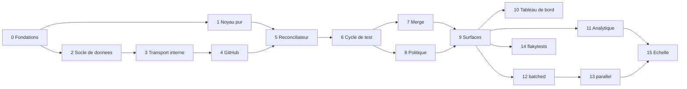

# Phases et lots

Contexte : qui commence un travail. Ce fichier découpe la feuille de route en lots d'environ une semaine pour un
développeur qui pilote des agents de code. Chaque lot a un objectif, un contenu, les interfaces qu'il **fige** (les
lots suivants s'appuient dessus sans les changer), ses dépendances et un **critère de sortie automatisé** qui est
la définition de « terminé ». Un lot ne commence que quand ses dépendances sont terminées et que les questions de
`AGENTS.md` §4.1 qu'il liste sont tranchées.

**Suivi (`AGENTS.md` D3).** Le statut d'un lot est `à faire`, `en cours`, `terminé` ou `bloqué` (avec la cause).
Dès qu'un lot commence, il reçoit un bloc « Suivi » : ce qui est fait (crates, points du contenu), ce qui reste,
et les écarts avec le plan, chacun validé selon `AGENTS.md` §4. Le statut et le bloc sont mis à jour dans le même
changement que le code.

## Phases

Quatre phases, chacune livrable seule et terminée par l'usage de CIHub sur son propre dépôt. Le réconciliateur à
base de graphe est construit dès la phase 1 sous sa forme générale, pour que les phases suivantes ajoutent des
stratégies et des modules, pas des réécritures.

| Phase                       | Lots            | Périmètre                                                                                                                                                                                                                                                                                                                                                         | Critère de sortie                                                                                                                                                             |
| --------------------------- | --------------- | ----------------------------------------------------------------------------------------------------------------------------------------------------------------------------------------------------------------------------------------------------------------------------------------------------------------------------------------------------------------- | ----------------------------------------------------------------------------------------------------------------------------------------------------------------------------- |
| 1. Merge queue installable  | 0 à 9           | Socle (tenancy, journal, jobs, adaptateur GitHub), noyau pur, réconciliateur, cycle de test complet, conditions d'entrée et de merge, fenêtre adaptative, budget d'échec, stratégies `sequential` et `pipelined`, méthodes squash / merge / rebase / fast-forward, merge direct, surfaces PR, API et CLI, `docker compose` et assistant de première configuration | Le dépôt de CIHub merge par CIHub pendant 2 semaines sans merge rouge ; une personne extérieure installe et merge une première PR en moins de 30 minutes en suivant le README |
| 2. Débit et visibilité      | 10 à 12         | Tableau de bord, analytique Postgres, vue Santé, Prometheus, webhooks sortants, stratégie `batched` (lots, bissection, profondeur d'échec, merge optimiste)                                                                                                                                                                                                       | Temps en file p50 réduit de 40 % sur une charge synthétique de 20 PR par heure ; la bissection isole un échec planté en ≤ log2(lot) exécutions                                |
| 3. Tests instables          | 14 (avancé)     | Récepteur OTLP, convertisseur JUnit et action GitHub, tables `ft_*`, détection, quarantaine, trait `FlakeOracle` consommé par la file, page dédiée                                                                                                                                                                                                                | Le module s'ajoute sans modifier la merge queue hors de l'appel au trait ; sur un dépôt avec un test instable connu, zéro PR évincée à tort                                   |
| 4. Échelle et écosystème    | 13, 15 et suite | Stratégie `parallel` avec cibles impactées, actions Bazel et Nx, ClickHouse derrière `AnalyticsStore`, chart Helm, durcissement, puis PR empilées, direct-to-queue, Slack, Terraform, GitLab derrière `Scm`                                                                                                                                                       | Un monodépôt pilote merge des PR disjointes en parallèle ; une instance tient 1 000 PR par jour avec ClickHouse activé ; première organisation extérieure en production       |

Les deux risques les plus élevés sont les invariants du réconciliateur sous des événements GitHub concurrents
(atténués par le noyau pur et ses tests de propriété, livrés en premier) et les rulesets GitHub mal configurés chez
les utilisateurs (atténués par le vérificateur de configuration et l'assistant d'installation, tous deux en
phase 1).

## Vue d'ensemble

| Lot | Titre                                                  | Phase | Dépend de | Questions | Statut                                   |
| --- | ------------------------------------------------------ | ----- | --------- | --------- | ---------------------------------------- |
| 0   | Fondations du dépôt                                    | 1     | —         | —         | terminé                                  |
| 1   | Noyau pur de la file                                   | 1     | 0         | —         | terminé                                  |
| 2   | Socle de données : serveur, tenancy, journal, outbox   | 1     | 0         | Q6, Q10   | à faire                                  |
| 3   | Transport interne : inbox, jobs, baux                  | 1     | 2         | —         | à faire                                  |
| 4   | Adaptateur GitHub, simulateur et installation de l'App | 1     | 3         | Q5        | à faire                                  |
| 5   | Réconciliateur et admission                            | 1     | 1, 4      | —         | à faire                                  |
| 6   | Cycle de test                                          | 1     | 5         | —         | à faire                                  |
| 7   | Merge et changements extérieurs                        | 1     | 6         | Q2, Q4    | à faire                                  |
| 8   | Politique de file                                      | 1     | 6         | —         | en cours (commencé avant son tour)       |
| 9   | Surfaces : PR, API, CLI                                | 1     | 7, 8      | —         | à faire                                  |
| 10  | Tableau de bord                                        | 2     | 9         | Q9        | à faire                                  |
| 11  | Analytique, métriques et webhooks sortants             | 2     | 9         | —         | à faire                                  |
| 12  | Stratégie `batched`                                    | 2     | 9         | Q3        | à faire                                  |
| 13  | Stratégie `parallel`                                   | 4     | 12        | —         | à faire                                  |
| 14  | Module `flakytests`                                    | 3     | 9         | Q1, Q7, Q12 | à faire                                |
| 15  | Échelle : ClickHouse, Helm, durcissement               | 4     | 11, 13    | Q8        | à faire                                  |

Les lots 1 et 2 peuvent avancer en parallèle après le lot 0, ainsi que les lots 7 et 8 après le lot 6, et les lots
10, 11, 12 et 14 après le lot 9.

---

## Phase 1 : merge queue installable

### Lot 0 : fondations du dépôt

- **Objectif** : un dépôt où chaque lot suivant n'ajoute que du code métier.
- **Contenu** : workspace Cargo (`Cargo.toml`, `[workspace.package]`, `[workspace.dependencies]`,
  `[workspace.lints]`) ; Rust et outils installés par `mise`, avec `mise.lock` (`AGENTS.md` D17) ; `clippy.toml` ; `deny.toml` (licences, avis de sécurité, règles
  `bans` qui gardent les crates pures et la CLI sans code serveur) ; tâches de `mise.toml` (`AGENTS.md` §5) ;
  `compose.yaml` avec Postgres (`AGENTS.md` D12) ; CI GitHub Actions avec un job par tâche `mise` et un job
  `Build Success` (`AGENTS.md` D18) ; `LICENSE` (Apache-2.0) et `.gitignore`.
- **Interfaces figées** : noms des crates (`cihub-*`, `publish = false`) ; noms des tâches `mise` ; lints du
  workspace.
- **Critère de sortie** : `mise install --locked` installe toute la suite ; `mise run check`, `mise run cover` et
  `mise run lint-workflows` passent en local et en CI ; `mise run db` démarre un Postgres sain.
- **Suivi** :
  - Fait : workspace ; Rust 1.98.1 et outils par `mise`, avec `mise.lock` ; lints de `AGENTS.md` §5.1 et
    interdiction de l'horloge et du hasard (D16) ; `deny.toml` ; tâches `fmt`, `lint`, `test`, `cover`, `check`,
    `lint-workflows` et `db` ; `compose.yaml` ; CI avec les jobs `Rust Lint`, `Rust Test`, `Rust Coverage`,
    `Workflow Lint` et `Build Success`, actions épinglées par SHA. Vérifié en local : `mise install --locked`,
    `mise run check`, `mise run cover` (91,4 % des lignes des crates pures), `mise run lint-workflows` et
    `mise run db`.
    `rust-toolchain.toml` retiré : `mise.toml` fixe Rust. release-please (`AGENTS.md` D19). Renovate
    (`AGENTS.md` D21), configuration validée par `renovate-config-validator` 44.118.1. La CI, release-please et
    Renovate passent sur GitHub.
  - Plus tard : le dépôt passera de `nlecoy/cihub` à `getcihub/cihub`. `Cargo.toml` et les documents utilisent déjà
    `getcihub` ; les workflows lisent le nom du dépôt dans `github.repository` et ne changent pas. Il faudra
    recréer les secrets et installer la GitHub App de bot sur le nouveau dépôt.
  - Écarts : le squelette de `cihub-server` passe au lot 2 (`AGENTS.md` D9).

### Lot 1 : noyau pur de la file

- **Objectif** : toute la logique de décision de la file, sans E/S, testée avant d'avoir un seul appel GitHub.
- **Contenu** : dans `cihub-domain`, les entités `Item`, `TestGroup`, `TestRun`, `Event` et tout le vocabulaire
  fermé, avec les tables des transitions permises (`AGENTS.md` D6) ; la crate `cihub-mq-core`, qui implémente
  `apply` (rejeu, `AGENTS.md` D5) ; l'ordre par `position` et l'insertion par `priority_value`, dont la préemption
  `urgent` ; le graphe de merge avec ensembles de cibles (`ALL` en mode simple, recouvrement en mode parallèle) ; la
  validité d'une exécution (prédécesseurs et `base_sha` inchangés) ; `plan` pour les groupes `single` ; les règles
  de cohérence de `docs/RELIABILITY.md` écrites dans `check`. La cible détaillée est ci-dessous.
- **Interfaces figées** : les entités et l'enveloppe `Event` (avec ses payloads) ; le vocabulaire fermé ; les
  signatures de `apply`, `plan` et `check`, et leurs types (snapshot de file, plan, violation).
- **Critère de sortie** : tests de table pour chaque ligne des tables de transitions ; un test prouve que rejouer
  avec `apply` les événements produits redonne le même état ; un test de propriété (`proptest`) qui génère des
  files aléatoires (soumissions, succès, échecs, annulations, pushes extérieurs) et vérifie `check` après chaque
  pas ; couverture des crates pures ≥ 90 % (`mise run cover`) ; aucune dépendance interdite (`cargo deny`).
- **Suivi** :
  - Fait (`cihub-domain`) : identifiants ULID typés (`AGENTS.md` D4) ; vocabulaire fermé, dont une seule
    énumération `Reason` et les tables des transitions des entrées, groupes, exécutions et de la file (D6 :
    `Lifecycle`, `check_transition`), `GroupState`, `Mergeability`, `JobError`, `RequiredStatusesSource`,
    `ActorKind` avec `bot`, `QueueControl`, `PrState`, `ReviewDecision` (déplacé depuis `cihub-conditions`) ;
    `ConflictCulprit::StackedPr` retiré (D7) ; enveloppe `Event` avec `cause_id`, faits et décisions
    (`EventKind`, `EventType`) ; les constructeurs d'identifiants sont interdits hors de leur exception (D20).
  - Fait (`cihub-mq-core`) : `Snapshot` ; `apply` (rejeu, demandes, retrait des demandes impossibles, sortie des
    entités concluses) ; ordre par `position`, insertion par priorité, préemption `urgent`, renumérotation ;
    graphe de merge par ensembles de cibles ; validité des exécutions (prédécesseurs et base) ; `plan` pour les
    groupes `single` : admission par la mergeabilité, formation dans une fenêtre fixe (`window.floor`), fin
    d'exécution (succès, échec, timeout), échec en attente à la profondeur 0 avec le budget d'échec, merge dans
    l'ordre du graphe, annulations, changements de la PR, push extérieur, merge manuel, pause, drainage,
    suspension, changement de mode ; identifiants des décisions sans hasard ; `check` (règles de
    `docs/RELIABILITY.md`). Tests : tables des transitions, scénarios rejoués, test de propriété (20 000 cas
    vérifiés en local). `mise run cover` couvre aussi `cihub-mq-core`. Exemple `simulate`, qui joue un
    scénario ligne par ligne et affiche les décisions (`crates/mq-core/examples/`).
  - Écarts validés (Nicolas Lecoy, 29 septembre 2026) : les réglages sont un paramètre de `plan` et de `check`,
    comme l'heure, car `cihub-domain` ne peut pas dépendre de `cihub-config` ; `queue.settings_changed` ne porte
    que le mode avant et après. `item.submitted` porte `author`, `additions`, `deletions` et `changed_files`
    (Q6). Dépendances `thiserror` et `proptest` (développement) ; pas d'`insta` à ce lot. Vocabulaire neutre du
    journal (`AGENTS.md` D23) : `Mergeability` (`mergeable`, `behind`, `conflict`, `blocked`, `unknown`, qui
    couvre aussi la valeur `DRAFT` de GitHub, absente avant), raisons d'échec du merge `merge_*` à la place de
    `github_api_*`, faits `access.lost` et `access.restored` à la place de `installation.*`, `CheckKind`
    `check` à la place de `check_run`.
  - Écarts de lecture des tables, à confirmer : un groupe `dissolved` accepte les raisons de retour en `pending`
    sans `merge_item_now_ready`, les raisons `cancelled` sans `not_ready_timeout_expired`, et les raisons
    d'échec du merge sans `direct_merge_rejected`. Un échec de merge direct donne toujours
    `direct_merge_rejected`, seule raison permise depuis `pending`. Une décision causée par l'horloge
    (timeout) ou par un changement de mode n'a pas de `cause_id`. Une PR vue mergée alors que la file demande son
    merge attend le résultat du job de merge.
  - Reste pour les lots suivants : conditions d'entrée et exception du statut de la file (lot 5), fenêtre
    adaptative (lot 8), profondeur d'échec en attente au-delà de 0 et merge optimiste (lot 12), lots et bissection
    (lot 12), merge direct (lot 7), `not_ready_timeout_hours` (lot 5), sérialisation du `Snapshot` pour
    l'instantané (lot 5). Les décisions de ce lot (crate, dépendances, réglages en paramètre, Q6) sont à écrire
    dans `AGENTS.md` §4 après validation du texte.

#### Cible du lot 1 : journal, faits et décisions

Le journal d'une file contient deux sortes d'événements (`AGENTS.md` D5 ; définitions dans `docs/DOMAIN.md`). Un
fait change seulement l'état observé ; une décision change seulement l'état de la file (états, positions, groupes,
exécutions, fenêtre). `plan` lit l'état et ne produit que des décisions. Le rejeu applique les événements dans
l'ordre avec `apply` et n'appelle jamais `plan` : une correction de `plan` ne change pas les décisions passées. Une
règle qui peut changer avec le code (l'exception du statut de la file, la traduction d'une erreur en raison)
produit donc une décision enregistrée, jamais un calcul dans `apply`. Un fait qui ne change pas l'état observé
n'est pas écrit.

Chaque décision porte l'identifiant du fait qui l'a causée (`cause_id`). Une demande (soumission, annulation,
relance, résultat de job, demande sur la file, suspension de l'installation) attend une décision. `apply` n'écrit
pas une demande qui ne peut pas recevoir de décision (annulation d'une entrée terminée, résultat d'une exécution
remplacée, soumission quand la file n'est pas `running`) ou qui répète une demande en attente ; la décision qui
cite une demande comme cause la retire, et une demande qu'une autre décision rend impossible est retirée aussi. La
création d'une entrée lit sa soumission dans la demande qu'elle cite. L'horloge n'est pas un événement : c'est un
paramètre de `plan`, et un délai dépassé devient une décision avec sa raison. Le webhook brut reste dans l'inbox ;
l'état voulu (statuts, commentaires, refs) devient des jobs.

Faits :

| Type                                                 | Source                                                       | Payload                                                                                                                                              |
| ---------------------------------------------------- | ------------------------------------------------------------ | ---------------------------------------------------------------------------------------------------------------------------------------------------- |
| `item.submitted`                                     | commande, label, API, tableau de bord, CLI                   | numéro de PR, SHA de tête, priorité, `no_batch`, `direct`, `submitted_via`, attributs de Q6                                                          |
| `item.cancel_requested`                              | `/cihub cancel`, API, CLI                                    | `by_admin` ; donne `admin_requested` ou `user_requested`                                                                                             |
| `item.restart_requested`                             | `/cihub restart`, API, CLI                                   | `by_api` ; donne `tests_restarted_by_user` ou `tests_restarted_by_api_request`                                                                       |
| `pr.observed`                                        | webhook `pull_request` ou `pull_request_review`, tic, resync | état complet lu : ouverte, fermée ou mergée, SHA de tête, branche de base, brouillon, labels, mergeabilité, décision de revue, checks de la PR        |
| `target.pushed`                                      | webhook `push` sur la branche cible, tic                     | SHA `before` (vide pour une lecture du tic), SHA `after`, `sender`                                                                                   |
| `check.observed`                                     | check ou statut de commit, tic                               | SHA de test, nom, nature, état, conclusion, URL ; seulement pour un SHA qu'une exécution vivante attend                                              |
| `targets.received`                                   | `POST …/impacted-targets`                                    | SHA de tête, cibles ou `ALL`                                                                                                                         |
| `test_branch.assembled`                              | job d'assemblage                                             | `run_id`, SHA de test, numéro de PR brouillon, statuts requis et leur source                                                                         |
| `test_branch.assembly_failed`                        | job d'assemblage                                             | `run_id`, erreur de job, `conflict_culprit`                                                                                                          |
| `merge.succeeded`                                    | job de merge                                                 | `item_id`, `merged_sha`                                                                                                                              |
| `merge.failed`                                       | job de merge                                                 | `item_id`, merge direct ou non, erreur de job                                                                                                        |
| `queue.control_requested`                            | API, CLI                                                     | `pause`, `resume` ou `drain`                                                                                                                         |
| `queue.settings_changed`                             | API, tableau de bord                                         | réglages avant et après                                                                                                                              |
| `access.lost`, `access.restored`                     | webhook `installation` (GitHub)                              | —                                                                                                                                                    |

Un seul fait `pr.observed` porte l'état complet de la PR, quelle que soit l'action GitHub : le webhook, le tic et
la resync produisent le même événement, un doublon ne change rien, et c'est `plan` qui trouve la différence (push
sur la tête, fermeture, merge hors de la file, changement de base, passage en brouillon, retrait du label).

Décisions :

| Type                     | Effet                                                                                                            | Payload                                                           |
| ------------------------ | ---------------------------------------------------------------------------------------------------------------- | ----------------------------------------------------------------- |
| `item.transitioned`      | l'entrée passe d'un état à un autre, avec une raison ; la création est une transition sans état de départ        | position à l'admission, `verified_by_run_id`, `merged_sha`        |
| `item.readiness_changed` | nouvelle mergeabilité et nouvelles raisons de blocage                                                            | la liste complète                                                 |
| `queue.renumbered`       | nouvelles positions (intervalle épuisé, préemption `urgent`)                                                     | `item_id` → position                                              |
| `group.formed`           | nouveau groupe, en `testing`                                                                                     | nature, `item_ids`, prédécesseurs, `base_sha`, parent             |
| `group.transitioned`     | le groupe passe d'un état à un autre, avec une raison                                                            | états avant et après                                              |
| `run.transitioned`       | l'exécution passe d'un statut à un autre, avec une raison ; la création est une transition sans statut de départ | tentative, branche de test ; à la fin, `failure_causing_statuses` |
| `queue.transitioned`     | la file passe d'un état à un autre, avec une raison                                                              | états avant et après                                              |
| `queue.window_changed`   | nouvelle fenêtre de spéculation                                                                                  | valeurs avant et après                                            |

Acteur d'un événement : `user` (avec son login), `bot` (le compte de l'App), `system` (CIHub : décisions, tic,
resync). Demande d'un opérateur sur la file : `pause`, `resume`, `drain`.

Choix du noyau :

- Le snapshot garde, avec chaque observation, l'identifiant du fait qui l'a produite, et les demandes qui
  attendent une décision ; les entités concluses sortent du snapshot dès qu'aucun groupe vivant ne les cite.
- Les identifiants des décisions sont des ULID calculés sans source aléatoire : les 48 bits d'heure viennent du
  paramètre `now` de `plan`, les 80 autres bits d'un hachage de la file, du nombre d'événements appliqués et d'un
  indice. Le même snapshot donne toujours les mêmes identifiants.
- `plan` retourne une erreur quand une de ses décisions est refusée par les tables : c'est un bogue du noyau.
- Un push sur la cible arrivé en retard (son `after` ou son `before` est un SHA plus ancien que la tête connue) ne
  change rien : le tic relit la vraie tête.
- Une entrée `urgent` passe devant tous les groupes, y compris `pending_failure` et `tests_passed`, qui retournent
  en `pending` avec `skip_the_line_interrupted`.

#### Cible du lot 1 : transitions et raisons

Une seule énumération `Reason` (`AGENTS.md` D6). Les valeurs des raisons `failed` portent le préfixe de leur
famille : la valeur enregistrée est `start_test_run_merge_conflict`, pas `merge_conflict`.

- Admission et test : `submitted`, `merge_item_now_ready`, `test_run_started`, `failure_budget_retry`.
- Retour en `pending` : `merge_item_now_ready`, `manual_push_to_target_branch`, `prerequisite_merge_item_failed`,
  `prerequisite_merge_item_cancelled`, `prerequisite_merge_item_manually_merged`, `tests_restarted_by_user`,
  `tests_restarted_by_api_request`, `skip_the_line_interrupted`, `bisection_required`, `bisection_test_run_passed`.
- `tests_passed` : `test_run_passed`, `successor_test_run_passed`, `passed_by_optimization`.
- `merged` : `merge_graph_merge`, `merge_graph_direct_merge`, `manual_merge`.
- `cancelled` : `user_requested`, `admin_requested`, `pr_closed`, `pr_pushed_to`, `pr_base_branch_changed`,
  `pr_converted_to_draft`, `label_removed`, `not_ready_timeout_expired`.
- `start_test_run_*` : `start_test_run_invalid_event`, `start_test_run_merge_conflict`,
  `start_test_run_config_not_found`, `start_test_run_config_parsing_failure`, `start_test_run_config_bad_version`,
  `start_test_run_config_missing_required_statuses`, `start_test_run_config_bad_required_statuses`,
  `start_test_run_no_required_statuses`, `start_test_run_retry_exhausted`, `start_test_run_draft_prs_not_allowed`,
  `start_test_run_permissions_block_test_branch`.
- `test_run_*` : `test_run_required_status_failed`, `test_run_timeout`, `test_run_failed_by_optimization`.
- Échec du merge : `merge_rejected`, `direct_merge_rejected`, `merge_rate_limit_exceeded`,
  `merge_branch_protection_unmet`, `merge_already_in_progress`, `merge_repeated_server_errors`,
  `pr_updated_at_merge_time`.
- Exécution : `test_branch_assembled`.
- File : `access_lost`, `access_restored`, `mode_changed`, `mode_switch_completed` (et
  `admin_requested`).

Transitions d'une entrée :

| De                     | Vers              | Raisons permises                                                                                                                                                                                                                                                                              |
| ---------------------- | ----------------- | --------------------------------------------------------------------------------------------------------------------------------------------------------------------------------------------------------------------------------------------------------------------------------------------- |
| —                      | `not_ready`       | `submitted`                                                                                                                                                                                                                                                                                   |
| `not_ready`            | `pending`         | `merge_item_now_ready`                                                                                                                                                                                                                                                                        |
| `pending`              | `testing`         | `test_run_started`                                                                                                                                                                                                                                                                            |
| `pending`              | `merged`          | `merge_graph_direct_merge`                                                                                                                                                                                                                                                                    |
| `pending`              | `failed`          | `direct_merge_rejected`                                                                                                                                                                                                                                                           |
| `testing`              | `tests_passed`    | `test_run_passed`, `passed_by_optimization`                                                                                                                                                                                                                                                   |
| `testing`              | `pending_failure` | `test_run_required_status_failed`, `test_run_timeout`                                                                                                                                                                                                                                         |
| `testing`              | `failed`          | toutes les raisons `start_test_run_*`, `test_run_failed_by_optimization`                                                                                                                                                                                                                      |
| `testing`              | `pending`         | `manual_push_to_target_branch`, `prerequisite_merge_item_failed`, `prerequisite_merge_item_cancelled`, `prerequisite_merge_item_manually_merged`, `tests_restarted_by_user`, `tests_restarted_by_api_request`, `skip_the_line_interrupted`                                                    |
| `pending_failure`      | `pending`         | `skip_the_line_interrupted`, `manual_push_to_target_branch`, `prerequisite_merge_item_failed`, `prerequisite_merge_item_cancelled`, `prerequisite_merge_item_manually_merged`, `tests_restarted_by_user`, `tests_restarted_by_api_request`, `bisection_required`, `bisection_test_run_passed` |
| `pending_failure`      | `testing`         | `failure_budget_retry`                                                                                                                                                                                                                                                                        |
| `pending_failure`      | `tests_passed`    | `successor_test_run_passed`                                                                                                                                                                                                                                                                   |
| `pending_failure`      | `failed`          | `test_run_required_status_failed`, `test_run_timeout`, `test_run_failed_by_optimization`                                                                                                                                                                                                      |
| `tests_passed`         | `merged`          | `merge_graph_merge`                                                                                                                                                                                                                                                                           |
| `tests_passed`         | `pending`         | `skip_the_line_interrupted`, `manual_push_to_target_branch`, `prerequisite_merge_item_failed`, `prerequisite_merge_item_cancelled`, `prerequisite_merge_item_manually_merged`                                                                                                                 |
| `tests_passed`         | `failed`          | `merge_rejected`, `merge_rate_limit_exceeded`, `merge_branch_protection_unmet`, `merge_already_in_progress`, `merge_repeated_server_errors`, `pr_updated_at_merge_time`                                                                                 |
| `not_ready`            | `cancelled`       | `not_ready_timeout_expired`, et les raisons de la ligne suivante                                                                                                                                                                                                                              |
| tout état non terminal | `cancelled`       | `user_requested`, `admin_requested`, `pr_closed`, `pr_pushed_to`, `pr_base_branch_changed`, `pr_converted_to_draft`, `label_removed`                                                                                                                                                          |
| tout état non terminal | `merged`          | `manual_merge`                                                                                                                                                                                                                                                                                |

États d'un groupe (`GroupState`) : `testing`, `pending_failure`, `tests_passed`, `merged`, `failed`, `bisected`,
`dissolved` ; les quatre derniers sont terminaux. Un lot n'atteint jamais `failed` : il devient `bisected`. Un
conflit à l'assemblage d'un lot abandonne le groupe (`dissolved`) ; la PR coupable passe en `failed` et les autres
membres retournent en `pending`. Une transition de groupe porte la raison que ses entrées reçoivent.

| De                     | Vers              | Raisons permises                                                                                                                                                                                                                               |
| ---------------------- | ----------------- | ---------------------------------------------------------------------------------------------------------------------------------------------------------------------------------------------------------------------------------------------- |
| —                      | `testing`         | `test_run_started`                                                                                                                                                                                                                             |
| `testing`              | `tests_passed`    | `test_run_passed`, `passed_by_optimization`                                                                                                                                                                                                    |
| `testing`              | `pending_failure` | `test_run_required_status_failed`, `test_run_timeout`                                                                                                                                                                                          |
| `testing`              | `failed`          | toutes les raisons `start_test_run_*`, `test_run_failed_by_optimization`                                                                                                                                                                       |
| `pending_failure`      | `testing`         | `failure_budget_retry`                                                                                                                                                                                                                         |
| `pending_failure`      | `tests_passed`    | `successor_test_run_passed`                                                                                                                                                                                                                    |
| `pending_failure`      | `failed`          | `test_run_required_status_failed`, `test_run_timeout`, `test_run_failed_by_optimization`                                                                                                                                                       |
| `pending_failure`      | `bisected`        | `bisection_required`                                                                                                                                                                                                                           |
| `tests_passed`         | `merged`          | `merge_graph_merge`                                                                                                                                                                                                                            |
| `tests_passed`         | `failed`          | les raisons de `tests_passed` → `failed` d'une entrée                                                                                                                                                                                          |
| tout état non terminal | `dissolved`       | la raison donnée à l'entrée qui cause l'abandon : raisons de retour en `pending`, raisons `cancelled`, `manual_merge`, `start_test_run_merge_conflict` pour un lot, raisons d'échec du merge pour un membre de lot                                  |

Transitions d'une exécution :

| De                          | Vers          | Raisons permises                                                                                 |
| --------------------------- | ------------- | ------------------------------------------------------------------------------------------------ |
| —                           | `assembling`  | `test_run_started`, `failure_budget_retry`                                                       |
| `assembling`                | `in_progress` | `test_branch_assembled`                                                                          |
| `assembling`                | `failed`      | toutes les raisons `start_test_run_*`                                                            |
| `in_progress`               | `succeeded`   | `test_run_passed`                                                                                |
| `in_progress`               | `failed`      | `test_run_required_status_failed`                                                                |
| `in_progress`               | `timed_out`   | `test_run_timeout`                                                                               |
| `assembling`, `in_progress` | `interrupted` | `passed_by_optimization`, et les raisons de `dissolved` d'un groupe sauf les raisons `cancelled` |
| `assembling`, `in_progress` | `cancelled`   | les raisons `cancelled`                                                                          |

Transitions de la file :

| De                                       | Vers              | Raisons permises                              |
| ---------------------------------------- | ----------------- | --------------------------------------------- |
| `running`, `draining`, `switching_modes` | `paused`          | `admin_requested`, `access_lost`   |
| `paused`                                 | `running`         | `admin_requested`, `access_restored` |
| `running`                                | `draining`        | `admin_requested`                             |
| `draining`                               | `running`         | `admin_requested`                             |
| `running`                                | `switching_modes` | `mode_changed`                                |
| `switching_modes`                        | `running`         | `mode_switch_completed`                       |

Autres valeurs fermées :

- Mergeabilité d'une entrée (`Mergeability`), traduite par l'adaptateur du SCM (`AGENTS.md` D23) : `mergeable`,
  `behind`, `conflict`, `blocked`, `unknown`.
- Source des statuts requis (`RequiredStatusesSource`), par ordre de précédence : `ui_override`, `repo_config`,
  `branch_protection`.
- Erreurs de job (`JobError`) : un job rapporte une erreur, jamais une raison ; c'est `plan` qui choisit la raison.
  Erreurs d'assemblage : `invalid_event`, `merge_conflict`, `config_not_found`, `config_parsing_failure`,
  `config_bad_version`, `config_missing_required_statuses`, `config_bad_required_statuses`,
  `no_required_statuses`, `retry_exhausted`, `draft_prs_not_allowed`, `permissions_block_test_branch` ; chacune
  donne `start_test_run_<erreur>`. Erreurs de merge : `merge_rejected`, `rate_limit_exceeded`,
  `branch_protection_unmet`, `merge_already_in_progress`, `repeated_server_errors`, `head_changed` ;
  `head_changed` (409 sur le garde-fou `sha`) donne `pr_updated_at_merge_time`, un merge direct donne toujours
  `direct_merge_rejected`, et les autres donnent `merge_rejected` ou `merge_<erreur>`.

### Lot 2 : socle de données : serveur, tenancy, journal, outbox

- **Objectif** : les tables partagées par tous les modules, avec l'isolation par organisation dès le départ, et
  le binaire qui les sert.
- **Contenu** :
  - `cihub-server` (`crates/server/`, `AGENTS.md` D8) : configuration `CIHUB_*`, dont `CIHUB_ROLES` et la
    chaîne de connexion ; logs (`AGENTS.md` D13) ; une boucle par rôle sous un `CancellationToken`, qui attend
    l'annulation tant que son lot n'est pas fait ; arrêt propre sur `SIGTERM` ; `/healthz` et `/readyz` sur une
    adresse interne séparée ; sous-commande `migrate` et contrôle du schéma au démarrage (`AGENTS.md` D14).
  - `cihub-store` : pool `sqlx`, transactions, positionnement de `cihub.org_id` pour la RLS, migrations embarquées
    (`migrations/`), requêtes vérifiées à la compilation (`.sqlx/`, `cargo sqlx prepare --check`), test qui compare
    les enums Postgres aux énumérations de `cihub-domain`.
  - Tables `orgs`, `installations`, `repos`, `users`, `memberships`, `api_tokens`, `audit_log` ; RLS avec
    `cihub.org_id` ; table `events` partitionnée par mois et sérialisation de `Event` (lot 1) ; `outbox`,
    abonnements ; contrat `Module` et activation par organisation ; jetons hachés en SHA-256 et scopes. Le schéma
    d'événement garde les attributs de Q6.
  - Tâches `migrate`, `test-integration` et `dev` ; service Postgres dans la CI.
- **Interfaces figées** : schéma de la table `events` ; contrat `Module` ; politique RLS ; format des jetons ;
  variables `CIHUB_*` du serveur.
- **Critère de sortie** : un test d'intégration contre un vrai Postgres prouve qu'une connexion positionnée sur
  l'organisation A ne lit ni n'écrit aucune ligne de B, pour chaque table ; un événement et son entrée d'outbox
  sont écrits dans la même transaction ; les partitions du mois suivant sont créées par un job ;
  `cihub-server migrate` lancé deux fois ne change rien la seconde fois ; `cihub-server` refuse de démarrer quand
  une migration manque ; `cihub-server` répond `200` sur `/healthz` et `/readyz`, en tout-en-un et avec un rôle
  par processus.

### Lot 3 : transport interne : inbox, jobs, baux

- **Objectif** : l'« API interne » entre les rôles, résistante aux crashes et aux doublons.
- **Contenu** : dans `cihub-platform`, `webhook_inbox` avec dédoublonnage par `delivery_id` ; jobs (enveloppe
  avec `idempotency_key`, exécuteurs par type, backoff, file de rebut, `locked_until`, quotas par installation,
  classe de priorité) ; `queue_leases` ou verrou consultatif par file ; `queues.dirty` et
  `NOTIFY cihub_queue`, `cihub_jobs`, `cihub_outbox` ; tic de 30 s ; traits `Inbox`, `JobQueue`, `Outbox`. La
  façon dont plusieurs répliques se partagent les jobs est une décision de ce lot.
- **Interfaces figées** : `Inbox`, `JobQueue`, `Outbox` ; format de `idempotency_key` ; classes de priorité.
- **Critère de sortie** : tests d'intégration : un worker tué pendant un job voit le job repris et exécuté une seule
  fois ; une livraison en double n'a aucun effet ; deux schedulers sur la même file n'ont jamais la même file en
  même temps ; un `NOTIFY` réveille un scheduler en moins de 1 s, et le tic le réveille quand `NOTIFY` est perdu.

### Lot 4 : adaptateur GitHub, simulateur et installation de l'App

- **Objectif** : parler à GitHub à travers une seule interface, et pouvoir tester toute la file sans GitHub.
- **Contenu** : trait `Scm` (`cihub-scm`) ; `cihub-github` (authentification App, jetons d'installation en cache,
  client REST et GraphQL groupé pour la mergeabilité jusqu'à 50 PR, lecture des protections et rulesets, suivi du
  budget par les en-têtes, modes dégradés `normal`, `throttled`, `github_unavailable`) ; ingestion dans le rôle
  `api` (`cihub-http` : HMAC, stockage, acquittement en moins de 2 s) ; traduction des webhooks en faits du
  domaine ; `cihub-github-sim`, un simulateur GitHub (refs, merges, PR, checks, protections) qui sait injecter
  5xx, 429, webhooks perdus, dupliqués et désordonnés ; flux de manifeste pour créer l'App ; vérificateur de
  configuration en endpoint d'API (l'interface arrive au lot 10) ; balayage de `GET /app/hook/deliveries`.
- **Interfaces figées** : trait `Scm` ; faits du domaine issus de GitHub ; permissions de l'App (`docs/GITHUB.md`).
- **Critère de sortie** : une suite de contrat unique passe contre `cihub-github-sim` et contre des réponses
  GitHub enregistrées ; un 429 met en pause les jobs de l'installation jusqu'au reset ; l'assistant crée une App
  sur une organisation de test et enregistre ses secrets (test manuel documenté, seul test non automatisé du lot).

### Lot 5 : réconciliateur et admission

- **Objectif** : relier le noyau pur au journal et à GitHub : une PR soumise devient `pending` ou reste
  `not_ready` avec une raison.
- **Contenu** : dans `cihub-mergequeue`, projection `queue_items`, `test_groups`, `test_runs` depuis le journal,
  instantané tous les 500 événements, rejeu ; boucle du scheduler (files `dirty`, verrou, réconciliation en
  transaction) ; convergence plan contre état observé et émission des jobs ; soumission par commande et par label ;
  mergeabilité, `block_reasons[]`, exception du statut de la file elle-même ; revérifications pilotées par les
  événements et sondage progressif de 1 à 15 minutes ; `not_ready_timeout_hours`.
- **Interfaces figées** : tables `queue_items`, `test_groups`, `test_runs` (`docs/DATA_MODEL.md`, noms selon Q10) ;
  types de jobs de la file.
- **Critère de sortie** : sur `cihub-github-sim`, 20 PR soumises dans des états variés atteignent `pending` ou
  `not_ready` avec la bonne raison ; rejouer le journal reconstruit exactement les mêmes projections ; un scheduler
  tué au milieu d'une réconciliation ne laisse aucune écriture partielle.

### Lot 6 : cycle de test

- **Objectif** : tester une PR au-dessus de ses prédécesseurs et conclure l'exécution.
- **Contenu** : job `assemble_test_branch` (ref `cihub-temp`, API merges, ref `cihub-merge`, suppression de la ref
  temporaire, `conflict_culprit`) ; modes `draft_pr`, `push` et `inplace` ; résolution des statuts requis (UI,
  fichier du dépôt, protection) et leur source ; `check_observations` ; succès, échec, timeout ; rapports tardifs
  ignorés ; échec en attente à la profondeur 0 ; redémarrage de l'aval ; suppression des branches de test après
  `keep_test_branches_minutes`.
- **Interfaces figées** : format des noms de branches ; corps de la PR brouillon ; `GET /v1/test-runs/{run_id}`.
- **Critère de sortie** : sur `cihub-github-sim`, une file de 10 PR dont 2 échouent teste chaque PR au-dessus de
  ses prédécesseurs, conclut chaque exécution avec la bonne raison et redémarre l'aval ; un conflit identifie la
  bonne PR coupable ; un check qui ne rapporte jamais donne `test_run_timeout`.

### Lot 7 : merge et changements extérieurs

- **Objectif** : merger dans l'ordre et rester correct quand le monde change autour de la file.
- **Contenu** : étape de merge (`squash`, `merge_commit`, `rebase`, `fast_forward`, garde-fou `sha`,
  `merge-commit-title`, reprises 5xx, 405, 409) ; `merged_sha` ; merge direct sur main ; push extérieur sur la
  cible ; merge manuel ; push, changement de base, brouillon, fermeture, retrait du label ; boucle de réparation
  (PR vivantes, checks silencieux, tête de la cible, existence des refs) ; `POST /queues/{id}:resync` ; tâche
  `sim`.
- **Interfaces figées** : raisons `merged`, `cancelled` et d'échec du merge (`merge_rejected`…).
- **Critère de sortie** : le test d'injection de pannes de `docs/RELIABILITY.md` (5xx, 429, webhooks perdus,
  dupliqués, désordonnés, processus tués à des instants aléatoires) passe sur 1 000 graines : chaque PR verte est
  mergée exactement une fois, dans l'ordre du graphe, et chaque PR rouge porte une raison.

### Lot 8 : politique de file

- **Objectif** : rendre la file configurable sans toucher au noyau.
- **Contenu** : fichier `.cihub.yaml` ou `.cihub.yml` lu sur la cible au `base_sha`, fusion avec les réglages de
  l'interface et source effective de chaque réglage ; langage de conditions (`queue_conditions`,
  `merge_conditions`, injection des protections, routage entre files d'une même branche, `priority_rules`) ;
  stratégies comme tables de valeurs par défaut ; fenêtre de spéculation adaptative ; budget d'échec ; priorités ;
  `queues.settings` versionné ; états `paused`, `draining`, `switching_modes`.
- **Interfaces figées** : schéma du fichier de configuration (version 1) ; grammaire des conditions ; noms des
  réglages (`docs/CONFIGURATION.md`).
- **Critère de sortie** : tests de table de la grammaire des conditions (analyse et évaluation) ; sur
  `cihub-github-sim`, une file `pipelined` sous 20 % d'échecs aléatoires contracte sa fenêtre au plancher puis la
  rouvre ; une PR ne peut pas modifier ses propres conditions (test dédié) ; chaque stratégie est une table sans
  code dans `cihub-mq-core`.
- **Suivi** :
  - Fait : `cihub-conditions` (grammaire `[-] attribut [op valeur]` avec blocs `and`, `or`, `not`, attributs aux
    noms de Mergify quand le sens est le même, évaluation sur un contexte de PR, erreurs avec position) ;
    `cihub-config` (modèle du fichier version 1, choix entre `.cihub.yaml` et `.cihub.yml`, table des stratégies,
    fusion des sources avec la source de chaque réglage, plages, erreurs avec ligne et colonne, raison d'échec de
    chaque erreur).
  - Reste : routage entre files d'une même branche ; injection des protections ; fenêtre adaptative et budget
    d'échec dans `plan` ; `queues.settings` versionné en base ; états de la file ; attribut `schedule` (reporté :
    les fuseaux horaires demandent une base embarquée dans le noyau pur).
  - Écarts : commencé avant les lots 2 à 6, car les deux crates sont pures et ne dépendent que de `cihub-domain`.

### Lot 9 : surfaces : PR, API, CLI

- **Objectif** : que les humains et la CI puissent utiliser la file ; fin de la phase 1.
- **Contenu** : statut `CIHub Merge Queue (<branche>)`, commentaire du bot modifié sur place, labels d'état ;
  commandes `/cihub merge|cancel|restart` et les alias `/trunk`, avec vérification des permissions ; API REST v1
  de `docs/API.md` (hors métriques et webhooks sortants), erreurs `problem+json`, limite de débit, OpenAPI 3.1
  généré depuis le code (`cihub-http`, `cihub-api-types`) ; client Rust `cihub-client` ; CLI `cihub` ;
  `Dockerfile` de l'image `cihub-server` et workflow de publication de l'image sur GHCR à chaque version
  (`AGENTS.md` D19) ; `docker compose` d'installation avec le service `cihub-migrate` (`AGENTS.md` D14) et README
  d'installation.
- **Interfaces figées** : API v1 publiée dans `/v1/openapi.json` ; commandes de PR ; commandes de la CLI.
- **Critère de sortie** : un test de bout en bout sur l'instance de staging soumet des PR sur un vrai dépôt et les
  merge ; le dépôt de CIHub passe sur sa propre file ; une personne extérieure suit le README et merge une première
  PR en moins de 30 minutes (critère de la phase 1, mesuré à la main).

---

## Phase 2 : débit et visibilité

### Lot 10 : tableau de bord

- **Contenu** : `web/` (Q9), servi et embarqué par le rôle `api` ; connexion OAuth GitHub, sessions, CSRF ; pages
  file, PR et chronologie, exécution (statuts requis contre statuts observés), graphe en direct ; vérificateur de
  configuration et assistant ; réglages avec journal d'audit.
- **Critère de sortie** : tests de composants et un test de navigateur de bout en bout sur `docker compose` :
  connexion, création d'une file, soumission, suivi jusqu'au merge ; l'assistant signale chaque point de
  configuration de `docs/GITHUB.md` sur un dépôt mal configuré.

### Lot 11 : analytique, métriques et webhooks sortants

- **Contenu** : trait `AnalyticsStore` et son implémentation Postgres (`cihub-analytics`, tables `an_*`) ; le rôle
  `notifier` ; `/metrics` sur l'adresse interne ; vue Santé ; `GET /v1/metrics` ; webhooks sortants Standard
  Webhooks avec les noms de Trunk ; endpoints `/orgs/{org}/webhooks`.
- **Critère de sortie** : les tables de faits reconstruites depuis `events` égalent celles écrites en continu ;
  chaque type de webhook est émis une seule fois par transition, signé, et retenté après un échec ; `rate()`
  fonctionne sur les compteurs exposés.

### Lot 12 : stratégie `batched`

- **Contenu** : formation des lots, `no_batch`, attente maximale ; bissection avec cache des résultats et pool
  `bisection_concurrency` ; `pending_failure_depth > 0` ; merge optimiste (Q3) ; stratégie `batched`.
- **Critère de sortie** : critère de la phase 2 sur une charge synthétique de `cihub-github-sim` : p50 réduit de
  40 % à 20 PR par heure contre `pipelined`, et un échec planté isolé en ≤ log2(taille du lot) exécutions.

---

## Phase 3 : tests instables

### Lot 14 : module `flakytests`

- **Contenu** : récepteur OTLP/HTTP dans le rôle `api` ; `cihub test-results push --junit` et l'action GitHub ;
  tables `ft_results` et `ft_cases` ; les trois signaux de détection, dont la bissection ; quarantaine ;
  `cihub-flaky-core` et `cihub-flakytests`, implémentation du trait `FlakeOracle` (`cihub-contracts`) et raison de
  relance (Q1) ; page « Tests instables », API `/v1/flaky/*`, webhooks `flaky.*`. Ce lot peut être scindé en deux
  (réception et stockage, puis détection et oracle) s'il dépasse une semaine.
- **Critère de sortie** : critère de la phase 3 ; le module désactivé, la suite de la file passe sans aucun
  changement ; l'oracle répond en moins de 50 ms au p99 sur 1 M de résultats.

---

## Phase 4 : échelle et écosystème

### Lot 13 : stratégie `parallel`

- **Contenu** : `POST /repos/{owner}/{name}/prs/{pr}/impacted-targets` (jeton `targets:write` ou exécution
  GitHub Actions pour les forks, limite de 20 Mo) ; voies par recouvrement ; lots par voie ; stratégie `parallel` ;
  actions d'exemple pour Bazel et Nx.
- **Critère de sortie** : sur `cihub-github-sim`, des PR aux cibles disjointes sont testées et mergées en
  parallèle, et une PR `ALL` sérialise tout ce qui la suit ; critère de la phase 4 sur un monodépôt pilote.

### Lot 15 : échelle : ClickHouse, Helm, durcissement

- **Contenu** : implémentation ClickHouse de `AnalyticsStore` (Q8) ; chart Helm, avec le `Job` de migration en
  hook `pre-install` et `pre-upgrade` (`AGENTS.md` D14) ; test de charge à l'ordre de grandeur de l'instance
  standard ; exercice de chaos sur staging ; politique de compatibilité de l'API et première version publiée.
- **Critère de sortie** : une instance tient 1 000 PR par jour avec ClickHouse activé ; la migration Postgres vers
  ClickHouse est une copie sans changement de code applicatif.

### Suite

PR empilées, direct-to-queue avec l'App `cihub-sudo`, Slack, Terraform, GitLab derrière `Scm`. Ces lots sont
découpés quand la phase 4 commence.
