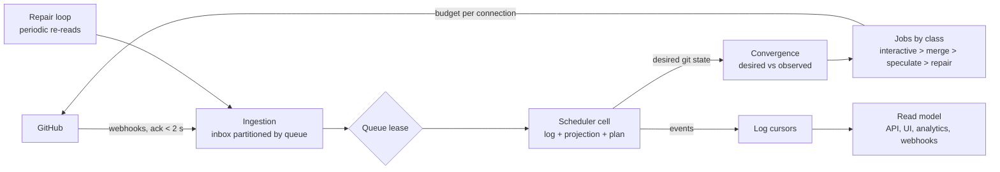

# System architecture

CIHub is a modular monolith deployed as stateless processes on top of Postgres. What makes it resilient comes down to three decisions: the state of a queue is an append-only **event log** from which everything else is derived; the reconciler does not drive GitHub step by step but computes a **desired git state** and converges the observed state toward it, idempotently, as many times as needed; and every outgoing call is a **budgeted, prioritized and replayable job**. What makes it scalable comes down to one: the unit of work is the queue, and a queue is leased to one instance at a time, which lets thousands of queues be spread over interchangeable instances with no coordination other than the database.



The path of an event: GitHub delivers a webhook, the ingestion verifies the signature, writes it as is into the inbox of the queue concerned and acknowledges, without deciding anything. The instance that holds the lease of that queue reads its inbox in order, appends to the log the facts that the event establishes (PR observed, check completed, push received), replays the projection, then runs the reconciler: a pure function which, from the projected state and the time, produces the decisions of the queue, appended to the log, and a **plan**: the set of git refs that should exist with their composition, the PRs that should be merged, the statuses and comments that should be displayed. The convergence compares this plan to the observed state (the last known from GitHub, recorded in the log) and emits only the jobs that close the gap. The jobs run against GitHub and deposit their result as facts in `queue_inbox`, which the queue applies under its lock: the scheduler is the only writer of the log. A reconciliation is therefore replayable identically, a lost job is simply re-emitted on the next turn, and a drifted GitHub state (branch deleted by hand, PR merged outside the queue) is corrected without specific code.

Design rules on which the rest of the specification rests:

- **Event log per queue, source of truth.** The log contains facts (what was observed) and decisions (what the queue chose); the state tables (`queue_items`, `test_groups`, `test_runs`) are projections, rebuildable by replay with the pure function `apply`, which never calls `plan`; a snapshot is taken every 500 events to bound the loading time. A queue can be replayed up to a given instant to understand a decision, or replayed entirely after a projection bug.
- **Deterministic reconciler.** `plan(state, now) → plan` has no I/O, knows neither Postgres nor GitHub, and is tested by tables and by properties. The same input always gives the same plan.
- **Convergence, not driving.** The plan describes a desired state ("the ref `cihub-merge/pr-12/…` must exist at the commit composed of A, B, C"), never a sequence of calls. Each job checks the real state before acting and has no effect if the state is already reached.
- **Lease per queue.** The columns `lease_owner` and `lease_expires_at` of `queues` (expiry at 15 s) designate the instance that processes a queue; any instance can take over an expired lease. The queues of one organization are preferably grouped on one instance to share the GitHub cache, without this being a constraint.
- **Partitioned inbox, unconditional acknowledgment.** The ingestion never fails for lack of processing: it stores and acknowledges in under 2 s, even if Postgres is slow (bounded local in-memory queue with replay). Order is guaranteed per queue, not globally.
- **Scheduled SCM budget.** Each connection has a token bucket fed by the rate limit headers, and each job a class: `interactive` (commands, statuses, comments), `merge`, `speculate` (test branches), `repair` (re-reads). When the budget drops, speculation is reduced first, merge last; nothing is lost, everything is deferred.
- **Repair loop.** Independently of webhooks, each queue periodically re-reads what matters (live PRs, checks of the runs in progress, head of the target branch, existence of the test refs) at an adaptive interval of 30 s to 10 min depending on activity, and injects what it observes into the inbox. A lost webhook costs at most one interval.
- **Explicit degraded modes.** Per connection: `normal`, `throttled` (low budget: no new speculation), `scm_unavailable` (nothing goes out, everything accumulates, the repair loop tests the recovery), `paused` (human decision). The mode is visible in the interface and the API, with its cause.
- **Transport on Postgres.** Inbox and jobs are Postgres tables, read and written by the functions of `cihub-platform` in the caller's transaction: a delivery is deleted from the inbox together with the writing of the facts it establishes. The log `events` is the outbox: a consumer reads it from its cursor per queue (Lot 11). No broker in v1.
- **Isolation between organizations.** Row level security, quotas per organization on the inbox and the jobs, and fair scheduling of the workers: a noisy organization slows down its own queues, not those of others.

What scales, and how:

| Dimension                | Natural limit                                                            | Answer                                                                                                                                                                        |
| ------------------------ | ------------------------------------------------------------------------ | ----------------------------------------------------------------------------------------------------------------------------------------------------------------------------- |
| Number of queues         | None, each queue is independent                                          | Leases spread over N scheduler instances; one instance holds a few hundred active queues                                                                                     |
| Depth of a queue         | The reconciler is O(n) on the live items                                 | Cap of 500 live items per queue, bounded speculation window                                                                                                                  |
| Webhooks                 | Postgres write throughput                                                | Inbox indexed by queue, which holds only the deliveries to process; no broker in v1                                                                       |
| GitHub calls             | 5,000 points per hour per installation, plus the secondary limits        | Budget per connection, priority classes, conditional reads by ETag, grouped GraphQL queries; a GitHub Enterprise Server has its own deployment        |
| History and analytics    | Row volume                                                               | Monthly partitions, fact tables, then ClickHouse behind the `AnalyticsStore` trait                                                                                               |
| Organizations            | Isolation and fairness                                                   | RLS, quotas, fair scheduling; one instance serves hundreds of organizations                                                                                                  |

Target order of magnitude for a standard instance: 1,000 organizations, 20,000 repositories, 5,000 queues, 50,000 submissions per day, one to two thousand webhooks per minute at peak, on one Postgres primary with read replicas. The split into lots is described in [LOTS.md](LOTS.md).

## Rust workspace and crates

A single repository contains the whole project: the Cargo workspace, then, with their lots, the dashboard, the
GitHub action, the Helm chart and the migrations. The workspace (edition 2024, Rust pinned by `mise.toml`)
produces two binaries: `cihub-server` starts and administers an instance, and `cihub`, the command line that a
person or a CI installs, talks to its API with `cihub login` and `cihub queue`. The crates are named `cihub-*`, are not published on crates.io (`publish = false`) and share
a single version, that of the release. A crate is created when a lot needs it, after validation; the list below is the target, and the "Lot" column says when each crate arrives.

```
Cargo.toml               workspace: members, [workspace.package], [workspace.dependencies], [workspace.lints]
Cargo.lock
clippy.toml              lint settings, including the ban on the clock and randomness
deny.toml                licenses, security advisories, dependency rules between crates
mise.toml                Rust, tools and tasks (mise tasks)
mise.lock                versions and checksums of the tools, per platform
compose.yaml             development Postgres
release-please-config.json, .release-please-manifest.json   versions and CHANGELOG.md
.renovaterc.json5        dependency updates
.github/workflows/       CI (parallel jobs, then Build Success, the required status)
crates/
  domain/                cihub-domain         (exists)
  conditions/            cihub-conditions     (exists)
  config/                cihub-config         (exists)
  mq-core/               cihub-mq-core        (exists)
  scm/                   cihub-scm            (exists)
  github/                cihub-github         (exists)
  store/                 cihub-store          (exists)
  telemetry/             cihub-telemetry      (exists)
  web/                   cihub-web            (exists)
  api-types/             cihub-api-types      (exists)
  client/                cihub-client         (exists)
  cli/                   cihub-cli            (exists, the cihub binary)
  server/                cihub-server         (exists, the cihub-server binary)
  ...                    the other crates of the table, with their lot
migrations/              Postgres migrations embedded in the cihub-server binary (Lot 2)
apps/
  console/               dashboard (React, Vite, TanStack), embedded in cihub-server by crates/web/build.rs (Lots 10a to 10d)
  website/               the website cihub.io and its documentation (Next.js, Fumadocs)
packages/
  theme/                 @cihub/theme: the tokens and the Tailwind theme, in CSS (console, website)
  icons/                 @cihub/icons: the icons and the logo, as React components (console, website)
  utils/                 @cihub/utils: the functions without React that more than one package needs (UTC days)
  ui/                    @cihub/ui: the components of the console and their hooks
```

| Crate              | Responsibility                                                                                                                                                         | Depends on (workspace)                                           | Lot | State  |
| ------------------ | ---------------------------------------------------------------------------------------------------------------------------------------------------------------------- | ---------------------------------------------------------------- | --- | ------ |
| `cihub-domain`     | Typed ULID identifiers, entities, closed vocabulary, `Event` envelope, transition tables (pure)                                                                        | —                                                                | 1   | exists |
| `cihub-conditions` | Conditions: attributes, operators, check of the values, evaluation on a PR context (pure); `cihub-config` reads their YAML                                             | `domain`                                                         | 8   | exists |
| `cihub-config`     | Model of `.cihub.yaml`, strategy table, merge of the sources with the source of each setting, ranges (pure)                                                            | `domain`, `conditions`                                           | 8   | exists |
| `cihub-mq-core`    | `apply`, merge graph, predecessors, validity of the runs, adaptive window, batches, bisection, failure budget, `plan`, `check` (pure)                                  | `domain`, `config`                                               | 1   | exists |
| `cihub-contracts`  | `FlakeOracle` trait and the neutral oracle that answers "unknown" (pure)                                                                                               | `domain`                                                         | 14  | target |
| `cihub-flaky-core` | Detection signals, `stable` / `suspect` / `flaky` / `broken` classification, `case_key` (pure)                                                                         | `domain`                                                         | 14  | target |
| `cihub-store`      | Postgres pool, transactions of an organization or of the system (RLS), tenancy, log and partitions, API tokens, locks, leases, embedded migrations, test of the Postgres enums | `domain`                                                         | 2   | exists |
| `cihub-telemetry`  | Logs, then OpenTelemetry traces and Prometheus registry                                                                                              | —                                                                | 2   | exists |
| `cihub-platform`   | Queue leases, wake-up, inbox, routing and sweeping of deliveries, connection budgets, jobs, worker loop and executor registry, maintenance; sync of the installations of the App into organizations and connections, and reading of the repositories of the connections and of the members of their accounts; the roles of a person who signs in (Lot 10a); API tokens created by an operator; `Module` contract (Lot 5) and its routes, `problem+json` error and route authorization (Lot 9), log cursors (Lot 11) | `domain`, `store`, `scm`                       | 3–5 | exists |
| `cihub-scm`        | `Scm` trait, normalized SCM types, call priority classes; GitHub simulator with fault injection, `sim` feature | `domain`                                                         | 4   | exists |
| `cihub-github`     | App auth, installation tokens, REST and GraphQL client, budget per connection, degraded modes, HMAC verification and translation of webhooks into facts             | `scm`, `domain`                                                  | 4   | exists |
| `cihub-web`        | HTTP server of the public address of the `web` role: SCM webhooks (signature by the adapter, unrouted storage); token authentication, rate limit, `/orgs/{org}/repos` and `/orgs/{org}/audit` routes, module routes under `/api/v1`, `/api/v1/openapi.json` (Lot 9); then sessions, CSRF and dashboard (Lots 10a to 10d) | `domain`, `store`, `platform`, `github`, `api-types` | 4   | exists |
| `cihub-mergequeue` | Merge queue module: log of each queue, projections, snapshots and replay; reconciliation loop and job executors (Lots 5 and 6); `/api/v1` routes of the queues, PR surfaces (status, comment, labels) and commands (Lot 9) | `domain`, `mq-core`, `store`, then `config`, `platform`, `scm`, `conditions`; `contracts` at Lot 14, `analytics` at Lot 11 | 5   | exists |
| `cihub-api-types`  | Requests and responses of the public API, error codes, `problem+json` body; OpenAPI schemas behind the `openapi` feature                                                                                                            | `domain`                                                         | 9   | exists |
| `cihub-client`     | Typed client of the public API, for `cihub queue` and the end-to-end tests                                                                                             | `api-types`                                                      | 9   | exists |
| `cihub-analytics`  | Facts derived from the log and Health of a queue on Postgres (Lot 11a); `AnalyticsStore` trait with ClickHouse (Lot 15)                                                | `domain`, `store`                                                | 11a | exists |
| `cihub-otlp`       | OTLP test spans, JUnit XML converter; used by the server and by `cihub`                                                                                                | `domain`                                                         | 14  | target |
| `cihub-flakytests` | Flaky tests module: OTLP reception, `ft_*` tables, classification, quarantine, `FlakeOracle` implementation, `/api/v1/flaky` routes                                    | `flaky-core`, `otlp`, `contracts`, `platform`, `analytics`       | 14  | target |
| `cihub-cli`        | `cihub` binary, the command line of the users: `login` and `queue`, one file per command; no server crate                                                              | `client`, `api-types`, `domain`                                  | 9   | exists |
| `cihub-server`     | `cihub-server` binary: `start`, `migrate`, `token`, one file per command and per role, configuration file, module registration                                        | the server crates                                                | 2   | exists |

Three rules structure the split, and each one is checked in CI rather than left to discipline:

- **The core is pure by construction.** The pure crates depend neither on `tokio`, nor on `sqlx`, nor on
  `reqwest`, nor on `axum`: the `bans` rules of `deny.toml` list, for each heavy dependency, the only
  crates that may declare it. The core changes often; since it depends on nothing heavy, it recompiles and
  tests in a few seconds.
- **The modules do not know each other.** `cihub-mergequeue` and `cihub-flakytests` do not depend on each
  other; they communicate through the traits of `cihub-contracts` and through events. Only `cihub-server` knows
  them both. The `Module` contract of `cihub-platform` exposes its routes, its job
  executors and its event subscriptions; there is no dynamic loading.
- **A single version per external dependency.** All versions are in `[workspace.dependencies]`; edition, license and `rust-version` come from `[workspace.package]`, the lints from
  `[workspace.lints]`.

Postgres queries are written in SQL with the `sqlx::query!` and `query_as!` macros, checked at
compile time against the schema; the metadata is versioned in `.sqlx/` so that compilation and CI
run without a database. The migrations are in `migrations/`, embedded in `cihub-server` and applied by
`cihub-server migrate up`. The Postgres enums are not derived in `cihub-domain`, so that it
stays free of `sqlx`: `cihub-store` converts them with `as_str` and `FromStr`, and a test compares `pg_enum` to the
variants of each enumeration.

## The binaries and the roles of the server

Two binaries, so that the command line of a CI does not carry the server. `cihub` (`cihub-cli`) talks to the
public API with a token (`cihub login`, `cihub queue`, `specs/API.md`) and depends on no server crate.
`cihub-server` (`cihub-server`) talks to Postgres (`start`, `migrate`, `token`, `specs/DEPLOYMENT.md`).
`cihub-server start` always runs the four roles in one process. Each crate defines its commands, one file per
command; `cihub-server` starts the components. A role has no crate: `crates/server/src/` has one file per role,
which starts loops whose code is in the library crates.

| Role        | What the role starts                            | Crate that holds the code |
| ----------- | ----------------------------------------------- | ----------------------- |
| `web`       | HTTP server: API, webhooks, OTLP, dashboard     | `cihub-web`         |
| `scheduler` | reconciliation loop of the queues               | `cihub-mergequeue`      |
| `worker`    | execution of the modules' jobs                  | `cihub-platform`        |
| `notifier`  | subscriptions of the modules to the log: the facts of the analytics (Lot 11a), then the webhooks (Lot 11c) | `cihub-platform` |

`main` reads the configuration, starts the logs and the Postgres pool, checks that the schema is up to date, then starts one
`tokio` task per role in a `JoinSet`, with a single `CancellationToken`. On `SIGTERM`, it cancels the token:
each loop stops taking work, finishes its current transaction, releases its leases and exits. If a loop
exits with an error, `main` cancels the others and the process stops. A task can be interrupted at any
await point, which is safe because the job executors are idempotent and the
reconciliations are transactional. The reconciliation itself is synchronous: the queue's task loads
the state, calls `plan`, then writes the result.

The roles of one process share only the Postgres pool and wake each other up with `LISTEN/NOTIFY`, as between
processes.

### Scaling

A deployment scales by identical replicas of `cihub-server start`, with the same image and the same
configuration file, behind a load balancer. Each role shares its work between the replicas:

| Role        | How the replicas share the work                                                                                                 |
| ----------- | ------------------------------------------------------------------------------------------------------------------------------- |
| `web`       | No state of the queues; each webhook goes into the inbox, and deduplication by `delivery_id` discards a duplicate received while the delivery waits. Each replica listens to `cihub_queue_changed` on one connection and serves the streams of the pages open on it |
| `scheduler` | A queue is processed by a single replica at a time (lease and lock); the queues are spread across the replicas                |
| `worker`    | Each replica claims and locks jobs; a job of a stopped replica is taken over when `locked_until` expires                       |
| `notifier`  | Each replica takes the cursor of a queue and of a subscription with `FOR UPDATE SKIP LOCKED`, which the others skip              |

The limits: a queue is processed by only one replica at a time, to keep the order, so adding
replicas increases the number of queues processed in parallel, not the speed of one queue; beyond a certain
number of replicas, the SCM budget of the connection is what limits; Postgres is the shared resource
(connections, with PgBouncer in front of the replicas, and write throughput). v1 adds no broker.

## The scheduler

The scheduler process is the one to understand in order to reason about correctness. Each replica runs
a loop: take or renew the leases (`lease_owner` and `lease_expires_at` of `queues`) on the queues that have pending work
(`queues.dirty = true` or a due tick), then, for each held queue, open a transaction, take
`pg_try_advisory_xact_lock`, run the reconciliation and reset `dirty` to false. The lease assigns a queue to a
replica; the transaction-level advisory lock guarantees that only one reconciliation applies at a time, including
during the takeover of an expired lease. Any write on the items of a queue (by the ingestion, by a
job result, by the API) sets `dirty` and emits `NOTIFY cihub_queue, '<queue_id>'`. A reconciliation that writes the log, the check and the read of the configuration file, and the creation of a queue emit `NOTIFY cihub_queue_changed` in their transaction, which the streams of the dashboard follow. The reconciliation of a
queue never runs in parallel with itself and waits on no I/O other than Postgres: one replica therefore
handles hundreds of queues. Between two passes, a replica waits for a notification until the next tick that is
not due yet, between 1 and 30 seconds, so that a `wake_at` is served on time.

A reconciliation (`cihub-mergequeue`, Lots 5 and 6) happens in a single transaction: load the last
snapshot and the events that follow it, write the facts of `queue_inbox` that change the state with their
projections, then those of the queue's deliveries (a check delivery that arrives before the assembly fact of
its run waits for the next reconciliation), run `plan`, write its decisions, request the jobs of the
desired state (PR reads, submissions, assembly of the test branches) and the cleanup of the runs that the
decisions terminate, and set `next_tick_at` to `wake_at`. A stop at any moment
leaves nothing behind: the transaction is rolled back and the next reconciliation redoes the same work. A pass of
each replica also reads the deliveries of a connection without a queue: a `/cihub merge` command
requests a `submit_pr` job, which finds the queue by the base branch of the PR it reads, because a comment does not give it. The pass reads each delivery in its own savepoint: a delivery that fails loses its writes alone, and the deliveries of the other organizations go on. After 5 failures the delivery is set aside (`webhook_inbox.set_aside_at`) and no pass reads it.
A lost or restored access comes from the sync of the installation, a job of `cihub-platform`, which deposits
`access.lost` or `access.restored` in the `queue_inbox` of each queue of the connection.
