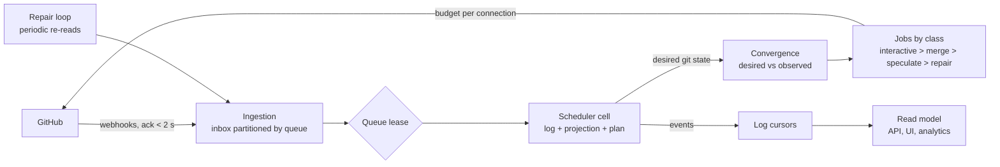

# System architecture

The path of an event, the design rules, the crates, the roles of the server and the contract of the scheduler.
The workspace is `Cargo.toml` (members `crates/*`); each crate says its role in its `//!` comment. CIHub is a
modular monolith of stateless processes on Postgres: the state of a queue is an event log, the reconciler converges
toward a desired state, every outgoing call is a budgeted and replayable job, and the unit of work is the queue,
which one instance at a time holds.

## Path of an event

- **ARC-1** The ingestion verifies the signature of a webhook, stores it in the inbox and acknowledges. It decides
  nothing.
- **ARC-2** The holder of the lease of a queue reads its inbox in order, appends the facts to the log, replays the
  projection, then runs `plan`: from the state and the time, it gives decisions and a desired state (refs and their
  composition, PRs to merge, statuses and comments to show).
- **ARC-3** The convergence compares the desired state with the last observed state in the log and requests only
  the jobs that close the gap. Jobs give their result as facts in `queue_inbox`: the scheduler is the only writer
  of the log.
- **ARC-4** A lost job is requested again at the next pass, and a drifted GitHub state is corrected without
  specific code.

## Design rules

- **ARC-5** The log of a queue is the source of truth. `apply` rebuilds the projections by replay and never calls
  `plan`. A snapshot every `SNAPSHOT_EVERY` events (`crates/mergequeue/src/log.rs`) bounds the load time.
- **ARC-6** `plan(state, now)` has no I/O; the same input always gives the same plan.
- **ARC-7** The plan describes a desired state, never a sequence of calls. Each job checks the real state before
  it acts and has no effect when the state is already reached.
- **ARC-8** Inbox and jobs are Postgres tables, written in the transaction of the caller: a delivery is deleted
  together with the facts that it establishes. The log `events` is the outbox, which a consumer reads from its
  cursor per queue. No broker.
- **ARC-9** Each connection has a budget fed by the rate limit headers, and each job a class: `interactive`,
  `merge`, `speculate`, `repair`. When the budget drops, speculation waits first (`specs/RELIABILITY.md`, REL-17).
- **ARC-10** Row level security isolates the organizations, and a quota of running jobs per connection keeps a
  noisy connection from hiding the jobs of the others (`specs/RELIABILITY.md`, REL-32).

## Crates

Code: `Cargo.toml` (`[workspace.dependencies]`, `[workspace.lints]`), `deny.toml` (`bans`)

- **ARC-11** Two binaries: `cihub` (`cihub-cli`), the command line of a person or a CI, talks to the public API and
  depends on no server crate; `cihub-server` starts and administers an instance.
- **ARC-12** The crates are `cihub-*`, not published, with one version, that of the release. A new crate is
  proposed and validated before it is written.
- **ARC-13** The pure crates depend neither on `tokio`, `sqlx`, `reqwest` nor `axum`: the `bans` of `deny.toml`
  name, for each heavy dependency, the only crates that may declare it.
- **ARC-14** `cihub-mergequeue` and `cihub-flakytests` do not depend on each other; only `cihub-server` knows both.
  The `Module` contract of `cihub-platform` gives the routes, the job executors and the subscriptions of a module;
  there is no dynamic load.
- **ARC-15** Queries use `sqlx::query!` and `query_as!`, checked at compile time; `.sqlx/` holds the metadata so
  that the build needs no database.
- **ARC-16** `cihub-domain` derives no Postgres enum, so that it stays free of `sqlx`: `cihub-store` converts with
  `as_str` and `FromStr`, and a test compares `pg_enum` with each enumeration.

| Crate              | Role                                                                                     |
| ------------------ | ---------------------------------------------------------------------------------------- |
| `cihub-domain`     | Identifiers, entities, closed vocabulary, events, transition tables (pure)               |
| `cihub-conditions` | Conditions: attributes, operators, evaluation on a PR (pure)                             |
| `cihub-config`     | `.cihub.yaml`, strategies, merge of the sources of each setting (pure)                   |
| `cihub-mq-core`    | `apply`, merge graph, window, batches, bisection, failure budget, `plan`, `check` (pure) |
| `cihub-store`      | Postgres pool, tenant transactions, log, secrets cipher, migrations                     |
| `cihub-telemetry`  | Logs                                                                                     |
| `cihub-scm`        | `Scm` trait, neutral SCM types, call classes; GitHub simulator (feature `sim`)            |
| `cihub-github`     | App auth, REST and GraphQL client, budget and modes, webhook verification and facts      |
| `cihub-platform`   | Leases, inbox, jobs and worker, installations, users, API tokens, `Module`, log cursors  |
| `cihub-web`        | HTTP server: webhooks, API, sessions, device codes, dashboard                            |
| `cihub-mergequeue` | Merge queue module: log, projections, scheduler, job executors, queue routes, PR surfaces |
| `cihub-analytics`  | Facts derived from the log, health of a queue                                            |
| `cihub-api-types`  | Requests, responses and errors of the public API; OpenAPI schemas                       |
| `cihub-client`     | Typed client of the public API                                                           |
| `cihub-cli`        | The `cihub` binary                                                                       |
| `cihub-server`     | The `cihub-server` binary: commands, roles, module registration                          |

Not built yet: `cihub-contracts` (the `FlakeOracle` trait) and the flaky tests module, `cihub-flakytests`.

## Roles

Code: `crates/server/src/` (one file per role), `crates/server/src/start.rs`

- **ARC-17** `cihub-server start` runs the four roles in one process: `web` (`cihub-web`), `scheduler`
  (`cihub-mergequeue`), `worker` and `notifier` (`cihub-platform`). A role has no crate; its loops are in the
  library crates.
- **ARC-18** The roles share one `CancellationToken`. On `SIGTERM` each loop stops taking work, ends its
  transaction, releases its leases and exits; a loop that fails stops the others. A stop at any `.await` is safe,
  because executors are idempotent and reconciliations are transactional.
- **ARC-19** The roles of one process share only the Postgres pool, and wake each other with `LISTEN/NOTIFY`, as
  between processes.

### Scaling

- **ARC-20** A deployment scales by identical replicas of `cihub-server start`. `web` keeps no queue state;
  `scheduler` processes a queue on one replica at a time; `worker` claims and locks jobs, and takes back a job
  whose lock expired; `notifier` takes the cursor of a queue and a subscription with `FOR UPDATE SKIP LOCKED`.
- **ARC-21** More replicas process more queues in parallel, not one queue faster, because one queue keeps its order
  on one replica. Beyond that, the SCM budget of the connection and Postgres are the limits.

## Scheduler

Code: `crates/platform/src/lease.rs` (`LEASE_TTL`, `pg_try_advisory_xact_lock`), `crates/platform/src/wake.rs`
(`mark_dirty`, `TICK`, `MIN_WAIT`), `crates/mergequeue/src/scheduler.rs`

- **ARC-22** A replica takes or renews the leases (`lease_owner`, `lease_expires_at`, `LEASE_TTL`) of the queues
  with work (`dirty`, or a due tick). For each queue it holds, it opens a transaction, takes the transaction
  advisory lock, reconciles, and resets `dirty`. The lock keeps one reconciliation at a time, also when an expired
  lease changes hands.
- **ARC-23** A write on the items of a queue (ingestion, job result, API) sets `dirty` and notifies
  `cihub_queue`. Between passes, a replica waits for a notification or for the next due tick.
- **ARC-24** A reconciliation is one transaction: load the snapshot and the events after it, write the facts of
  `queue_inbox` and of the deliveries of the queue, run `plan`, write its decisions, request the jobs of the
  desired state and the cleanup of ended runs, and set `next_tick_at` to `wake_at`. A stop at any moment rolls it
  back, and the next one redoes the same work.
- **ARC-25** A check delivery that arrives before the assembly fact of its run waits for the next reconciliation.
- **ARC-26** A pass also reads the deliveries of a connection without a queue, each in its own savepoint: a
  `/cihub merge` command requests a `submit_pr` job, which finds the queue from the base branch of the PR.
- **ARC-27** The sync of an installation, a job of `cihub-platform`, gives `access.lost` or `access.restored` in
  the `queue_inbox` of each queue of the connection.

## Internal channels

Code: `crates/platform/src/wake.rs` (`QUEUE_CHANNEL`), `crates/platform/src/jobs.rs` (`JOB_CHANNEL`),
`crates/platform/src/news.rs` (`QUEUE_CHANGED_CHANNEL`)

- **ARC-28** The internal interfaces are not RPC: the processes share Postgres, so the internal API is the `jobs`
  table, the `events` log and the `NOTIFY` channels.
- **ARC-29** `cihub_queue` says that a queue has work; `cihub_jobs` that a job is ready.
- **ARC-30** `cihub_queue_changed` (`<org> <queue> <seq>`) says that what the pages of a queue show changed. It is
  sent in the transaction of the change (a reconciliation that writes the log, the check and the read of the
  configuration file, the creation of a queue), and each web process listens to it once for the streams of its
  pages.
