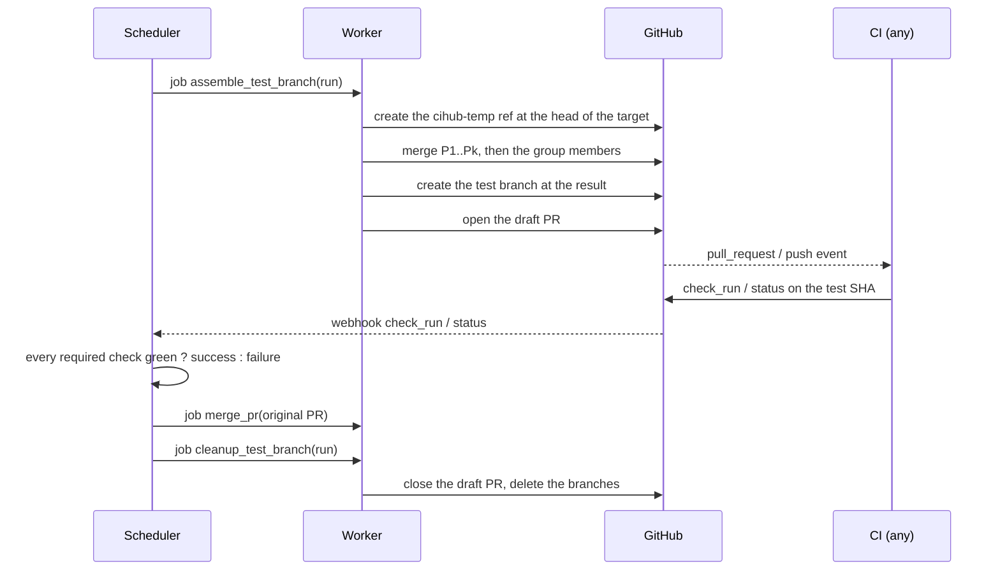

# CI integration

This spec gives the contract between the queue and the CI of a repository. The names of the branches are in
`crates/domain/src/branch.rs` (`test_branch`), the draft PR and the cleanup in `crates/mergequeue/src/assembly.rs`
(`draft_pr_title`, `draft_pr_body`, `cleanup_test_branch`).

## Contract

- **CI-1** CIHub never starts the CI. It produces a commit on a test branch, and any CI that reports check runs or
  commit statuses on that commit works without a change.
- **CI-2** The only contract between the queue and the CI is the names of the required statuses and the test SHA.
- **CI-3** The names of the required statuses are resolved once per run and kept on the run with their source
  (`repo_config`, `branch_protection`). A check that reports under another name (a renamed job) is the most common
  error of configuration: the dashboard shows the required names next to the observed names of each run.

## Triggers

- **CI-4** In the `draft_pr` mode (the default), CIHub opens a draft PR from the test branch to the target branch,
  so that the workflows on `pull_request` run without a change. The CI tells a run of the queue apart by its head
  ref, under `cihub-merge/`.
- **CI-5** In the `push` mode, CIHub opens no PR, and the CI listens to `push` on `cihub-merge/**`. This avoids the
  preview deployments and the bots that a PR starts at each run.
- **CI-6** The body of the draft PR gives the run, its base and the PRs that it tests, so that a person who opens
  it knows what it is and does not merge it.

## Branches

- **CI-7** The name of the test branch ends with the identifier of its run. A check reported on it goes to its
  queue by this name, or by its test SHA once the branch is deleted.
- **CI-8** A CI job reads its run identifier from the last segment of the branch name: `${GITHUB_HEAD_REF##*/}` on a
  `pull_request` event (the `draft_pr` mode), `${GITHUB_REF##*/}` on a `push` event. `GET
  /api/v1/orgs/{org}/repos/{repo}/runs/{run_id}` then gives the PRs that the run tests.
- **CI-9** At the end of the run, whatever its result, `cleanup_test_branch` closes the draft PR and deletes the
  test branch and the temporary branch, after `keep_test_branches_minutes` (0 by default), which keeps them for a
  debug.
