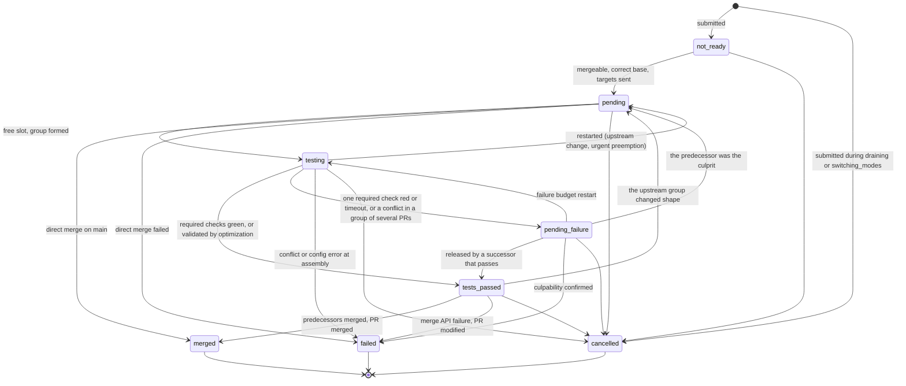

# Domain model: the vocabulary contract

This file defines the terms that we all use, humans and agents. The list of values of each closed
vocabulary is in `cihub-domain`, with a `///` comment that gives the meaning of each value.

## Entities

The vocabulary of the domain is that of CIHub, not that of an SCM: each adapter
(`cihub-github`) translates the values of its SCM, and the core sees none of them. A **PR** designates any change
request: a GitHub pull request, a GitLab merge request.

Six entities carry the whole product: an organization installs the GitHub App on repositories, each repository has one
queue per target branch, a queue contains items (one per PR submission), the items are grouped into
test groups (a single PR or a batch) which own test runs, and each observed fact and each
decision of the queue is recorded as an immutable event. Everything else (lanes, bisections, stacks) follows
from it.

| Entity               | Identity                     | Meaning                                                                                                                                       | Code (`cihub-domain`)  |
| -------------------- | ---------------------------- | --------------------------------------------------------------------------------------------------------------------------------------------- | ---------------------- |
| Organization         | `org_id`                     | Tenancy boundary: all the other tables carry `org_id`, except `users`                                                                         | `OrgId`                |
| Connection           | `connection_id`              | The means by which CIHub reaches the repositories of an SCM account, named by `account_external_id` (`ConnectionKind`); carries the budget, the quotas and the degraded modes; kept in step with the installation of the App on the SCM | `ConnectionId`         |
| Repository           | `repo_id`                    | A repository attached to a connection; a connection can cover several repositories                                                            | `RepoId`               |
| Queue                | `queue_id`                   | A target branch of a repository, with a name unique within the repository, its state, its mode and its settings                               | `Queue`                |
| Queue item           | `item_id`                    | A submission of a PR; a resubmission after cancellation creates a new item, and `is_current` designates the live item of that PR              | `Item`                 |
| Test group           | `group_id`                   | The unit that is tested and held in pending failure: a single PR, a batch, or one half of a bisection                                         | `TestGroup`            |
| Test run             | `run_id`                     | One attempt to test a group on a test branch; a group can have several runs (restarts)                                                        | `TestRun`              |
| Check observation    | (`run_id`, name)             | The last observation of a check run or of a commit status on the test SHA                                                                     | `CheckObservation`     |
| Impacted targets     | (`repo_id`, PR, head SHA)    | What a PR changes, which places it in the merge graph; `ALL` in simple mode                                                                   | `ImpactedTargets`      |
| Event                | `event_id`                   | A fact or a decision, append-only in the log of the queue                                                                                     | `Event`                |

Identifiers are typed ULIDs in the `typedid` text format. An SCM identifier is an
`external_id`, unique within the deployment, which serves a single SCM. Each closed vocabulary is an
enumeration whose text value (`snake_case`) is the same in the API, the webhooks, the analytics and Postgres.

Outside the queue, `DeviceCodeState` says where a sign-in of the command line stands (`specs/API.md`): `pending`
while the command line waits for the person, `approved` once the person approved its code, `denied` once they
denied it. The command line takes its session from an `approved` code, which then ends.

## Log

- **Log**: the append-only sequence of the events of a queue; it is the source of truth of the queue. The
  state tables are projections of the log.
- **Fact**: what GitHub, the CI or a user has established ("PR 12 has a new head SHA"). A fact
  changes only the observed state.
- **Decision**: what the queue chose ("the item of PR 12 moves to `cancelled`, reason `pr_pushed_to`").
  A decision changes only the state of the queue and carries the identifier of the fact that caused it (`cause_id`).
- **Request**: a fact that awaits a decision (submission, cancellation, restart, job result).
- **`apply`**: the pure function that applies an event to the state; the replay uses only it.
- **`plan`**: the pure function that reads the state and the time, and produces decisions and the desired state.
- **Reason**: the readable cause of a transition, from a closed vocabulary. Each transition carries one.
- **Actor**: who originated an event: an SCM user account (its identifier; the `users` table keeps the login), the App account, or CIHub.

Code: `Event`, `EventKind` (one payload per type), `EventType` (the `<subject>.<verb>` names, with
`is_decision`), `Actor` and `ActorKind` in `cihub-domain`; `apply` in `cihub-mq-core`. A pending request
is a `Request` of the snapshot.

## Queue item

States (`ItemState`): `not_ready`, `pending`, `testing`, `pending_failure`, `tests_passed`, `merged`, `failed`,
`cancelled`. The last three are terminal. They are used as is in the API, the webhooks and the analytics.

| State             | Meaning                                                                                       |
| ----------------- | --------------------------------------------------------------------------------------------- |
| `not_ready`       | Submitted, but not yet admissible (review, PR checks, mergeability, missing targets)          |
| `pending`         | Admitted, waiting for a place in the speculation window                                       |
| `testing`         | Member of a group with a run in progress                                                      |
| `pending_failure` | Its run failed; the queue waits to know whether the fault is its own or a predecessor's       |
| `tests_passed`    | Validated by a run; waits for its predecessors to merge                                       |
| `merged`          | Merged by the queue, by direct merge, or outside the queue                                    |
| `failed`          | Removed from the queue with a reason; the PR must be resubmitted                              |
| `cancelled`       | Cancelled by a user or by a change of the PR                                                  |

The allowed transitions and their reasons are in the code: a single `Reason` enumeration and, for each
state machine, a table (start state, end state) → allowed reasons, the
`Lifecycle` trait and the `check_transition` function.

Families of reasons, to find one's way: admission and test; return to `pending` (upstream change, a member
of the batch left with `batch_member_left`, restart, `urgent` preemption, bisection); `tests_passed`; `merged`;
`cancelled`; `start_test_run_*` (failure at the assembly of the test branch); `test_run_*` (failure or timeout of the run); failure of the merge call
(`merge_rejected`, `direct_merge_rejected`, `merge_rate_limit_exceeded`, `merge_branch_protection_unmet`,
`merge_already_in_progress`, `merge_repeated_server_errors`, `pr_updated_at_merge_time`); queue reasons,
including `access_lost` and `access_restored` when CIHub loses or regains its access to the repository.

Each reason has a sentence in English for a person, `Reason::describe` (for example `pr_pushed_to`: "the PR
received a new commit after its submission"): the PR comment and status, the API (`state_description`) and the
CLI show it instead of the code. The code is the stable contract; the sentence is a free rendering that can
change without a decision.

A `not_ready` item also carries block reasons (`BlockReason`): what prevents it from being admitted,
displayed in the PR comment. The mergeability (`Mergeability`) says whether the SCM accepts the merge: `mergeable`, `behind`,
`conflict`, `blocked` or `unknown`; the translation from GitHub and the admission rule are in
`specs/GITHUB.md`. What CIHub reads from a PR: its state
(`PrState`: `open`, `closed`, `merged`), its review decision (`ReviewDecision`) and its checks (`CheckReport`).

Priority (`Priority`): a value from 0 to 255; the smallest goes first. The names `urgent` (0), `high`
(10), `medium` (100) and `low` (200) are shortcuts. Only the value decides the order
(`specs/ALGORITHMS.md`). Source of a submission: `SubmittedVia`.

## Test group

Nature of a group (`GroupKind`): `single` (one PR), `batch` (a batch), `bisection` (one half of a failed
group of several PRs; `parent_group_id` names that group). A group has its own state, because a split or abandoned group has no items anymore, and the members
of a batch move one by one to `merged`. States (`GroupState`): `testing`, `pending_failure`, `tests_passed`,
`merged`, `failed`, `bisected`, `dissolved`; the last four are terminal. A `dissolved` group is
abandoned by the queue (a member left, a predecessor or the base changed); its members that are still live
return to `pending`. A group in bisection stays `pending_failure` with the PRs that wait for the result of
its current half, and ends `bisected` when its PRs have all left to its halves. The consistency rule between the state of a group and that of its items is in
`specs/RELIABILITY.md`.

## Test run

Statuses (`RunStatus`): `assembling`, `in_progress`, `succeeded`, `failed`, `interrupted`, `cancelled`,
`timed_out`. The last five are terminal. `interrupted` means that the queue replaced the run (group
abandoned, validated by optimization); `cancelled` means that a member of the group was cancelled.

Nature of an observed check (`CheckKind`): `check` (a check with a run: GitHub check run, GitLab
pipeline job) or `status` (a commit status). Progress (`CheckStatus`): `queued` (it waits for a
runner, or a required status has not reported), `in_progress`, `completed` (it has a conclusion);
a check gives when it started and completed, a commit status only the time of its state.
A report that has not concluded does not take a `completed` check back, unless it started after the
end of that check, as a rerun does: GitHub does not order its deliveries, and an `in_progress` that
arrives after the `completed` of the same execution is ignored (`CheckObservation::is_regressed_by`).
Conclusion (`CheckConclusion`): the values of GitHub; `success`, `neutral` and `skipped` pass, the
others fail the run. Culprit of a conflict at
assembly (`ConflictCulprit`): what the group member conflicts with, a PR ahead of it in the
queue (`queue_pr`) or the target branch alone (`base_branch`). Source of the required statuses
(`RequiredStatusesSource`): `repo_config`, `branch_protection`. A job that fails reports an
error (`JobError`), never a reason: `plan` chooses the reason. Class of a job (`JobClass`, by priority on the
budget of its connection): `interactive`, `merge`, `speculate`, `repair`. State of a job (`JobState`): `queued`,
`running`, `done`, `failed` (a new attempt would not fix the error), `dead` (all attempts
failed; it waits for an operator).

## Queue

States (`QueueState`): `running` accepts and merges; `paused` decides nothing and merges nothing but keeps
the order, and a submission there waits for the resume; `draining` lets what is in flight merge and
refuses a new submission, whose item is created `cancelled` with the reason `queue_draining`;
`switching_modes` is reached automatically when the mode changes with items in flight and behaves like
`draining` (reason `queue_switching_modes`) until the queue is empty. Mode (`QueueMode`): `single` or `parallel`. Operator request (`QueueControl`): `pause`,
`resume`, `drain`. The settings of the queue are in `cihub-config`
(`specs/CONFIGURATION.md`).
