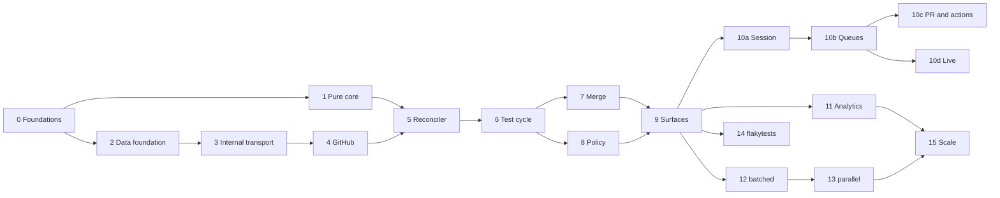

# Phases and lots

Context: whoever starts a piece of work. This file splits the roadmap into lots of about one week for one
developer who drives coding agents. Each lot has a goal, a content, the interfaces it **freezes** (the following
lots build on them without changing them), its dependencies and an **automated exit criterion** that is the
definition of "done". A lot starts only when its dependencies are done and when the open questions that it
lists are settled.

**Tracking.** The status of a lot is `to do`, `in progress`, `done` or `blocked` (with the cause).
As soon as a lot starts, it receives a "Tracking" block: what is done (crates, points of the content), what remains,
and the deviations from the plan, each validated by the project lead. The status and the block are updated in the
same change as the code.

## Phases

Four phases, each deliverable on its own and completed by the use of CIHub on its own repository. The graph-based
reconciler is built from phase 1 in its general form, so that the following phases add strategies and modules, not
rewrites.

| Phase                       | Lots            | Scope                                                                                                                                                                                                                                                                                                                                                             | Exit criterion                                                                                                                                                                |
| --------------------------- | --------------- | ----------------------------------------------------------------------------------------------------------------------------------------------------------------------------------------------------------------------------------------------------------------------------------------------------------------------------------------------------------------- | ----------------------------------------------------------------------------------------------------------------------------------------------------------------------------- |
| 1. Installable merge queue  | 0 to 9          | Foundation (tenancy, log, jobs, GitHub adapter), pure core, reconciler, complete test cycle, entry and merge conditions, adaptive window, failure budget, `sequential` and `pipelined` strategies, squash / merge / rebase / fast-forward methods, direct merge, PR surfaces, API and CLI, `docker compose` and procedure to create the App                       | The CIHub repository merges through CIHub for 2 weeks without a red merge; an outside person installs and merges a first PR in less than 30 minutes by following `INSTALL.md`; measured in lot 15 |
| 2. Throughput and visibility | 10 to 12       | Dashboard, Postgres analytics, Health view, Prometheus, outgoing webhooks, `batched` strategy (batches, bisection, failure depth, optimistic merge)                                                                                                                                                                                                                 | At 20 PRs per hour on the simulator, `batched` uses 30 % fewer runs per merged PR than `pipelined`; bisection isolates a planted failure in ≤ log2(batch) runs |
| 3. Flaky tests              | 14 (advanced)   | OTLP receiver, JUnit converter and GitHub action, `ft_*` tables, detection, quarantine, `FlakeOracle` trait consumed by the queue, dedicated page                                                                                                                                                                                                                | The module is added without changing the merge queue outside the call to the trait; on a repository with a known flaky test, zero PR evicted wrongly                        |
| 4. Scale and ecosystem      | 13, 15 and next | `parallel` strategy with impacted targets, Bazel and Nx actions, ClickHouse behind `AnalyticsStore`, hardening, then stacked PRs, direct-to-queue, Slack, Terraform, GitLab behind `Scm`                                                                                                                                                                            | A pilot monorepo merges disjoint PRs in parallel; an instance holds 1,000 PRs per day with ClickHouse enabled; first outside organization in production                     |

The two highest risks are the invariants of the reconciler under concurrent GitHub events (mitigated by the pure
core and its property tests, delivered first) and the GitHub rulesets misconfigured by the users (mitigated by the
configuration checker, in phase 1).

## Overview

| Lot | Title                                                  | Phase | Depends on | Questions | Status                                   |
| --- | ------------------------------------------------------ | ----- | ---------- | --------- | ---------------------------------------- |
| 0   | Repository foundations                                 | 1     | —          | —         | done                                     |
| 1   | Pure core of the queue                                 | 1     | 0          | —         | done                                     |
| 2   | Data foundation: server, tenancy, log                  | 1     | 0          | —         | done                                     |
| 3   | Internal transport: inbox, jobs, leases                | 1     | 2          | —         | done                                     |
| 4   | GitHub adapter, simulator and App installation         | 1     | 3          | —         | done                                     |
| 5   | Reconciler and admission                               | 1     | 1, 4       | —         | done                                     |
| 6   | Test cycle                                             | 1     | 5          | —         | done                                     |
| 7   | Merge and outside changes                              | 1     | 6          | —         | done                                     |
| 8   | Queue policy                                           | 1     | 6          | —         | done                                     |
| 9   | Surfaces: PR, API, CLI                                 | 1     | 7, 8       | —         | done                                     |
| 10a | Dashboard: session, roles and frame                    | 2     | 9          | —         | done                                     |
| 10b | Dashboard: queues and the page of a queue              | 2     | 10a        | —         | done                                     |
| 10c | Dashboard: your pull requests, drawer and actions      | 2     | 10b        | —         | in progress                              |
| 10d | Dashboard: live updates                                | 2     | 10b        | —         | to do                                    |
| 11  | Analytics, metrics and outgoing webhooks               | 2     | 9          | —         | to do                                    |
| 12  | `batched` strategy                                     | 2     | 9          | —         | done                                     |
| 13  | `parallel` strategy                                    | 4     | 12         | —         | to do                                    |
| 14  | `flakytests` module                                    | 3     | 9          | Q1, Q7, Q12 | to do                                  |
| 15  | Scale: ClickHouse, hardening                           | 4     | 11, 13     | Q8        | to do                                    |

Lots 1 and 2 can advance in parallel after lot 0, as can lots 7 and 8 after lot 6, lots 10a, 11, 12 and 14
after lot 9, and lots 10c and 10d after lot 10b.

---

## Phase 1: installable merge queue

Lots 0 to 8 are done; the git history keeps their tracking.

### Lot 9: surfaces: PR, API, CLI

- **Goal**: let humans and the CI use the queue; end of phase 1.
- **Content**: `CIHub Merge Queue (<branch>)` status, bot comment edited in place, state labels;
  `/cihub merge|cancel|restart` commands, with permission checks; REST API v1
  of `specs/API.md` (without metrics and outgoing webhooks), `problem+json` errors, rate limit, OpenAPI 3.1
  generated from the code (`cihub-web`, `cihub-api-types`); Rust client `cihub-client`; `cihub` CLI;
  `Dockerfile` of the `cihub-server` image and workflow that publishes the image to GHCR at each version; installation `docker compose` with the `cihub-migrate` service and
  installation README, with a prompt that helps write `.cihub.yaml`; configuration checker as an API endpoint, with the rulesets read through the
  `Scm` trait; block reason that names the missing required check; 5-minute
  permission cache and message of a refused submission.
- **Frozen interfaces**: API v1 published in `/api/v1/openapi.json`; PR commands; CLI commands.
- **Exit criterion**: an end-to-end test on the staging instance submits PRs on a real repository and merges
  them; the CIHub repository moves to its own queue; an outside person follows `INSTALL.md` and merges a first
  PR in less than 30 minutes (criterion of phase 1, measured by hand).
- **Tracking**:
  - Steps: 1. start of an organization; 2. PR surfaces; 3. API v1; 4. client and CLI;
    5. configuration checker; 6. image, installation `docker compose` and README; 7. exit criteria.
  - Done (October 2, 2026): step 1. An admin command reads the account
    of the installation, creates the organization (slug: the login of the account), its account and its connection,
    requests `sync_repos` and shows once a token with
    every scope; on an installation already known, it creates only a new token. Replaced on October 9, 2026 by the
    sync of the installations and `cihub server token create --org <slug>`. The
    `Scm` trait gains `installation` and `list_repos` (GitHub and simulator, contract suite). The `sync_repos` job
    creates and updates `repos` without deleting any and without taking the repository of another organization; it is
    requested by the routing of each `installation_repositories` delivery (key of the delivery), and by the admin
    command and each scheduler replica (key of the hour). Tests: against Postgres, the admin command and its rerun, the reading of
    the repositories, the hourly request and the routing; the two GitHub routes on hand-written responses.
  - Done (October 2, 2026): the GitHub responses are recorded again (64 exchanges, with the installation and
    its repositories), with the `cihub` ruleset put back in recording mode for the duration of the recording;
    #55 merged afterwards. The recorder keeps only the repository of the suite in the list of the repositories of
    the installation, because the others may be private and the cassette is public.
  - Done (October 2, 2026): step 2. `plan` gives `Desired.surfaces` (each live item, and each item
    that the reconciliation terminates, seen before its eviction); `cihub-mergequeue` turns it into the queue status,
    the comment and the state labels, writes the desired rendering in `pr_surfaces` and requests `publish_surfaces`,
    which publishes under an advisory lock of the PR; `merge_pr` publishes `success` before the merge. `/cihub cancel`
    and `/cihub restart` go through the `pr_command` job; a refused command receives a comment. `cihub-github`
    keeps a permission for 5 minutes. `pr.observed` carries `required_checks`, and a `blocked` PR names its required
    checks that fail or are pending. Tests: rendering (status, comment, labels, cut at 140 characters), surfaces in
    the core (position, end of an evicted item, named reasons), and against Postgres and the simulator a single
    comment, the status and the labels, then restart, cancellation and refusal of a command.
  - Done (October 2, 2026): step 3. Crate `cihub-api-types` (requests, responses, `ErrorCode`,
    `Problem`, OpenAPI schemas behind the `openapi` feature, `utoipa` dependency). `cihub-platform` carries the
    `problem+json` error, `ApiGrant` and the extractors; the `Module` contract gains `ModuleApi` (routes and document).
    `cihub-web` authenticates `/api/v1` by token, limits each token to 600 requests per minute and per replica,
    serves `/repos`, `/orgs/{org}/audit` and `/api/v1/openapi.json` (without token). `cihub-mergequeue` serves the
    queue routes of `specs/API.md`; `audit_log` gains `actor_token_id`, and the admin command audits its token. Tests: against
    Postgres, the authentication, the scopes, the limit and the document; and end to end on the simulator, a
    submission through the API, the item, its timeline, its run, the graph, restart, cancellation, pause, new
    queue, resync and audit log.
  - Done (October 2, 2026): step 4. `cihub-client` (the methods that the CLI uses) and `cihub-cli` (`cihub` binary,
    `clap` dependency). Tests: git remote, choice of the queue, and the client against the real server in the
    end-to-end test of the API.
  - Done (October 2, 2026): step 5. The `Scm` trait gains `check_setup` (neutral findings); GitHub reads the
    rulesets of the target branch and of the test branches, and the simulator restricts no update;
    `GET /queues/{id}/config-check`. Tests: the contract suite, a hand-written response, and the route.
  - Done (October 2, 2026): step 6. `Dockerfile` (distroless, pinned by digest), `.github/workflows/image.yaml`
    (GHCR, one native runner per architecture, then a manifest), `deploy/compose.yaml` and `deploy/.env.example`,
    `README.md` with the installation procedure and the help prompt for `.cihub.yaml`, `release` profile. Verified
    by the agent: image built (69.6 MB), `migrate` in the image against Postgres, `docker compose config`,
    `actionlint` and `zizmor`.
  - Done (October 2, 2026): welcome comment. `PrChanged` gains `opened`; the `welcome_pr` job posts the
    welcome comment once, with its submit box; `pr_comments` keeps the comment of the PR, shared by its queues,
    and `publish_surfaces` takes it over. The adapter translates the checked box into `SubmitBoxChecked`, which the
    connection pass submits if the comment is the one of CIHub. The box comes back for a `failed` or `cancelled`
    item. Tests: translation of the opening and of the box, and against Postgres and the simulator the welcome,
    the submission by the box, its return after a cancellation, the refusal of an account without `write` and a
    box in the comment of someone else.
  - Done (October 4, 2026): sentence of each reason. `Reason::describe` in `cihub-domain`; the status and the
    comment of a `failed` or `cancelled` PR show it instead of the code, the API `Item` gains `state_description`
    and the CLI shows it. Tests: the table (one short, unique sentence per reason), the rendering of a failure, and
    the field against Postgres.
  - Done (October 3, 2026): one binary, `cihub`. `cihub-cli` (`crates/cli/`, the former
    `crates/server/`) gives it, with `clap`: one file per command and one per role; the HTTP endpoints stay in
    `cihub-web`. The former client-only `cihub-cli` crate is removed. Groups `login`, `queue` (`--repo`, `--queue`; with two queues and no `--queue`, the command refuses and
    lists the names) and `server` (`start`, `migrate`, the admin command of step 1, `--config
    <file>`). `CIHUB_ROLES` is removed and `CIHUB_LOG` becomes `CIHUB_LOG_FILTER`; the YAML file of the server has one
    key per variable. Image: entry point `cihub`, default command `server start`. Tests: table tests of the
    configuration (file only, variables only, a variable over the file, unknown key, wrong type, missing database,
    rules of the `github` keys), the refused arguments, and against Postgres `cihub server start|migrate` and
    `cihub queue drain|status` against a running server.
  - Done (October 5, 2026): `cihub server start` takes no argument and always runs the four roles; a
    deployment scales by identical replicas. The probes give only the name and the version of the binary.
  - Done (October 4, 2026): no queue is created by hand. The first `/cihub merge` on a branch without a
    queue creates, in `submit_pr`, the queues that `.cihub.yaml` names on the branch, or the queue of the default
    branch named after it, with the file that it read; a queue without an entry has `defaults`; a queue that the
    file no longer names takes no new submission. `POST /repos/{owner}/{name}/queues`, `cihub queue create`,
    `CreateQueue` and `queue_exists` are removed; the README no longer has a step that creates a queue. Tests:
    `defaults` alone in `cihub-config`, the rule of the queues that take submissions, and against Postgres and
    the simulator the queue of the default branch, the queues of the file and their routing, a label and a
    command on another branch that create nothing.
  - Done (October 2, 2026): the GitHub responses are recorded again for `check_setup`, with the
    rules of the target branch and of the test branches.
  - Done (October 5, 2026): CIHub on its own queue, on an instance started locally behind a tunnel. The queue
    `main` of `nlecoy/cihub` merged 9 PRs (#6, #7, #11, #15, #18, #22, #26, #28, #30); `Build Success` passes on
    each commit of `main`, and the tree of each merge is the tree of its last test. Seen during this use: the
    test `two_workers_at_the_same_time_never_share_a_job` is unstable (a claim locks up to ten times its limit,
    so the other worker can get nothing); #15 did not start before a second `/cihub merge`, cause not verified.
  - Closed on October 5, 2026 by the project lead without the rest of step 7: the end-to-end test on staging,
    two weeks of CIHub on its own queue and an installation by an outside person wait for the deployment of an
    instance.
  - Deviations: deferred, `DELETE /queues/{id}`, `GET /queues/{id}/test-results`, the `?branch=`
    search and the no-op ref update of the checker.

---

## Phase 2: throughput and visibility

### Lots 10a to 10d: dashboard

The dashboard follows the mockups v3: the list of the queues of an organization, the page of a queue (counters,
settings, live graph, items), the drawer of a PR (run, checks, history), the settings (configuration, branch
protection, audit log). It is split in five lots of about one week; each lot brings its routes, its migrations
and its pages together, and starts from the routes by name of `/orgs/{org}/…`.

Decisions:

- **Q9** (decided October 10, 2026): TypeScript, React, Vite and the TanStack libraries (Router, Query, Form),
  with a client generated from the OpenAPI document. The stack and its rules are in `web/AGENTS.md`.
- The roles are `admin` and `member`, from the SCM membership. The `viewer` role and the change of a role by an
  admin come after lot 10d (see "Next").
- The mockups v5 (October 10, 2026, validated by the project lead) drop the pages of the settings (configuration,
  branch protection, audit log), the form that changes `.cihub.yaml` and the search, which go to "Next", and add
  "Your pull requests": where each PR of the person is, and when it should merge. Lot 10e disappears; what remains
  of it, the configuration check stored for the banner of a queue, goes to lot 10b.

#### Lot 10a: session, roles and frame

- **Goal**: a person signs in with the SCM and sees the organizations that the App serves for them.
- **Content**: `GET /auth/github`, `GET /auth/github/callback` and `POST /auth/sign-out`, outside `/api/v1`;
  `sessions` table (14 days, revocable) and `memberships` table, filled from the SCM membership and refreshed
  every hour (`specs/SCHEMA_PLAN.md`); same-site cookie and CSRF token on every `POST`, `PATCH` and `DELETE` of a
  session; `GET /api/v1/me` (login, organizations with their role, version of the instance, installation URL of
  the App); a session is a second authentication of every route, and its role gives the scopes (`member`:
  `queues:read`, `prs:write`; `admin`: every scope); the sign-in flow in the simulator; a server on the
  simulator for the browser tests. `web/`: Vite, the generated client, the router, the sign-in page and its
  two errors, the frame (navigation, organization switcher, user menu), the pages "not found" and "server
  error"; the build embedded by the `web` role; the dashboard in `mise run lint`, `mise run check` and the CI.
- **Frozen interfaces**: the session cookie and the CSRF token; `GET /me`; the scopes of each role.
- **Exit criterion**: a browser test on the simulator signs in and sees its organization; a `member` gets
  `403` on `PATCH` of a queue; a session of another organization gets `404` (principle VIII); a failed sign-in
  and a user without an organization see their message.
- **Tracking**:
  - Steps: 1. `sessions` and `memberships` tables; 2. sign-in through the SCM, in `cihub-github` and in the
    simulator, and the refresh of the roles; 3. session in `cihub-web` (cookie, CSRF, scopes of a role, `/auth/*`,
    `GET /me`); 4. `web/` (tools, Vite, router, generated client, lint and tests in `mise` and the CI); 5. pages and
    the build embedded in the binary; 6. server on the simulator and browser test of the exit criterion.
  - Decided (October 10, 2026): the sign-in goes through the App that exists (authorization of a user by the
    App), coded with `reqwest`, without an OAuth crate: the App lists the installations that the user reaches
    and already reads the members. A session is a row of `sessions` that keeps the hash of its token, as
    `api_tokens`, so that a sign-out revokes it; the table is global, as `users`, because a session covers
    several organizations. The client is generated by `@hey-api/openapi-ts` at a pinned version. The tools of
    the dashboard are Node and pnpm, pinned in `mise.toml`.
  - Done (October 10, 2026): step 1. Migration `sessions`: the `memberships` table (tenant, `refreshed_at` so
    that a refresh deletes the rows that it no longer sees) and the `sessions` table (global, hash of a `chs_`
    secret, deleted by the daily maintenance once expired). `cihub-domain` gains `SessionId`, `MembershipRole`
    and its scopes, and the form of a session token; `cihub-store` creates, authenticates and deletes a session,
    and records, forgets and lists the memberships of a user. Tests: `tests/postgres.rs` of `cihub-store` and the
    maintenance test of `cihub-platform`.
  - Done (October 10, 2026): step 2. The `Scm` trait gains `sign_in_url`, `sign_in` and `members` (simulator,
    GitHub adapter); the token of the person stays in the adapter, which forgets it. `members` reads the
    installation first, so that a renamed organization is never taken for the account of a person. `record_sign_in`
    (`cihub-platform`) records the person and their roles in the organizations that CIHub knows, and deletes
    none; the hourly `sync_members` job converges the members of each connection and alone deletes. New keys `github.client_id` and
    `github.client_secret`, both or none. Tests: the simulator and the contract suite (`members`), the GitHub
    adapter on answers written by hand, `tests/postgres.rs` of `cihub-platform`.
  - Done (October 10, 2026): the simulator checks PKCE: a code is refused when the verifier does not give the
    challenge of its request. `code_challenge` (`cihub-scm`) computes it, for the simulator and for `cihub-web`.
  - Waits on the project lead: a new recording by the `github` example (`record` mode), so that the recorded
    contract suite also runs `contract::members`; the fixture admin must be an owner of the account. Then
    `contract::members` moves into `contract::run`.
  - Done (October 10, 2026): step 3. A session is a second authentication of `/api/v1`: the cookie
    `__Host-cihub_session`, the role in the organization of the URL as scopes, `404` for an organization without a
    role, the header `X-CSRF-Token` (a SHA-256 of the secret of the session, which the server keeps nowhere) on a
    request that can change a state, refused with the code `csrf_refused`; one rate limit per token or session.
    `ApiGrant` names its actor, a token or a user: the audit log and the log of the queue record the user, and a
    submission carries their account, so that the job checks their permission on the repository. The OpenAPI
    document gives the scheme `session` to every route. `GET /auth/github` and its callback, with the new key
    `http.public_url`; `GET /api/v1/me` (with the page that installs the App, from the new `Scm` method
    `app_install_url`); `POST /auth/sign-out`. The chart and `deploy/compose.yaml` give the three keys of the
    sign-in.
  - Changed by the mockups v5 (October 10, 2026, validated by the project lead): a person without an organization
    gets a session, and the dashboard asks them to install the App, instead of an error of the sign-in.
  - Done (October 10, 2026): step 4. `web/`: TypeScript 6 (`typescript-eslint` does not take 7 yet), React 19,
    Vite 8, TanStack Router and Query, Zod 4, the client of `@hey-api/openapi-ts` from `web/openapi.json`, which
    the example `openapi` of `cihub-cli` writes without a database; ESLint, Prettier and Vitest in `mise run lint`
    and `mise run test`; Node 24 and pnpm 12 in `mise.toml`.
  - Done (October 10, 2026), part of step 5: the sign-in page of the mockups v5 (sign-in, failure, no
    organization, another account with `prompt=select_account`), and the build embedded in the binary by
    `crates/web/build.rs`, without a dependency (decided by the project lead); `index.html` answers every path of
    the dashboard. The image builds the dashboard in a stage of its own.
  - Done (October 10, 2026): end of step 5. The frame of the mockups v5: the top bar with the pickers of the
    organization (with the role of the person, and the page that installs the App), of the repository and of the
    queue, and the menu of the person (theme, sign-out); the routes `/orgs/$org`, `/orgs/$org/repos/$repo` and
    `/orgs/$org/repos/$repo/queues/$queue`, as the API names them, whose content comes with lot 10b; `/` opens the
    organization that the person opened last. The pages "not found", "server error" and "no access" (the API
    answers `404` on an organization where the person has no role, or that does not exist; an organization that
    the App left keeps its members, and its queues say that the access is lost, lot 10b). The pages read the data of
    the server from the cache of the queries (fresh 30 seconds), and a `401` drops `/me` from it, so that the
    sign-in does not send the person back.
  - Done (October 10, 2026): step 6 and exit criterion. `crates/cli/examples/e2e.rs` serves the API, the dashboard
    and the sign-in on the simulator, with a fresh database `cihub_e2e` (`acme` and `globex`); the simulator serves
    its sign-in on a page that a browser opens, and signs in the person chosen there. `web/e2e/sign-in.spec.ts`
    (Playwright, `mise run e2e`, the required job `Dashboard E2E`): a person signs in and sees their organization,
    a member gets `403` on `PATCH` of a queue, a session gets `404` on another organization and its page, a refused
    sign-in and a person without an organization see their message.
  - To check on the App of staging: that GitHub shows its account picker for a GitHub App with
    `prompt=select_account` (documented for an OAuth App only), and the URL of the callback of the App.

#### Lot 10b: queues and the page of a queue

- **Goal**: read the state of every queue and of the items of one queue.
- **Content**: `Queue` gains `strategy`, `state_changed_at`, `state_changed_by` (the login, for "Paused by
  @hugo"), `target_head_sha`, `access` (`ok`, `suspended`) and `has_config_file`; `GET …/queues/{queue}` gives the
  counters of `GET /orgs/{org}/queues`, the number of live runs, the window (current, floor, ceiling) and the
  summary of the settings (strategy, batching, failure budget, merge method); `Item` gains `title`, `author`,
  `run_id`, `no_batch`, `submitted_by` and `submitted_via`; the filter `state` of `GET …/prs` takes
  several states; `Graph` gains the head of the target branch and the live runs (members, predecessors, attempt,
  status); the configuration check is stored with its time, refreshed by the repair loop, and `GET …/config-check`
  reads it without a call to the SCM. Migrations: the title of the PR, kept up to date by the reads of the PRs;
  the time and the author of the last state of a queue; the stored configuration check. Pages: the queues of an
  organization and of a repository (cards, the queues that need someone first, a filter from eight queues, the
  empty states); the page of a queue (banners of pause, drain, lost access, invalid file and up-to-date rule;
  counters; settings; live graph; the tabs of the items, live, merged, failed and cancelled). The pages read again
  every 10 seconds until lot 10d.
- **Frozen interfaces**: `Queue`, `QueueDetail`, `Item`, `Graph`, `ConfigCheck`.
- **Exit criterion**: a browser test on the simulator shows the cards of the queues and the page of a queue with
  the PRs submitted by comment, their title, author and position, and the runs of the graph; the routes give the
  same answers after a replay of the log (principle I); showing a page calls the SCM zero times (principle VII).
- **Tracking**:
  - Done (October 10, 2026): step 1. `Queue` gains its fields, read from Postgres only: the log projects in
    `queues` the time of the last state, its author (the user of the cause of `queue.transitioned`, since a
    decision acts as CIHub), the head of the target and the window; the replay rebuilds them. `GET
    …/queues/{queue}` answers `QueueDetail`. The migration of `queues` is rewritten, as before the first version:
    a development database needs `mise run db-reset`.
  - Done (October 10, 2026): step 2. `Item` gains `title`, `author`, `run_id`, `no_batch`,
    `submitted_by` and `submitted_via`; the filter `state` takes several states, separated by commas. The title
    of a PR is kept in `pr_titles` at each read of the PR by a job, outside the log.
  - Changed (October 10, 2026, validated by the project lead): the `url` of an item goes to lot 10c, with the
    drawer that links to the PR. The adapter does not read it yet, and reading it changes the recorded answers of
    the contract, which must then be recorded again.
  - Done (October 10, 2026): step 3. `Graph` gains the head of the target branch and the last run of each live
    group: a group in `pending_failure` keeps its failed run, which the page shows as failing.
  - Done (October 11, 2026): step 4. The job `check_config` keeps the findings of the configuration of the SCM
    and the time of the check in `config_checks`; the scheduler asks for it when the last check is one hour old,
    and `:resync` asks for it too. `GET …/config-check` reads it: the routes of the queues no longer hold the `Scm`.
  - Done (October 11, 2026): step 5. The cards of the queues of an organization and of a repository (the ones
    that need someone first, a filter from eight queues); the page of a queue: the banners of a lost access, of
    an invalid file, of a pause with its author, of a drain and of each finding of the configuration check; the
    counters; the settings; the live graph (the items that wait, then the runs, the run of the head of the queue next to the branch);
    the tabs of the live items in their order, and of the items merged, failed or cancelled in the last 24 hours,
    the tab in the address. The pages read their queue again every 10 seconds. "Your pull requests" and the
    actions stay for lot 10c.
  - Done (October 11, 2026): step 6 and exit criterion. The server of the browser tests runs the worker, the
    router and the scheduler of the queues on the simulator, where `ada` submits three PRs of `acme/web` by
    comment; `web/e2e/queues.spec.ts` checks the cards and the page of the queue (titles, authors, positions,
    runs). `the_page_of_a_queue_follows_its_prs_and_survives_a_replay` checks that the page calls the SCM zero
    times and gives the same answers after a replay.

#### Lot 10c: your pull requests, drawer and actions

- **Goal**: a person follows their PRs to the merge, and acts on the queue from the dashboard.
- **Content**: `GET /orgs/{org}/prs?author={login}`: the current items of a person in every queue, those that
  merged in the last 10 minutes, with the states of the PRs ahead of each one; `GET …/prs` gains the filter
  `state_changed_since`, for the tabs of the last 24 hours; `QueueDetail` gains the median duration of the runs
  that succeeded in the last 24 hours, for the estimate "merges in about N min"; "Your pull requests" on the
  queues, their spotlight on the page of a queue, the title of the tab. `TimelineEvent` gains `actor` and
  `description`; `RunCheck` gains `status`, `started_at` and `completed_at` (migration of `check_observations`);
  `TestRun` gains `draft_pr_url`; `Item` gains `url`, read by the adapter with the PR (the recorded contract is
  recorded again); `POST …/prs` refuses at once, with `409 invalid_state`, a queue that accepts nothing and a PR
  already in the queue (the refusals that need a read of the SCM stay asynchronous, principle V); `:cancel` and `:restart` write
  `item.cancel_requested` and `item.restart_requested` in the audit log. The comment of CIHub and the status of a PR link to the
  page of the PR in the dashboard (`http.public_url`), `/orgs/$org/repos/$repo/queues/$queue/prs/$number`. Pages:
  the drawer of a PR at this address (where it is, run, required and observed checks, history); the submission,
  with TanStack Form, cancellation and restart; pause, drain and resume.
- **Frozen interfaces**: the answer of `GET /orgs/{org}/prs`, `TimelineEvent`, `RunCheck`, `Item`.
- **Exit criterion**: a browser test on the simulator signs in, creates a queue by the first `/cihub merge`,
  submits a PR from the dashboard and follows it in "Your pull requests" until the merge; a member pauses
  nothing; the comment of the PR links to its page.

- **Tracking**:
  - Decided (October 11, 2026, validated by the project lead): `Item.url` read by the adapter, with a new
    recording of the contract; the address of a PR in the dashboard, `…/queues/$queue/prs/$number`, which the
    comment links to; TanStack Form for the submission; "a moment ago" is 10 minutes; the median duration of a
    run is over the runs that succeeded in the last 24 hours; the filter `state_changed_since`.
  - Done (October 11, 2026): step 1. `GET /orgs/{org}/prs?author={login}` (`OrgPrList`), the filter
    `state_changed_since` of `GET …/prs`, which the tabs of the last 24 hours now use, and
    `QueueDetail.median_run_seconds`. `OrgPr` carries `merges_in_seconds`, computed by the server from the
    median duration of the runs and the window of the queue, so that the dashboard holds no queue logic.
  - Done (October 11, 2026): part of step 2 and step 3. `TimelineEvent` gains `actor` (the user of the cause
    of a decision) and `description` (the sentences of the blocks are those of the comment); `POST …/prs`
    answers `409 invalid_state` for a queue that accepts nothing (`draining`, `switching_modes`) and a PR
    already in the queue; `:cancel` and `:restart`
    write the audit log.
  - Waits on the project lead: `RunCheck.status`, `started_at` and `completed_at` change `CheckReport`, so the
    log; with `Item.url` and `TestRun.draft_pr_url`, they wait for the new recording of the contract.
  - Remaining: the links of the comment and of the status, the pages, the browser test.

#### Lot 10d: live updates

- **Goal**: the pages follow the queue without a reload.
- **Content**: `GET /orgs/{org}/stream`, server-sent events built on `NOTIFY cihub_queue`, that carry only
  `queue_changed` (queue, sequence number) and a ping; the dashboard invalidates the reads of the queue that
  changed and stops its polling; the motion of the mockups v5 (what changed moves, a merged PR goes into its
  branch) and a notice when a PR of the person moves.
- **Frozen interfaces**: the event `queue_changed`.
- **Exit criterion**: a change on the simulator shows on an open page in less than 2 seconds; the stream of an
  organization carries no event of another one (principle VIII); the stream closes when the server stops.

### Lot 11: analytics, metrics and outgoing webhooks

- **Content**: `AnalyticsStore` trait and its Postgres implementation (`cihub-analytics`, `an_*` tables); the
  `notifier` role; the subscriptions and their cursors on the log `events`, which is the outbox; `/metrics` on the internal address; Health view; `GET /api/v1/metrics`; Standard Webhooks
  outgoing webhooks with the CIHub vocabulary; `/orgs/{org}/webhooks` endpoints.
- **Exit criterion**: a consumer advances its cursor in the transaction of its effect; the fact tables rebuilt
  from `events` equal those written continuously;
  each webhook type is emitted exactly once per transition, signed, and retried after a failure; `rate()`
  works on the exposed counters.

### Lot 12: `batched` strategy

- **Content**: batch formation, `no_batch`, maximum wait; bisection with a cache of the results and a
  `bisection_concurrency` pool; `pending_failure_depth > 0`; optimistic merge with the strict rule; an inferred failure never evicts a PR; `batched` strategy; a load model in the
  simulator (arrivals, CI duration, broken and flaky PRs). Taken over from lot 7: measure the useless assemblies
  after the closing of the PR at the head, and remove them above 5 %.
- **Exit criterion**: `fault_injection` passes with `batched`; a planted failure is
  isolated in ≤ log2(batch size) rounds of runs after the confirmed failure of the batch; on the fixed scenario
  of the simulator (`crates/mq-core/tests/load.rs`), `batched` uses at least 30 % fewer runs per merged PR than `pipelined`, with a p50 time in queue at
  most 1.5 times as long (`mise run load`).
- **Tracking**:
  - Steps: 1. batch formation; 2. bisection (cache, `bisection_concurrency` pool); 3.
    `pending_failure_depth > 0`; 4. optimistic merge; 5. load model and cost criterion in `cihub-mq-core`; 6. useless assemblies; 7. `fault_injection` with `batched`, exit criteria.
  - Done (October 6, 2026): step 1. `plan` forms a batch from the first pending item whose predecessors are in
    groups and the pending items that follow it, up to `batching.size`, until a `no_batch` item; a batch that is
    not full waits until its oldest member has waited `batching.max_wait_minutes` since its admission
    (`Item.admitted_at`, set by `apply` from the admission), and `wake_at` gives the end of the wait. A batch
    takes one slot of the window. A member that leaves dissolves the batch, and the others restart with
    `batch_member_left`; `validity` finds a batch by its first member still in the
    queue, so that a push on the target restarts the members left after a partial merge. Tests: scenarios in
    `tests/batching.rs`, batches in the property test.
  - Done (October 6, 2026): step 2. The `bisection` rule of `plan` bisects a group of several PRs in failure
    whose predecessors merged, at once: the first half is tested in a child group of kind `bisection`,
    from the `bisection_concurrency` pool; the other half waits in the group, in `pending_failure`. A child
    that passes makes the other half split in turn, down to one PR tested alone; with
    `optimization_mode: off`, that half goes back to the queue. A child that fails or is given up sends the
    other half back to the queue. The first split of a batch closes the window by half, and the failure of a
    bisection group does not close it again. `evict` keeps a finished half while its parent is live; `check`
    accepts a member in a group in bisection and in its half. The budget restart of a bisection group draws
    from the bisection pool. Tests: five scenarios in `tests/batching.rs` (culprit last, culprit first,
    flaky failure, `optimization_mode: off`, full pool); the CI of the world (`World::drain`) moves the clock
    when a round has no run.
  - Done (October 6, 2026): a merge conflict at the assembly of a group of several PRs sends it to
    `pending_failure`, and the bisection finds the PR that conflicts. Test: a conflict in a batch evicts
    only its PR.
  - Done (October 6, 2026): the reason `test_run_failed_by_optimization` is removed.
  - Done (October 6, 2026): step 3. With `pending_failure_depth: N > 0`, a group in failure whose predecessors
    merged waits for the runs of the first `N` live groups behind it whose predecessors include its members,
    before its failure budget, its failure or its first split; a group without such a successor does not
    wait. A successor that passes releases nothing yet: that is step 4. Tests: `tests/failure_depth.rs`, and
    a depth of 0 to 2 in the property test.
  - Done (October 6, 2026): step 4. With `optimistic_merging`, the `optimistic` rule of `plan` takes a group
    that passed by its own run, and gives `tests_passed` to each live group whose live members are all in its
    predecessors: `passed_by_optimization` from `testing` (its run is interrupted), `successor_test_run_passed`
    from `pending_failure`; the members record the run of the successor. A group in bisection is not proved:
    its halves are. An evicted group still restarts the groups behind it. `evict` keeps a run that a
    live item cites as its proof. Tests: `tests/optimistic.rs`, and the option in the property test.
  - Done (October 6, 2026): step 5. `tests/load.rs` plays the scenario of the exit criterion in the world of `cihub-mq-core`:
    exponential arrivals, a CI of 20 minutes, broken and flaky PRs, three fixed seeds, `pipelined` against
    `batched`. Measured (October 6, 2026): runs per merged PR 4.18 against 1.69 (−60 %, the bar of −30 %
    holds); p50 time in queue 465 minutes against 881 (+89 %, the bar of +25 % fails). The test fails
    until a decision on the algorithm, the scenario or the bar. After three changes validated by the project lead (halves at once,
    groups behind given up, batches of 4): runs per merged PR 4.18 against 1.09 (−74 %); p50 465 minutes
    against 657 (+41 %). With 3 % of broken PRs instead of 10 %: 1.91 against 0.58 runs, p50 76 against 129
    minutes (+70 %). The project lead sets the time bar at 1.5 times: the test passes (1.41), in `mise run load`.
  - Done (October 6, 2026): step 7. `fault_injection_batched` plays the fault injection test of lot 7 with
    `strategy: batched` and checks that the seeds formed batches and bisections; it passes on 200 seeds, and
    `fault_injection` too. In the CI of both tests, a red PR fails every run that tests its head, as a member
    or as a predecessor: before, only its own run failed, and a run on top of it could prove it by optimistic
    merge. `mise run sim` plays both tests. `a_planted_failure_is_isolated_in_log2_rounds` checks the
    bisection for each batch size from 2 to 8 and each place of the failure.
  - Done (October 6, 2026): step 6. `useless_assemblies_after_a_close_stay_under_5_percent` plays the load of
    the exit criterion where 5 % of the PRs close up to an hour after their submission. An assembly is useless when its run
    stops without a result because a PR that it tested closed (`prerequisite_merge_item_cancelled`,
    `batch_member_left`); the run of the closed PR alone does not count. Measured: `pipelined` 2 out of 1,765
    assemblies, `batched` 0 out of 454: under 5 %, so nothing to remove. Limit: an assembly is instant in the
    simulated world, so the measure is a floor.
  - Done (October 7, 2026), after a manual test on `getsyncr/contracts`: a batch that is not full starts
    at once when the item right behind it is `no_batch`. Test: `a_no_batch_pr_does_not_wait_for_the_batch_ahead_of_it`.
  - Closed on October 6, 2026 by the project lead: the exit criteria pass (`mise run load`, `mise run sim`, the
    bisection test).
  - Later, outside the lot (asked by the project lead on October 6, 2026, not done): a nightly CI job for
    `mise run sim` and `mise run load`. No workflow runs them today, although `AGENTS.md` says that the CI runs
    `sim` at night.

---

## Phase 3: flaky tests

### Lot 14: `flakytests` module

- **Content**: OTLP/HTTP receiver in the `web` role; `cihub test-results push --junit` and the GitHub action;
  `ft_results` and `ft_cases` tables; the three detection signals, including bisection; quarantine;
  `cihub-flaky-core` and `cihub-flakytests`, implementation of the `FlakeOracle` trait (`cihub-contracts`) and
  restart reason (Q1); "Flaky tests" page, `/api/v1/flaky/*` API, `flaky.*` webhooks. This lot can be split in two
  (reception and storage, then detection and oracle) if it exceeds one week.
- **Exit criterion**: criterion of phase 3; with the module disabled, the queue suite passes without any
  change; the oracle answers in less than 50 ms at p99 on 1 M results.
- **Open questions**:
  - **Q1** The reason `tests_restarted_flake_suspected` (`specs/FLAKY_TESTS.md`) is not in the closed vocabulary.
  - **Q7** OpenTelemetry semantic conventions for tests: follow the proposal of the CI/CD group, or freeze
    `cihub.*` attributes as long as it is not stable.
  - **Q12** `specs/FLAKY_TESTS.md` subscribes the module to `mergequeue.run.completed`, which is not an event
    type of `specs/DOMAIN.md` (`run.transitioned`?).

---

## Phase 4: scale and ecosystem

### Lot 13: `parallel` strategy

- **Content**: `POST /orgs/{org}/repos/{repo}/prs/{number}/impacted-targets` (`targets:write` token or GitHub Actions
  run for forks, 20 MB limit); lanes by overlap; batches per lane; `parallel` strategy;
  example actions for Bazel and Nx.
- **Exit criterion**: on the simulator, PRs with disjoint targets are tested and merged in
  parallel, and an `ALL` PR serializes everything that follows it; criterion of phase 4 on a pilot monorepo.

### Lot 15: scale: ClickHouse, hardening

- **Content**: ClickHouse implementation of `AnalyticsStore` (Q8); load test at the order of magnitude of the
  standard instance; chaos exercise on staging; the two bars of phase 1 measured by hand; API
  compatibility policy and first published version. The Helm chart came before this lot.
- **Exit criterion**: an instance holds 1,000 PRs per day with ClickHouse enabled; the migration from Postgres to
  ClickHouse is a copy without any change to the application code.
- **Open questions**:
  - **Q8** Switch-over threshold to ClickHouse: volume from which the documentation recommends it.

### Next

Stacked PRs, direct-to-queue with the `cihub-sudo` App, Slack, Terraform, GitLab behind `Scm`; the `viewer` role
and the change of a role by an admin (`specs/SECURITY.md`); from the mockups v3, the pages of the settings
(configuration and its sources, branch protection with "Check again", audit log), the form that changes
`.cihub.yaml` through a PR, and the search of a PR. These lots are split when phase 4 starts.
